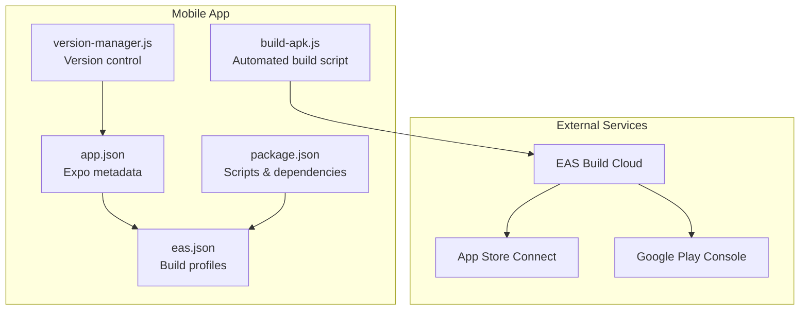
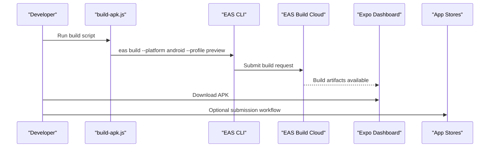
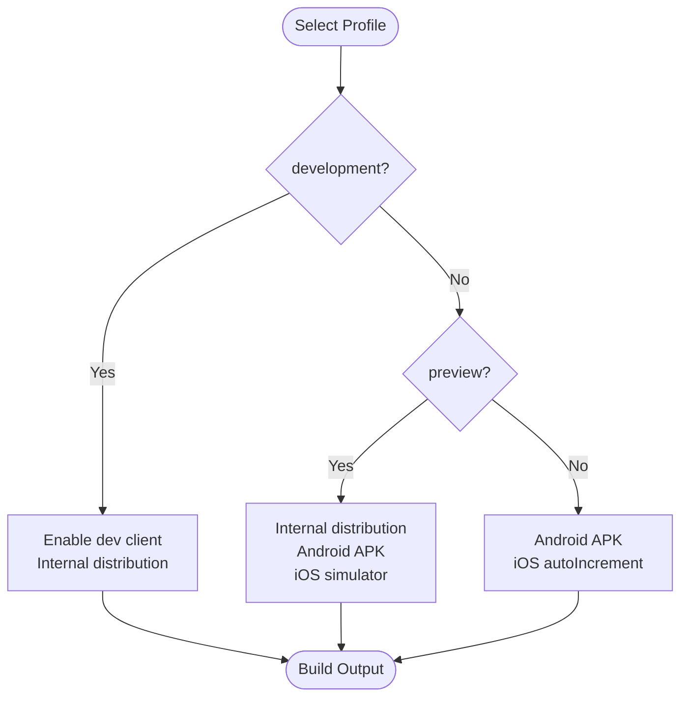
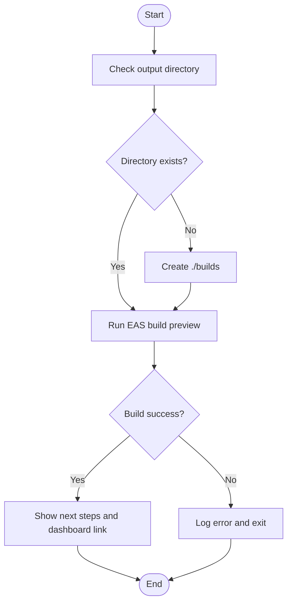
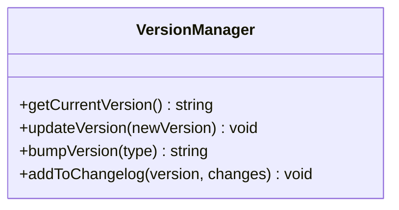
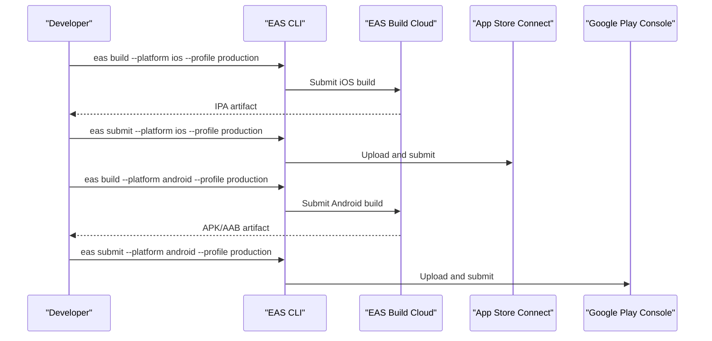
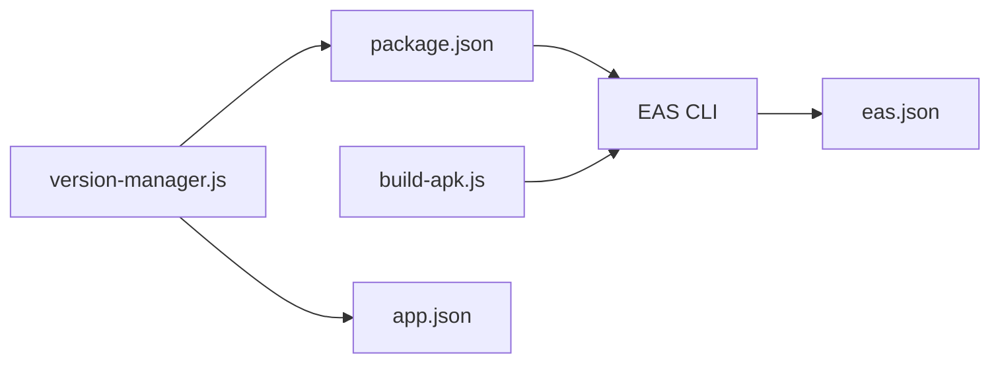

# Mobile App Deployment

<cite>
**Referenced Files in This Document**
- [eas.json](file://axx-spaces-mobile/eas.json)
- [app.json](file://axx-spaces-mobile/app.json)
- [package.json](file://axx-spaces-mobile/package.json)
- [build-apk.js](file://axx-spaces-mobile/build-apk.js)
- [version-manager.js](file://axx-spaces-mobile/version-manager.js)
- [DEPLOYMENT.md](file://axx-spaces-mobile/DEPLOYMENT.md)
- [BUILD_GUIDE.md](file://axx-spaces-mobile/BUILD_GUIDE.md)
</cite>

## Table of Contents
1. [Introduction](#introduction)
2. [Project Structure](#project-structure)
3. [Core Components](#core-components)
4. [Architecture Overview](#architecture-overview)
5. [Detailed Component Analysis](#detailed-component-analysis)
6. [Dependency Analysis](#dependency-analysis)
7. [Performance Considerations](#performance-considerations)
8. [Troubleshooting Guide](#troubleshooting-guide)
9. [Conclusion](#conclusion)
10. [Appendices](#appendices)

## Introduction
This document provides a comprehensive guide to deploying the AXX Spaces mobile app using Expo Application Services (EAS). It covers EAS build profiles for development, preview, and production; signing configuration for Android APK and iOS IPA; automated build scripts; version management; and step-by-step instructions for setting up certificates, provisioning profiles, and store credentials. It also includes troubleshooting, debugging techniques, and performance optimization recommendations for reliable mobile deployments.

## Project Structure
The mobile project is an Expo-based React Native application with EAS configured for multi-environment builds. Key deployment-related files include:
- EAS configuration for build profiles and CLI requirements
- Expo app metadata including bundle identifiers and permissions
- Package scripts that wrap EAS commands
- Automation scripts for building and versioning
- Documentation guides for deployment workflows

**Diagram sources**
- [app.json:1-49](file://axx-spaces-mobile/app.json#L1-L49)
- [eas.json:1-28](file://axx-spaces-mobile/eas.json#L1-L28)
- [package.json:1-41](file://axx-spaces-mobile/package.json#L1-L41)
- [build-apk.js:1-51](file://axx-spaces-mobile/build-apk.js#L1-L51)
- [version-manager.js:1-116](file://axx-spaces-mobile/version-manager.js#L1-L116)

**Section sources**
- [app.json:1-49](file://axx-spaces-mobile/app.json#L1-L49)
- [eas.json:1-28](file://axx-spaces-mobile/eas.json#L1-L28)
- [package.json:1-41](file://axx-spaces-mobile/package.json#L1-L41)

## Core Components
- EAS Build Profiles:
  - Development: internal distribution with development client enabled
  - Preview: internal distribution, Android APK, iOS simulator builds
  - Production: Android APK output, iOS auto-increment build number
- Expo App Metadata:
  - Bundle identifier and package name set for iOS and Android
  - Permissions declared for camera, storage, location, network
  - EAS project ID included under extra.eas.projectId
- Package Scripts:
  - Convenience scripts to trigger EAS builds and submissions
- Automation Scripts:
  - build-apk.js orchestrates EAS builds for Android via the preview profile
  - version-manager.js manages semantic versioning across package.json and app.json

**Section sources**
- [eas.json:1-28](file://axx-spaces-mobile/eas.json#L1-L28)
- [app.json:1-49](file://axx-spaces-mobile/app.json#L1-L49)
- [package.json:1-41](file://axx-spaces-mobile/package.json#L1-L41)
- [build-apk.js:1-51](file://axx-spaces-mobile/build-apk.js#L1-L51)
- [version-manager.js:1-116](file://axx-spaces-mobile/version-manager.js#L1-L116)

## Architecture Overview
The deployment architecture integrates local tooling with cloud build services and app stores:
- Local scripts invoke EAS CLI to build artifacts
- EAS Build compiles and signs apps using configured profiles
- Artifacts are distributed internally or submitted to stores

**Diagram sources**
- [build-apk.js:28-49](file://axx-spaces-mobile/build-apk.js#L28-L49)
- [eas.json:5-26](file://axx-spaces-mobile/eas.json#L5-L26)

## Detailed Component Analysis

### EAS Build Profiles
Profiles define how builds are executed and what outputs are produced:
- development: enables development client and internal distribution
- preview: internal distribution, Android APK, iOS simulator builds
- production: Android APK output, iOS auto-increment build numbers

**Diagram sources**
- [eas.json:5-26](file://axx-spaces-mobile/eas.json#L5-L26)

**Section sources**
- [eas.json:1-28](file://axx-spaces-mobile/eas.json#L1-L28)

### Signing Configuration
- Android:
  - The production profile outputs APKs. For production releases, ensure keystore configuration is set in EAS credentials.
  - Use EAS credentials to manage keystore securely.
- iOS:
  - The production profile sets autoIncrement for build numbers. Ensure Apple Developer account, App ID, and provisioning profiles are configured via EAS credentials.

Operational steps:
- Configure EAS credentials for both platforms
- Verify keystore and provisioning profiles are linked to the correct bundle identifiers
- Test builds before submitting to stores

**Section sources**
- [eas.json:19-26](file://axx-spaces-mobile/eas.json#L19-L26)
- [DEPLOYMENT.md:46-92](file://axx-spaces-mobile/DEPLOYMENT.md#L46-L92)
- [DEPLOYMENT.md:119-167](file://axx-spaces-mobile/DEPLOYMENT.md#L119-L167)

### Automated Build Script
The build script automates the Android preview build process:
- Creates output directory if missing
- Invokes EAS CLI with the preview profile
- Provides next steps and dashboard links

**Diagram sources**
- [build-apk.js:22-49](file://axx-spaces-mobile/build-apk.js#L22-L49)

**Section sources**
- [build-apk.js:1-51](file://axx-spaces-mobile/build-apk.js#L1-L51)

### Version Management
The version manager synchronizes versions across package.json and app.json:
- Supports bumping major/minor/patch
- Allows setting specific versions
- Updates changelog entries
- Integrates with app metadata for consistent versioning

**Diagram sources**
- [version-manager.js:17-74](file://axx-spaces-mobile/version-manager.js#L17-L74)

**Section sources**
- [version-manager.js:1-116](file://axx-spaces-mobile/version-manager.js#L1-L116)

### App Store Submission Process
- iOS:
  - Set up Apple Developer account, App ID, and provisioning profiles
  - Configure EAS submit settings with Apple ID, ASC App ID, and team ID
  - Build production IPA and submit via EAS
- Android:
  - Set up Google Play Developer account and service account
  - Configure EAS submit settings with service account key path
  - Build production APK/AAB and submit via EAS

**Diagram sources**
- [DEPLOYMENT.md:75-92](file://axx-spaces-mobile/DEPLOYMENT.md#L75-L92)
- [DEPLOYMENT.md:150-167](file://axx-spaces-mobile/DEPLOYMENT.md#L150-L167)

**Section sources**
- [DEPLOYMENT.md:46-92](file://axx-spaces-mobile/DEPLOYMENT.md#L46-L92)
- [DEPLOYMENT.md:119-167](file://axx-spaces-mobile/DEPLOYMENT.md#L119-L167)

### Step-by-Step Setup Guides

#### iOS Certificates and Provisioning Profiles
- Create an App ID with the bundle identifier defined in app.json
- Generate Development and Distribution provisioning profiles
- Configure EAS credentials for iOS (Apple ID, Team ID, ASC App ID)
- Validate by running a production build and submission

**Section sources**
- [app.json:17-20](file://axx-spaces-mobile/app.json#L17-L20)
- [DEPLOYMENT.md:46-92](file://axx-spaces-mobile/DEPLOYMENT.md#L46-L92)

#### Android Keystore and Signatures
- Generate a keystore file using keytool
- Configure EAS credentials for Android (keystore path and passwords)
- Ensure the Android package matches app.json
- Validate by running a production build and submission

**Section sources**
- [app.json:21-37](file://axx-spaces-mobile/app.json#L21-L37)
- [DEPLOYMENT.md:119-167](file://axx-spaces-mobile/DEPLOYMENT.md#L119-L167)

#### App Store Credentials
- iOS:
  - Provide Apple ID, ASC App ID, and Team ID in EAS submit configuration
- Android:
  - Provide Google Play service account JSON key path in EAS submit configuration

**Section sources**
- [DEPLOYMENT.md:59-73](file://axx-spaces-mobile/DEPLOYMENT.md#L59-L73)
- [DEPLOYMENT.md:136-148](file://axx-spaces-mobile/DEPLOYMENT.md#L136-L148)

## Dependency Analysis
- EAS CLI depends on the profiles defined in eas.json
- Package scripts depend on EAS CLI and map to specific profiles
- Build automation depends on EAS CLI and the preview profile
- Version manager updates app.json and package.json consistently

**Diagram sources**
- [package.json:5-12](file://axx-spaces-mobile/package.json#L5-L12)
- [eas.json:1-28](file://axx-spaces-mobile/eas.json#L1-L28)
- [build-apk.js:28-35](file://axx-spaces-mobile/build-apk.js#L28-L35)
- [version-manager.js:22-33](file://axx-spaces-mobile/version-manager.js#L22-L33)

**Section sources**
- [package.json:1-41](file://axx-spaces-mobile/package.json#L1-L41)
- [eas.json:1-28](file://axx-spaces-mobile/eas.json#L1-L28)
- [build-apk.js:1-51](file://axx-spaces-mobile/build-apk.js#L1-L51)
- [version-manager.js:1-116](file://axx-spaces-mobile/version-manager.js#L1-L116)

## Performance Considerations
- Use preview builds for faster iteration during development
- Enable incremental builds where possible
- Monitor app size and optimize assets
- Leverage EAS caching to reduce build times
- Keep dependencies updated and remove unused modules

[No sources needed since this section provides general guidance]

## Troubleshooting Guide
Common issues and resolutions:
- iOS:
  - No matching provisioning profiles: verify bundle identifier and profiles
  - Code signing errors: reset EAS credentials and rebuild
- Android:
  - Keystore not found: generate keystore and configure EAS credentials
  - Google Play API access: verify service account permissions and JSON key validity

Additional debugging:
- Use logcat for Android runtime errors
- Review EAS build logs in the Expo dashboard
- Validate environment variables and API URLs

**Section sources**
- [DEPLOYMENT.md:219-243](file://axx-spaces-mobile/DEPLOYMENT.md#L219-L243)
- [BUILD_GUIDE.md:155-183](file://axx-spaces-mobile/BUILD_GUIDE.md#L155-L183)

## Conclusion
This guide consolidates the EAS configuration, signing setup, automation, versioning, and store submission processes required to deploy the AXX Spaces mobile app reliably. By following the documented steps and leveraging the provided scripts, teams can streamline their mobile deployment pipeline and maintain consistency across environments.

[No sources needed since this section summarizes without analyzing specific files]

## Appendices

### Quick Commands Reference
- Install dependencies and configure EAS
- Build Android APK via preview profile
- Submit builds to stores

**Section sources**
- [BUILD_GUIDE.md:13-30](file://axx-spaces-mobile/BUILD_GUIDE.md#L13-L30)
- [package.json:5-12](file://axx-spaces-mobile/package.json#L5-L12)