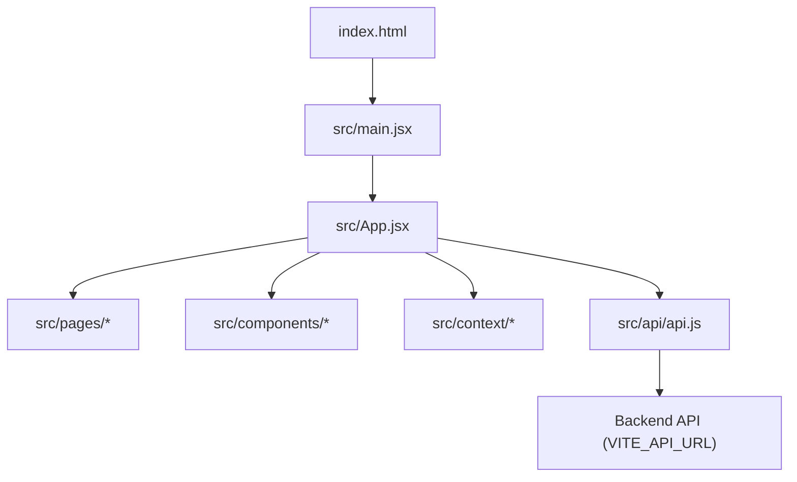
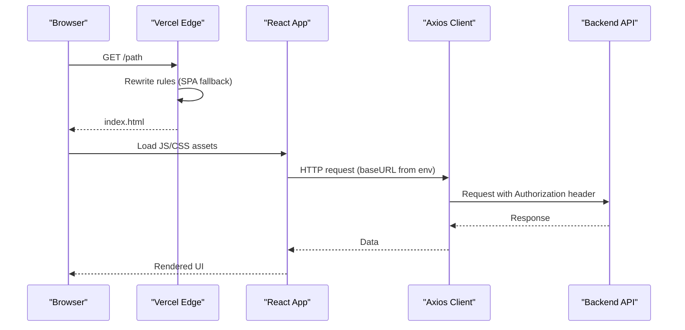
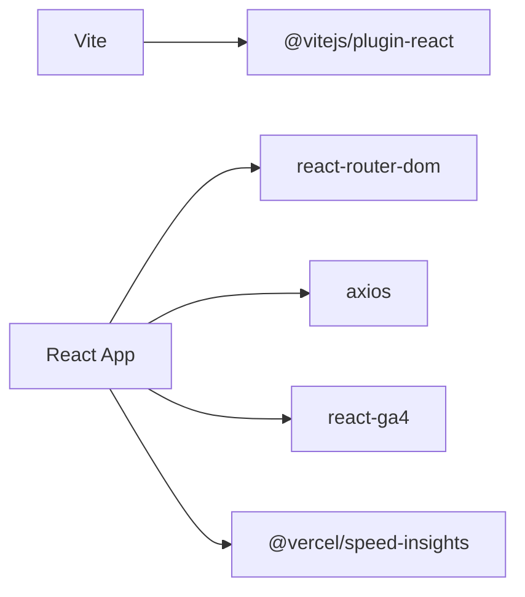

# Web Application Deployment

<cite>
**Referenced Files in This Document**
- [package.json](file://package.json)
- [vercel.json](file://vercel.json)
- [vite.config.js](file://vite.config.js)
- [setup-frontend.sh](file://setup-frontend.sh)
- [README.md](file://README.md)
- [index.html](file://index.html)
- [src/main.jsx](file://src/main.jsx)
- [src/App.jsx](file://src/App.jsx)
- [src/api/api.js](file://src/api/api.js)
</cite>

## Table of Contents
1. [Introduction](#introduction)
2. [Project Structure](#project-structure)
3. [Core Components](#core-components)
4. [Architecture Overview](#architecture-overview)
5. [Detailed Component Analysis](#detailed-component-analysis)
6. [Dependency Analysis](#dependency-analysis)
7. [Performance Considerations](#performance-considerations)
8. [Troubleshooting Guide](#troubleshooting-guide)
9. [Conclusion](#conclusion)

## Introduction
This document provides comprehensive deployment guidance for the React + Vite web application, focusing on Vercel configuration, environment variables, build optimization, and operational best practices. It covers setup scripts, dependency installation, production builds, redirects/rewrites, headers, security policies, custom domains, SSL, and CDN integration.

## Project Structure
The project is a standard Vite + React application with:
- Build tooling configured via Vite
- Routing handled by React Router
- API client using Axios with environment-driven base URL
- Vercel-specific routing and security headers
- HTML entry with SEO and analytics tags

**Diagram sources**
- [index.html:140-147](file://index.html#L140-L147)
- [src/main.jsx:1-27](file://src/main.jsx#L1-L27)
- [src/App.jsx:1-120](file://src/App.jsx#L1-L120)
- [src/api/api.js:1-47](file://src/api/api.js#L1-L47)

**Section sources**
- [package.json:1-50](file://package.json#L1-L50)
- [README.md:1-17](file://README.md#L1-L17)

## Core Components
- Vite build configuration: output directory, source maps, chunk naming, dev server headers, and global constants.
- Vercel configuration: rewrites for SPA routing, static assets, and download endpoints; security headers; Content Security Policy.
- API client: Axios instance with environment-based base URL and interceptors for auth tokens and logging.
- Entry point: initializes providers, analytics, and app shell.

Key responsibilities:
- vite.config.js controls bundling and development behavior.
- vercel.json controls runtime routing and response headers on Vercel.
- src/api/api.js centralizes HTTP requests and environment usage.
- index.html sets up SEO, analytics, and CSP meta tag.

**Section sources**
- [vite.config.js:1-36](file://vite.config.js#L1-L36)
- [vercel.json:1-48](file://vercel.json#L1-L48)
- [src/api/api.js:1-47](file://src/api/api.js#L1-L47)
- [index.html:1-147](file://index.html#L1-L147)

## Architecture Overview
End-to-end flow from browser to backend:

**Diagram sources**
- [vercel.json:1-48](file://vercel.json#L1-L48)
- [src/main.jsx:1-27](file://src/main.jsx#L1-L27)
- [src/App.jsx:1-120](file://src/App.jsx#L1-L120)
- [src/api/api.js:1-47](file://src/api/api.js#L1-L47)

## Detailed Component Analysis

### Vercel Deployment Configuration
- Rewrites:
  - Static downloads path preserved.
  - All other routes fall back to index.html for client-side routing.
- Headers:
  - Custom Content-Type and attachment for Android APKs under /downloads.
  - Global security headers including CSP, X-Frame-Options, X-Content-Type-Options, Referrer-Policy.
- Environment variables:
  - No explicit env vars defined here; use Vercel dashboard or .env files during build.

Operational notes:
- Ensure your backend origin is allowed by CSP connect-src.
- For mobile app distribution, verify Content-Disposition and MIME type for APKs.

**Section sources**
- [vercel.json:1-48](file://vercel.json#L1-L48)

### Vite Build Process Optimization
- Output directory: dist
- Source maps disabled in production
- Chunk and asset filenames include hashes for cache busting
- Dev server includes basic security headers
- Global constant injection for app name

Build commands:
- Development: npm run dev
- Production build: npm run build
- Preview locally: npm run preview

Bundle splitting:
- Vite automatically splits code based on dynamic imports and shared dependencies.
- Hashed filenames improve long-term caching.

Asset handling:
- Assets are emitted under assets/ with hashed names.
- External fonts and images should be referenced via absolute paths or relative to public/.

**Section sources**
- [vite.config.js:1-36](file://vite.config.js#L1-L36)
- [package.json:6-11](file://package.json#L6-L11)

### Environment Variables Management
- The API client reads the backend URL from import.meta.env.VITE_API_URL at build time.
- If not provided, it falls back to a local development URL.
- Recommended variables:
  - VITE_API_URL: Backend API base URL (e.g., https://api.example.com/api)
  - VITE_APP_NAME: Optional app identifier (already injected by Vite config)

Best practices:
- Define VITE_API_URL in Vercel environment variables per environment (preview, production).
- Avoid committing secrets; use .env.local for local development only.

Runtime behavior:
- Requests include Authorization header when token exists in localStorage.
- Interceptors log request/response details for debugging.

**Section sources**
- [src/api/api.js:1-47](file://src/api/api.js#L1-L47)
- [vite.config.js:32-36](file://vite.config.js#L32-L36)

### Setup Scripts Execution and Dependency Installation
- Setup script creates initial scaffolding and sample files.
- Typical workflow:
  - Install dependencies: npm install
  - Run setup script if needed: bash setup-frontend.sh
  - Start dev server: npm run dev
  - Build for production: npm run build

Notes:
- The setup script is optional and primarily for scaffolding.
- Ensure Node.js version matches project requirements.

**Section sources**
- [setup-frontend.sh:1-98](file://setup-frontend.sh#L1-L98)
- [package.json:6-11](file://package.json#L6-L11)

### Routing and Client-Side Navigation
- React Router defines numerous routes for public pages, dashboards, and protected areas.
- Vercel rewrite rule ensures all non-static routes resolve to index.html.
- Protected routes rely on authentication context and role checks.

Operational tips:
- Verify that deep links work after deployment due to SPA fallback.
- Keep route order consistent to avoid conflicts.

**Section sources**
- [src/App.jsx:124-495](file://src/App.jsx#L124-L495)
- [vercel.json:1-11](file://vercel.json#L1-L11)

### Security and Content Security Policy
- Vercel headers enforce strict security posture:
  - CSP restricts scripts, styles, fonts, and connections.
  - X-Frame-Options prevents clickjacking.
  - X-Content-Type-Options prevents MIME sniffing.
  - Referrer-Policy limits referrer leakage.
- HTML also contains a CSP meta tag; ensure consistency between meta and Vercel headers.

Recommendations:
- Align CSP directives with actual third-party services used (analytics, maps, auth providers).
- Remove unsafe-inline/unsafe-eval where possible over time.

**Section sources**
- [vercel.json:12-47](file://vercel.json#L12-L47)
- [index.html:18-56](file://index.html#L18-L56)

### Analytics and Tracking Integration
- Google Analytics initialized in main entry.
- Additional tracking via Microsoft Clarity included in HTML.
- Speed Insights component integrated in app shell.

Considerations:
- Ensure CSP allows required domains for analytics scripts and data collection.
- Respect user privacy and consent requirements.

**Section sources**
- [src/main.jsx:13-24](file://src/main.jsx#L13-L24)
- [index.html:114-138](file://index.html#L114-L138)

## Dependency Analysis
High-level dependencies relevant to deployment:
- Vite and React plugin for building and serving
- React Router for navigation
- Axios for HTTP requests
- Third-party integrations (analytics, maps, auth)

**Diagram sources**
- [package.json:12-48](file://package.json#L12-L48)

**Section sources**
- [package.json:12-48](file://package.json#L12-L48)

## Performance Considerations
- Enable compression on Vercel (automatic).
- Use hashed asset filenames for long-term caching (configured).
- Minimize bundle size:
  - Prefer dynamic imports for heavy features.
  - Remove unused dependencies.
- Optimize images and fonts:
  - Serve modern formats (WebP/AVIF).
  - Use font-display strategies.
- Leverage CDN:
  - Vercel’s edge network caches static assets.
  - Configure appropriate Cache-Control headers for immutable assets.
- Reduce third-party overhead:
  - Defer non-critical scripts.
  - Limit analytics payloads.

[No sources needed since this section provides general guidance]

## Troubleshooting Guide

Common issues and resolutions:
- Blank page on refresh or direct link:
  - Ensure Vercel rewrites fall back to index.html.
  - Confirm client-side router is correctly set up.
- API calls fail in production:
  - Set VITE_API_URL in Vercel environment variables.
  - Check CORS and CSP allowlists for backend domain.
- Authentication errors:
  - Verify Authorization header is attached by Axios interceptor.
  - Ensure token persistence and expiration handling.
- Mobile APK downloads not triggering:
  - Confirm Content-Type and Content-Disposition headers for /downloads.
- CSP blocking resources:
  - Update CSP to allow necessary domains for analytics, maps, and auth providers.
- Slow initial load:
  - Review bundle size and lazy-load heavy components.
  - Preload critical assets and fonts.

**Section sources**
- [vercel.json:1-48](file://vercel.json#L1-L48)
- [src/api/api.js:10-44](file://src/api/api.js#L10-L44)
- [index.html:18-56](file://index.html#L18-L56)

## Conclusion
This guide outlines how to deploy the React + Vite application on Vercel with robust routing, security headers, and environment-driven configuration. By following the recommended practices for environment variables, build optimizations, and troubleshooting steps, you can achieve reliable deployments and strong performance.

[No sources needed since this section summarizes without analyzing specific files]