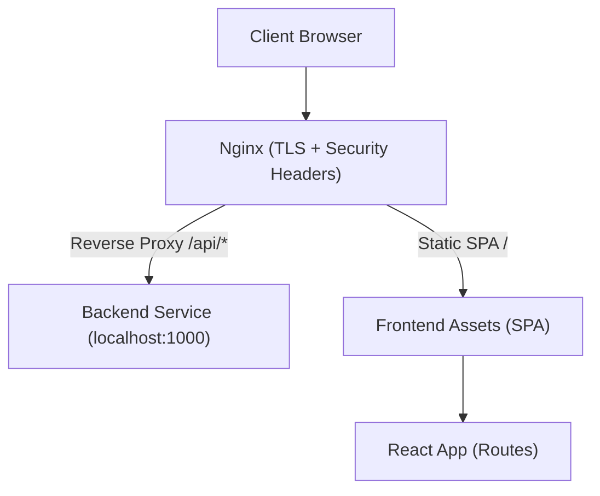
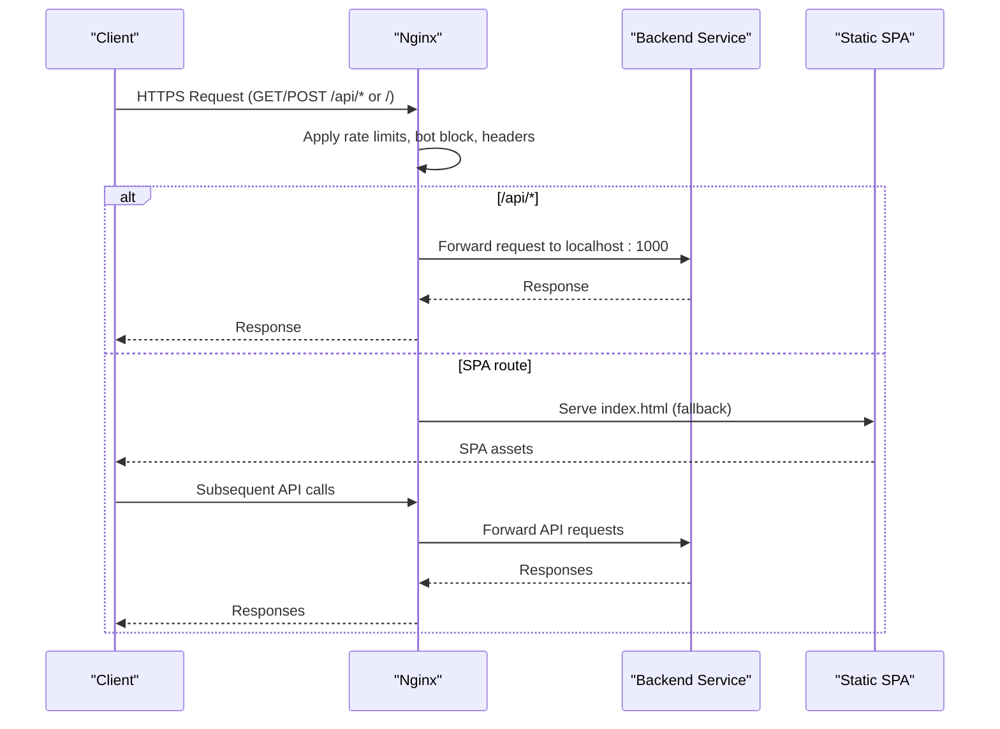
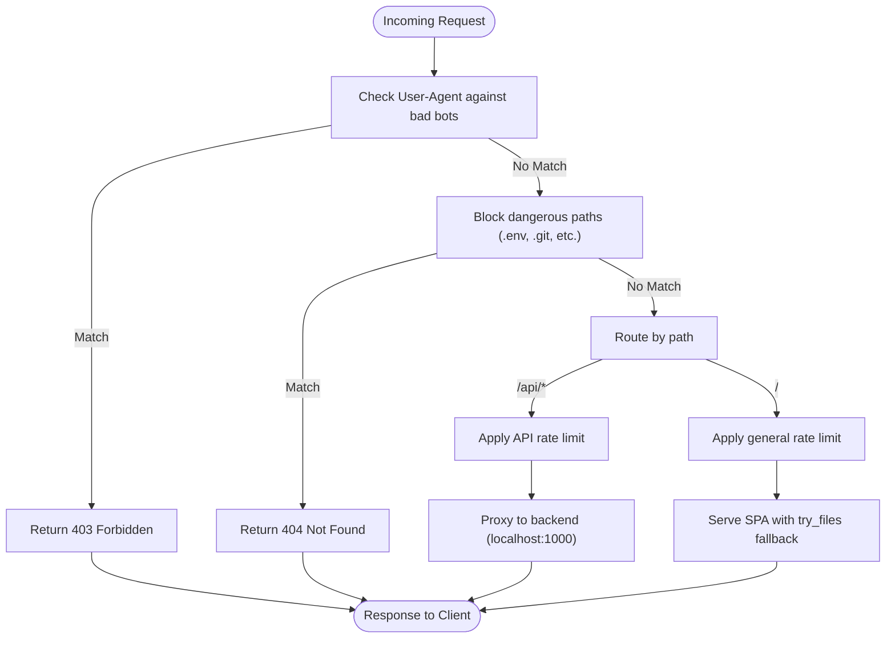
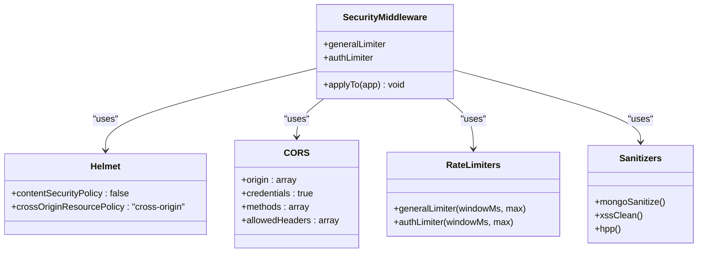
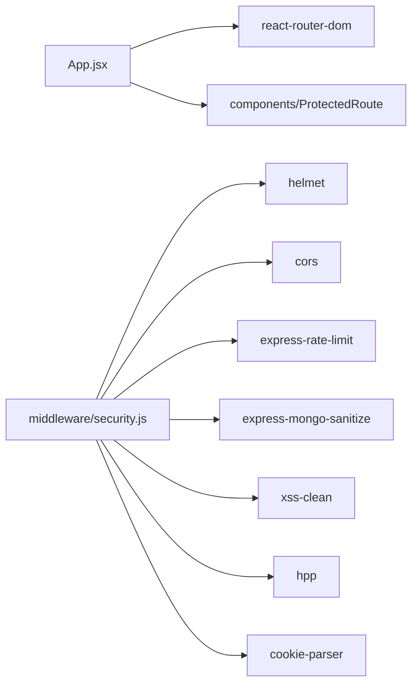

# Production Server Setup

<cite>
**Referenced Files in This Document**
- [nginx-security.conf](file://nginx-security.conf)
- [security.js](file://middleware/security.js)
- [package.json](file://package.json)
- [vercel.json](file://vercel.json)
- [App.jsx](file://src/App.jsx)
</cite>

## Table of Contents
1. [Introduction](#introduction)
2. [Project Structure](#project-structure)
3. [Core Components](#core-components)
4. [Architecture Overview](#architecture-overview)
5. [Detailed Component Analysis](#detailed-component-analysis)
6. [Dependency Analysis](#dependency-analysis)
7. [Performance Considerations](#performance-considerations)
8. [Troubleshooting Guide](#troubleshooting-guide)
9. [Conclusion](#conclusion)

## Introduction
This document provides production server setup guidance focused on Nginx configuration and security hardening for the Axx Spaces frontend application. It covers reverse proxy setup, SSL/TLS configuration, security headers, performance tuning, middleware-based security controls, environment variable management, logging, monitoring, containerization patterns, load balancing, and disaster recovery procedures. The content is grounded in the repository’s existing Nginx configuration, Vercel deployment settings, and application-level security middleware.

## Project Structure
The repository includes:
- An Nginx security configuration file that defines rate limiting, bot blocking, TLS settings, security headers, and reverse proxy rules to a local backend service.
- Application-level security middleware that configures Helmet, CORS, rate limiting, input sanitization, and header pollution protection.
- Vercel deployment configuration with rewrites and security headers for static hosting.
- Frontend routing and page composition via React Router.

**Diagram sources**
- [nginx-security.conf:17-64](file://nginx-security.conf#L17-L64)
- [App.jsx:140-491](file://src/App.jsx#L140-L491)

**Section sources**
- [nginx-security.conf:1-74](file://nginx-security.conf#L1-L74)
- [vercel.json:1-48](file://vercel.json#L1-L48)
- [App.jsx:140-491](file://src/App.jsx#L140-L491)

## Core Components
- Nginx Reverse Proxy and Security Layer:
  - Enforces HTTPS with modern TLS protocols and ciphers.
  - Applies strict security headers (HSTS, X-Frame-Options, X-Content-Type-Options, XSS Protection, Referrer-Policy, Permissions-Policy).
  - Blocks known malicious user agents and sensitive paths.
  - Rate limits API, authentication, and upload endpoints; limits concurrent connections per IP.
  - Proxies API requests to a local backend service and serves the SPA with client-side routing fallback.

- Application-Level Security Middleware:
  - Helmet for response headers (CSP disabled by configuration).
  - CORS with explicit allowed origins and credentials support.
  - General and authentication-specific rate limiters.
  - Input sanitization against NoSQL injection and XSS.
  - Header pollution protection.

- Deployment Configuration (Vercel):
  - Rewrites to serve SPA and allow direct access to downloads.
  - Security headers including CSP, frame options, content type sniffing prevention, and referrer policy.

**Section sources**
- [nginx-security.conf:1-74](file://nginx-security.conf#L1-L74)
- [security.js:1-61](file://middleware/security.js#L1-L61)
- [vercel.json:1-48](file://vercel.json#L1-L48)

## Architecture Overview
The production architecture uses Nginx as the edge server handling TLS termination, request filtering, and reverse proxying to the backend while serving the static SPA. The frontend app manages client-side routes and communicates with the backend over HTTPS through the Nginx reverse proxy.

**Diagram sources**
- [nginx-security.conf:17-64](file://nginx-security.conf#L17-L64)
- [App.jsx:140-491](file://src/App.jsx#L140-L491)

## Detailed Component Analysis

### Nginx Reverse Proxy and Security Hardening
Key responsibilities:
- TLS termination with strong protocols and ciphers.
- Strict security headers applied to all responses.
- Bot blocking based on User-Agent patterns.
- Path-based blocking for sensitive files and common attack vectors.
- Rate limiting zones for API, auth, and uploads; connection limits per IP.
- Reverse proxy to backend service for API and SPA.

**Diagram sources**
- [nginx-security.conf:10-64](file://nginx-security.conf#L10-L64)

Operational notes:
- Ensure certificate paths are correct and renewed automatically (e.g., via Let’s Encrypt).
- Validate that the backend service listens on the expected port and accepts proxied headers.
- Monitor rate limit hits and adjust burst/nodelay parameters based on traffic patterns.

**Section sources**
- [nginx-security.conf:1-74](file://nginx-security.conf#L1-L74)

### Application-Level Security Middleware
Responsibilities:
- Helmet configured with CSP disabled and cross-origin resource policy set.
- CORS restricted to specific origins with credentials enabled.
- Global and authentication-specific rate limiters.
- Input sanitization for NoSQL injection and XSS.
- Header pollution protection.

**Diagram sources**
- [security.js:13-51](file://middleware/security.js#L13-L51)

Best practices:
- Align CORS origins with your production domain(s).
- Tune rate limiter windows and maximums according to expected traffic and abuse patterns.
- Enable CSP in Helmet when feasible to further restrict script execution and data sources.

**Section sources**
- [security.js:1-61](file://middleware/security.js#L1-L61)
- [package.json:12-33](file://package.json#L12-L33)

### Environment Variable Management
- Frontend URL used by CORS is sourced from an environment variable with a fallback to a default production URL.
- Recommendations:
  - Store FRONTEND_URL in your deployment environment (systemd, Docker, CI/CD secrets).
  - Avoid committing secrets to version control; use secret managers or platform-native secret stores.
  - Validate environment variables at startup and fail fast if required values are missing.

**Section sources**
- [security.js:18-28](file://middleware/security.js#L18-L28)

### Logging Configuration
- Nginx access and error logs should be centralized and rotated.
- Recommended approach:
  - Configure structured JSON logging for machine readability.
  - Ship logs to a central aggregator (e.g., ELK stack, CloudWatch, Datadog).
  - Include upstream response codes, latency, and request IDs for tracing.

[No sources needed since this section provides general guidance]

### Monitoring Setup
- Metrics to collect:
  - HTTP request rates, error rates, latency percentiles.
  - Rate limit triggers and blocked requests.
  - TLS handshake failures and certificate expiry alerts.
- Tools:
  - Nginx stub_status module or OpenMetrics exporter.
  - Application metrics via Prometheus client libraries.
  - Health checks exposed by the backend service.

[No sources needed since this section provides general guidance]

### Containerization with Docker
Recommended structure:
- Multi-stage build for the frontend assets.
- Nginx image serving static files and proxying API requests.
- Separate container for the backend service.

Example steps:
- Build frontend assets using Vite and copy into Nginx HTML directory.
- Mount Nginx configuration and certificates via volumes or secrets.
- Expose only ports 80 and 443; forward internal traffic to the backend container.

[No sources needed since this section provides general guidance]

### Load Balancing Configuration
- Use multiple backend instances behind Nginx upstream blocks.
- Implement health checks and failover strategies.
- Distribute traffic using round-robin or least_conn depending on workload characteristics.
- Consider sticky sessions if stateful backends require it.

[No sources needed since this section provides general guidance]

### Disaster Recovery Procedures
- Backups:
  - Regularly backup Nginx configurations, TLS certificates, and application code.
  - Automate backups and test restoration procedures.
- Failover:
  - Deploy redundant Nginx nodes with active-passive or active-active setups.
  - Use DNS failover or cloud load balancers for global redundancy.
- Incident response:
  - Define runbooks for certificate renewal failures, rate limit misconfigurations, and backend outages.
  - Maintain rollback procedures for configuration changes.

[No sources needed since this section provides general guidance]

## Dependency Analysis
The frontend application depends on several security-related packages installed via npm. These dependencies enable the application-level security middleware.

**Diagram sources**
- [App.jsx:1-10](file://src/App.jsx#L1-L10)
- [security.js:5-11](file://middleware/security.js#L5-L11)
- [package.json:12-33](file://package.json#L12-L33)

**Section sources**
- [package.json:12-33](file://package.json#L12-L33)
- [security.js:5-11](file://middleware/security.js#L5-L11)
- [App.jsx:1-10](file://src/App.jsx#L1-L10)

## Performance Considerations
- Nginx:
  - Keep TLS session caching enabled and ensure proper cipher suites.
  - Tune worker processes and events based on CPU cores.
  - Enable gzip/brotli compression for text-based assets.
  - Set appropriate keepalive timeouts and buffer sizes.
- SPA:
  - Leverage browser caching with cache-control headers for static assets.
  - Minimize payload size and defer non-critical resources.
- Backend:
  - Use connection pooling and efficient query patterns.
  - Cache frequently accessed data where appropriate.

[No sources needed since this section provides general guidance]

## Troubleshooting Guide
Common issues and resolutions:
- 403 Forbidden due to bot blocking:
  - Verify User-Agent strings and update the bad bot map if legitimate clients are blocked.
- 404 Not Found for sensitive paths:
  - Confirm that blocked paths match actual attack vectors without interfering with valid routes.
- Rate limit errors:
  - Adjust rate limit zones and burst parameters to accommodate legitimate traffic spikes.
- CORS errors:
  - Ensure FRONTEND_URL matches the origin making requests and is included in allowed origins.
- TLS handshake failures:
  - Check certificate paths, permissions, and renewal automation.

**Section sources**
- [nginx-security.conf:10-49](file://nginx-security.conf#L10-L49)
- [security.js:18-28](file://middleware/security.js#L18-L28)

## Conclusion
This guide consolidates production server setup practices for the Axx Spaces frontend, emphasizing Nginx as a hardened edge layer and application-level security middleware. By enforcing strict TLS, security headers, rate limiting, and input sanitization, the system mitigates common web vulnerabilities. For robust operations, integrate centralized logging, monitoring, containerization, load balancing, and disaster recovery procedures tailored to your infrastructure.