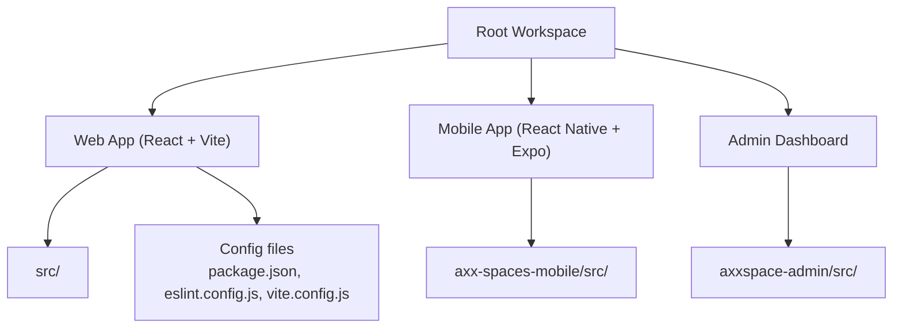
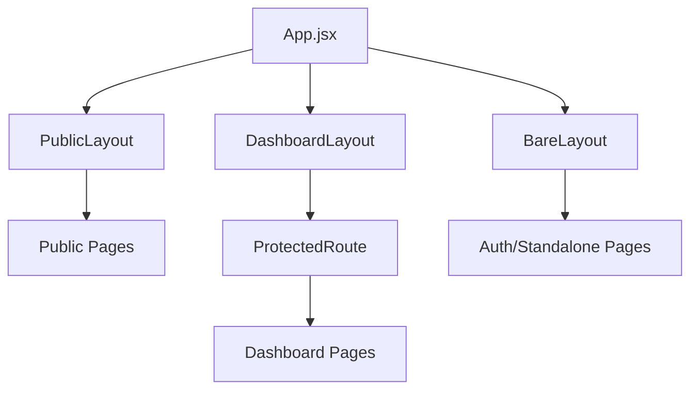
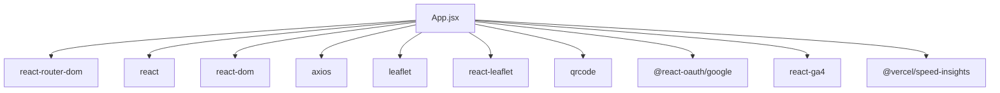

# Developer Guidelines

<cite>
**Referenced Files in This Document**
- [README.md](file://README.md)
- [package.json](file://package.json)
- [eslint.config.js](file://eslint.config.js)
- [.gitignore](file://.gitignore)
- [App.jsx](file://src/App.jsx)
- [axx-spaces-mobile/README.md](file://axx-spaces-mobile/README.md)
</cite>

## Table of Contents
1. [Introduction](#introduction)
2. [Project Structure](#project-structure)
3. [Core Components](#core-components)
4. [Architecture Overview](#architecture-overview)
5. [Detailed Component Analysis](#detailed-component-analysis)
6. [Dependency Analysis](#dependency-analysis)
7. [Performance Considerations](#performance-considerations)
8. [Troubleshooting Guide](#troubleshooting-guide)
9. [Conclusion](#conclusion)
10. [Appendices](#appendices)

## Introduction
This document provides comprehensive developer guidelines for contributing to the AxxSpaces frontend project. It covers code style conventions, Git workflow procedures, pull request processes, naming and file organization standards, code review practices, debugging techniques, logging practices, and development best practices. The goal is to help contributors write consistent, maintainable code and collaborate effectively across the web and mobile subprojects.

## Project Structure
The repository contains:
- Web application (React + Vite) under the root directory
- Mobile application (React Native + Expo) under axx-spaces-mobile
- Admin dashboard under axxspace-admin
- Shared assets and configuration at the root level

**Diagram sources**
- [package.json:1-50](file://package.json#L1-L50)
- [eslint.config.js:1-30](file://eslint.config.js#L1-L30)

Key observations:
- The web app uses Vite with React and ESLint configured via a flat config.
- The mobile app uses Expo and follows its own structure and scripts.
- The admin dashboard is a separate React application.

**Section sources**
- [README.md:1-17](file://README.md#L1-L17)
- [package.json:1-50](file://package.json#L1-L50)

## Core Components
- Linting and formatting are enforced by ESLint with React hooks and refresh plugins.
- Development server and build tooling are provided by Vite.
- Routing and layout composition are centralized in the main application component.

Development and linting commands:
- Start dev server: npm run dev
- Build production: npm run build
- Run linter: npm run lint
- Preview build: npm run preview

Code style rules:
- ECMAScript 2020 features enabled
- JSX support enabled
- Globals set to browser environment
- Unused variables flagged except constants following an uppercase pattern

**Section sources**
- [package.json:6-11](file://package.json#L6-L11)
- [eslint.config.js:1-30](file://eslint.config.js#L1-L30)

## Architecture Overview
The web application organizes routes and layouts centrally, applying public, dashboard, and bare layouts based on feature areas. Protected routes enforce role-based access.

**Diagram sources**
- [App.jsx:88-122](file://src/App.jsx#L88-L122)
- [App.jsx:140-185](file://src/App.jsx#L140-L185)

Routing highlights:
- Public routes include home, listings, authentication, quick sales, accommodation search, business directory, and informational pages.
- Dashboard routes require specific roles and use a focused navigation shell.
- Legacy redirects ensure backward compatibility for older URLs.

**Section sources**
- [App.jsx:140-490](file://src/App.jsx#L140-L490)

## Detailed Component Analysis

### Code Style Conventions
- Use functional components with hooks.
- Prefer small, single-purpose components.
- Keep logic in custom hooks or utility modules.
- Follow ESLint rules defined in the project’s flat config.
- Avoid unused variables; use uppercase constants when intentional.

Examples of conventions in practice:
- Layouts encapsulate shared chrome (navbar, notifications).
- Routes group related pages and apply appropriate layouts.
- Role-based protection is applied consistently.

**Section sources**
- [eslint.config.js:10-28](file://eslint.config.js#L10-L28)
- [App.jsx:88-122](file://src/App.jsx#L88-L122)

### File Organization Standards
- Place page-level components under src/pages.
- Reusable UI components go under src/components.
- Feature-specific modules can be grouped under src/features.
- Hooks live under src/hooks.
- Utilities and helpers under src/utils.
- Styles and themes under src/styles.

Rationale:
- Clear separation improves discoverability and reduces coupling.
- Feature folders enable cohesive changes without scattering related code.

**Section sources**
- [App.jsx:11-81](file://src/App.jsx#L11-L81)

### Git Workflow Procedures
Recommended flow:
1. Create a feature branch from main.
2. Make incremental commits with clear messages.
3. Run linters locally before pushing.
4. Open a pull request with a descriptive summary.
5. Address review feedback promptly.
6. Squash and rebase as needed to keep history clean.

Branch naming suggestions:
- feature/<short-description>
- fix/<short-description>
- chore/<short-description>

Commit message format:
- Type: scope — subject
- Example: feat(auth): add email verification flow

**Section sources**
- [axx-spaces-mobile/README.md:221-227](file://axx-spaces-mobile/README.md#L221-L227)

### Pull Request Processes
- Ensure all checks pass (lint, build).
- Include a concise description of changes and motivation.
- Link related issues or tasks.
- Add screenshots or screen recordings for UI changes.
- Confirm no secrets or sensitive data are included.

Review checklist:
- Does the change follow code style?
- Are there any performance regressions?
- Is error handling robust?
- Are tests updated if applicable?
- Is documentation updated if needed?

**Section sources**
- [axx-spaces-mobile/README.md:221-227](file://axx-spaces-mobile/README.md#L221-L227)

### Naming Conventions
- Components: PascalCase (e.g., Navbar, PropertyDetailPage)
- Files: kebab-case for utilities and styles; PascalCase for components
- Variables and functions: camelCase
- Constants: UPPER_SNAKE_CASE where appropriate
- Routes: kebab-case paths (e.g., /quicksales-dashboard)

Evidence in code:
- Component names follow PascalCase.
- Route paths are kebab-case.

**Section sources**
- [App.jsx:11-81](file://src/App.jsx#L11-L81)

### Logging Practices
- Use console.log sparingly during development.
- Avoid logging sensitive information.
- For critical errors, consider structured logging or error tracking services.
- Remove verbose logs before merging.

Environment safety:
- Never commit API keys or secrets.
- Use .env files and ensure they are ignored by version control.

**Section sources**
- [.gitignore:1-31](file://.gitignore#L1-L31)

### Debugging Techniques
- Use browser DevTools for network inspection and breakpoints.
- Leverage React DevTools for component state and props inspection.
- Validate route transitions and protected route behavior.
- Check console for runtime errors and warnings.

Common pitfalls:
- Missing environment variables causing API failures.
- Incorrect route ordering leading to unexpected matches.
- Unhandled exceptions in async flows.

**Section sources**
- [App.jsx:124-138](file://src/App.jsx#L124-L138)

### Development Best Practices
- Keep components small and composable.
- Extract reusable logic into hooks or utilities.
- Centralize configuration and constants.
- Write meaningful comments for complex logic.
- Test user flows manually and automate where possible.

**Section sources**
- [axx-spaces-mobile/README.md:124-129](file://axx-spaces-mobile/README.md#L124-L129)

## Dependency Analysis
The web application depends on:
- React and React DOM for UI rendering
- React Router for routing
- Axios for HTTP requests
- Leaflet and React Leaflet for mapping
- QR code generation
- Google OAuth integration
- Speed insights for performance monitoring

Dev dependencies include:
- Vite for building and serving
- ESLint with React plugins for linting
- Tailwind CSS for styling
- PostCSS and Autoprefixer for CSS processing

**Diagram sources**
- [package.json:12-33](file://package.json#L12-L33)
- [App.jsx:1-10](file://src/App.jsx#L1-L10)

**Section sources**
- [package.json:12-48](file://package.json#L12-L48)

## Performance Considerations
- Use lazy loading for heavy routes and components.
- Optimize images and assets; leverage caching headers.
- Minimize bundle size by removing unused dependencies.
- Monitor performance with built-in tools and analytics.
- Avoid unnecessary re-renders by memoizing expensive computations.

[No sources needed since this section provides general guidance]

## Troubleshooting Guide
Common issues and resolutions:
- Linting errors: Run npm run lint and fix reported issues.
- Build failures: Verify Node version and reinstall dependencies.
- Environment variables: Ensure .env files exist and are not committed.
- Mobile build issues: Follow platform-specific steps in the mobile README.

Security reminders:
- Do not commit secrets or API keys.
- Rotate credentials if accidentally exposed.

**Section sources**
- [.gitignore:1-31](file://.gitignore#L1-L31)
- [axx-spaces-mobile/README.md:197-220](file://axx-spaces-mobile/README.md#L197-L220)

## Conclusion
By adhering to these guidelines—consistent code style, clear file organization, disciplined Git workflows, and thorough code reviews—you will contribute high-quality, maintainable code to AxxSpaces. Use the provided commands, patterns, and checklists to streamline your development process and collaborate effectively across teams.

[No sources needed since this section summarizes without analyzing specific files]

## Appendices

### Quick Reference Commands
- Web dev: npm run dev
- Web build: npm run build
- Lint: npm run lint
- Preview: npm run preview

**Section sources**
- [package.json:6-11](file://package.json#L6-L11)