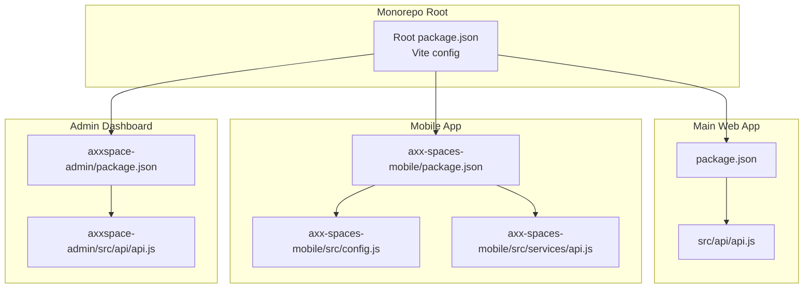
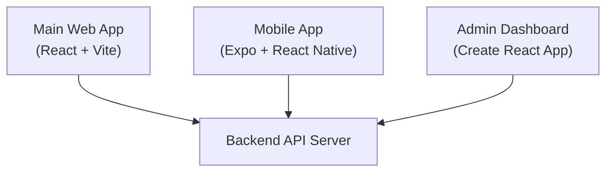
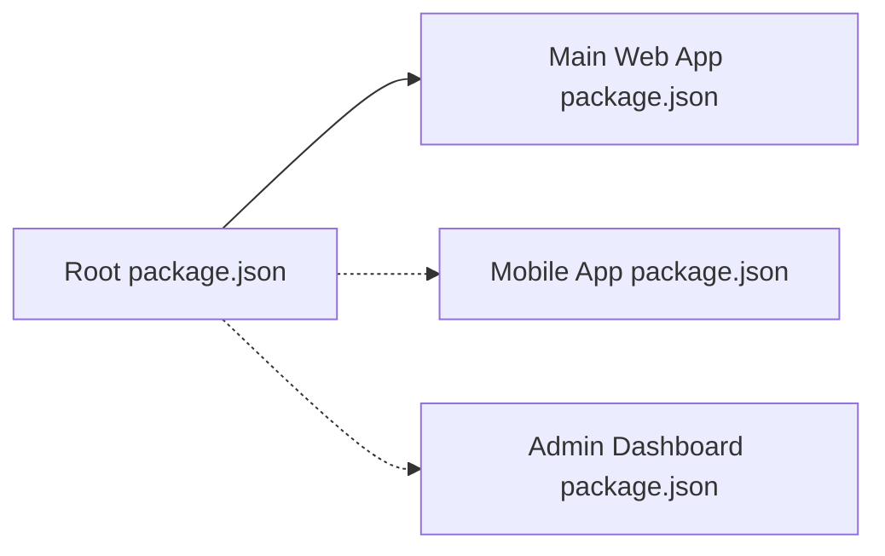

# Getting Started

<cite>
**Referenced Files in This Document**
- [README.md](file://README.md)
- [package.json](file://package.json)
- [vite.config.js](file://vite.config.js)
- [src/api/api.js](file://src/api/api.js)
- [axx-spaces-mobile/package.json](file://axx-spaces-mobile/package.json)
- [axx-spaces-mobile/README.md](file://axx-spaces-mobile/README.md)
- [axx-spaces-mobile/BUILD_GUIDE.md](file://axx-spaces-mobile/BUILD_GUIDE.md)
- [axx-spaces-mobile/src/config.js](file://axx-spaces-mobile/src/config.js)
- [axx-spaces-mobile/src/services/api.js](file://axx-spaces-mobile/src/services/api.js)
- [axxspace-admin/package.json](file://axxspace-admin/package.json)
- [axxspace-admin/README.md](file://axxspace-admin/README.md)
- [axxspace-admin/src/api/api.js](file://axxspace-admin/src/api/api.js)
</cite>

## Table of Contents
1. [Introduction](#introduction)
2. [Project Structure](#project-structure)
3. [Core Components](#core-components)
4. [Architecture Overview](#architecture-overview)
5. [Detailed Component Analysis](#detailed-component-analysis)
6. [Dependency Analysis](#dependency-analysis)
7. [Performance Considerations](#performance-considerations)
8. [Troubleshooting Guide](#troubleshooting-guide)
9. [Conclusion](#conclusion)

## Introduction
This guide helps you set up and run the AxxSpaces frontend monorepo, which powers a multi-platform real estate platform with three applications:
- Main web app (React + Vite)
- Mobile app (React Native via Expo)
- Admin dashboard (Create React App)

The platform provides property rentals, tourism listings, business directory, materials marketplace, movers services, authentication, messaging, wallet features, offline support, location services, and push notifications.

## Project Structure
The repository is organized as a monorepo with three independent apps sharing common concepts but separate dependency trees and build tools.

**Diagram sources**
- [package.json:1-50](file://package.json#L1-L50)
- [src/api/api.js:1-47](file://src/api/api.js#L1-L47)
- [axx-spaces-mobile/package.json:1-41](file://axx-spaces-mobile/package.json#L1-L41)
- [axx-spaces-mobile/src/config.js:1-44](file://axx-spaces-mobile/src/config.js#L1-L44)
- [axx-spaces-mobile/src/services/api.js:1-194](file://axx-spaces-mobile/src/services/api.js#L1-L194)
- [axxspace-admin/package.json:1-44](file://axxspace-admin/package.json#L1-L44)
- [axxspace-admin/src/api/api.js:1-22](file://axxspace-admin/src/api/api.js#L1-L22)

**Section sources**
- [README.md:1-17](file://README.md#L1-L17)
- [package.json:1-50](file://package.json#L1-L50)

## Core Components
- Main web app: React + Vite application with Axios-based API client configured via environment variables.
- Mobile app: Expo-based React Native app with a custom fetch wrapper for API calls and secure token storage.
- Admin dashboard: Create React App with Axios client and environment-based API base URL.

Key responsibilities:
- API configuration and interceptors for auth tokens and logging
- Environment-driven backend connectivity
- Platform-specific scripts for development and builds

**Section sources**
- [src/api/api.js:1-47](file://src/api/api.js#L1-L47)
- [axx-spaces-mobile/src/services/api.js:1-194](file://axx-spaces-mobile/src/services/api.js#L1-L194)
- [axxspace-admin/src/api/api.js:1-22](file://axxspace-admin/src/api/api.js#L1-L22)

## Architecture Overview
All three frontends connect to a backend API. The main web app uses an Axios instance with request/response interceptors; the mobile app uses a fetch wrapper with SecureStore for tokens; the admin dashboard uses an Axios instance with environment-based base URL.

**Diagram sources**
- [src/api/api.js:1-47](file://src/api/api.js#L1-L47)
- [axx-spaces-mobile/src/services/api.js:1-194](file://axx-spaces-mobile/src/services/api.js#L1-L194)
- [axxspace-admin/src/api/api.js:1-22](file://axxspace-admin/src/api/api.js#L1-L22)

## Detailed Component Analysis

### Main Web App (React + Vite)
- Build tooling: Vite with React plugin
- Scripts: dev, build, lint, preview
- API client: Axios instance with baseURL from environment variable or fallback
- Auth: Bearer token read from localStorage and attached to requests
- Logging: Request/response interceptors log URLs and payloads/errors

Prerequisites
- Node.js compatible with Vite 8.x (use a recent LTS release)
- npm or yarn

Installation and setup
- Install dependencies at the monorepo root: npm install
- Configure environment variable for backend:
  - Set VITE_API_URL to your backend base URL (e.g., http://localhost:1000/api)
- Start development server: npm run dev
- Preview production build: npm run preview

Common commands
- Development: npm run dev
- Build: npm run build
- Lint: npm run lint
- Preview: npm run preview

Environment variables
- VITE_API_URL: Base URL for backend API

Example usage
- Use the provided API client to call endpoints like /auth/login, /properties, etc.

**Section sources**
- [package.json:1-50](file://package.json#L1-L50)
- [src/api/api.js:1-47](file://src/api/api.js#L1-L47)

### Mobile App (Expo + React Native)
- Framework: Expo SDK ~51.0.0 with React Native 0.74.5
- Navigation: React Navigation (tabs, stack)
- Services: Camera, location, notifications, secure store, offline caching
- API: Custom fetch wrapper with optional auth token from SecureStore

Prerequisites
- Node.js v14 or higher
- npm or yarn
- Expo CLI globally installed
- For iOS: Xcode (macOS only)
- For Android: Android Studio with SDK

Installation and setup
- Navigate to axx-spaces-mobile and install dependencies: npm install
- Configure environment:
  - Update src/config.js API_URL for local or production backend
  - Optionally create .env with API_URL and EXPO_PROJECT_ID
- Start development server: npm start
- Run on platforms:
  - iOS: npm run ios
  - Android: npm run android
  - Web: npm run web

Common commands
- Start: npm start
- iOS: npm run ios
- Android: npm run android
- Web: npm run web
- Build APK (EAS): npm run build:apk
- Build Android (EAS production): npm run build:android
- Submit Android (EAS): npm run submit:android

Environment variables
- API_URL: Backend API base URL (development vs production)
- EXPO_PROJECT_ID: Expo project identifier

Example usage
- Use the exported API methods (authAPI, propertyAPI, tourismAPI, businessAPI, materialsAPI, moversAPI, userAPI, notificationAPI, walletAPI) to interact with the backend.

**Section sources**
- [axx-spaces-mobile/package.json:1-41](file://axx-spaces-mobile/package.json#L1-L41)
- [axx-spaces-mobile/README.md:1-246](file://axx-spaces-mobile/README.md#L1-L246)
- [axx-spaces-mobile/BUILD_GUIDE.md:1-279](file://axx-spaces-mobile/BUILD_GUIDE.md#L1-L279)
- [axx-spaces-mobile/src/config.js:1-44](file://axx-spaces-mobile/src/config.js#L1-L44)
- [axx-spaces-mobile/src/services/api.js:1-194](file://axx-spaces-mobile/src/services/api.js#L1-L194)

### Admin Dashboard (Create React App)
- Framework: Create React App with react-scripts
- API client: Axios instance with baseURL from REACT_APP_API_URL or default
- Auth: Bearer token from localStorage attached to requests
- Logging: Interceptors log requests/responses/errors

Prerequisites
- Node.js compatible with react-scripts 5.x (use a recent LTS release)
- npm or yarn

Installation and setup
- Navigate to axxspace-admin and install dependencies: npm install
- Configure environment variable for backend:
  - Set REACT_APP_API_URL to your backend base URL (default points to a hosted backend)
- Start development server: npm start

Common commands
- Development: npm start
- Build: npm run build
- Debug build: npm run build:debug
- Test: npm test
- Eject: npm run eject

Environment variables
- REACT_APP_API_URL: Base URL for backend API

Example usage
- Use the provided API client to call admin endpoints such as badge management, boost management, payment approvals, and user badge management.

**Section sources**
- [axxspace-admin/package.json:1-44](file://axxspace-admin/package.json#L1-L44)
- [axxspace-admin/README.md:1-71](file://axxspace-admin/README.md#L1-L71)
- [axxspace-admin/src/api/api.js:1-22](file://axxspace-admin/src/api/api.js#L1-L22)

## Dependency Analysis
Each app maintains its own dependencies and scripts. The root package.json defines shared tooling for the main web app.

Notes
- Main web app depends on Vite, React, Axios, and related utilities.
- Mobile app depends on Expo, React Native, navigation libraries, and device feature modules.
- Admin dashboard depends on react-scripts and React ecosystem packages.

**Diagram sources**
- [package.json:1-50](file://package.json#L1-L50)
- [axx-spaces-mobile/package.json:1-41](file://axx-spaces-mobile/package.json#L1-L41)
- [axxspace-admin/package.json:1-44](file://axxspace-admin/package.json#L1-L44)

**Section sources**
- [package.json:1-50](file://package.json#L1-L50)
- [axx-spaces-mobile/package.json:1-41](file://axx-spaces-mobile/package.json#L1-L41)
- [axxspace-admin/package.json:1-44](file://axxspace-admin/package.json#L1-L44)

## Performance Considerations
- Main web app:
  - Use Vite’s fast HMR and optimized builds.
  - Keep API responses small; leverage pagination where applicable.
- Mobile app:
  - Enable image caching and limit upload sizes per configuration.
  - Use offline cache settings to reduce network overhead.
- Admin dashboard:
  - Prefer lazy loading for heavy pages if needed.
  - Minimize unnecessary re-renders by memoizing components.

[No sources needed since this section provides general guidance]

## Troubleshooting Guide

Common issues and resolutions:
- Main web app cannot reach backend
  - Ensure VITE_API_URL is set correctly in your environment.
  - Verify CORS policies on the backend allow requests from your origin.
  - Check browser console logs from the API interceptors for errors.

- Mobile app API calls failing
  - Confirm API_URL in src/config.js matches your backend address.
  - Ensure device/emulator can reach the backend (network permissions).
  - Verify SecureStore contains a valid token when authenticated routes are used.

- Admin dashboard API errors
  - Set REACT_APP_API_URL to point to your backend.
  - Check that localStorage contains a valid token for protected endpoints.
  - Review interceptor logs for request/response details.

- Expo/Metro bundler issues (mobile)
  - Reset Metro cache: npm start -- --reset-cache
  - Reinstall dependencies if necessary.

- Android/iOS build issues (mobile)
  - Follow platform-specific steps in the mobile README and BUILD_GUIDE.
  - For iOS: ensure pods are installed and Xcode is configured.
  - For Android: clean Gradle caches and rebuild.

**Section sources**
- [src/api/api.js:1-47](file://src/api/api.js#L1-L47)
- [axx-spaces-mobile/src/config.js:1-44](file://axx-spaces-mobile/src/config.js#L1-L44)
- [axx-spaces-mobile/src/services/api.js:1-194](file://axx-spaces-mobile/src/services/api.js#L1-L194)
- [axx-spaces-mobile/README.md:197-220](file://axx-spaces-mobile/README.md#L197-L220)
- [axx-spaces-mobile/BUILD_GUIDE.md:155-183](file://axx-spaces-mobile/BUILD_GUIDE.md#L155-L183)
- [axxspace-admin/src/api/api.js:1-22](file://axxspace-admin/src/api/api.js#L1-L22)

## Conclusion
You now have the essentials to set up and run all three applications in the AxxSpaces frontend monorepo. Configure environment variables to point to your backend, install dependencies per app, and use the documented scripts to develop, build, and deploy. Refer to the troubleshooting section for common pitfalls and consult each app’s README for deeper platform-specific guidance.

[No sources needed since this section summarizes without analyzing specific files]