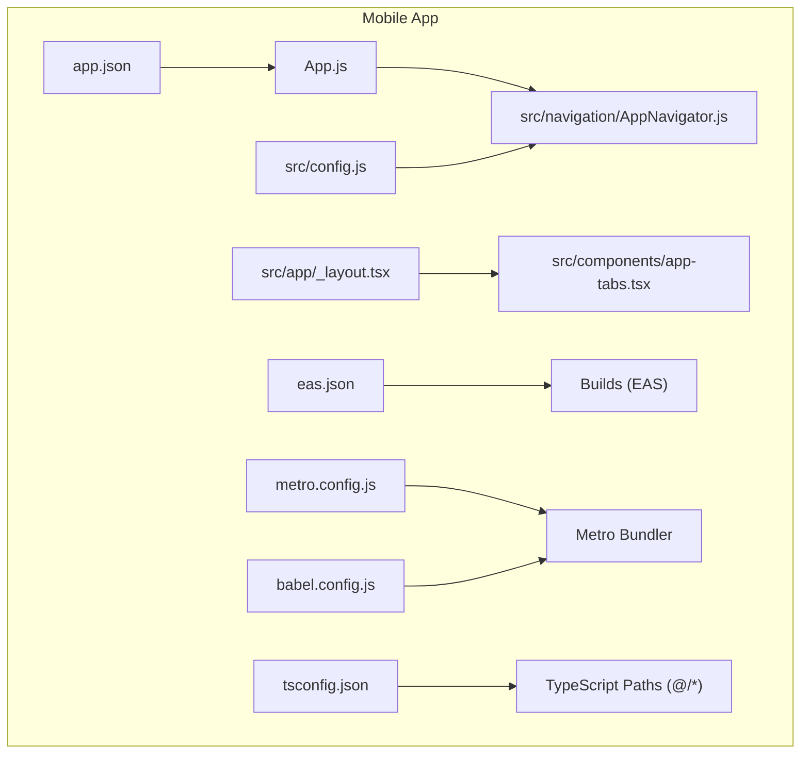
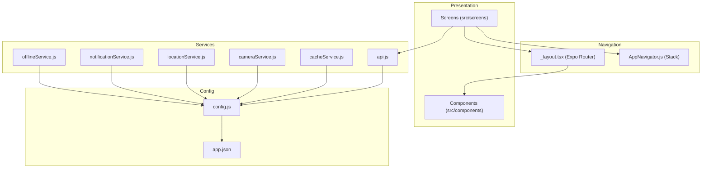
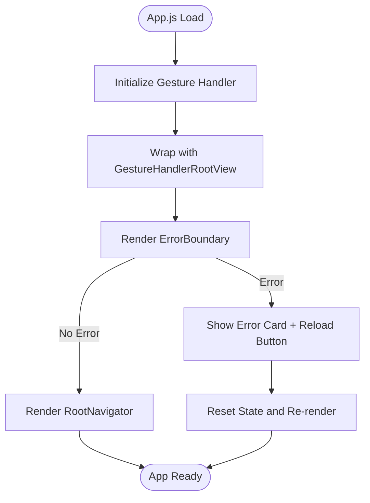
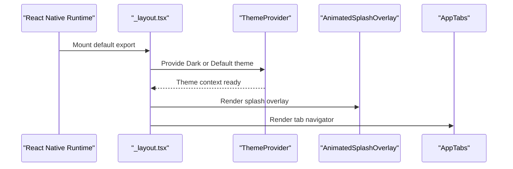
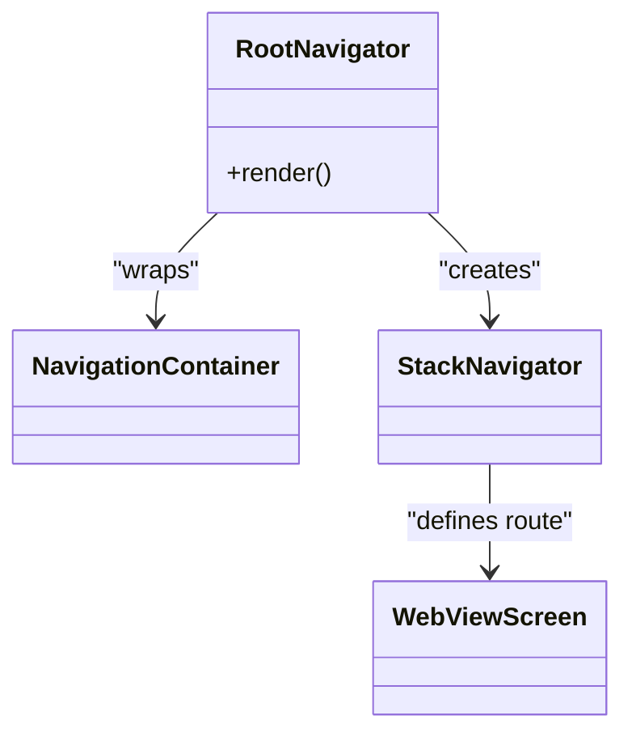
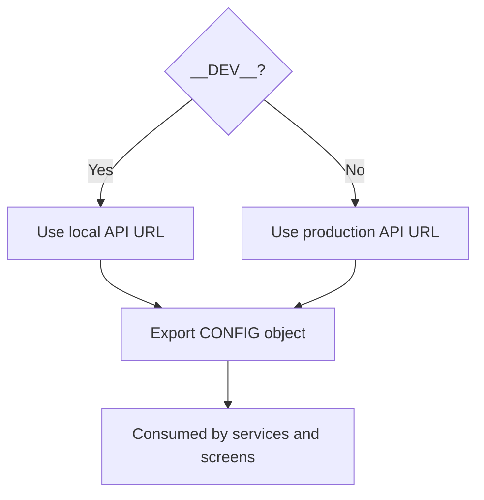
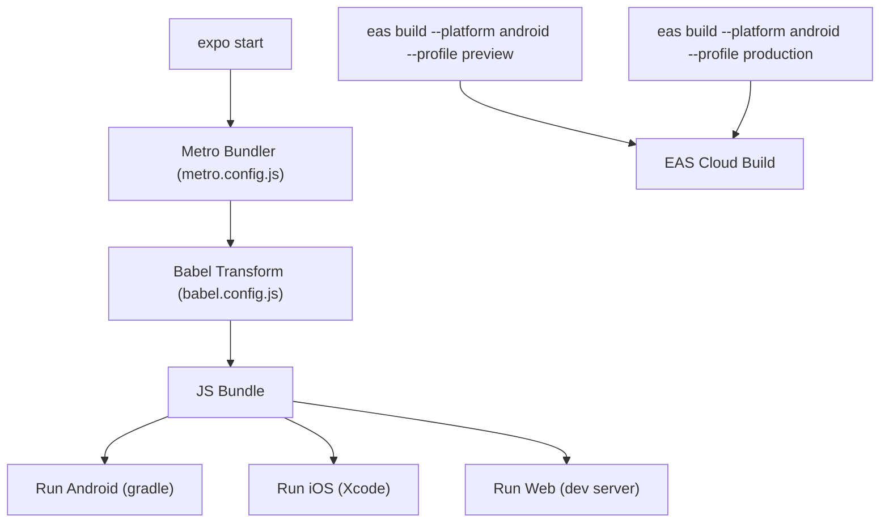
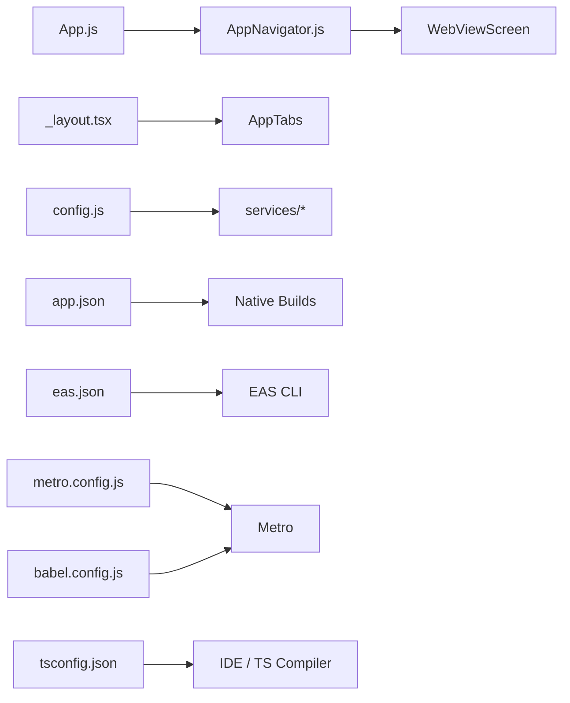

# App Structure & Architecture

<cite>
**Referenced Files in This Document**
- [App.js](file://axx-spaces-mobile/App.js)
- [app.json](file://axx-spaces-mobile/app.json)
- [package.json](file://axx-spaces-mobile/package.json)
- [_layout.tsx](file://axx-spaces-mobile/src/app/_layout.tsx)
- [AppNavigator.js](file://axx-spaces-mobile/src/navigation/AppNavigator.js)
- [config.js](file://axx-spaces-mobile/src/config.js)
- [eas.json](file://axx-spaces-mobile/eas.json)
- [metro.config.js](file://axx-spaces-mobile/metro.config.js)
- [babel.config.js](file://axx-spaces-mobile/babel.config.js)
- [tsconfig.json](file://axx-spaces-mobile/tsconfig.json)
</cite>

## Table of Contents
1. [Introduction](#introduction)
2. [Project Structure](#project-structure)
3. [Core Components](#core-components)
4. [Architecture Overview](#architecture-overview)
5. [Detailed Component Analysis](#detailed-component-analysis)
6. [Dependency Analysis](#dependency-analysis)
7. [Performance Considerations](#performance-considerations)
8. [Troubleshooting Guide](#troubleshooting-guide)
9. [Conclusion](#conclusion)
10. [Appendices](#appendices)

## Introduction
This document explains the React Native mobile app structure and architecture for the AXX Spaces project. It focuses on the Expo-based setup, project organization, core configuration files, entry points, layout system, navigation, and build/development workflow. It also provides guidance on extending the app, adding new modules, and customizing Expo configuration.

## Project Structure
The mobile application lives under axx-spaces-mobile and is an Expo-based React Native project. Key directories and files:
- Root configuration: package.json, app.json, eas.json, metro.config.js, babel.config.js, tsconfig.json
- Entry point: App.js (Expo root component)
- Router/layout: src/app/_layout.tsx (Expo Router layout with theme provider and tabs)
- Navigation: src/navigation/AppNavigator.js (React Navigation stack)
- Configuration: src/config.js (API URLs, feature flags, pagination, upload limits, cache settings)
- Screens and components: src/screens, src/components
- Services and utilities: src/services, src/utils

**Diagram sources**
- [App.js:1-110](file://axx-spaces-mobile/App.js#L1-L110)
- [_layout.tsx:1-19](file://axx-spaces-mobile/src/app/_layout.tsx#L1-L19)
- [AppNavigator.js:1-30](file://axx-spaces-mobile/src/navigation/AppNavigator.js#L1-L30)
- [config.js:1-44](file://axx-spaces-mobile/src/config.js#L1-L44)
- [app.json:1-49](file://axx-spaces-mobile/app.json#L1-L49)
- [eas.json:1-28](file://axx-spaces-mobile/eas.json#L1-L28)
- [metro.config.js:1-6](file://axx-spaces-mobile/metro.config.js#L1-L6)
- [babel.config.js:1-10](file://axx-spaces-mobile/babel.config.js#L1-L10)
- [tsconfig.json:1-21](file://axx-spaces-mobile/tsconfig.json#L1-L21)

**Section sources**
- [package.json:1-41](file://axx-spaces-mobile/package.json#L1-L41)
- [app.json:1-49](file://axx-spaces-mobile/app.json#L1-L49)

## Core Components
- App entrypoint: Registers the root component and wraps navigation with gesture handling and error boundary.
- Layout: Provides theming via expo-router ThemeProvider and renders splash overlay and tab navigator.
- Navigation: Configures a React Navigation stack with a WebView screen as the initial route.
- Configuration: Centralizes API endpoints, feature flags, pagination, image upload constraints, and cache settings.

Key responsibilities:
- App.js: Bootstraps the app, ensures gesture handler compatibility, and protects against crashes.
- _layout.tsx: Sets up global theme and top-level UI shell.
- AppNavigator.js: Defines the navigation container and routes.
- config.js: Exposes runtime configuration consumed by services and screens.

**Section sources**
- [App.js:1-110](file://axx-spaces-mobile/App.js#L1-L110)
- [_layout.tsx:1-19](file://axx-spaces-mobile/src/app/_layout.tsx#L1-L19)
- [AppNavigator.js:1-30](file://axx-spaces-mobile/src/navigation/AppNavigator.js#L1-L30)
- [config.js:1-44](file://axx-spaces-mobile/src/config.js#L1-L44)

## Architecture Overview
The app follows a layered architecture:
- Presentation layer: Screens and reusable components.
- Navigation layer: React Navigation stack and Expo Router layout.
- Service layer: Network, storage, camera, location, notifications, caching, offline support.
- Configuration layer: Environment-aware settings and feature toggles.

[No sources needed since this diagram shows conceptual workflow, not actual code structure]

## Detailed Component Analysis

### App Entry Point (App.js)
Responsibilities:
- Imports and initializes react-native-gesture-handler.
- Wraps the app with GestureHandlerRootView for consistent gesture behavior.
- Implements an ErrorBoundary to catch unhandled errors and present a recovery UI.
- Registers MainApp as the root component using registerRootComponent.

**Diagram sources**
- [App.js:1-110](file://axx-spaces-mobile/App.js#L1-L110)

**Section sources**
- [App.js:1-110](file://axx-spaces-mobile/App.js#L1-L110)

### Layout System (src/app/_layout.tsx)
Responsibilities:
- Prevents auto-hiding splash screen during initialization.
- Applies theme based on color scheme using expo-router’s ThemeProvider.
- Renders AnimatedSplashOverlay and AppTabs as the root shell.

**Diagram sources**
- [_layout.tsx:1-19](file://axx-spaces-mobile/src/app/_layout.tsx#L1-L19)

**Section sources**
- [_layout.tsx:1-19](file://axx-spaces-mobile/src/app/_layout.tsx#L1-L19)

### Navigation (src/navigation/AppNavigator.js)
Responsibilities:
- Creates a Stack Navigator with NavigationContainer.
- Configures global options such as header visibility and background color.
- Adds the WebViewScreen as the initial route.

**Diagram sources**
- [AppNavigator.js:1-30](file://axx-spaces-mobile/src/navigation/AppNavigator.js#L1-L30)

**Section sources**
- [AppNavigator.js:1-30](file://axx-spaces-mobile/src/navigation/AppNavigator.js#L1-L30)

### Configuration Management (src/config.js)
Responsibilities:
- Exposes environment-aware API_URL (development vs production).
- Defines app metadata (name, version), feature flags, pagination limits, image upload constraints, and cache settings.

**Diagram sources**
- [config.js:1-44](file://axx-spaces-mobile/src/config.js#L1-L44)

**Section sources**
- [config.js:1-44](file://axx-spaces-mobile/src/config.js#L1-L44)

### Expo Configuration (app.json)
Responsibilities:
- Declares app metadata (name, slug, version, orientation, icon, splash).
- Configures platform-specific settings for iOS and Android (bundle identifiers, permissions, cleartext traffic).
- Includes extra fields for EAS project ID.

Key areas:
- General: name, slug, version, orientation, userInterfaceStyle, assetBundlePatterns.
- iOS: supportsTablet, bundleIdentifier.
- Android: adaptiveIcon, package, permissions, usesCleartextTraffic.
- Web: favicon.
- Extra: eas.projectId.

**Section sources**
- [app.json:1-49](file://axx-spaces-mobile/app.json#L1-L49)

### Build and Development Workflow
- Scripts: start, android, ios, web, build:apk, build:android, submit:android.
- EAS profiles: development, preview, production with platform-specific options.
- Metro bundler: default Expo configuration.
- Babel: preset-expo and reanimated plugin.
- TypeScript: strict mode and path aliases @/* and "@/assets/*".

**Diagram sources**
- [package.json:1-41](file://axx-spaces-mobile/package.json#L1-L41)
- [eas.json:1-28](file://axx-spaces-mobile/eas.json#L1-L28)
- [metro.config.js:1-6](file://axx-spaces-mobile/metro.config.js#L1-L6)
- [babel.config.js:1-10](file://axx-spaces-mobile/babel.config.js#L1-L10)

**Section sources**
- [package.json:1-41](file://axx-spaces-mobile/package.json#L1-L41)
- [eas.json:1-28](file://axx-spaces-mobile/eas.json#L1-L28)
- [metro.config.js:1-6](file://axx-spaces-mobile/metro.config.js#L1-L6)
- [babel.config.js:1-10](file://axx-spaces-mobile/babel.config.js#L1-L10)
- [tsconfig.json:1-21](file://axx-spaces-mobile/tsconfig.json#L1-L21)

## Dependency Analysis
High-level dependency relationships:
- App.js depends on react-native-gesture-handler and registers the root component.
- AppNavigator.js depends on React Navigation primitives and a WebView screen.
- _layout.tsx depends on expo-router ThemeProvider and local components.
- config.js is consumed across services and screens for environment-aware settings.
- app.json defines platform metadata and permissions used by the native builds.
- eas.json defines build profiles consumed by EAS CLI.
- metro.config.js and babel.config.js configure bundling and transformation.
- tsconfig.json enables strict TypeScript and path aliases.

**Diagram sources**
- [App.js:1-110](file://axx-spaces-mobile/App.js#L1-L110)
- [AppNavigator.js:1-30](file://axx-spaces-mobile/src/navigation/AppNavigator.js#L1-L30)
- [_layout.tsx:1-19](file://axx-spaces-mobile/src/app/_layout.tsx#L1-L19)
- [config.js:1-44](file://axx-spaces-mobile/src/config.js#L1-L44)
- [app.json:1-49](file://axx-spaces-mobile/app.json#L1-L49)
- [eas.json:1-28](file://axx-spaces-mobile/eas.json#L1-L28)
- [metro.config.js:1-6](file://axx-spaces-mobile/metro.config.js#L1-L6)
- [babel.config.js:1-10](file://axx-spaces-mobile/babel.config.js#L1-L10)
- [tsconfig.json:1-21](file://axx-spaces-mobile/tsconfig.json#L1-L21)

**Section sources**
- [package.json:14-35](file://axx-spaces-mobile/package.json#L14-L35)

## Performance Considerations
- Keep the initial bundle lean by lazy-loading heavy screens and features.
- Use memoization and avoid unnecessary re-renders in high-frequency components.
- Configure image sizes and compression; leverage the upload constraints defined in config.js.
- Prefer platform-specific implementations where possible to reduce overhead.
- Monitor network requests and implement caching strategies aligned with CACHE settings in config.js.

[No sources needed since this section provides general guidance]

## Troubleshooting Guide
Common issues and resolutions:
- Crash loops or white screens: The ErrorBoundary in App.js catches unhandled errors and presents a reload option. If you see the error card, tap “Reload App” to recover.
- Navigation not rendering: Ensure NavigationContainer and Stack.Navigator are configured correctly in AppNavigator.js.
- Theming not applied: Verify that ThemeProvider from expo-router is wrapping content in _layout.tsx and that useColorScheme returns the expected value.
- Permissions missing on Android: Confirm required permissions are declared in app.json and that the app is rebuilt after changes.
- Build failures with EAS: Validate eas.json profiles and ensure the EAS CLI version meets the minimum requirement.
- Metro/Babel issues: Confirm metro.config.js uses the default Expo config and babel.config.js includes the reanimated plugin.

**Section sources**
- [App.js:8-46](file://axx-spaces-mobile/App.js#L8-L46)
- [AppNavigator.js:9-29](file://axx-spaces-mobile/src/navigation/AppNavigator.js#L9-L29)
- [_layout.tsx:8-18](file://axx-spaces-mobile/src/app/_layout.tsx#L8-L18)
- [app.json:21-37](file://axx-spaces-mobile/app.json#L21-L37)
- [eas.json:1-28](file://axx-spaces-mobile/eas.json#L1-L28)
- [metro.config.js:1-6](file://axx-spaces-mobile/metro.config.js#L1-L6)
- [babel.config.js:1-10](file://axx-spaces-mobile/babel.config.js#L1-L10)

## Conclusion
The AXX Spaces mobile app is an Expo-based React Native application with a clear separation of concerns: a robust entry point with error handling, a themed layout shell, a simple navigation stack, centralized configuration, and well-defined build workflows. Extending the app involves adding screens and services, wiring them into navigation, and leveraging the shared configuration and platform settings.

[No sources needed since this section summarizes without analyzing specific files]

## Appendices

### How to Extend the App Structure
- Add a new screen:
  - Create a new file under src/screens.
  - Import and register it in AppNavigator.js within the Stack Navigator.
- Add a new module/service:
  - Place logic under src/services or src/utils.
  - Consume config.js for environment-aware settings.
- Customize Expo configuration:
  - Update app.json for icons, splash, permissions, and platform-specific settings.
  - Adjust eas.json for build profiles and distribution options.

**Section sources**
- [AppNavigator.js:9-29](file://axx-spaces-mobile/src/navigation/AppNavigator.js#L9-L29)
- [config.js:1-44](file://axx-spaces-mobile/src/config.js#L1-L44)
- [app.json:1-49](file://axx-spaces-mobile/app.json#L1-L49)
- [eas.json:1-28](file://axx-spaces-mobile/eas.json#L1-L28)