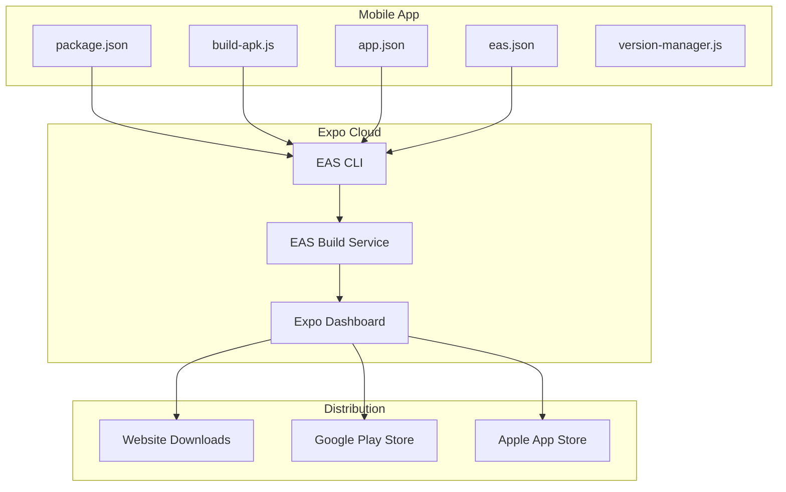
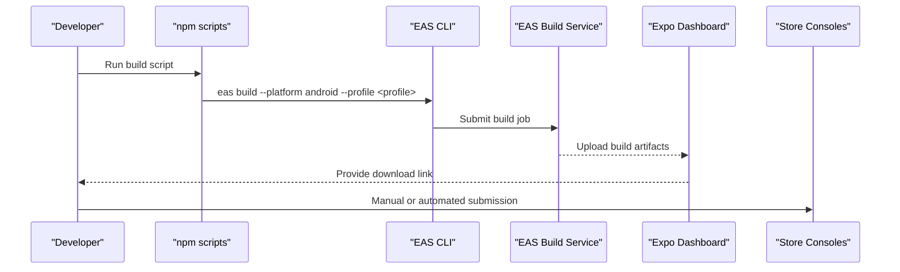
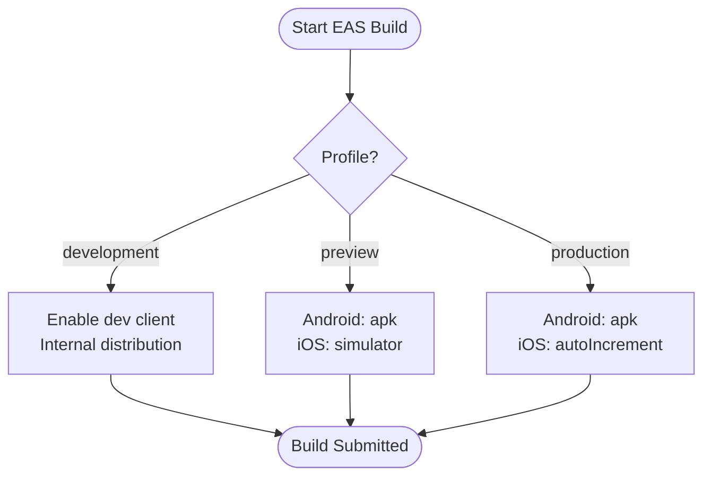
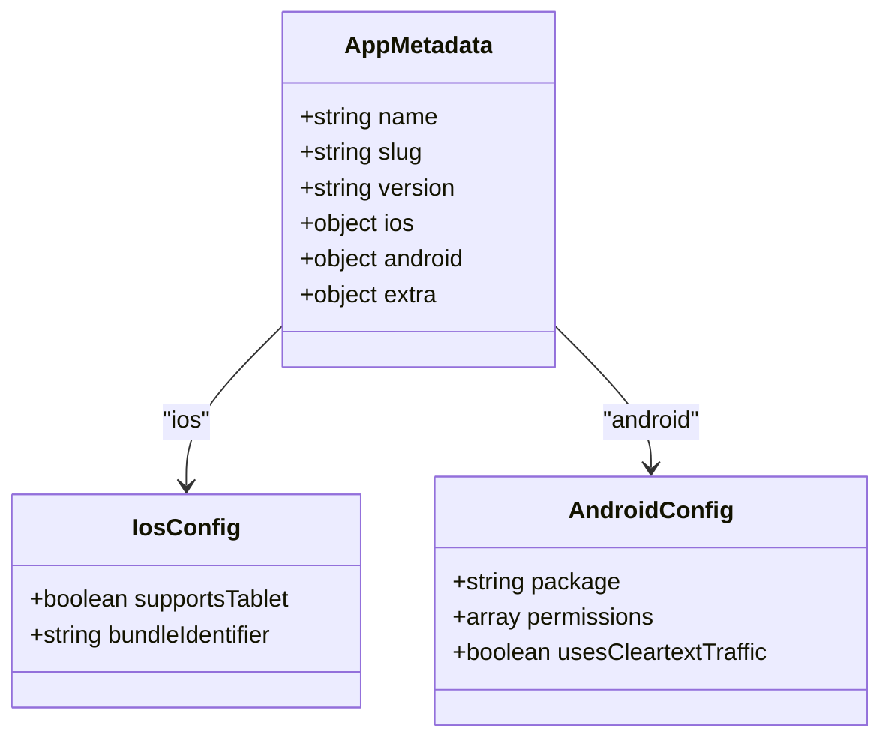
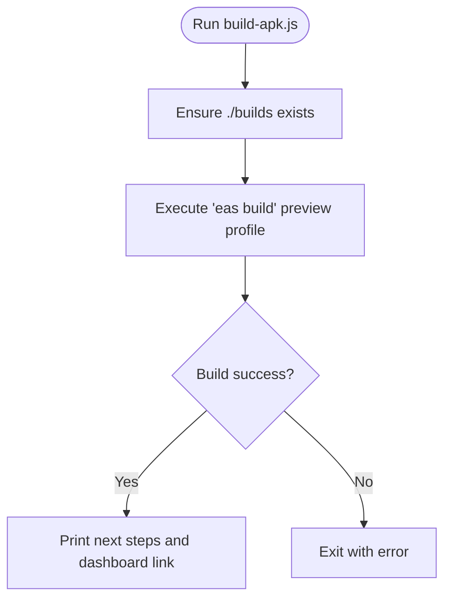
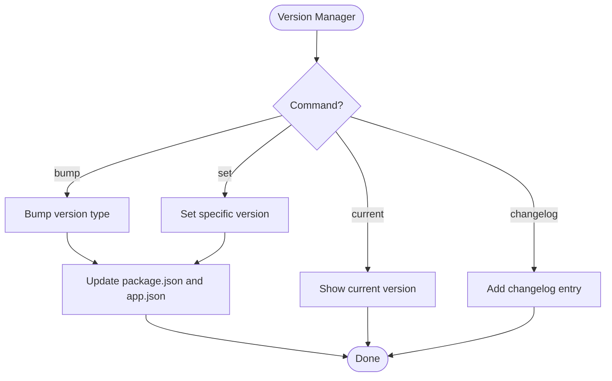
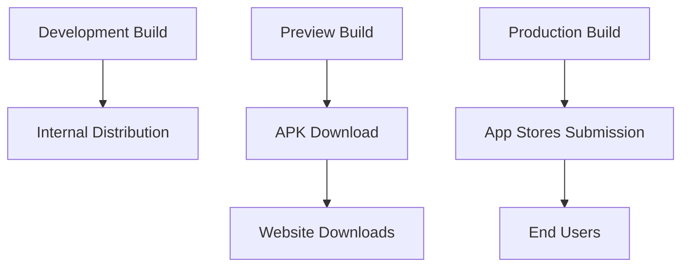
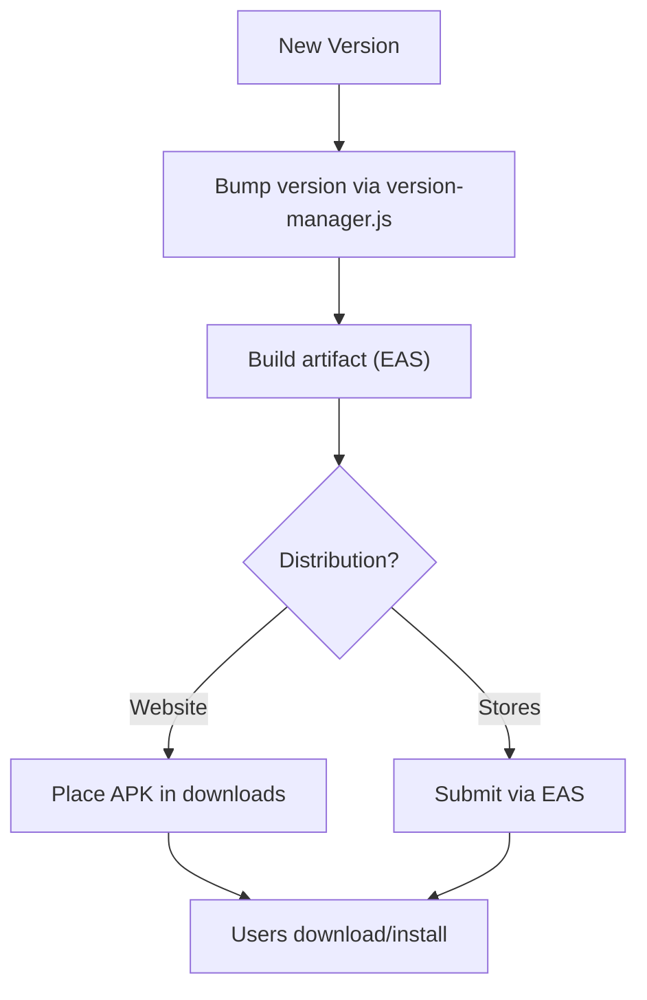
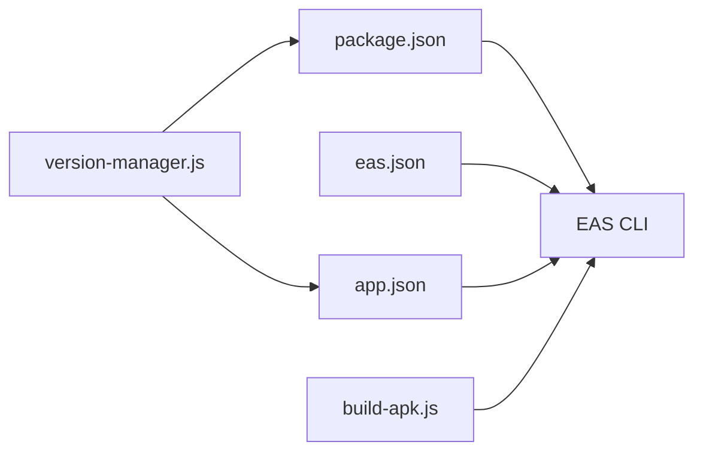

# Build & Deployment

<cite>
**Referenced Files in This Document**
- [eas.json](file://axx-spaces-mobile/eas.json)
- [app.json](file://axx-spaces-mobile/app.json)
- [package.json](file://axx-spaces-mobile/package.json)
- [build-apk.js](file://axx-spaces-mobile/build-apk.js)
- [version-manager.js](file://axx-spaces-mobile/version-manager.js)
- [BUILD_GUIDE.md](file://axx-spaces-mobile/BUILD_GUIDE.md)
- [DEPLOYMENT.md](file://axx-spaces-mobile/DEPLOYMENT.md)
</cite>

## Table of Contents
1. [Introduction](#introduction)
2. [Project Structure](#project-structure)
3. [Core Components](#core-components)
4. [Architecture Overview](#architecture-overview)
5. [Detailed Component Analysis](#detailed-component-analysis)
6. [Dependency Analysis](#dependency-analysis)
7. [Performance Considerations](#performance-considerations)
8. [Troubleshooting Guide](#troubleshooting-guide)
9. [Conclusion](#conclusion)
10. [Appendices](#appendices)

## Introduction
This document explains how to build and deploy the AXX Spaces mobile application using Expo Application Services (EAS). It covers environment setup, EAS configuration, APK generation workflows, signing considerations, distribution strategies for development and production, update handling, and troubleshooting common issues. The goal is to enable both developers and operators to reliably produce Android artifacts and distribute them via internal testing or public stores.

## Project Structure
The mobile project lives under axx-spaces-mobile and uses Expo with EAS for cloud builds. Key build-related files:
- eas.json: EAS profiles for development, preview, and production builds.
- app.json: App metadata, bundle identifiers, permissions, and EAS project ID.
- package.json: Scripts to trigger EAS builds and submissions.
- build-apk.js: Helper script to run an EAS preview build and guide next steps.
- version-manager.js: Utility to bump versions across package.json and app.json.
- BUILD_GUIDE.md and DEPLOYMENT.md: Step-by-step guides for building, deploying, and troubleshooting.

**Diagram sources**
- [package.json:5-12](file://axx-spaces-mobile/package.json#L5-L12)
- [eas.json:1-28](file://axx-spaces-mobile/eas.json#L1-L28)
- [app.json:1-49](file://axx-spaces-mobile/app.json#L1-L49)
- [build-apk.js:1-51](file://axx-spaces-mobile/build-apk.js#L1-L51)

**Section sources**
- [app.json:1-49](file://axx-spaces-mobile/app.json#L1-L49)
- [eas.json:1-28](file://axx-spaces-mobile/eas.json#L1-L28)
- [package.json:1-41](file://axx-spaces-mobile/package.json#L1-L41)

## Core Components
- EAS Profiles:
  - development: Enables development client and internal distribution.
  - preview: Produces an Android APK for quick sharing/testing.
  - production: Builds a release artifact; Android set to APK; iOS configured for auto-incrementing build numbers.
- App Metadata:
  - Bundle identifiers and package names are defined for iOS and Android.
  - Permissions include network, camera, storage, and location access.
  - EAS project ID is embedded for linking builds to the correct project.
- Scripts:
  - npm scripts wrap EAS commands for consistent build and submission flows.
- Utilities:
  - build-apk.js automates running a preview build and provides guidance on downloading and distributing the APK.
  - version-manager.js synchronizes version strings between package.json and app.json and maintains a changelog.

**Section sources**
- [eas.json:5-26](file://axx-spaces-mobile/eas.json#L5-L26)
- [app.json:17-45](file://axx-spaces-mobile/app.json#L17-L45)
- [package.json:5-12](file://axx-spaces-mobile/package.json#L5-L12)
- [build-apk.js:14-49](file://axx-spaces-mobile/build-apk.js#L14-L49)
- [version-manager.js:17-34](file://axx-spaces-mobile/version-manager.js#L17-L34)

## Architecture Overview
The build and deployment architecture centers around EAS as the orchestrator:
- Developers invoke npm scripts that call EAS CLI.
- EAS CLI authenticates and submits build jobs to EAS Build Service.
- EAS Build Service compiles the app and returns artifacts to the Expo Dashboard.
- Artifacts are distributed either by manual download from the dashboard or automated submission to store consoles.

**Diagram sources**
- [package.json:10-12](file://axx-spaces-mobile/package.json#L10-L12)
- [eas.json:5-26](file://axx-spaces-mobile/eas.json#L5-L26)

## Detailed Component Analysis

### EAS Configuration (eas.json)
Profiles define how builds are executed:
- development: Enables development client and sets distribution to internal.
- preview: Forces Android to build APKs and enables simulator mode for iOS.
- production: Sets Android to build APKs and configures iOS to auto-increment build numbers.

**Diagram sources**
- [eas.json:5-26](file://axx-spaces-mobile/eas.json#L5-L26)

**Section sources**
- [eas.json:1-28](file://axx-spaces-mobile/eas.json#L1-L28)

### App Metadata and Permissions (app.json)
- Defines app name, slug, version, orientation, splash screen, and icons.
- iOS bundle identifier and Android package name are specified.
- Android permissions include internet, network state, camera, storage, and location.
- EAS project ID is included under extra.eas.projectId.

**Diagram sources**
- [app.json:1-49](file://axx-spaces-mobile/app.json#L1-L49)

**Section sources**
- [app.json:1-49](file://axx-spaces-mobile/app.json#L1-L49)

### Build Scripts and Automation (package.json and build-apk.js)
- package.json defines npm scripts:
  - build:apk triggers a preview build for Android.
  - build:android triggers a production build for Android.
  - submit:android invokes EAS submission for Android.
- build-apk.js:
  - Creates output directory.
  - Runs EAS preview build non-interactively.
  - Prints next steps including where to find artifacts and how to distribute.

**Diagram sources**
- [build-apk.js:22-49](file://axx-spaces-mobile/build-apk.js#L22-L49)
- [package.json:10-12](file://axx-spaces-mobile/package.json#L10-L12)

**Section sources**
- [package.json:5-12](file://axx-spaces-mobile/package.json#L5-L12)
- [build-apk.js:1-51](file://axx-spaces-mobile/build-apk.js#L1-L51)

### Version Management (version-manager.js)
- Reads current version from package.json.
- Bumps major/minor/patch and updates both package.json and app.json.
- Optionally writes entries to a changelog file.

**Diagram sources**
- [version-manager.js:17-34](file://axx-spaces-mobile/version-manager.js#L17-L34)
- [version-manager.js:36-60](file://axx-spaces-mobile/version-manager.js#L36-L60)
- [version-manager.js:63-74](file://axx-spaces-mobile/version-manager.js#L63-L74)

**Section sources**
- [version-manager.js:1-116](file://axx-spaces-mobile/version-manager.js#L1-L116)

### Environment Setup and Signing
- Environment variables:
  - API_URL should be configured per environment (development vs production). Refer to the build guide for updating the configuration file.
- Signing:
  - For production Android builds, generate a keystore and configure signing in EAS credentials.
  - Use different credentials for development and production.
  - Keep keystores secure and backed up.

**Section sources**
- [BUILD_GUIDE.md:32-40](file://axx-spaces-mobile/BUILD_GUIDE.md#L32-L40)
- [BUILD_GUIDE.md:186-195](file://axx-spaces-mobile/BUILD_GUIDE.md#L186-L195)
- [DEPLOYMENT.md:244-259](file://axx-spaces-mobile/DEPLOYMENT.md#L244-L259)

### Distribution Strategies
- Development:
  - Use the development profile to install via Expo’s development client or internal distribution.
- Preview:
  - Generate an APK for quick sharing and testing outside of app stores.
- Production:
  - Use the production profile to build release artifacts.
  - Distribute via Google Play Store or Apple App Store using EAS submit.

**Diagram sources**
- [eas.json:5-26](file://axx-spaces-mobile/eas.json#L5-L26)
- [package.json:10-12](file://axx-spaces-mobile/package.json#L10-L12)

**Section sources**
- [BUILD_GUIDE.md:42-68](file://axx-spaces-mobile/BUILD_GUIDE.md#L42-L68)
- [DEPLOYMENT.md:46-167](file://axx-spaces-mobile/DEPLOYMENT.md#L46-L167)

### Handling App Updates
- Version management:
  - Use version-manager.js to bump versions consistently across package.json and app.json.
- Distribution:
  - Place new APKs in the website downloads directory for direct installation.
  - For store releases, increment version numbers and submit updated builds.

**Diagram sources**
- [version-manager.js:36-60](file://axx-spaces-mobile/version-manager.js#L36-L60)
- [BUILD_GUIDE.md:97-124](file://axx-spaces-mobile/BUILD_GUIDE.md#L97-L124)

**Section sources**
- [version-manager.js:1-116](file://axx-spaces-mobile/version-manager.js#L1-L116)
- [BUILD_GUIDE.md:97-124](file://axx-spaces-mobile/BUILD_GUIDE.md#L97-L124)

## Dependency Analysis
- package.json depends on EAS CLI to orchestrate builds and submissions.
- eas.json defines build profiles consumed by EAS CLI.
- app.json provides metadata required by EAS during build.
- build-apk.js wraps EAS CLI invocation and user guidance.
- version-manager.js ensures consistency between package.json and app.json versions.

**Diagram sources**
- [package.json:5-12](file://axx-spaces-mobile/package.json#L5-L12)
- [eas.json:1-28](file://axx-spaces-mobile/eas.json#L1-L28)
- [app.json:1-49](file://axx-spaces-mobile/app.json#L1-L49)
- [build-apk.js:1-51](file://axx-spaces-mobile/build-apk.js#L1-L51)
- [version-manager.js:17-34](file://axx-spaces-mobile/version-manager.js#L17-L34)

**Section sources**
- [package.json:1-41](file://axx-spaces-mobile/package.json#L1-L41)
- [eas.json:1-28](file://axx-spaces-mobile/eas.json#L1-L28)
- [app.json:1-49](file://axx-spaces-mobile/app.json#L1-L49)
- [build-apk.js:1-51](file://axx-spaces-mobile/build-apk.js#L1-L51)
- [version-manager.js:1-116](file://axx-spaces-mobile/version-manager.js#L1-L116)

## Performance Considerations
- Prefer preview builds for faster iteration during development.
- Keep app size reasonable; monitor asset sizes and dependencies.
- Use production builds only when necessary for final artifacts.
- Monitor crash reports and performance metrics post-release.

[No sources needed since this section provides general guidance]

## Troubleshooting Guide
Common issues and resolutions:
- Build fails due to missing provisioning profiles:
  - Configure EAS credentials for Android and iOS.
- Build takes too long:
  - Use preview builds for quicker feedback loops.
- Installation blocked on device:
  - Enable “Unknown sources” in Android settings.
- App crashes on launch:
  - Inspect logs using adb logcat.
- API calls failing:
  - Verify API URL configuration and backend availability.
- Keystore not found:
  - Generate a keystore and update EAS signing configuration.
- Google Play API access errors:
  - Verify service account permissions and JSON key validity.

**Section sources**
- [BUILD_GUIDE.md:155-183](file://axx-spaces-mobile/BUILD_GUIDE.md#L155-L183)
- [DEPLOYMENT.md:219-242](file://axx-spaces-mobile/DEPLOYMENT.md#L219-L242)

## Conclusion
By leveraging EAS profiles, consistent version management, and clear distribution strategies, the AXX Spaces mobile app can be built and deployed reliably for both internal testing and public release. Follow the provided guides to set up environments, manage signing, automate builds, and handle updates effectively.

[No sources needed since this section summarizes without analyzing specific files]

## Appendices

### Quick Commands Reference
- Install dependencies and login:
  - npm install
  - eas login
- Configure EAS:
  - eas build:configure
- Build APKs:
  - npm run build:apk (preview)
  - npm run build:android (production)
- Submit to stores:
  - npm run submit:android

**Section sources**
- [BUILD_GUIDE.md:15-30](file://axx-spaces-mobile/BUILD_GUIDE.md#L15-L30)
- [package.json:10-12](file://axx-spaces-mobile/package.json#L10-L12)