# Mobile Application

<cite>
**Referenced Files in This Document**
- [App.js](file://axx-spaces-mobile/App.js)
- [package.json](file://axx-spaces-mobile/package.json)
- [app.json](file://axx-spaces-mobile/app.json)
- [eas.json](file://axx-spaces-mobile/eas.json)
- [README.md](file://axx-spaces-mobile/README.md)
- [src/navigation/AppNavigator.js](file://axx-spaces-mobile/src/navigation/AppNavigator.js)
- [src/config.js](file://axx-spaces-mobile/src/config.js)
- [src/screens/HomeScreen.js](file://axx-spaces-mobile/src/screens/HomeScreen.js)
- [src/screens/LoginScreen.js](file://axx-spaces-mobile/src/screens/LoginScreen.js)
- [src/services/api.js](file://axx-spaces-mobile/src/services/api.js)
- [src/services/notificationService.js](file://axx-spaces-mobile/src/services/notificationService.js)
- [src/services/offlineService.js](file://axx-spaces-mobile/src/services/offlineService.js)
</cite>

## Table of Contents
1. [Introduction](#introduction)
2. [Project Structure](#project-structure)
3. [Core Components](#core-components)
4. [Architecture Overview](#architecture-overview)
5. [Detailed Component Analysis](#detailed-component-analysis)
6. [Dependency Analysis](#dependency-analysis)
7. [Performance Considerations](#performance-considerations)
8. [Troubleshooting Guide](#troubleshooting-guide)
9. [Conclusion](#conclusion)
10. [Appendices](#appendices)

## Introduction
This document provides comprehensive documentation for the React Native mobile application built with Expo and React Navigation. It explains the app structure, navigation system, screen implementations, native module integration, platform-specific features, build and deployment processes, offline functionality, push notifications, and mobile UI components. It also includes practical examples for adding new screens, integrating native features, and optimizing performance.

## Project Structure
The mobile project is organized under axx-spaces-mobile with a clear separation of concerns:
- App entry and root navigator setup
- Navigation configuration using React Navigation
- Screen components for core flows (home, login, etc.)
- Services layer for API calls, offline caching, and push notifications
- Configuration files for Expo, EAS builds, and environment settings

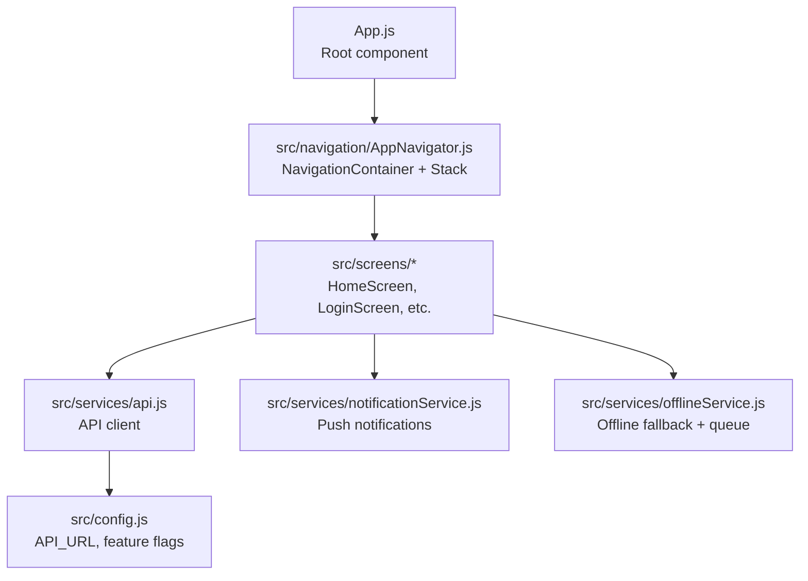

**Diagram sources**
- [App.js:1-110](file://axx-spaces-mobile/App.js#L1-L110)
- [src/navigation/AppNavigator.js:1-30](file://axx-spaces-mobile/src/navigation/AppNavigator.js#L1-L30)
- [src/screens/HomeScreen.js:1-261](file://axx-spaces-mobile/src/screens/HomeScreen.js#L1-L261)
- [src/screens/LoginScreen.js:1-209](file://axx-spaces-mobile/src/screens/LoginScreen.js#L1-L209)
- [src/services/api.js:1-194](file://axx-spaces-mobile/src/services/api.js#L1-L194)
- [src/config.js:1-44](file://axx-spaces-mobile/src/config.js#L1-L44)
- [src/services/notificationService.js:1-216](file://axx-spaces-mobile/src/services/notificationService.js#L1-L216)
- [src/services/offlineService.js:1-211](file://axx-spaces-mobile/src/services/offlineService.js#L1-L211)

**Section sources**
- [README.md:95-111](file://axx-spaces-mobile/README.md#L95-L111)

## Core Components
- Root entry point: Registers the root component and wraps navigation with gesture handling and error boundary.
- Navigation: Uses React Navigation’s NavigationContainer and Stack Navigator to manage screens.
- Screens: Feature-focused components such as HomeScreen and LoginScreen that handle UI and user interactions.
- Services: Centralized modules for API calls, push notifications, and offline capabilities.
- Configuration: Environment-aware settings including API base URL and feature toggles.

Key responsibilities:
- App.js: Bootstraps the app, sets up error boundary, and mounts the navigator.
- AppNavigator.js: Defines global navigation container and stack routes.
- api.js: Provides typed API methods and handles authentication headers via secure storage.
- notificationService.js: Manages permissions, tokens, scheduling, and badge control.
- offlineService.js: Detects connectivity, caches responses, queues actions, and syncs when online.
- config.js: Exposes centralized configuration values used across the app.

**Section sources**
- [App.js:1-110](file://axx-spaces-mobile/App.js#L1-L110)
- [src/navigation/AppNavigator.js:1-30](file://axx-spaces-mobile/src/navigation/AppNavigator.js#L1-L30)
- [src/services/api.js:1-194](file://axx-spaces-mobile/src/services/api.js#L1-L194)
- [src/services/notificationService.js:1-216](file://axx-spaces-mobile/src/services/notificationService.js#L1-L216)
- [src/services/offlineService.js:1-211](file://axx-spaces-mobile/src/services/offlineService.js#L1-L211)
- [src/config.js:1-44](file://axx-spaces-mobile/src/config.js#L1-L44)

## Architecture Overview
The app follows a layered architecture:
- Presentation Layer: Screens and reusable components render UI and handle user input.
- Navigation Layer: React Navigation manages routing and transitions.
- Service Layer: Encapsulates network requests, local storage, and device features.
- Configuration Layer: Centralizes environment variables and feature flags.

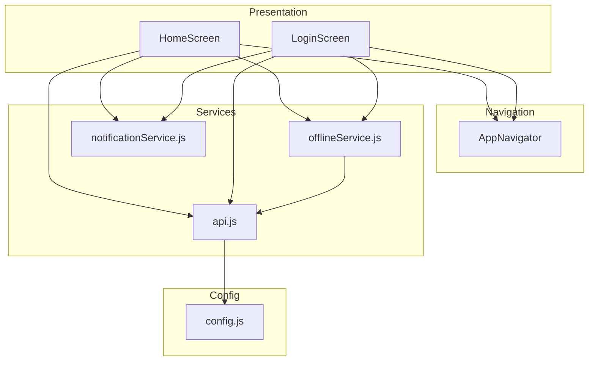

**Diagram sources**
- [src/screens/HomeScreen.js:1-261](file://axx-spaces-mobile/src/screens/HomeScreen.js#L1-L261)
- [src/screens/LoginScreen.js:1-209](file://axx-spaces-mobile/src/screens/LoginScreen.js#L1-L209)
- [src/navigation/AppNavigator.js:1-30](file://axx-spaces-mobile/src/navigation/AppNavigator.js#L1-L30)
- [src/services/api.js:1-194](file://axx-spaces-mobile/src/services/api.js#L1-L194)
- [src/services/offlineService.js:1-211](file://axx-spaces-mobile/src/services/offlineService.js#L1-L211)
- [src/services/notificationService.js:1-216](file://axx-spaces-mobile/src/services/notificationService.js#L1-L216)
- [src/config.js:1-44](file://axx-spaces-mobile/src/config.js#L1-L44)

## Detailed Component Analysis

### Root Entry and Error Boundary
- The root component registers the main app and wraps it with GestureHandlerRootView and an ErrorBoundary.
- The ErrorBoundary catches unhandled errors and presents a user-friendly recovery UI with a reload action.

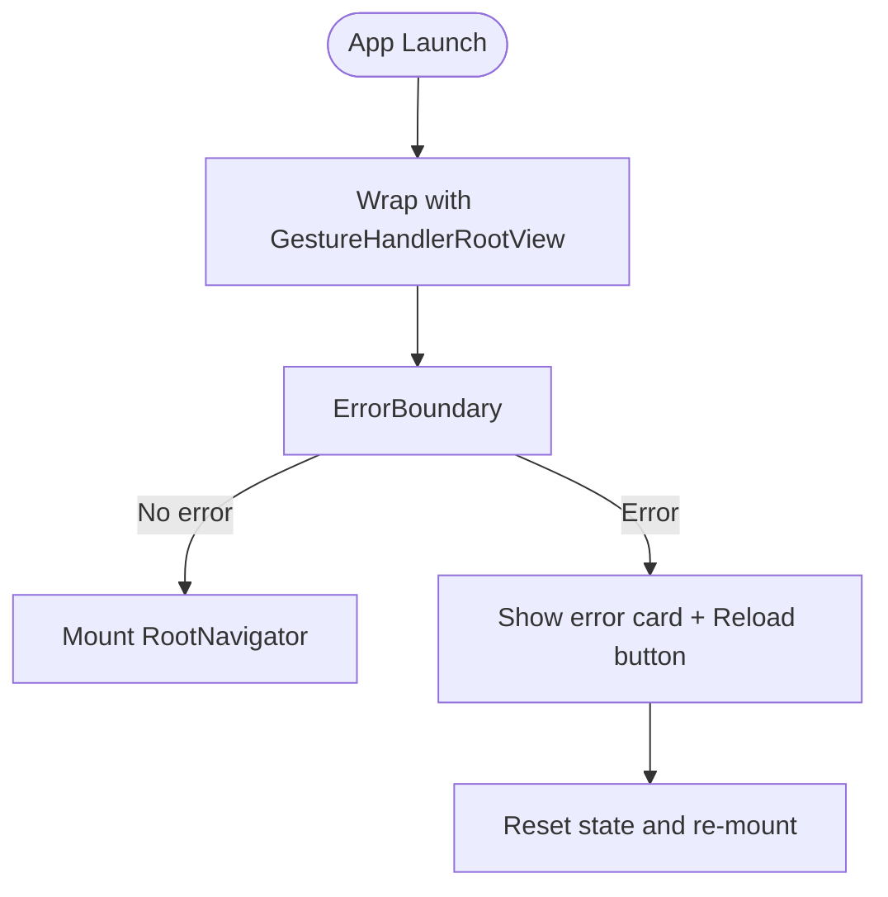

**Diagram sources**
- [App.js:1-110](file://axx-spaces-mobile/App.js#L1-L110)

**Section sources**
- [App.js:1-110](file://axx-spaces-mobile/App.js#L1-L110)

### Navigation System
- The root navigator uses NavigationContainer and a Stack Navigator.
- Currently, the stack defines a single route pointing to WebViewScreen; additional screens can be added here.

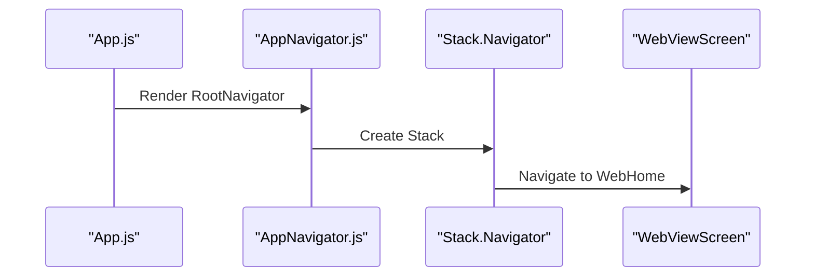

**Diagram sources**
- [src/navigation/AppNavigator.js:1-30](file://axx-spaces-mobile/src/navigation/AppNavigator.js#L1-L30)

**Section sources**
- [src/navigation/AppNavigator.js:1-30](file://axx-spaces-mobile/src/navigation/AppNavigator.js#L1-L30)

### Home Screen
- Displays categories and featured properties.
- Loads data from the API and navigates to detail or category screens.

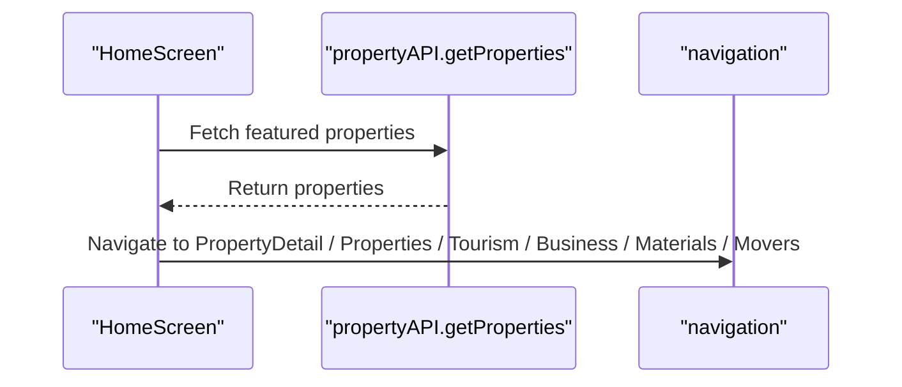

**Diagram sources**
- [src/screens/HomeScreen.js:1-261](file://axx-spaces-mobile/src/screens/HomeScreen.js#L1-L261)
- [src/services/api.js:79-102](file://axx-spaces-mobile/src/services/api.js#L79-L102)

**Section sources**
- [src/screens/HomeScreen.js:1-261](file://axx-spaces-mobile/src/screens/HomeScreen.js#L1-L261)

### Login Screen
- Handles email/password input, role selection, and triggers authentication via context.
- Shows loading states and alerts on failure.

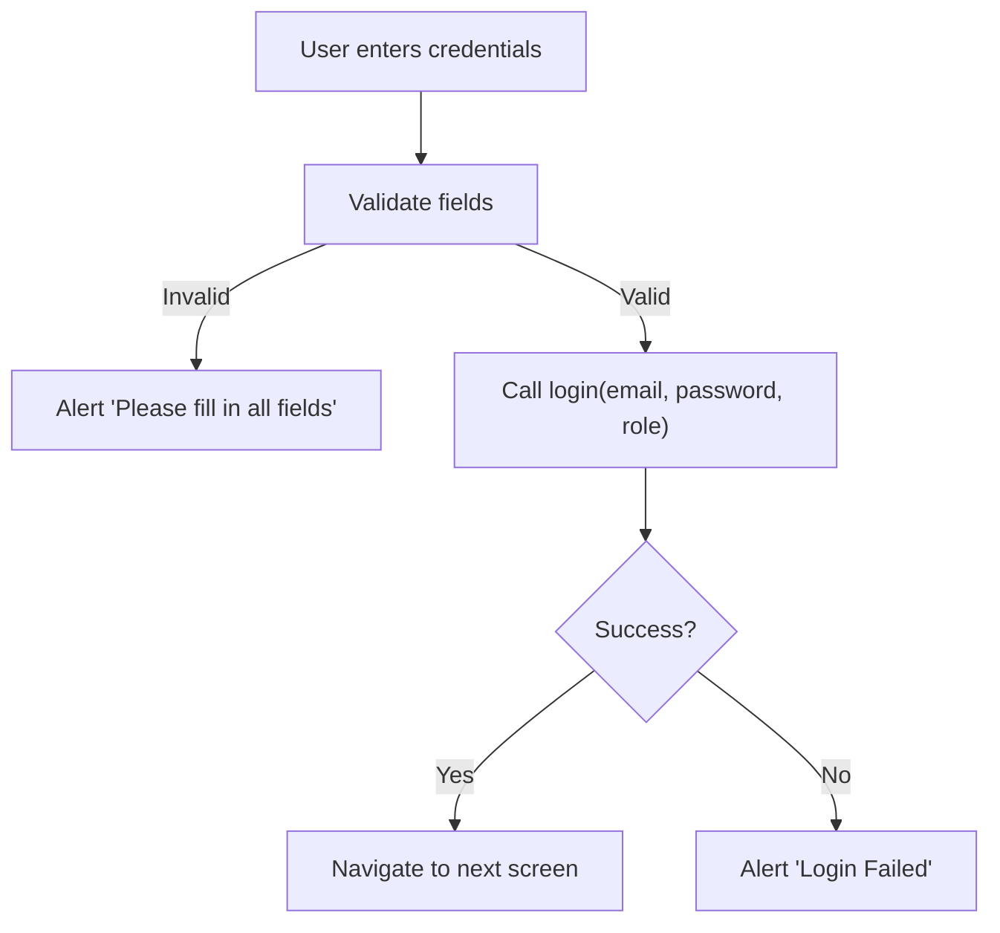

**Diagram sources**
- [src/screens/LoginScreen.js:1-209](file://axx-spaces-mobile/src/screens/LoginScreen.js#L1-L209)

**Section sources**
- [src/screens/LoginScreen.js:1-209](file://axx-spaces-mobile/src/screens/LoginScreen.js#L1-L209)

### API Client
- Centralized fetch wrapper that injects Authorization headers using a token from secure storage.
- Organizes endpoints by domain: auth, property, tourism, business, materials, movers, user, notifications, wallet.

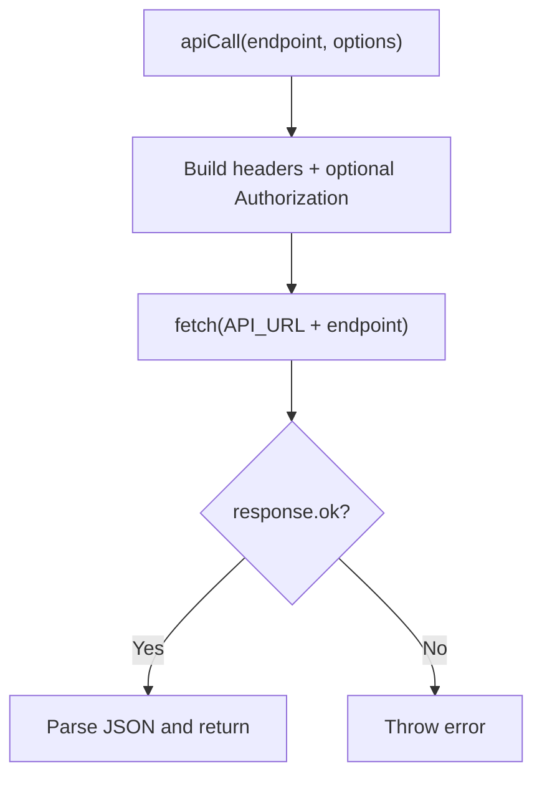

**Diagram sources**
- [src/services/api.js:1-194](file://axx-spaces-mobile/src/services/api.js#L1-L194)

**Section sources**
- [src/services/api.js:1-194](file://axx-spaces-mobile/src/services/api.js#L1-L194)

### Push Notifications
- Requests permissions, retrieves push token, schedules/dismisses notifications, and manages badges.
- Android channel configuration included.

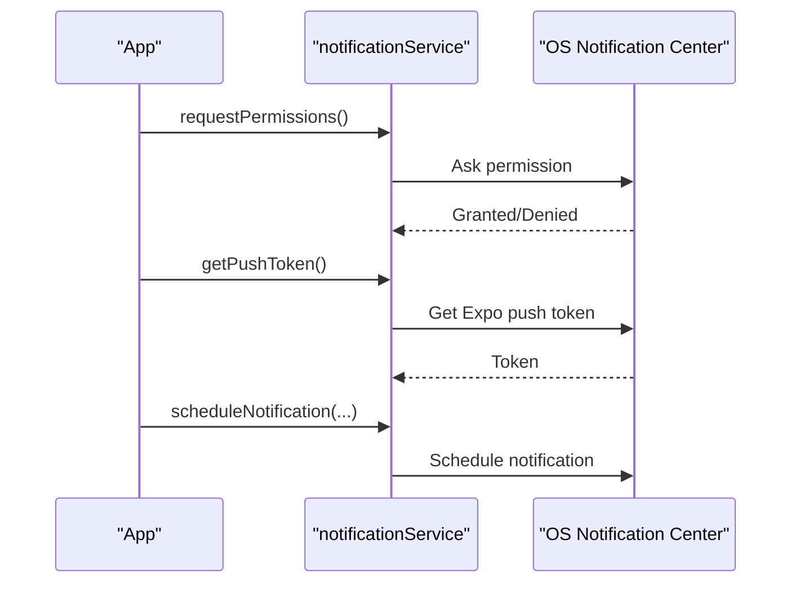

**Diagram sources**
- [src/services/notificationService.js:1-216](file://axx-spaces-mobile/src/services/notificationService.js#L1-L216)

**Section sources**
- [src/services/notificationService.js:1-216](file://axx-spaces-mobile/src/services/notificationService.js#L1-L216)

### Offline Functionality
- Detects connectivity, falls back to cached data, queues actions for later sync, and prefetches essential data.

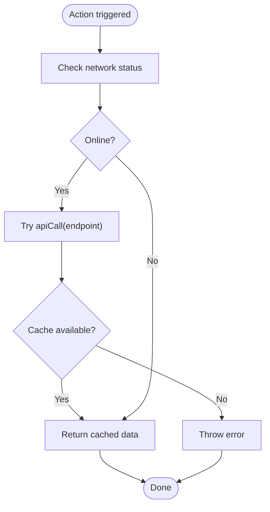

**Diagram sources**
- [src/services/offlineService.js:1-211](file://axx-spaces-mobile/src/services/offlineService.js#L1-L211)

**Section sources**
- [src/services/offlineService.js:1-211](file://axx-spaces-mobile/src/services/offlineService.js#L1-L211)

### Configuration
- Centralizes API URLs, website URL, app metadata, feature flags, pagination, upload limits, and cache settings.

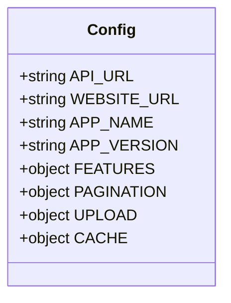

**Diagram sources**
- [src/config.js:1-44](file://axx-spaces-mobile/src/config.js#L1-L44)

**Section sources**
- [src/config.js:1-44](file://axx-spaces-mobile/src/config.js#L1-L44)

## Dependency Analysis
The app depends on Expo, React Navigation, and several native modules for camera, location, notifications, and secure storage.

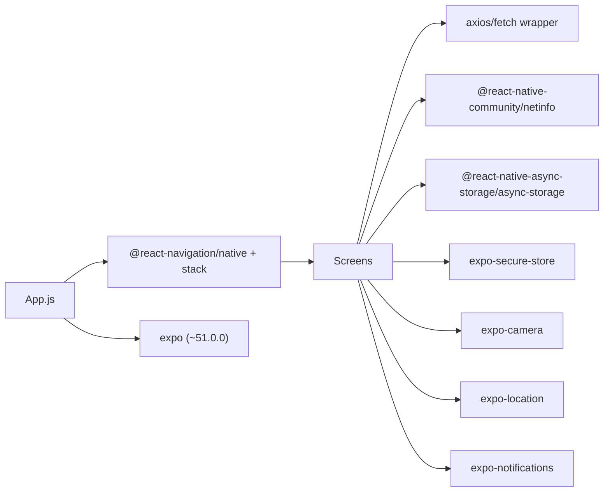

**Diagram sources**
- [package.json:14-35](file://axx-spaces-mobile/package.json#L14-L35)
- [src/services/offlineService.js:1-211](file://axx-spaces-mobile/src/services/offlineService.js#L1-L211)
- [src/services/notificationService.js:1-216](file://axx-spaces-mobile/src/services/notificationService.js#L1-L216)

**Section sources**
- [package.json:14-35](file://axx-spaces-mobile/package.json#L14-L35)

## Performance Considerations
- Minimize re-renders: Use memoization and avoid unnecessary state updates in screens.
- Optimize lists: Prefer FlatList with proper keyExtractor and item rendering optimizations.
- Image handling: Use appropriate image sizes and consider caching strategies.
- Network efficiency: Leverage caching and pagination; avoid redundant requests.
- Native modules: Initialize only when needed; avoid heavy operations on the main thread.
- Bundle size: Remove unused dependencies and enable code splitting where possible.

[No sources needed since this section provides general guidance]

## Troubleshooting Guide
Common issues and resolutions:
- Metro bundler problems: Reset cache and restart the development server.
- iOS build issues: Run pod install in the iOS directory if required.
- Android build issues: Clean Gradle build and rebuild.
- Network issues: Verify backend availability, API URL configuration, and network permissions.

Operational tips:
- Ensure correct API_URL in configuration for development vs production.
- Confirm device permissions for camera, location, and notifications are granted.
- For push notifications, use a physical device and ensure the Expo project ID is configured.

**Section sources**
- [README.md:197-220](file://axx-spaces-mobile/README.md#L197-L220)
- [src/config.js:1-44](file://axx-spaces-mobile/src/config.js#L1-L44)
- [app.json:21-37](file://axx-spaces-mobile/app.json#L21-L37)

## Conclusion
The mobile application leverages Expo and React Navigation to deliver a cross-platform experience with robust service layers for networking, offline support, and push notifications. Its modular structure supports easy extension of screens and features while maintaining clarity and performance. Following the guidelines in this document will help you add new screens, integrate native capabilities, and optimize the app effectively.

[No sources needed since this section summarizes without analyzing specific files]

## Appendices

### How to Add a New Screen
Steps:
1. Create a new screen file under src/screens/.
2. Implement the screen component and navigate to it from existing screens using navigation.navigate('YourScreen').
3. Register the screen in the root navigator if it should be globally accessible.

Example references:
- Adding a route in the stack navigator: [src/navigation/AppNavigator.js:1-30](file://axx-spaces-mobile/src/navigation/AppNavigator.js#L1-L30)
- Navigating between screens: [src/screens/HomeScreen.js:42-78](file://axx-spaces-mobile/src/screens/HomeScreen.js#L42-L78)

**Section sources**
- [src/navigation/AppNavigator.js:1-30](file://axx-spaces-mobile/src/navigation/AppNavigator.js#L1-L30)
- [src/screens/HomeScreen.js:42-78](file://axx-spaces-mobile/src/screens/HomeScreen.js#L42-L78)

### Integrating Native Features
Camera:
- Install expo-camera and request permissions before use.
- Capture images and process them within your screen logic.

Location:
- Use expo-location to request permissions and access GPS coordinates.

Notifications:
- Use notificationService to request permissions, retrieve tokens, and schedule notifications.

References:
- Camera and image picker dependencies: [package.json:22-24](file://axx-spaces-mobile/package.json#L22-L24)
- Notification service usage: [src/services/notificationService.js:1-216](file://axx-spaces-mobile/src/services/notificationService.js#L1-L216)

**Section sources**
- [package.json:22-24](file://axx-spaces-mobile/package.json#L22-L24)
- [src/services/notificationService.js:1-216](file://axx-spaces-mobile/src/services/notificationService.js#L1-L216)

### Build and Deployment Processes
Development:
- Start the dev server and run on platforms using npm scripts.

Production builds:
- Configure EAS profiles for development, preview, and production.
- Build APK/AAB and submit to stores.

References:
- Scripts and dependencies: [package.json:5-13](file://axx-spaces-mobile/package.json#L5-L13)
- EAS configuration: [eas.json:1-28](file://axx-spaces-mobile/eas.json#L1-L28)
- Expo app metadata and permissions: [app.json:1-49](file://axx-spaces-mobile/app.json#L1-L49)
- Build and deployment instructions: [README.md:161-196](file://axx-spaces-mobile/README.md#L161-L196)

**Section sources**
- [package.json:5-13](file://axx-spaces-mobile/package.json#L5-L13)
- [eas.json:1-28](file://axx-spaces-mobile/eas.json#L1-L28)
- [app.json:1-49](file://axx-spaces-mobile/app.json#L1-L49)
- [README.md:161-196](file://axx-spaces-mobile/README.md#L161-L196)