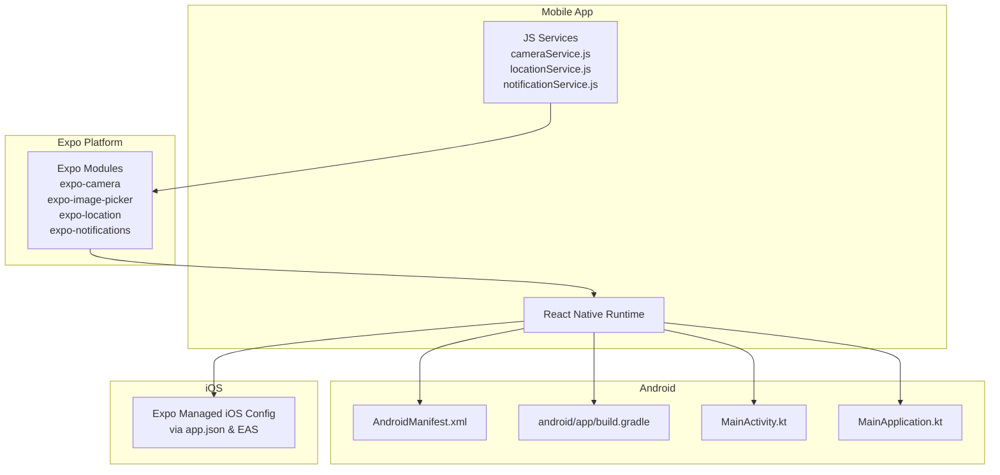
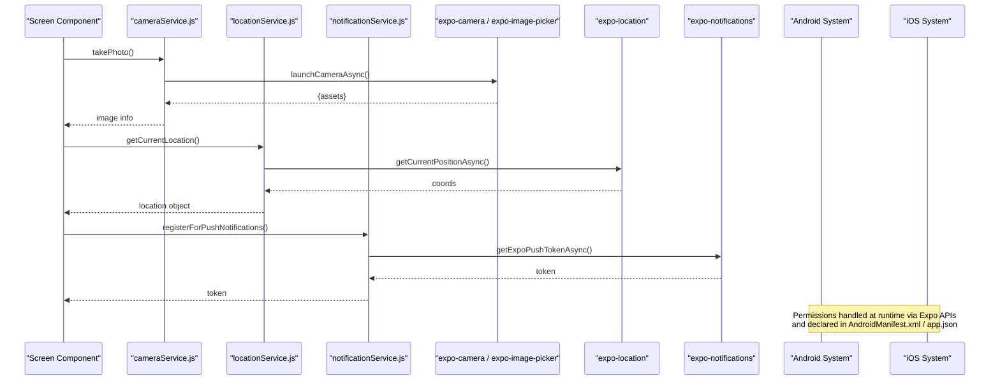
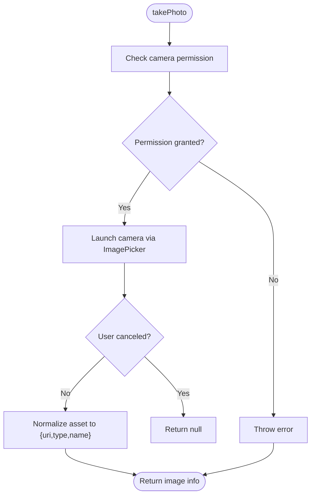
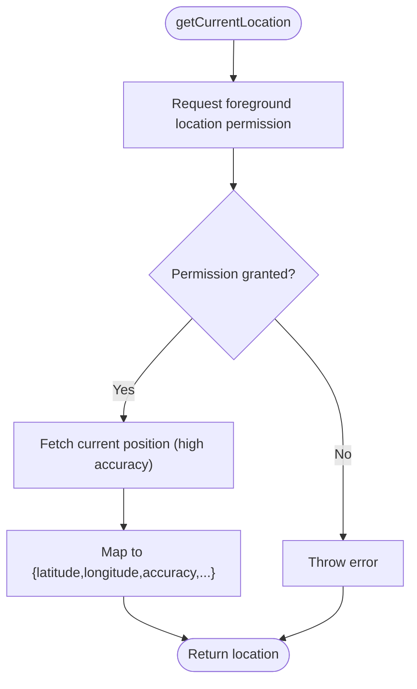
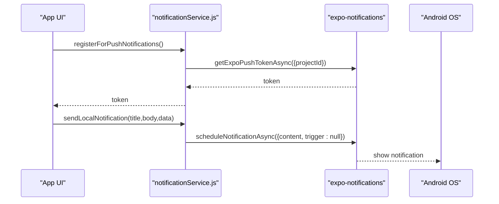
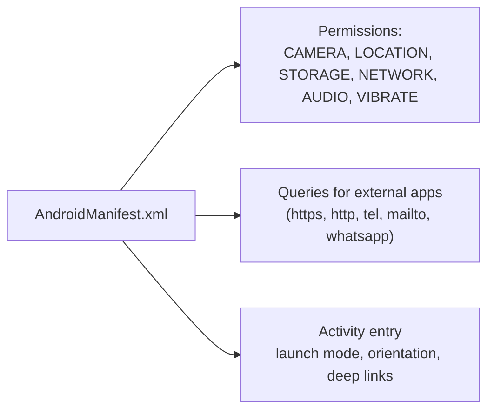
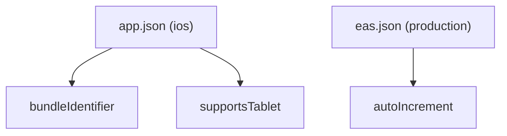
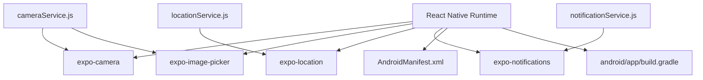
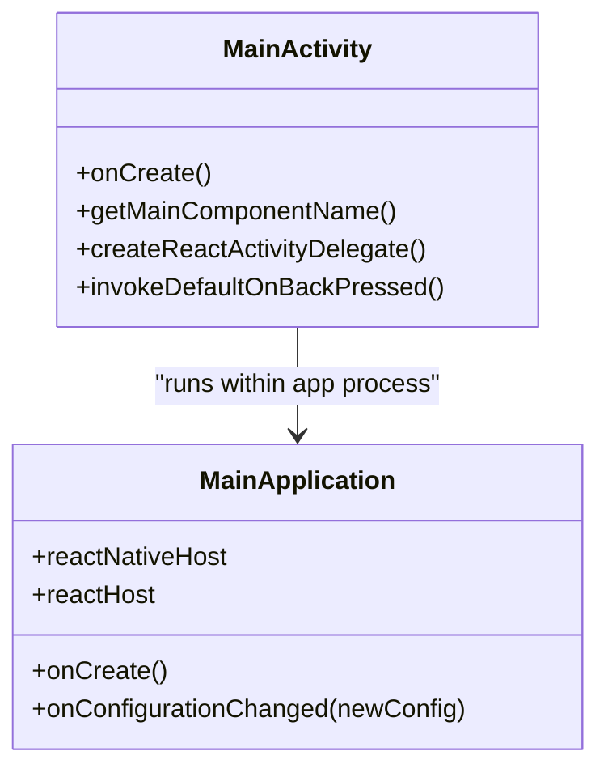

# Native Module Integration

<cite>
**Referenced Files in This Document**
- [cameraService.js](file://axx-spaces-mobile/src/services/cameraService.js)
- [locationService.js](file://axx-spaces-mobile/src/services/locationService.js)
- [notificationService.js](file://axx-spaces-mobile/src/services/notificationService.js)
- [AndroidManifest.xml](file://axx-spaces-mobile/android/app/src/main/AndroidManifest.xml)
- [app.json](file://axx-spaces-mobile/app.json)
- [MainApplication.kt](file://axx-spaces-mobile/android/app/src/main/java/com/axxspaces/mobile/MainApplication.kt)
- [MainActivity.kt](file://axx-spaces-mobile/android/app/src/main/java/com/axxspaces/mobile/MainActivity.kt)
- [package.json](file://axx-spaces-mobile/package.json)
- [eas.json](file://axx-spaces-mobile/eas.json)
- [build.gradle](file://axx-spaces-mobile/android/app/build.gradle)
</cite>

## Table of Contents
1. [Introduction](#introduction)
2. [Project Structure](#project-structure)
3. [Core Components](#core-components)
4. [Architecture Overview](#architecture-overview)
5. [Detailed Component Analysis](#detailed-component-analysis)
6. [Dependency Analysis](#dependency-analysis)
7. [Performance Considerations](#performance-considerations)
8. [Troubleshooting Guide](#troubleshooting-guide)
9. [Conclusion](#conclusion)
10. [Appendices](#appendices)

## Introduction
This document explains how native modules are integrated into the mobile application, focusing on camera functionality, location services, push notifications, and platform-specific configurations for Android and iOS. It also covers permissions handling, cross-platform compatibility patterns, examples for adding new native modules, handling platform differences, and optimizing native performance.

The app uses Expo-managed workflow with React Native and integrates native capabilities through Expo packages:
- Camera and image picking via expo-camera and expo-image-picker
- Location via expo-location
- Push notifications via expo-notifications

Android configuration is present in the repository; iOS configuration is managed by Expo and can be extended via app.json and EAS build profiles.

## Project Structure
The mobile project resides under axx-spaces-mobile. Key areas relevant to native integration:
- src/services: JavaScript/TypeScript service wrappers around native APIs (camera, location, notifications)
- android/: Android native configuration and entry points
- app.json: Expo config including iOS and Android metadata and permissions
- package.json: Dependencies for native modules
- eas.json: Build profiles for development, preview, and production

**Diagram sources**
- [cameraService.js:1-100](file://axx-spaces-mobile/src/services/cameraService.js#L1-L100)
- [locationService.js:1-162](file://axx-spaces-mobile/src/services/locationService.js#L1-L162)
- [notificationService.js:1-216](file://axx-spaces-mobile/src/services/notificationService.js#L1-L216)
- [AndroidManifest.xml:1-54](file://axx-spaces-mobile/android/app/src/main/AndroidManifest.xml#L1-L54)
- [build.gradle:1-211](file://axx-spaces-mobile/android/app/build.gradle#L1-L211)
- [MainActivity.kt:1-62](file://axx-spaces-mobile/android/app/src/main/java/com/axxspaces/mobile/MainActivity.kt#L1-L62)
- [MainApplication.kt:1-56](file://axx-spaces-mobile/android/app/src/main/java/com/axxspaces/mobile/MainApplication.kt#L1-L56)
- [app.json:1-49](file://axx-spaces-mobile/app.json#L1-L49)

**Section sources**
- [package.json:14-34](file://axx-spaces-mobile/package.json#L14-L34)
- [app.json:17-37](file://axx-spaces-mobile/app.json#L17-L37)

## Core Components
This section summarizes the three primary native-facing services and their responsibilities.

- Camera Service
  - Requests camera and gallery permissions
  - Launches camera or image picker
  - Returns normalized image assets (uri, type, name)
  - Provides validation helpers and placeholder compression

- Location Service
  - Requests foreground location permission
  - Gets current position, reverse geocoding, and forward geocoding
  - Calculates distances between coordinates
  - Starts/stops location updates and checks if location services are enabled

- Notification Service
  - Requests notification permissions and retrieves push token
  - Schedules local notifications and manages scheduled notifications
  - Sets Android notification channel
  - Adds listeners for received notifications and responses
  - Manages badge count and dismissal

**Section sources**
- [cameraService.js:1-100](file://axx-spaces-mobile/src/services/cameraService.js#L1-L100)
- [locationService.js:1-162](file://axx-spaces-mobile/src/services/locationService.js#L1-L162)
- [notificationService.js:1-216](file://axx-spaces-mobile/src/services/notificationService.js#L1-L216)

## Architecture Overview
The app follows a layered architecture where UI screens call service functions that wrap Expo native modules. On Android, permissions are declared in the manifest and Gradle builds configure the app bundle. iOS settings are managed via Expo configuration and EAS.

**Diagram sources**
- [cameraService.js:18-46](file://axx-spaces-mobile/src/services/cameraService.js#L18-L46)
- [locationService.js:11-36](file://axx-spaces-mobile/src/services/locationService.js#L11-L36)
- [notificationService.js:39-74](file://axx-spaces-mobile/src/services/notificationService.js#L39-L74)
- [AndroidManifest.xml:1-54](file://axx-spaces-mobile/android/app/src/main/AndroidManifest.xml#L1-L54)
- [app.json:17-37](file://axx-spaces-mobile/app.json#L17-L37)

## Detailed Component Analysis

### Camera Functionality
Responsibilities:
- Permission handling for camera and media library access
- Capturing photos and selecting images from gallery
- Normalizing results to a consistent shape for upload pipelines

Key behaviors:
- requestCameraPermissions and requestGalleryPermissions gate operations
- takePhoto uses ImagePicker.launchCameraAsync with editing and aspect ratio constraints
- pickFromGallery supports single/multiple selection and editing when not multiple
- Validation helpers check allowed types and provide placeholders for size validation and compression

**Diagram sources**
- [cameraService.js:18-46](file://axx-spaces-mobile/src/services/cameraService.js#L18-L46)

**Section sources**
- [cameraService.js:1-100](file://axx-spaces-mobile/src/services/cameraService.js#L1-L100)

### Location Services
Responsibilities:
- Requesting and validating foreground location permission
- Getting current location with high accuracy
- Reverse and forward geocoding
- Distance calculation using Haversine formula
- Starting/stopping periodic location updates
- Checking if location services are enabled

Key behaviors:
- requestLocationPermissions ensures permission before any location operation
- getCurrentLocation returns structured coordinates and metadata
- startLocationUpdates sets up watchPositionAsync with distance/time intervals
- stopLocationUpdates unsubscribes to avoid leaks

**Diagram sources**
- [locationService.js:11-36](file://axx-spaces-mobile/src/services/locationService.js#L11-L36)

**Section sources**
- [locationService.js:1-162](file://axx-spaces-mobile/src/services/locationService.js#L1-L162)

### Push Notifications
Responsibilities:
- Requesting notification permissions and retrieving push tokens
- Registering device with backend (placeholder)
- Scheduling and managing local notifications
- Setting Android notification channels
- Managing badges and dismissing notifications

Key behaviors:
- requestPermissions checks Device.isDevice and prompts user
- getPushToken requires a valid projectId and returns token data
- setNotificationChannel configures Android channel importance and vibration
- Listeners allow handling incoming notifications and actions

**Diagram sources**
- [notificationService.js:15-74](file://axx-spaces-mobile/src/services/notificationService.js#L15-L74)
- [notificationService.js:76-112](file://axx-spaces-mobile/src/services/notificationService.js#L76-L112)

**Section sources**
- [notificationService.js:1-216](file://axx-spaces-mobile/src/services/notificationService.js#L1-L216)

### Android Configuration and Permissions
- Manifest declares required permissions for network, location, camera, storage, audio, system alert window, and vibrate.
- Queries define supported URL schemes and external app interactions.
- Application and activity entries include theme, orientation, and deep link intent filter.

**Diagram sources**
- [AndroidManifest.xml:1-54](file://axx-spaces-mobile/android/app/src/main/AndroidManifest.xml#L1-L54)

**Section sources**
- [AndroidManifest.xml:1-54](file://axx-spaces-mobile/android/app/src/main/AndroidManifest.xml#L1-L54)

### iOS Configuration
- iOS settings are managed via Expo configuration in app.json and EAS build profiles.
- Bundle identifier and tablet support are defined.
- Production builds can auto-increment version numbers.

**Diagram sources**
- [app.json:17-20](file://axx-spaces-mobile/app.json#L17-L20)
- [eas.json:19-27](file://axx-spaces-mobile/eas.json#L19-L27)

**Section sources**
- [app.json:17-20](file://axx-spaces-mobile/app.json#L17-L20)
- [eas.json:19-27](file://axx-spaces-mobile/eas.json#L19-L27)

### Adding New Native Modules
Steps to integrate a new native module:
1. Add dependency in package.json (for Expo-managed workflow).
2. If the module requires platform permissions or capabilities, update:
   - Android: add <uses-permission> entries in AndroidManifest.xml
   - iOS: add keys in Info.plist via Expo config or prebuild
3. Create a service wrapper in src/services to encapsulate native calls and handle permissions.
4. Update app.json to declare any additional Expo-managed permissions.
5. Rebuild with EAS or local toolchain.

Examples:
- Camera and image picker were added via expo-camera and expo-image-picker dependencies.
- Location via expo-location.
- Notifications via expo-notifications.

**Section sources**
- [package.json:21-25](file://axx-spaces-mobile/package.json#L21-L25)
- [AndroidManifest.xml:2-11](file://axx-spaces-mobile/android/app/src/main/AndroidManifest.xml#L2-L11)
- [app.json:27-35](file://axx-spaces-mobile/app.json#L27-L35)

### Handling Platform Differences
- Use Platform.OS checks to conditionally execute platform-specific logic (e.g., setting Android notification channels).
- Wrap platform-specific behavior inside service methods to keep UI code clean.
- For features not available on all platforms, guard with Device.isDevice or feature detection.

Example:
- Notification channel setup runs only on Android.

**Section sources**
- [notificationService.js:145-155](file://axx-spaces-mobile/src/services/notificationService.js#L145-L155)

### Optimizing Native Performance
- Camera:
  - Set quality and aspect ratio to reduce payload size.
  - Avoid unnecessary editing when not needed.
  - Implement real image compression before upload.
- Location:
  - Tune accuracy and intervals based on use case (tracking vs one-off).
  - Stop subscriptions promptly to prevent battery drain.
- Notifications:
  - Batch badge updates and dismiss unused notifications.
  - Use scheduled notifications for time-based UX rather than polling.

[No sources needed since this section provides general guidance]

## Dependency Analysis
The following diagram shows how JS services depend on Expo modules and how Android native layers are wired.

**Diagram sources**
- [cameraService.js:1-3](file://axx-spaces-mobile/src/services/cameraService.js#L1-L3)
- [locationService.js:1-2](file://axx-spaces-mobile/src/services/locationService.js#L1-L2)
- [notificationService.js:1-4](file://axx-spaces-mobile/src/services/notificationService.js#L1-L4)
- [AndroidManifest.xml:1-54](file://axx-spaces-mobile/android/app/src/main/AndroidManifest.xml#L1-L54)
- [build.gradle:1-211](file://axx-spaces-mobile/android/app/build.gradle#L1-L211)

**Section sources**
- [package.json:21-25](file://axx-spaces-mobile/package.json#L21-L25)
- [build.gradle:106-150](file://axx-spaces-mobile/android/app/build.gradle#L106-L150)

## Performance Considerations
- Prefer foreground location permission for active tracking; background location requires additional configuration and permissions.
- Limit image processing to necessary steps; defer heavy compression to a background task or server side when possible.
- Minimize number of scheduled notifications and clear them after display.
- Ensure proper cleanup of location subscriptions and notification listeners to avoid memory leaks.

[No sources needed since this section provides general guidance]

## Troubleshooting Guide
Common issues and resolutions:
- Camera/gallery permission denied:
  - Ensure runtime permission is requested before launching camera or gallery.
  - Verify Android permissions in AndroidManifest.xml and app.json.
- Location not working:
  - Confirm foreground permission is granted.
  - Check that device location services are enabled.
- Push notifications not received:
  - Verify Device.isDevice and that permissions are granted.
  - Ensure projectId is correctly configured in getExpoPushTokenAsync.
  - On Android, ensure notification channel is created.

Operational checks:
- Validate that AndroidManifest includes CAMERA, ACCESS_FINE_LOCATION, ACCESS_COARSE_LOCATION, READ_EXTERNAL_STORAGE, WRITE_EXTERNAL_STORAGE.
- Confirm app.json lists the same permissions under android.permissions.
- Rebuild with EAS to apply changes consistently across environments.

**Section sources**
- [cameraService.js:6-16](file://axx-spaces-mobile/src/services/cameraService.js#L6-L16)
- [locationService.js:5-9](file://axx-spaces-mobile/src/services/locationService.js#L5-L9)
- [notificationService.js:17-37](file://axx-spaces-mobile/src/services/notificationService.js#L17-L37)
- [AndroidManifest.xml:2-11](file://axx-spaces-mobile/android/app/src/main/AndroidManifest.xml#L2-L11)
- [app.json:27-35](file://axx-spaces-mobile/app.json#L27-L35)

## Conclusion
The mobile application integrates native capabilities through well-encapsulated service modules that wrap Expo’s native APIs. Android permissions are explicitly declared, while iOS configuration is managed via Expo and EAS. By following the patterns shown here—requesting permissions at runtime, isolating platform-specific logic, and cleaning up resources—you can reliably extend the app with new native modules and maintain cross-platform compatibility.

[No sources needed since this section summarizes without analyzing specific files]

## Appendices

### Android Entry Points and Lifecycle
- MainActivity handles React Native activity lifecycle and back button behavior.
- MainApplication initializes SoLoader, React Native host, and Expo lifecycle dispatcher.

**Diagram sources**
- [MainActivity.kt:13-61](file://axx-spaces-mobile/android/app/src/main/java/com/axxspaces/mobile/MainActivity.kt#L13-L61)
- [MainApplication.kt:18-55](file://axx-spaces-mobile/android/app/src/main/java/com/axxspaces/mobile/MainApplication.kt#L18-L55)

**Section sources**
- [MainActivity.kt:1-62](file://axx-spaces-mobile/android/app/src/main/java/com/axxspaces/mobile/MainActivity.kt#L1-L62)
- [MainApplication.kt:1-56](file://axx-spaces-mobile/android/app/src/main/java/com/axxspaces/mobile/MainApplication.kt#L1-L56)