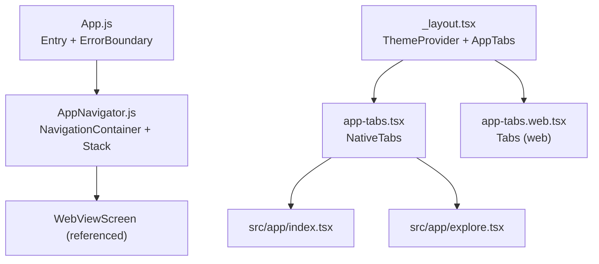
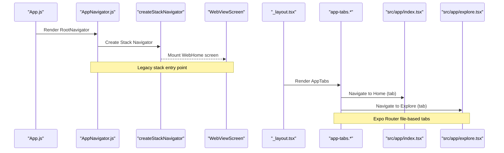
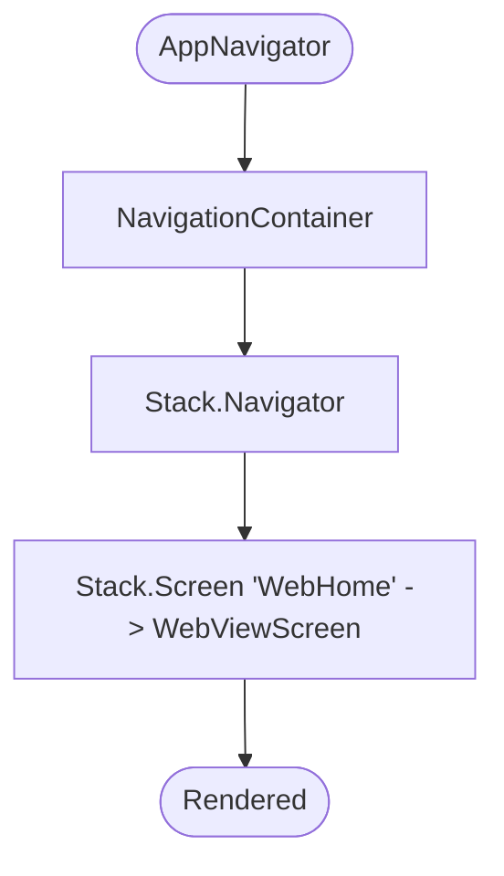
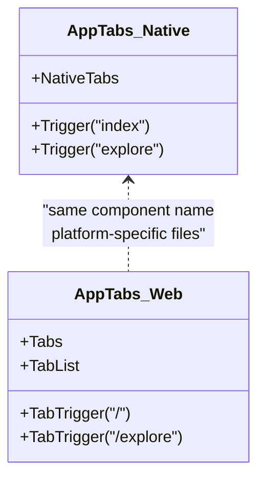
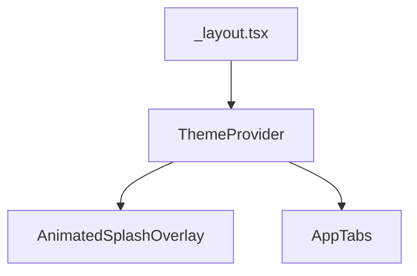
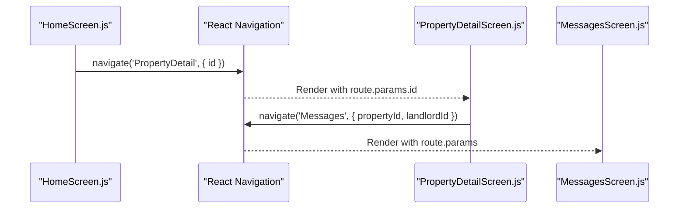
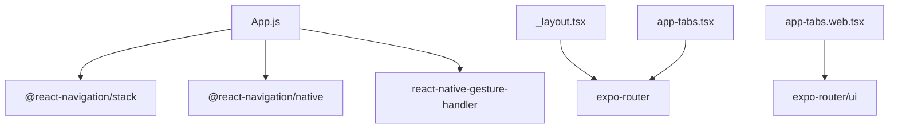

# Navigation System

<cite>
**Referenced Files in This Document**
- [App.js](file://axx-spaces-mobile/App.js)
- [AppNavigator.js](file://axx-spaces-mobile/src/navigation/AppNavigator.js)
- [app-tabs.tsx](file://axx-spaces-mobile/src/components/app-tabs.tsx)
- [app-tabs.web.tsx](file://axx-spaces-mobile/src/components/app-tabs.web.tsx)
- [_layout.tsx](file://axx-spaces-mobile/src/app/_layout.tsx)
- [index.tsx](file://axx-spaces-mobile/src/app/index.tsx)
- [explore.tsx](file://axx-spaces-mobile/src/app/explore.tsx)
- [package.json](file://axx-spaces-mobile/package.json)
- [HomeScreen.js](file://axx-spaces-mobile/src/screens/HomeScreen.js)
- [PropertyDetailScreen.js](file://axx-spaces-mobile/src/screens/PropertyDetailScreen.js)
</cite>

## Table of Contents
1. [Introduction](#introduction)
2. [Project Structure](#project-structure)
3. [Core Components](#core-components)
4. [Architecture Overview](#architecture-overview)
5. [Detailed Component Analysis](#detailed-component-analysis)
6. [Dependency Analysis](#dependency-analysis)
7. [Performance Considerations](#performance-considerations)
8. [Troubleshooting Guide](#troubleshooting-guide)
9. [Conclusion](#conclusion)
10. [Appendices](#appendices)

## Introduction
This document explains the mobile navigation system for the AXX Spaces frontend, focusing on:
- React Navigation setup and stack configuration
- Tab-based navigation using app-tabs components (native vs web)
- Screen routing patterns and parameter passing between screens
- Platform-specific navigation behaviors
- How to add new navigation flows, implement deep linking, and manage navigation state

The codebase uses both Expo Router file-based routing (for the app shell) and a legacy React Navigation stack (for a WebView entry point). Tabs are implemented with platform-specific components that render native tabs on mobile and a custom tab bar on web.

## Project Structure
At a high level:
- App entry wraps the navigation container and error boundary
- The root navigator defines a minimal stack used by the WebView entry
- The app shell uses Expo Router layout and tabs
- Screens under src/screens use React Navigation’s navigation API for programmatic navigation



**Diagram sources**
- [App.js:48-56](file://axx-spaces-mobile/App.js#L48-L56)
- [AppNavigator.js:9-29](file://axx-spaces-mobile/src/navigation/AppNavigator.js#L9-L29)
- [_layout.tsx:10-17](file://axx-spaces-mobile/src/app/_layout.tsx#L10-L17)
- [app-tabs.tsx:6-31](file://axx-spaces-mobile/src/components/app-tabs.tsx#L6-L31)
- [app-tabs.web.tsx:18-34](file://axx-spaces-mobile/src/components/app-tabs.web.tsx#L18-L34)
- [index.tsx:31-61](file://axx-spaces-mobile/src/app/index.tsx#L31-L61)
- [explore.tsx:14-125](file://axx-spaces-mobile/src/app/explore.tsx#L14-L125)

**Section sources**
- [App.js:1-110](file://axx-spaces-mobile/App.js#L1-L110)
- [AppNavigator.js:1-30](file://axx-spaces-mobile/src/navigation/AppNavigator.js#L1-L30)
- [_layout.tsx:1-19](file://axx-spaces-mobile/src/app/_layout.tsx#L1-L19)
- [app-tabs.tsx:1-33](file://axx-spaces-mobile/src/components/app-tabs.tsx#L1-L33)
- [app-tabs.web.tsx:1-116](file://axx-spaces-mobile/src/components/app-tabs.web.tsx#L1-L116)
- [index.tsx:1-99](file://axx-spaces-mobile/src/app/index.tsx#L1-L99)
- [explore.tsx:1-181](file://axx-spaces-mobile/src/app/explore.tsx#L1-L181)

## Core Components
- App entry and error boundary:
  - Wraps the app with GestureHandlerRootView and an ErrorBoundary, then renders the root navigator.
- Root navigator:
  - Uses NavigationContainer and createStackNavigator to host a single screen (WebView entry).
- App tabs:
  - Native implementation uses expo-router’s unstable-native-tabs for bottom tabs.
  - Web implementation uses expo-router/ui Tabs with a custom tab list and styling.
- App shell layout:
  - Provides theme provider and splash overlay, then renders AppTabs.
- File-based routes:
  - index.tsx and explore.tsx define the two tab screens.

Key responsibilities:
- App.js: Application bootstrap and error handling
- AppNavigator.js: Root navigation container and stack definition
- app-tabs.tsx / app-tabs.web.tsx: Platform-specific tab UI and route triggers
- _layout.tsx: Theme and splash integration around tabs
- index.tsx / explore.tsx: Tab content screens

**Section sources**
- [App.js:48-56](file://axx-spaces-mobile/App.js#L48-L56)
- [AppNavigator.js:9-29](file://axx-spaces-mobile/src/navigation/AppNavigator.js#L9-L29)
- [app-tabs.tsx:6-31](file://axx-spaces-mobile/src/components/app-tabs.tsx#L6-L31)
- [app-tabs.web.tsx:18-34](file://axx-spaces-mobile/src/components/app-tabs.web.tsx#L18-L34)
- [_layout.tsx:10-17](file://axx-spaces-mobile/src/app/_layout.tsx#L10-L17)

## Architecture Overview
The application has two coexisting navigation approaches:
- Legacy React Navigation stack for a WebView entry point
- Expo Router file-based routing for the main app shell with tabs



**Diagram sources**
- [App.js:48-56](file://axx-spaces-mobile/App.js#L48-L56)
- [AppNavigator.js:9-29](file://axx-spaces-mobile/src/navigation/AppNavigator.js#L9-L29)
- [_layout.tsx:10-17](file://axx-spaces-mobile/src/app/_layout.tsx#L10-L17)
- [app-tabs.tsx:10-30](file://axx-spaces-mobile/src/components/app-tabs.tsx#L10-L30)
- [app-tabs.web.tsx:20-33](file://axx-spaces-mobile/src/components/app-tabs.web.tsx#L20-L33)
- [index.tsx:31-61](file://axx-spaces-mobile/src/app/index.tsx#L31-L61)
- [explore.tsx:14-125](file://axx-spaces-mobile/src/app/explore.tsx#L14-L125)

## Detailed Component Analysis

### Root Navigator (Legacy Stack)
- Purpose: Hosts a minimal stack used by the WebView entry point.
- Configuration:
  - NavigationContainer wraps the entire navigation tree.
  - createStackNavigator defines a single screen named “WebHome” pointing to WebViewScreen.
  - Global options hide headers and set a dark background.



**Diagram sources**
- [AppNavigator.js:9-29](file://axx-spaces-mobile/src/navigation/AppNavigator.js#L9-L29)

**Section sources**
- [AppNavigator.js:1-30](file://axx-spaces-mobile/src/navigation/AppNavigator.js#L1-L30)

### App Tabs (Platform-Specific)
- Native tabs:
  - Uses expo-router/unstable-native-tabs with a trigger per tab (“index”, “explore”).
  - Applies theme-aware colors and icons.
- Web tabs:
  - Uses expo-router/ui Tabs with a custom tab list and styled buttons.
  - Maps tab names to href paths (“/”, “/explore”).



**Diagram sources**
- [app-tabs.tsx:6-31](file://axx-spaces-mobile/src/components/app-tabs.tsx#L6-L31)
- [app-tabs.web.tsx:18-34](file://axx-spaces-mobile/src/components/app-tabs.web.tsx#L18-L34)

**Section sources**
- [app-tabs.tsx:1-33](file://axx-spaces-mobile/src/components/app-tabs.tsx#L1-L33)
- [app-tabs.web.tsx:1-116](file://axx-spaces-mobile/src/components/app-tabs.web.tsx#L1-L116)

### App Shell Layout
- Provides theme provider based on color scheme.
- Renders animated splash overlay and AppTabs.



**Diagram sources**
- [_layout.tsx:10-17](file://axx-spaces-mobile/src/app/_layout.tsx#L10-L17)

**Section sources**
- [_layout.tsx:1-19](file://axx-spaces-mobile/src/app/_layout.tsx#L1-L19)

### File-Based Routes (Expo Router)
- Two tab screens:
  - Home: src/app/index.tsx
  - Explore: src/app/explore.tsx
- These are automatically routed by Expo Router based on file structure.

```mermaid
graph LR
Index["src/app/index.tsx"] --> |Tab "Home"| ViewIndex["Home Screen"]
Explore["src/app/explore.tsx"] --> |Tab "Explore"| ViewExplore["Explore Screen"]
```

**Diagram sources**
- [index.tsx:31-61](file://axx-spaces-mobile/src/app/index.tsx#L31-L61)
- [explore.tsx:14-125](file://axx-spaces-mobile/src/app/explore.tsx#L14-L125)

**Section sources**
- [index.tsx:1-99](file://axx-spaces-mobile/src/app/index.tsx#L1-L99)
- [explore.tsx:1-181](file://axx-spaces-mobile/src/app/explore.tsx#L1-L181)

### Screen Routing Patterns and Parameter Passing
Screens under src/screens use React Navigation’s imperative API:
- Programmatic navigation via navigation.navigate
- Passing parameters through route.params
- Example flows:
  - List item press navigates to detail with id
  - Detail screen reads params and navigates to messaging with propertyId and landlordId



**Diagram sources**
- [HomeScreen.js:45-73](file://axx-spaces-mobile/src/screens/HomeScreen.js#L45-L73)
- [PropertyDetailScreen.js:17-82](file://axx-spaces-mobile/src/screens/PropertyDetailScreen.js#L17-L82)

**Section sources**
- [HomeScreen.js:45-73](file://axx-spaces-mobile/src/screens/HomeScreen.js#L45-L73)
- [PropertyDetailScreen.js:17-82](file://axx-spaces-mobile/src/screens/PropertyDetailScreen.js#L17-L82)

### Adding New Navigation Flows
- For Expo Router file-based routes:
  - Add a new file under src/app/<route>.tsx
  - Link from existing screens or tabs using href or router.push
- For legacy stack navigation:
  - Register a new Stack.Screen in AppNavigator.js
  - Navigate programmatically from any screen using navigation.navigate

Best practices:
- Keep route names consistent and descriptive
- Validate and sanitize route params before use
- Centralize common navigation actions in hooks or services if reused

[No sources needed since this section provides general guidance]

### Implementing Deep Linking
- Expo Router supports URL-based routing out of the box; ensure your app.json config includes prefixes and linking rules.
- For legacy stacks, configure linking inside NavigationContainer to map URLs to routes and params.

Steps:
- Define prefixes in app.json
- Map URL segments to route names and params
- Test on each platform (iOS, Android, web)

[No sources needed since this section provides general guidance]

### Handling Navigation State Management
- Use React Navigation’s navigation state listeners to sync analytics or persistence when routes change.
- For Expo Router, leverage built-in state persistence and back button behavior.
- Avoid storing large objects in route params; prefer IDs and fetch data on destination screens.

[No sources needed since this section provides general guidance]

## Dependency Analysis
The navigation layer depends on:
- @react-navigation/native and @react-navigation/stack for the legacy stack
- expo-router for file-based routing and tabs
- react-native-gesture-handler for gesture support
- expo-status-bar for status bar styling



**Diagram sources**
- [App.js:1-6](file://axx-spaces-mobile/App.js#L1-L6)
- [AppNavigator.js:1-4](file://axx-spaces-mobile/src/navigation/AppNavigator.js#L1-L4)
- [_layout.tsx:1-6](file://axx-spaces-mobile/src/app/_layout.tsx#L1-L6)
- [app-tabs.tsx:1-4](file://axx-spaces-mobile/src/components/app-tabs.tsx#L1-L4)
- [app-tabs.web.tsx:1-10](file://axx-spaces-mobile/src/components/app-tabs.web.tsx#L1-L10)
- [package.json:14-34](file://axx-spaces-mobile/package.json#L14-L34)

**Section sources**
- [package.json:14-34](file://axx-spaces-mobile/package.json#L14-L34)

## Performance Considerations
- Prefer file-based routing (Expo Router) for better performance and reduced bundle size.
- Avoid heavy computations in route components; defer to lazy loading where possible.
- Minimize prop drilling; use context or hooks for shared navigation state.
- Use image optimization and lazy loading for tab icons and assets.

[No sources needed since this section provides general guidance]

## Troubleshooting Guide
Common issues and resolutions:
- Blank screen after navigation:
  - Ensure NavigationContainer is mounted once at the root.
  - Verify route names match exactly.
- Params not received:
  - Confirm route.params exists and handle undefined cases.
- Tabs not switching on web:
  - Check app-tabs.web.tsx href mappings and ensure routes exist.
- Status bar misalignment:
  - Verify StatusBar configuration and safe area usage.

**Section sources**
- [App.js:8-46](file://axx-spaces-mobile/App.js#L8-L46)
- [AppNavigator.js:9-29](file://axx-spaces-mobile/src/navigation/AppNavigator.js#L9-L29)
- [app-tabs.web.tsx:18-34](file://axx-spaces-mobile/src/components/app-tabs.web.tsx#L18-L34)

## Conclusion
The navigation system combines a legacy React Navigation stack for a WebView entry point with Expo Router’s file-based routing and platform-specific tabs for the main app shell. Screens pass parameters via route.params and navigate imperatively. To extend the system:
- Add file-based routes under src/app for Expo Router
- Register stack screens in AppNavigator.js for legacy flows
- Configure deep linking in app.json and NavigationContainer
- Manage navigation state carefully to avoid unnecessary re-renders

[No sources needed since this section summarizes without analyzing specific files]

## Appendices

### Quick Reference: Key Files and Responsibilities
- App.js: Entry point, error boundary, and root navigator wrapper
- AppNavigator.js: Root stack configuration
- app-tabs.tsx: Native tabs implementation
- app-tabs.web.tsx: Web tabs implementation
- _layout.tsx: Theme provider and splash overlay
- index.tsx: Home tab screen
- explore.tsx: Explore tab screen
- package.json: Navigation dependencies

**Section sources**
- [App.js:48-56](file://axx-spaces-mobile/App.js#L48-L56)
- [AppNavigator.js:9-29](file://axx-spaces-mobile/src/navigation/AppNavigator.js#L9-L29)
- [app-tabs.tsx:6-31](file://axx-spaces-mobile/src/components/app-tabs.tsx#L6-L31)
- [app-tabs.web.tsx:18-34](file://axx-spaces-mobile/src/components/app-tabs.web.tsx#L18-L34)
- [_layout.tsx:10-17](file://axx-spaces-mobile/src/app/_layout.tsx#L10-L17)
- [index.tsx:31-61](file://axx-spaces-mobile/src/app/index.tsx#L31-L61)
- [explore.tsx:14-125](file://axx-spaces-mobile/src/app/explore.tsx#L14-L125)
- [package.json:14-34](file://axx-spaces-mobile/package.json#L14-L34)