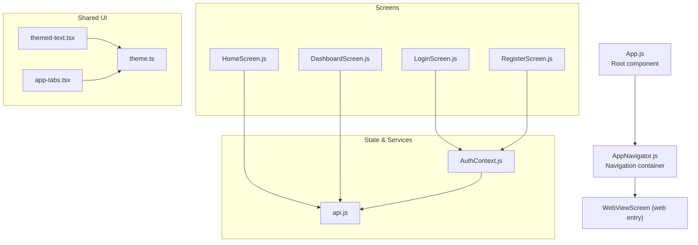
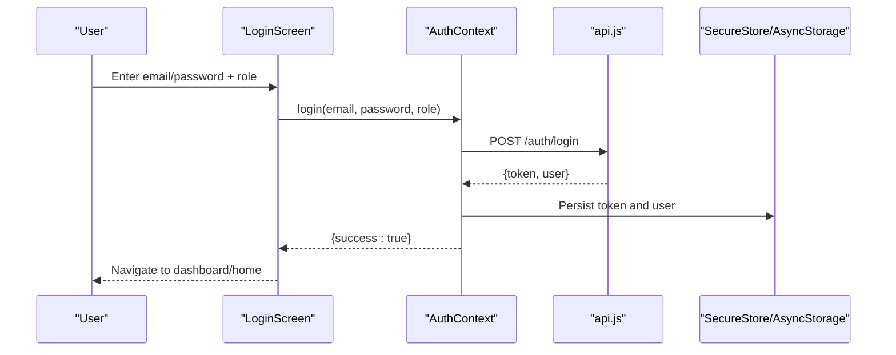
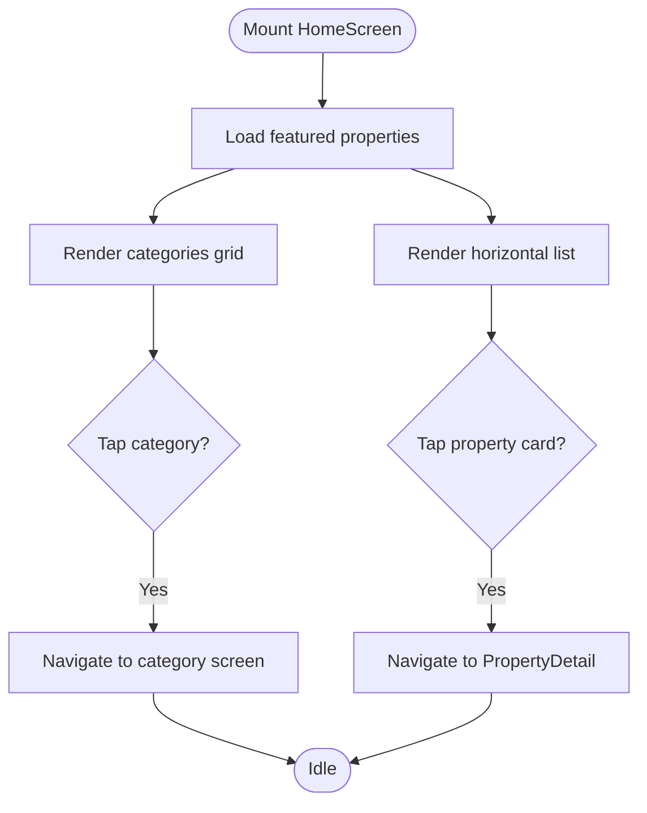
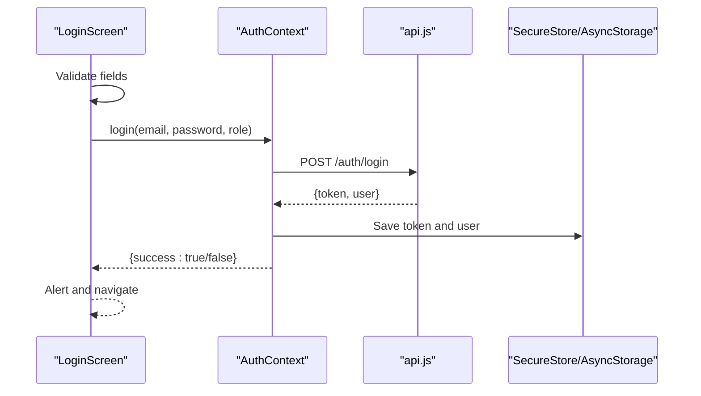
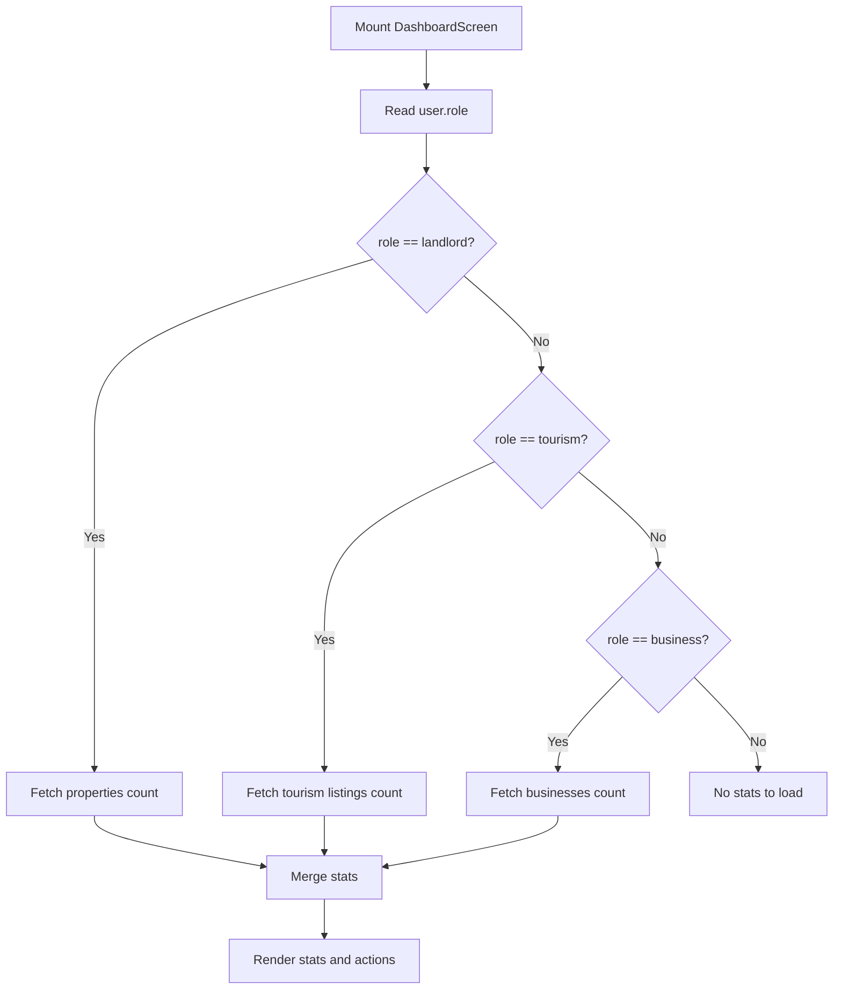
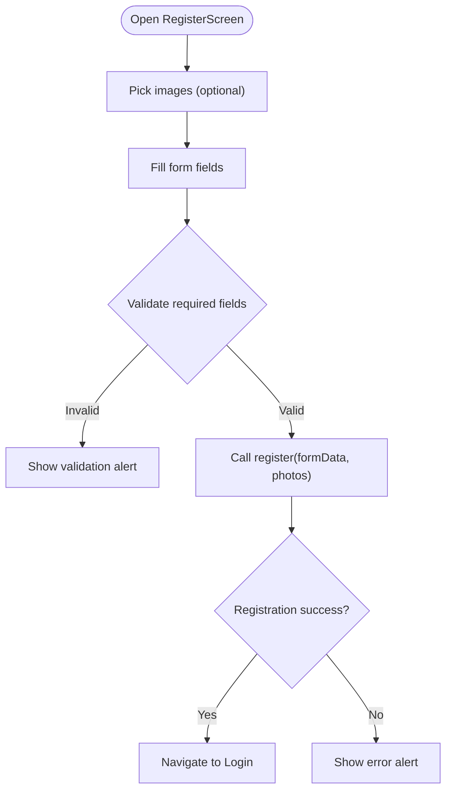
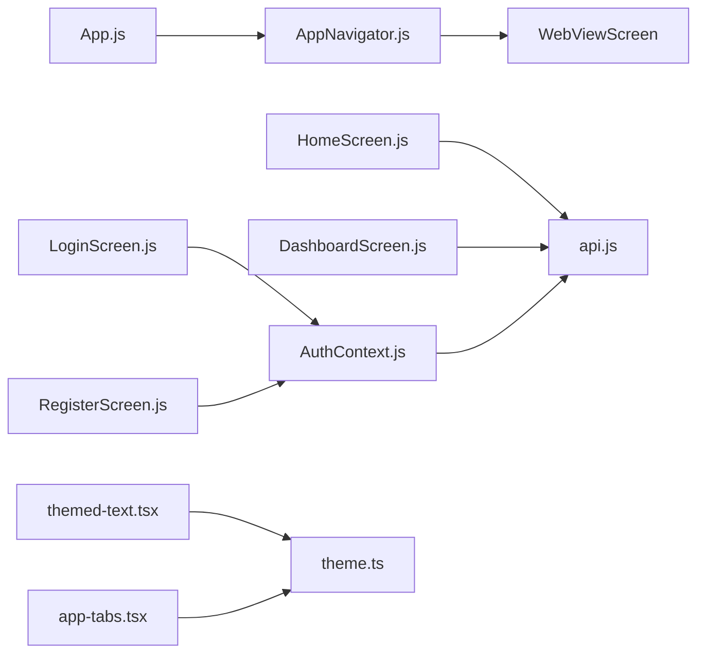

# Screen Implementations

<cite>
**Referenced Files in This Document**
- [App.js](file://axx-spaces-mobile/App.js)
- [AppNavigator.js](file://axx-spaces-mobile/src/navigation/AppNavigator.js)
- [AuthContext.js](file://axx-spaces-mobile/src/context/AuthContext.js)
- [api.js](file://axx-spaces-mobile/src/services/api.js)
- [HomeScreen.js](file://axx-spaces-mobile/src/screens/HomeScreen.js)
- [LoginScreen.js](file://axx-spaces-mobile/src/screens/LoginScreen.js)
- [DashboardScreen.js](file://axx-spaces-mobile/src/screens/DashboardScreen.js)
- [RegisterScreen.js](file://axx-spaces-mobile/src/screens/RegisterScreen.js)
- [themed-text.tsx](file://axx-spaces-mobile/src/components/themed-text.tsx)
- [theme.ts](file://axx-spaces-mobile/src/constants/theme.ts)
- [app-tabs.tsx](file://axx-spaces-mobile/src/components/app-tabs.tsx)
</cite>

## Table of Contents
1. [Introduction](#introduction)
2. [Project Structure](#project-structure)
3. [Core Components](#core-components)
4. [Architecture Overview](#architecture-overview)
5. [Detailed Component Analysis](#detailed-component-analysis)
6. [Dependency Analysis](#dependency-analysis)
7. [Performance Considerations](#performance-considerations)
8. [Troubleshooting Guide](#troubleshooting-guide)
9. [Conclusion](#conclusion)
10. [Appendices](#appendices)

## Introduction
This document explains the mobile screen architecture and UI components for the AXX Spaces frontend, focusing on:
- Screen composition patterns used across HomeScreen, LoginScreen, DashboardScreen, and RegisterScreen
- State management integration via AuthContext
- Navigation setup and how screens interact with shared services
- Practical guidance for creating new screens, implementing responsive layouts, and integrating shared components

The goal is to help developers understand how screens are structured, how authentication state flows through the app, and how to extend the codebase consistently.

## Project Structure
The mobile application uses React Native with Expo. Screens live under src/screens, navigation is configured in src/navigation, authentication context in src/context, and API utilities in src/services. Shared UI primitives and theming are provided under src/components and src/constants.

**Diagram sources**
- [App.js:48-56](file://axx-spaces-mobile/App.js#L48-L56)
- [AppNavigator.js:9-29](file://axx-spaces-mobile/src/navigation/AppNavigator.js#L9-L29)
- [HomeScreen.js:1-13](file://axx-spaces-mobile/src/screens/HomeScreen.js#L1-L13)
- [LoginScreen.js:1-14](file://axx-spaces-mobile/src/screens/LoginScreen.js#L1-L14)
- [DashboardScreen.js:1-11](file://axx-spaces-mobile/src/screens/DashboardScreen.js#L1-L11)
- [RegisterScreen.js:1-16](file://axx-spaces-mobile/src/screens/RegisterScreen.js#L1-L16)
- [AuthContext.js:1-4](file://axx-spaces-mobile/src/context/AuthContext.js#L1-L4)
- [api.js:1-5](file://axx-spaces-mobile/src/services/api.js#L1-L5)
- [themed-text.tsx:1-4](file://axx-spaces-mobile/src/components/themed-text.tsx#L1-L4)
- [theme.ts:1-6](file://axx-spaces-mobile/src/constants/theme.ts#L1-L6)
- [app-tabs.tsx:1-4](file://axx-spaces-mobile/src/components/app-tabs.tsx#L1-L4)

**Section sources**
- [App.js:48-56](file://axx-spaces-mobile/App.js#L48-L56)
- [AppNavigator.js:9-29](file://axx-spaces-mobile/src/navigation/AppNavigator.js#L9-L29)

## Core Components
- Authentication Context (AuthContext): Provides user state, token persistence, login/register/logout actions, and an isAuthenticated flag. It persists credentials using SecureStore and AsyncStorage.
- API Layer (api.js): Centralizes fetch calls, adds Authorization headers when needed, and exposes typed modules for auth, properties, tourism, business, materials, movers, user, notifications, and wallet.
- Theming and UI Primitives: Theme constants define colors, fonts, spacing, and platform-specific values. ThemedText provides consistent typography and theme-aware colors.
- Navigation: Root navigator wraps the app with a stack; currently routes to a web view for the main experience. Tabs are defined but not wired into the current root stack.

Key responsibilities:
- AuthContext manages authentication lifecycle and exposes hooks for screens.
- api.js ensures authenticated requests and standardized error handling.
- ThemedText and theme.ts provide consistent visual design.
- AppNavigator sets up navigation container and global options.

**Section sources**
- [AuthContext.js:8-132](file://axx-spaces-mobile/src/context/AuthContext.js#L8-L132)
- [api.js:6-45](file://axx-spaces-mobile/src/services/api.js#L6-L45)
- [themed-text.tsx:11-30](file://axx-spaces-mobile/src/components/themed-text.tsx#L11-L30)
- [theme.ts:10-25](file://axx-spaces-mobile/src/constants/theme.ts#L10-L25)
- [AppNavigator.js:9-29](file://axx-spaces-mobile/src/navigation/AppNavigator.js#L9-L29)

## Architecture Overview
The app follows a layered approach:
- Presentation layer: Screens compose UI using React Native primitives and shared components.
- State layer: AuthContext holds authentication state and exposes actions.
- Data layer: api.js encapsulates network calls and token injection.
- Navigation layer: AppNavigator configures routing.

**Diagram sources**
- [LoginScreen.js:23-36](file://axx-spaces-mobile/src/screens/LoginScreen.js#L23-L36)
- [AuthContext.js:31-59](file://axx-spaces-mobile/src/context/AuthContext.js#L31-L59)
- [api.js:59-77](file://axx-spaces-mobile/src/services/api.js#L59-L77)

## Detailed Component Analysis

### HomeScreen
Responsibilities:
- Display categories and featured properties
- Load data from propertyAPI
- Navigate to detail and category screens

Patterns:
- Local state for loading and data
- FlatList for horizontal and grid rendering
- Direct navigation via props.navigation

Integration points:
- Uses propertyAPI for data fetching
- Navigates to Properties, Tourism, Materials, Movers, PropertyDetail

Responsive considerations:
- Horizontal scrolling for featured cards
- Grid layout for categories using numColumns

**Diagram sources**
- [HomeScreen.js:18-31](file://axx-spaces-mobile/src/screens/HomeScreen.js#L18-L31)
- [HomeScreen.js:42-78](file://axx-spaces-mobile/src/screens/HomeScreen.js#L42-L78)
- [HomeScreen.js:80-137](file://axx-spaces-mobile/src/screens/HomeScreen.js#L80-L137)

**Section sources**
- [HomeScreen.js:1-261](file://axx-spaces-mobile/src/screens/HomeScreen.js#L1-L261)

### LoginScreen
Responsibilities:
- Collect email, password, and role
- Validate inputs
- Call AuthContext.login and handle success/failure
- Navigate to Register or protected screens

Authentication flow:
- Delegates to AuthContext.login which performs network request and persists tokens
- Displays alerts for validation and errors

**Diagram sources**
- [LoginScreen.js:23-36](file://axx-spaces-mobile/src/screens/LoginScreen.js#L23-L36)
- [AuthContext.js:31-59](file://axx-spaces-mobile/src/context/AuthContext.js#L31-L59)
- [api.js:59-77](file://axx-spaces-mobile/src/services/api.js#L59-L77)

**Section sources**
- [LoginScreen.js:1-209](file://axx-spaces-mobile/src/screens/LoginScreen.js#L1-L209)
- [AuthContext.js:31-59](file://axx-spaces-mobile/src/context/AuthContext.js#L31-L59)

### DashboardScreen
Responsibilities:
- Show role-based stats and quick actions
- Fetch counts from property/tourism/business APIs based on user role
- Provide navigation to feature screens

Role-based logic:
- Filters available actions by user role
- Loads different datasets depending on role

**Diagram sources**
- [DashboardScreen.js:27-46](file://axx-spaces-mobile/src/screens/DashboardScreen.js#L27-L46)
- [DashboardScreen.js:48-59](file://axx-spaces-mobile/src/screens/DashboardScreen.js#L48-L59)

**Section sources**
- [DashboardScreen.js:1-229](file://axx-spaces-mobile/src/screens/DashboardScreen.js#L1-L229)

### RegisterScreen
Responsibilities:
- Collect registration data including optional photos
- Validate required fields and password length
- Submit via AuthContext.register with multipart form data
- Navigate to Login on success

Image handling:
- Uses ImagePicker to select multiple images
- Attaches photos to FormData for upload

**Diagram sources**
- [RegisterScreen.js:33-58](file://axx-spaces-mobile/src/screens/RegisterScreen.js#L33-L58)
- [RegisterScreen.js:60-82](file://axx-spaces-mobile/src/screens/RegisterScreen.js#L60-L82)
- [AuthContext.js:62-103](file://axx-spaces-mobile/src/context/AuthContext.js#L62-L103)

**Section sources**
- [RegisterScreen.js:1-332](file://axx-spaces-mobile/src/screens/RegisterScreen.js#L1-L332)
- [AuthContext.js:62-103](file://axx-spaces-mobile/src/context/AuthContext.js#L62-L103)

### Shared Components and Theming
- ThemedText: Provides type-based styles and theme-aware colors.
- Theme constants: Define light/dark color palettes, fonts, spacing, and platform-specific insets.
- AppTabs: Demonstrates native tab usage with theme colors.

Usage patterns:
- Use ThemedText for consistent typography across screens.
- Reference Colors and Spacing for consistent styling.
- Integrate tabs where appropriate using NativeTabs.

**Section sources**
- [themed-text.tsx:11-30](file://axx-spaces-mobile/src/components/themed-text.tsx#L11-L30)
- [theme.ts:10-25](file://axx-spaces-mobile/src/constants/theme.ts#L10-L25)
- [app-tabs.tsx:6-30](file://axx-spaces-mobile/src/components/app-tabs.tsx#L6-L30)

## Dependency Analysis
High-level dependencies between core files:

**Diagram sources**
- [App.js:48-56](file://axx-spaces-mobile/App.js#L48-L56)
- [AppNavigator.js:9-29](file://axx-spaces-mobile/src/navigation/AppNavigator.js#L9-L29)
- [HomeScreen.js:12-12](file://axx-spaces-mobile/src/screens/HomeScreen.js#L12-L12)
- [DashboardScreen.js:11-11](file://axx-spaces-mobile/src/screens/DashboardScreen.js#L11-L11)
- [LoginScreen.js:14-14](file://axx-spaces-mobile/src/screens/LoginScreen.js#L14-L14)
- [RegisterScreen.js:15-15](file://axx-spaces-mobile/src/screens/RegisterScreen.js#L15-L15)
- [AuthContext.js:1-4](file://axx-spaces-mobile/src/context/AuthContext.js#L1-L4)
- [api.js:1-5](file://axx-spaces-mobile/src/services/api.js#L1-L5)
- [themed-text.tsx:1-4](file://axx-spaces-mobile/src/components/themed-text.tsx#L1-L4)
- [theme.ts:1-6](file://axx-spaces-mobile/src/constants/theme.ts#L1-L6)
- [app-tabs.tsx:1-4](file://axx-spaces-mobile/src/components/app-tabs.tsx#L1-L4)

Coupling and cohesion:
- Screens depend minimally on each other; most interactions go through navigation and shared services.
- AuthContext centralizes authentication logic, reducing duplication across screens.
- api.js abstracts HTTP details, improving cohesion and testability.

Potential circular dependencies:
- None observed among analyzed files.

External integrations:
- expo-secure-store for secure token storage
- @react-native-async-storage/async-storage for user data persistence
- react-navigation for navigation
- expo-image-picker for image selection

**Section sources**
- [App.js:48-56](file://axx-spaces-mobile/App.js#L48-L56)
- [AppNavigator.js:9-29](file://axx-spaces-mobile/src/navigation/AppNavigator.js#L9-L29)
- [AuthContext.js:1-4](file://axx-spaces-mobile/src/context/AuthContext.js#L1-L4)
- [api.js:1-5](file://axx-spaces-mobile/src/services/api.js#L1-L5)

## Performance Considerations
- List performance: Use keyExtractor and avoid unnecessary re-renders in FlatList render functions.
- Image handling: Compress images before upload and limit selection count to reduce memory pressure.
- Network requests: Debounce repeated queries and cache results where appropriate.
- Token retrieval: Cache token access within a session to avoid repeated SecureStore reads.
- Conditional rendering: Keep heavy computations out of render paths; use useMemo/useCallback if needed.

[No sources needed since this section provides general guidance]

## Troubleshooting Guide
Common issues and resolutions:
- Login fails:
  - Verify API_URL configuration and server availability.
  - Ensure SecureStore and AsyncStorage permissions are granted.
  - Check error messages returned by AuthContext.login.
- Registration fails:
  - Confirm all required fields are present and password meets minimum length.
  - Ensure image picker permissions are granted.
  - Validate multipart/form-data handling in AuthContext.register.
- Navigation not working:
  - Confirm route names match those registered in AppNavigator.
  - Ensure navigation prop is passed correctly to screens.
- Styling inconsistencies:
  - Use ThemedText and theme constants for consistent colors and fonts.
  - Check platform-specific styles and insets.

Operational checks:
- Wrap critical sections with ErrorBoundary to catch unhandled exceptions.
- Log API errors centrally in api.js for easier debugging.

**Section sources**
- [App.js:8-46](file://axx-spaces-mobile/App.js#L8-L46)
- [AuthContext.js:31-59](file://axx-spaces-mobile/src/context/AuthContext.js#L31-L59)
- [api.js:32-44](file://axx-spaces-mobile/src/services/api.js#L32-L44)

## Conclusion
The mobile screens follow a clear separation of concerns:
- Screens focus on presentation and user interactions
- AuthContext manages authentication state and persistence
- api.js standardizes network operations and security
- Shared components and theming ensure consistency

By adhering to these patterns, adding new screens becomes straightforward: create a screen file, integrate with AuthContext for authentication, use api.js for data, and navigate via the configured router.

[No sources needed since this section summarizes without analyzing specific files]

## Appendices

### Creating a New Screen
Steps:
1. Create a new file under src/screens with a descriptive name.
2. Import necessary React Native primitives and shared components.
3. If authentication is required, import useAuth from AuthContext.
4. For data fetching, import relevant modules from api.js.
5. Use navigation prop to navigate to other screens.
6. Style using theme constants and shared components where possible.

Example references:
- See LoginScreen for authentication integration.
- See HomeScreen for data fetching and navigation.
- See RegisterScreen for form handling and image uploads.

**Section sources**
- [LoginScreen.js:1-209](file://axx-spaces-mobile/src/screens/LoginScreen.js#L1-L209)
- [HomeScreen.js:1-261](file://axx-spaces-mobile/src/screens/HomeScreen.js#L1-L261)
- [RegisterScreen.js:1-332](file://axx-spaces-mobile/src/screens/RegisterScreen.js#L1-L332)

### Implementing Responsive Layouts
Guidelines:
- Use flexbox and relative units for adaptable layouts.
- Employ SafeAreaView to handle device insets.
- Utilize Spacing constants for consistent padding/margins.
- Test on both iOS and Android due to platform differences.

References:
- SafeAreaView usage in RegisterScreen.
- Spacing constants in theme.ts.

**Section sources**
- [RegisterScreen.js:88-94](file://axx-spaces-mobile/src/screens/RegisterScreen.js#L88-L94)
- [theme.ts:54-66](file://axx-spaces-mobile/src/constants/theme.ts#L54-L66)

### Integrating with Shared Components
Recommendations:
- Use ThemedText for text elements to maintain consistent typography and theme colors.
- Reference Colors and Fonts from theme.ts for palette and font families.
- Reuse common UI patterns like buttons and cards by extracting them into reusable components.

References:
- ThemedText implementation and usage patterns.
- Theme constants structure.

**Section sources**
- [themed-text.tsx:11-30](file://axx-spaces-mobile/src/components/themed-text.tsx#L11-L30)
- [theme.ts:10-25](file://axx-spaces-mobile/src/constants/theme.ts#L10-L25)