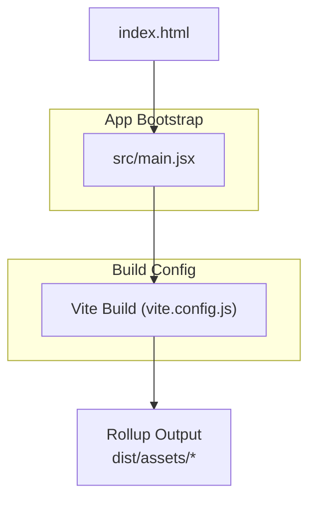
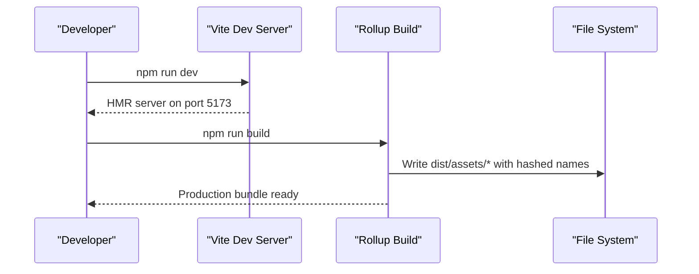
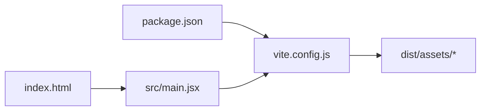

# Bundle Optimization

<cite>
**Referenced Files in This Document**
- [vite.config.js](file://vite.config.js)
- [package.json](file://package.json)
- [index.html](file://index.html)
- [main.jsx](file://src/main.jsx)
</cite>

## Table of Contents
1. [Introduction](#introduction)
2. [Project Structure](#project-structure)
3. [Core Components](#core-components)
4. [Architecture Overview](#architecture-overview)
5. [Detailed Component Analysis](#detailed-component-analysis)
6. [Dependency Analysis](#dependency-analysis)
7. [Performance Considerations](#performance-considerations)
8. [Troubleshooting Guide](#troubleshooting-guide)
9. [Conclusion](#conclusion)

## Introduction
This document explains how to optimize JavaScript and CSS bundles for the AxxSpaces frontend built with Vite. It covers code splitting, tree shaking, bundle analysis, dynamic imports, lazy loading components, CSS extraction, asset optimization, environment-specific optimizations, deployment-time optimizations, and common bundle bloat issues with actionable solutions.

## Project Structure
The frontend is a Vite + React application. The build configuration lives in vite.config.js, scripts are defined in package.json, and the HTML entrypoint is index.html. Application bootstrap is in src/main.jsx.

**Diagram sources**
- [index.html:140-145](file://index.html#L140-L145)
- [main.jsx:1-27](file://src/main.jsx#L1-L27)
- [vite.config.js:1-36](file://vite.config.js#L1-L36)

**Section sources**
- [vite.config.js:1-36](file://vite.config.js#L1-L36)
- [package.json:6-11](file://package.json#L6-L11)
- [index.html:140-145](file://index.html#L140-L145)
- [main.jsx:1-27](file://src/main.jsx#L1-L27)

## Core Components
- Vite configuration: Controls output naming, sourcemaps, and Rollup options for chunking and caching.
- Scripts: Provide dev, build, preview, and lint commands.
- HTML entrypoint: Loads the app module and third-party analytics/identity scripts.
- App bootstrap: Initializes providers, routing, and global styles.

Key responsibilities:
- Code splitting: Enabled by default via Vite/Rollup; custom chunk naming via RollupOptions.
- Tree shaking: Enabled by default in production builds.
- Asset hashing: Deterministic filenames for long-term caching.
- Environment constants: Define global constants at build time.

**Section sources**
- [vite.config.js:19-35](file://vite.config.js#L19-L35)
- [package.json:6-11](file://package.json#L6-L11)
- [index.html:114-139](file://index.html#L114-L139)
- [main.jsx:1-27](file://src/main.jsx#L1-L27)

## Architecture Overview
The build pipeline uses Vite’s development server and Rollup-based production build. The HTML file loads the main module, which bootstraps React, routing, and global providers. Vite config defines output structure and Rollup behavior.

**Diagram sources**
- [package.json:6-11](file://package.json#L6-L11)
- [vite.config.js:7-17](file://vite.config.js#L7-L17)
- [vite.config.js:19-29](file://vite.config.js#L19-L29)

## Detailed Component Analysis

### Vite Configuration and Build Settings
- Plugins: React plugin is enabled.
- Development server: Port 5173, auto-open, security headers.
- Build output:
  - outDir set to dist.
  - Sourcemaps disabled in production.
  - RollupOptions customize entry/chunk/asset filename patterns with hashes for cache busting.
- Global constants: Define import.meta.env.VITE_APP_NAME at build time.

Optimization implications:
- Hashed filenames improve browser caching.
- Disabling sourcemaps reduces production payload size.
- RollupOptions allow fine-grained control over chunk naming and grouping.

Recommendations:
- Add manual chunk splitting for large libraries (e.g., map rendering, QR generation).
- Enable dependency pre-bundling tuning if needed.
- Integrate a bundle analyzer to visualize dependencies.

**Section sources**
- [vite.config.js:1-36](file://vite.config.js#L1-L36)

### Scripts and Toolchain
- Scripts:
  - dev: Starts Vite dev server.
  - build: Runs production build.
  - preview: Serves the production build locally.
  - lint: Runs ESLint.
- Dependencies include React, Leaflet, QRCode, Google Analytics, Speed Insights, and Tailwind/Autoprefixer/PostCSS toolchain.

Optimization implications:
- Use npm run build to generate optimized assets.
- Ensure unused dependencies are removed to reduce bundle size.
- Keep dev-only tools in devDependencies only.

**Section sources**
- [package.json:6-11](file://package.json#L6-L11)
- [package.json:12-48](file://package.json#L12-L48)

### HTML Entrypoint and Third-Party Scripts
- Loads the app module from src/main.jsx.
- Includes third-party scripts for analytics, telemetry, and identity providers.
- Content Security Policy restricts script/style/font/image sources.

Optimization implications:
- External scripts increase initial load; consider deferring or lazy-loading where possible.
- CSP must be aligned with any new external resources.

**Section sources**
- [index.html:140-145](file://index.html#L140-L145)
- [index.html:18-56](file://index.html#L18-L56)
- [index.html:114-139](file://index.html#L114-L139)

### App Bootstrap and Global Imports
- Initializes React Router, AuthProvider, NotificationProvider, ErrorBoundary, and SpeedInsights.
- Imports global CSS and Leaflet CSS.

Optimization implications:
- Global CSS is included at startup; ensure it is necessary and minimal.
- Large UI libraries should be split into feature chunks.

**Section sources**
- [main.jsx:1-27](file://src/main.jsx#L1-L27)

### Code Splitting and Dynamic Imports
- Vite supports dynamic imports out of the box, enabling automatic code splitting.
- Recommended pattern: Lazy-load heavy routes and optional features using dynamic imports.
- Example approach:
  - Wrap route components with a lazy loader that returns a Promise resolving to the component module.
  - Use Suspense to show a fallback while the chunk loads.
- Benefits:
  - Reduces initial bundle size.
  - Improves Time to Interactive by loading only what is needed.

Implementation guidance:
- Identify heavy modules (maps, charts, rich editors, large data tables).
- Replace static imports with dynamic imports for those modules.
- Group related chunks using Rollup manualChunks if needed.

Note: Do not place heavy logic in the root entry to avoid blocking startup.

[No sources needed since this section provides general guidance]

### Tree Shaking
- Vite/Rollup automatically removes unused exports in production builds.
- Best practices:
  - Prefer named imports over default imports when possible.
  - Avoid side-effectful imports unless necessary.
  - Mark packages without side effects in package.json to aid tree shaking.

[No sources needed since this section provides general guidance]

### CSS Extraction and Styles Optimization
- Current setup imports global CSS directly in the app bootstrap.
- For better performance:
  - Extract CSS into separate files during build.
  - Minify CSS and remove unused rules.
  - Use PostCSS/Tailwind purge to eliminate unused styles.
- Recommendations:
  - Configure CSS extraction in Vite plugins.
  - Ensure critical CSS is inlined for above-the-fold content if needed.

[No sources needed since this section provides general guidance]

### Asset Optimization
- Images, fonts, and other static assets benefit from:
  - Compression (e.g., Brotli/Gzip) at the CDN/web server level.
  - Modern formats (WebP/AVIF) served conditionally.
  - Proper caching via hashed filenames (already configured).
- Recommendations:
  - Pre-optimize images before bundling.
  - Use responsive images and sizes attributes.
  - Serve fonts with font-display: swap.

[No sources needed since this section provides general guidance]

### Environment-Specific Optimizations
- Define environment variables for different stages (dev, staging, prod).
- Use Vite’s define to inject build-time constants.
- Gate analytics and telemetry behind environment flags.
- Disable verbose logging and debug features in production.

Current usage:
- A global constant is defined for the app name.

Recommendations:
- Add flags like ENABLE_ANALYTICS, ENABLE_DEBUG_LOGS.
- Conditionally initialize third-party SDKs based on environment.

**Section sources**
- [vite.config.js:32-35](file://vite.config.js#L32-L35)

### Deployment-Time Optimizations
- Serve the dist folder through a CDN with:
  - Long-term caching for hashed assets.
  - Gzip/Brotli compression.
  - HTTP/2 or HTTP/3.
- Align CSP with deployed domains and third-party services.
- Validate that all external scripts and styles are allowed by CSP.

**Section sources**
- [index.html:18-56](file://index.html#L18-L56)
- [index.html:114-139](file://index.html#L114-L139)

### Common Bundle Bloat Issues and Solutions
- Large third-party libraries:
  - Issue: Heavy libraries loaded upfront.
  - Solution: Lazy-load via dynamic imports; extract into vendor chunks.
- Unused dependencies:
  - Issue: Dead code increases bundle size.
  - Solution: Audit dependencies; remove unused packages; rely on tree shaking.
- Inefficient CSS:
  - Issue: Global styles bloating initial payload.
  - Solution: Extract CSS, purge unused rules, minify.
- Missing compression:
  - Issue: Large payloads over network.
  - Solution: Enable Brotli/Gzip at CDN/web server.
- Poor caching:
  - Issue: Frequent re-downloads.
  - Solution: Use hashed filenames (already configured) and proper Cache-Control headers.

[No sources needed since this section provides general guidance]

## Dependency Analysis
High-level relationships between key files:

**Diagram sources**
- [package.json:6-11](file://package.json#L6-L11)
- [vite.config.js:1-36](file://vite.config.js#L1-L36)
- [index.html:140-145](file://index.html#L140-L145)
- [main.jsx:1-27](file://src/main.jsx#L1-L27)

**Section sources**
- [package.json:6-11](file://package.json#L6-L11)
- [vite.config.js:1-36](file://vite.config.js#L1-L36)
- [index.html:140-145](file://index.html#L140-L145)
- [main.jsx:1-27](file://src/main.jsx#L1-L27)

## Performance Considerations
- Initial Load:
  - Reduce first paint payload by lazy-loading non-critical routes and features.
  - Inline critical CSS if necessary; defer non-critical styles.
- Runtime Performance:
  - Avoid heavy computations on the main thread; use Web Workers for CPU-intensive tasks.
  - Debounce/throttle user interactions and API calls.
- Caching Strategy:
  - Leverage hashed filenames for immutable assets.
  - Set appropriate Cache-Control and ETag headers.
- Network Efficiency:
  - Compress responses (Brotli preferred).
  - Use CDN and edge caching.
- Monitoring:
  - Integrate performance monitoring (e.g., Speed Insights already present).
  - Track Core Web Vitals and set budgets.

[No sources needed since this section provides general guidance]

## Troubleshooting Guide
- Build fails due to missing environment variables:
  - Ensure required env vars are defined in your environment or .env files.
- Unexpected large bundles:
  - Run a bundle analyzer to identify heavy dependencies.
  - Check for accidental full-library imports instead of specific modules.
- CSS not extracted:
  - Verify CSS extraction plugin configuration.
  - Confirm Purge/Tailwind settings target correct source paths.
- CSP blocking resources:
  - Update CSP in index.html to allow new domains/scripts/styles.
- Sourcemaps in production:
  - Ensure sourcemap is disabled in production builds to avoid exposing source.

**Section sources**
- [vite.config.js:21-21](file://vite.config.js#L21-L21)
- [index.html:18-56](file://index.html#L18-L56)

## Conclusion
AxxSpaces’ frontend leverages Vite for fast development and efficient production builds. With hashed output, disabled production sourcemaps, and RollupOptions for chunk naming, the baseline is solid. To further optimize:
- Implement dynamic imports and lazy loading for heavy features.
- Extract and minify CSS, and purge unused styles.
- Analyze and trim dependencies.
- Optimize assets and enable compression at the CDN.
- Gate analytics and debug features behind environment flags.
These steps will significantly reduce bundle size, improve load times, and enhance overall user experience.