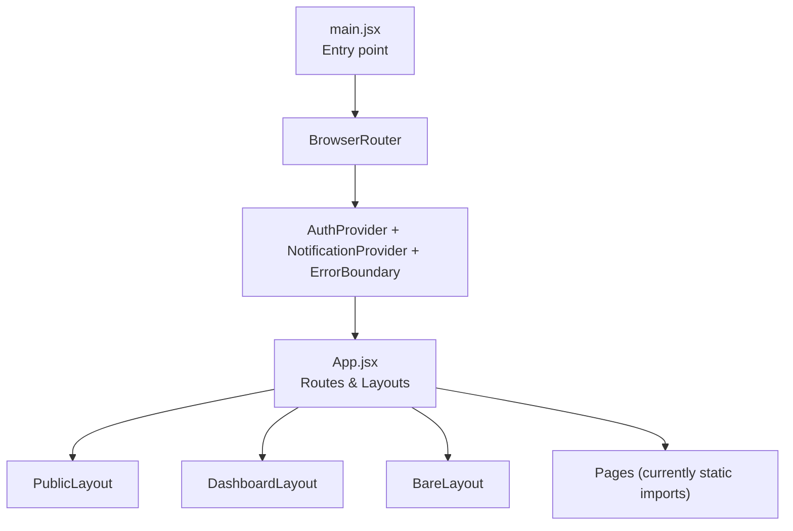
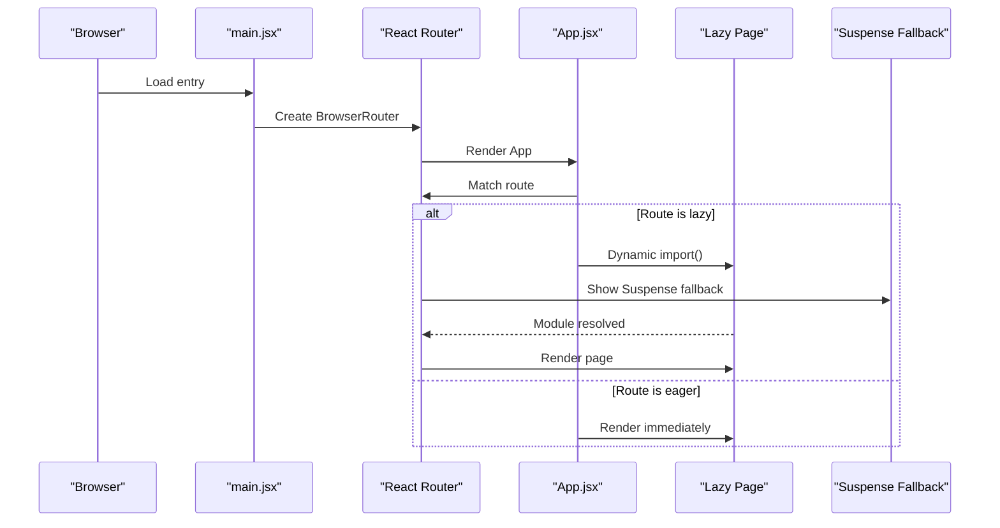
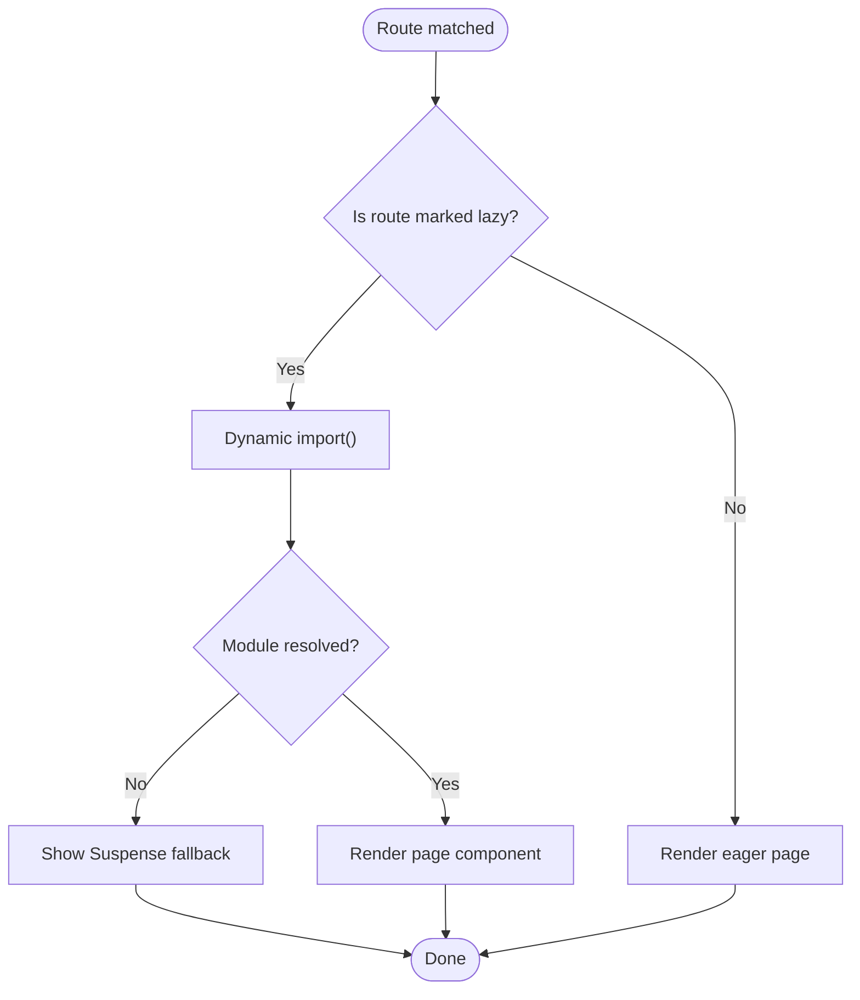

# Lazy Loading Strategies

<cite>
**Referenced Files in This Document**
- [main.jsx](file://src/main.jsx)
- [App.jsx](file://src/App.jsx)
- [SplashScreen.jsx](file://src/components/SplashScreen.jsx)
- [LoadingBlock.jsx](file://src/features/accommodation/components/LoadingBlock.jsx)
- [Home.jsx](file://src/pages/Home.jsx)
- [package.json](file://package.json)
</cite>

## Table of Contents
1. [Introduction](#introduction)
2. [Project Structure](#project-structure)
3. [Core Components](#core-components)
4. [Architecture Overview](#architecture-overview)
5. [Detailed Component Analysis](#detailed-component-analysis)
6. [Dependency Analysis](#dependency-analysis)
7. [Performance Considerations](#performance-considerations)
8. [Troubleshooting Guide](#troubleshooting-guide)
9. [Conclusion](#conclusion)
10. [Appendices](#appendices)

## Introduction
This document explains lazy loading strategies for the AxxSpaces platform, focusing on:
- Component-level lazy loading with React.lazy and Suspense
- Route-based code splitting using React Router
- Image lazy loading patterns and performance benefits
- Splash screens, progressive loading, and skeleton loaders
- Mobile-specific considerations and memory management
- Guidelines to identify loadable components and optimize initial page load times

The current codebase uses React Router v7 with Vite as the build tool. The app currently imports pages statically at the top of App.jsx, which means all routes are bundled together by default. We will outline how to evolve this into a fully lazy-loaded architecture while preserving existing splash screen and loading behaviors.

## Project Structure
At runtime, the application bootstraps via main.jsx, wraps the app with BrowserRouter, AuthProvider, NotificationProvider, and ErrorBoundary, then renders App.jsx. App.jsx defines all routes and layouts (PublicLayout, DashboardLayout, BareLayout). The splash screen is implemented as a dedicated component.

**Diagram sources**
- [main.jsx:16-26](file://src/main.jsx#L16-L26)
- [App.jsx:89-114](file://src/App.jsx#L89-L114)
- [App.jsx:140-491](file://src/App.jsx#L140-L491)

**Section sources**
- [main.jsx:1-27](file://src/main.jsx#L1-L27)
- [App.jsx:1-114](file://src/App.jsx#L1-L114)

## Core Components
- SplashScreen: Provides an animated brand intro with a progress bar and controlled exit animation. It can be used during initial app bootstrap or route transitions.
- LoadingBlock: A simple placeholder UI for data-loading states within feature sections.
- Home: Contains extensive styles and content; includes CSS-only skeleton animations for list cards.

These components demonstrate presentational loading patterns that complement code-splitting strategies.

**Section sources**
- [SplashScreen.jsx:1-277](file://src/components/SplashScreen.jsx#L1-L277)
- [LoadingBlock.jsx:1-9](file://src/features/accommodation/components/LoadingBlock.jsx#L1-L9)
- [Home.jsx:174-195](file://src/pages/Home.jsx#L174-L195)

## Architecture Overview
Current state:
- All pages are statically imported in App.jsx, causing them to be included in the initial bundle.
- Routes are defined declaratively with React Router v7.
- No use of React.lazy or Suspense yet.

Recommended evolution:
- Convert heavy or infrequently visited routes to dynamic imports via React.lazy.
- Wrap each lazy route with Suspense and a fallback (e.g., a minimal skeleton or spinner).
- Keep critical first-screen routes (e.g., Home) eagerly loaded to improve perceived performance.
- Use image lazy loading where appropriate to defer offscreen images.

[No diagram sources needed since this diagram shows conceptual workflow, not actual code structure]

## Detailed Component Analysis

### Route-Based Code Splitting with React Router
Goal: Reduce initial bundle size by deferring non-critical routes.

Implementation approach:
- Replace static imports in App.jsx with React.lazy for selected routes.
- Wrap each lazy route with Suspense and a lightweight fallback.
- Preserve layout wrappers (PublicLayout, DashboardLayout, BareLayout) around lazy routes.

Example transformation pattern:
- Before: Static import of a page and direct usage in a Route element.
- After: React.lazy(() => import("./pages/PageName")) inside the Route element, wrapped with Suspense.

Key considerations:
- Keep essential routes (e.g., Home) eager to avoid extra round-trips on first paint.
- Group related routes under shared layouts to minimize repeated wrapper overhead.
- Ensure error boundaries are in place to catch module loading failures.

[No diagram sources needed since this diagram shows conceptual workflow, not actual code structure]

Guidelines:
- Identify heavy pages (dashboards, media-rich listings, third-party integrations) as candidates for lazy loading.
- Use Suspense boundaries per route group to provide contextual fallbacks.
- Avoid over-lazy-loading small components; prefer route-level splitting for significant impact.

**Section sources**
- [App.jsx:11-80](file://src/App.jsx#L11-L80)
- [App.jsx:140-491](file://src/App.jsx#L140-L491)

### Component-Level Lazy Loading with React.lazy and Suspense
Use cases:
- Heavy modals, charts, maps, or third-party widgets that are not required on initial render.
- Optional features toggled by user actions.

Approach:
- Wrap the component with React.lazy and render it conditionally.
- Provide a Suspense boundary with a minimal fallback near the component tree.

Benefits:
- Reduces peak memory usage and CPU time during startup.
- Improves Time to Interactive by deferring non-critical work.

Best practices:
- Keep fallbacks minimal and fast to render.
- Preload critical resources only when necessary.
- Combine with IntersectionObserver for truly on-demand loading of large components.

[No section sources needed since this section provides general guidance]

### Image Lazy Loading Implementations and Performance Benefits
Patterns:
- Native lazy loading: Use loading="lazy" on  elements to defer offscreen images.
- IntersectionObserver: Dynamically set src or srcset when images enter the viewport.
- Placeholder strategy: Show low-quality placeholders or skeletons until high-res images load.

Performance benefits:
- Reduced bandwidth and faster initial paint.
- Lower memory pressure on mobile devices.
- Improved scroll responsiveness.

Recommendations:
- Prefer native lazy loading for simple cases.
- For galleries or long lists, implement IntersectionObserver with a queue to avoid overwhelming the network.
- Use responsive images (srcset/sizes) to serve appropriately sized assets.

[No section sources needed since this section provides general guidance]

### Splash Screens, Progressive Loading, and Skeleton Loaders
Splash Screen:
- The SplashScreen component provides a branded intro with animations and a progress bar.
- It supports a minimum display duration and a smooth exit transition.

Progressive Loading:
- Show a minimal shell (header, nav) immediately, then progressively reveal sections.
- Use Suspense fallbacks to indicate loading states for deferred modules.

Skeleton Loaders:
- Use CSS-only skeletons (as seen in Home.jsx) to simulate content shape while data loads.
- Keep skeletons lightweight and visually consistent with final content.

Integration tips:
- Display SplashScreen during initial bootstrap, then hide it once critical routes and data are ready.
- Use Suspense fallbacks for route-level loading and skeleton loaders for data-bound sections.

**Section sources**
- [SplashScreen.jsx:1-277](file://src/components/SplashScreen.jsx#L1-L277)
- [Home.jsx:193-195](file://src/pages/Home.jsx#L193-L195)

### Mobile-Specific Lazy Loading Considerations and Memory Management
Considerations:
- Network variability: Defer non-critical assets aggressively on slow networks.
- Memory constraints: Avoid keeping large images or heavy components in memory longer than necessary.
- Battery life: Minimize unnecessary re-renders and expensive computations during idle periods.

Strategies:
- Use IntersectionObserver to load images and heavy components only when visible.
- Debounce or throttle expensive operations triggered by scroll or resize events.
- Unmount or memoize components that are no longer needed to free memory.
- Prefer smaller image formats and sizes for mobile breakpoints.

[No section sources needed since this section provides general guidance]

### Identifying Loadable Components and Optimizing Initial Page Load Times
How to identify candidates:
- Large vendor libraries (maps, charts, rich editors).
- Feature-heavy dashboards and admin panels.
- Media-rich pages (galleries, video players).
- Low-frequency routes (settings, help, legal).

Optimization checklist:
- Keep first-screen routes and critical UI eager.
- Apply route-level code splitting for heavy pages.
- Use Suspense fallbacks to maintain perceived responsiveness.
- Implement image lazy loading and responsive images.
- Monitor bundle size and performance metrics continuously.

[No section sources needed since this section provides general guidance]

## Dependency Analysis
The frontend relies on:
- react-router-dom for routing
- vite for bundling and development server
- react and react-dom for UI rendering

**Diagram sources**
- [package.json:12-32](file://package.json#L12-L32)
- [package.json:34-48](file://package.json#L34-L48)

**Section sources**
- [package.json:1-50](file://package.json#L1-L50)

## Performance Considerations
- Bundle size: Prioritize route-level code splitting to reduce initial payload.
- Critical rendering path: Keep essential UI and data for the first screen eager.
- Resource loading: Defer images and heavy assets; use placeholders and skeletons.
- Runtime performance: Avoid blocking the main thread; split work across microtasks and requestIdleCallback where appropriate.
- Monitoring: Use speed insights tools and analytics to track performance improvements.

[No section sources needed since this section provides general guidance]

## Troubleshooting Guide
Common issues and resolutions:
- Blank screen after navigation:
  - Ensure Suspense fallbacks are provided for lazy routes.
  - Verify error boundaries wrap lazy components to catch module loading errors.
- Slow initial load:
  - Review which routes are still statically imported.
  - Move heavy dependencies to lazy imports or conditional initialization.
- Images not loading:
  - Confirm lazy loading attributes or IntersectionObserver logic is correct.
  - Check network conditions and caching headers.
- High memory usage on mobile:
  - Unmount unused components and avoid retaining large objects.
  - Limit concurrent image requests and use proper sizing.

**Section sources**
- [SplashScreen.jsx:1-277](file://src/components/SplashScreen.jsx#L1-L277)
- [LoadingBlock.jsx:1-9](file://src/features/accommodation/components/LoadingBlock.jsx#L1-L9)

## Conclusion
By adopting route-based code splitting with React.lazy and Suspense, implementing image lazy loading, and leveraging splash screens and skeleton loaders, AxxSpaces can significantly improve initial load performance and perceived responsiveness. Focus on lazy-loading heavy, low-frequency routes while keeping critical paths eager. Continuously monitor bundle size and runtime performance to ensure sustained optimization across web and mobile platforms.

[No section sources needed since this section summarizes without analyzing specific files]

## Appendices

### Migration Checklist
- Convert heavy route imports in App.jsx to React.lazy.
- Wrap lazy routes with Suspense and provide minimal fallbacks.
- Add image lazy loading for offscreen images.
- Integrate skeleton loaders for data-bound sections.
- Test on mobile devices for memory and battery impact.
- Measure and validate improvements with performance tools.

[No section sources needed since this section provides general guidance]