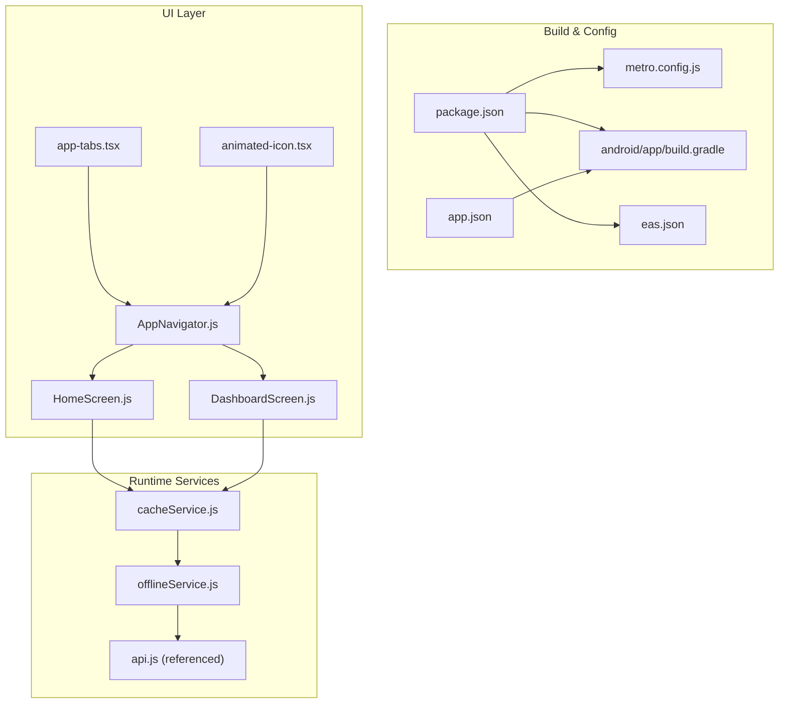
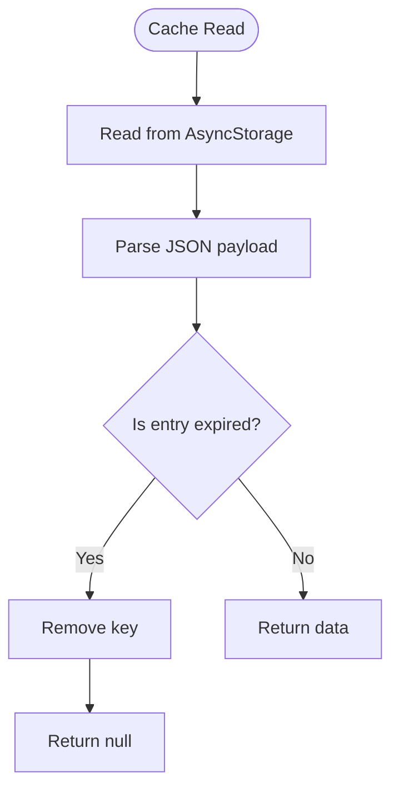
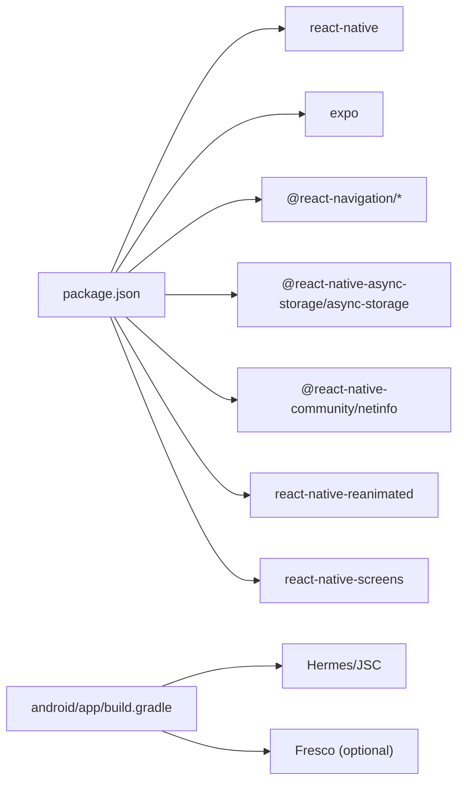

# Mobile Performance

<cite>
**Referenced Files in This Document**
- [package.json](file://axx-spaces-mobile/package.json)
- [metro.config.js](file://axx-spaces-mobile/metro.config.js)
- [app.json](file://axx-spaces-mobile/app.json)
- [eas.json](file://axx-spaces-mobile/eas.json)
- [android/app/build.gradle](file://axx-spaces-mobile/android/app/build.gradle)
- [src/services/cacheService.js](file://axx-spaces-mobile/src/services/cacheService.js)
- [src/services/offlineService.js](file://axx-spaces-mobile/src/services/offlineService.js)
- [src/navigation/AppNavigator.js](file://axx-spaces-mobile/src/navigation/AppNavigator.js)
- [src/components/app-tabs.tsx](file://axx-spaces-mobile/src/components/app-tabs.tsx)
- [src/components/animated-icon.tsx](file://axx-spaces-mobile/src/components/animated-icon.tsx)
- [src/screens/HomeScreen.js](file://axx-spaces-mobile/src/screens/HomeScreen.js)
- [src/screens/DashboardScreen.js](file://axx-spaces-mobile/src/screens/DashboardScreen.js)
</cite>

## Table of Contents
1. [Introduction](#introduction)
2. [Project Structure](#project-structure)
3. [Core Components](#core-components)
4. [Architecture Overview](#architecture-overview)
5. [Detailed Component Analysis](#detailed-component-analysis)
6. [Dependency Analysis](#dependency-analysis)
7. [Performance Considerations](#performance-considerations)
8. [Troubleshooting Guide](#troubleshooting-guide)
9. [Conclusion](#conclusion)

## Introduction
This document provides mobile performance optimization guidance for the React Native application, focusing on bundle size reduction, memory management, battery efficiency, image optimization, caching, offline behavior, navigation/list rendering/animation performance, and platform-specific considerations for iOS and Android. It references concrete files in the codebase to ground recommendations in actual implementation.

## Project Structure
The mobile app is an Expo-based React Native project with:
- Metro bundler configuration
- EAS build profiles
- Android Gradle configuration with Hermes and optional ProGuard/minification
- Navigation using React Navigation
- Caching and offline support via AsyncStorage and NetInfo
- Screens and components that render lists and images



**Diagram sources**
- [package.json:1-41](file://axx-spaces-mobile/package.json#L1-L41)
- [metro.config.js:1-6](file://axx-spaces-mobile/metro.config.js#L1-L6)
- [app.json:1-49](file://axx-spaces-mobile/app.json#L1-L49)
- [eas.json:1-28](file://axx-spaces-mobile/eas.json#L1-L28)
- [android/app/build.gradle:1-211](file://axx-spaces-mobile/android/app/build.gradle#L1-L211)
- [src/services/cacheService.js:1-198](file://axx-spaces-mobile/src/services/cacheService.js#L1-L198)
- [src/services/offlineService.js:1-211](file://axx-spaces-mobile/src/services/offlineService.js#L1-L211)
- [src/navigation/AppNavigator.js:1-30](file://axx-spaces-mobile/src/navigation/AppNavigator.js#L1-L30)
- [src/components/app-tabs.tsx:1-33](file://axx-spaces-mobile/src/components/app-tabs.tsx#L1-L33)
- [src/screens/HomeScreen.js:1-261](file://axx-spaces-mobile/src/screens/HomeScreen.js#L1-L261)
- [src/screens/DashboardScreen.js:1-229](file://axx-spaces-mobile/src/screens/DashboardScreen.js#L1-L229)
- [src/components/animated-icon.tsx:1-149](file://axx-spaces-mobile/src/components/animated-icon.tsx#L1-L149)

**Section sources**
- [package.json:1-41](file://axx-spaces-mobile/package.json#L1-L41)
- [metro.config.js:1-6](file://axx-spaces-mobile/metro.config.js#L1-L6)
- [app.json:1-49](file://axx-spaces-mobile/app.json#L1-L49)
- [eas.json:1-28](file://axx-spaces-mobile/eas.json#L1-L28)
- [android/app/build.gradle:1-211](file://axx-spaces-mobile/android/app/build.gradle#L1-L211)

## Core Components
- Bundle and build pipeline:
  - Metro bundler defaults via Expo
  - EAS build profiles for preview and production
  - Android Gradle settings for Hermes, resource shrinking, PNG crunching, ABI splits, and optional ProGuard
- Runtime services:
  - Cache service with TTL-based expiration and statistics
  - Offline service with network detection, fallbacks, action queue, and auto-sync
- UI layer:
  - Navigation container and stack navigator
  - Tabs component using native tabs
  - Animated splash and icon using Reanimated
  - List-heavy screens (Home, Dashboard)

Key observations:
- The Android build enables resource shrinking and PNG crunching in release builds and supports ABI splits for smaller APKs.
- Hermes is used when enabled; otherwise JSC is selected.
- The app uses AsyncStorage-backed caching and NetInfo for connectivity checks.
- Navigation currently wraps a WebView screen in a stack navigator; tabs are defined separately.

**Section sources**
- [android/app/build.gradle:75-86](file://axx-spaces-mobile/android/app/build.gradle#L75-L86)
- [android/app/build.gradle:121-128](file://axx-spaces-mobile/android/app/build.gradle#L121-L128)
- [android/app/build.gradle:137-150](file://axx-spaces-mobile/android/app/build.gradle#L137-L150)
- [android/app/build.gradle:178-204](file://axx-spaces-mobile/android/app/build.gradle#L178-L204)
- [src/services/cacheService.js:1-198](file://axx-spaces-mobile/src/services/cacheService.js#L1-L198)
- [src/services/offlineService.js:1-211](file://axx-spaces-mobile/src/services/offlineService.js#L1-L211)
- [src/navigation/AppNavigator.js:1-30](file://axx-spaces-mobile/src/navigation/AppNavigator.js#L1-L30)
- [src/components/app-tabs.tsx:1-33](file://axx-spaces-mobile/src/components/app-tabs.tsx#L1-L33)
- [src/components/animated-icon.tsx:1-149](file://axx-spaces-mobile/src/components/animated-icon.tsx#L1-L149)

## Architecture Overview
The runtime architecture centers around a small set of services that manage data persistence and offline behavior, while UI screens consume these services and navigate between views.

```mermaid
sequenceDiagram
participant Screen as "HomeScreen / DashboardScreen"
participant Nav as "AppNavigator"
participant Off as "offlineService"
participant Cache as "cacheService"
participant API as "api.js"
participant Storage as "AsyncStorage"
Screen->>Off : fetchWithOfflineFallback(endpoint)
Off->>Off : isOnline()
alt Online
Off->>API : apiCall(endpoint)
API-->>Off : response
Off->>Cache : cacheApiResponse(endpoint, data)
Cache->>Storage : set(key, {data, timestamp})
Off-->>Screen : {data, source : 'network'}
else Offline or Network Error
Off->>Cache : getCachedApiResponse(endpoint)
Cache->>Storage : get(key)
Storage-->>Cache : cachedData or null
Cache-->>Off : cachedData or null
Off-->>Screen : {data, source : 'cache'} or throw error
end
```

**Diagram sources**
- [src/services/offlineService.js:18-45](file://axx-spaces-mobile/src/services/offlineService.js#L18-L45)
- [src/services/cacheService.js:112-122](file://axx-spaces-mobile/src/services/cacheService.js#L112-L122)
- [src/services/cacheService.js:6-24](file://axx-spaces-mobile/src/services/cacheService.js#L6-L24)

## Detailed Component Analysis

### Bundle Size Optimization
- Use Hermes for faster startup and smaller bundles on Android.
- Enable ProGuard/R8 minification and resource shrinking in release builds.
- Configure PNG crunching to reduce asset sizes.
- Split APKs by ABI to avoid shipping unused native libraries.
- Keep Metro configuration minimal and rely on Expo defaults unless specific optimizations are needed.

Recommendations:
- Ensure `hermesEnabled` is true in production builds.
- Enable `minifyEnabled` and `shrinkResources` in release builds.
- Keep `crunchPngs` enabled for PNG assets.
- Maintain ABI splits for arm64-v8a and armeabi-v7a.
- Audit dependencies and remove unused ones from package.json.

**Section sources**
- [android/app/build.gradle:75-86](file://axx-spaces-mobile/android/app/build.gradle#L75-L86)
- [android/app/build.gradle:137-150](file://axx-spaces-mobile/android/app/build.gradle#L137-L150)
- [android/app/build.gradle:121-128](file://axx-spaces-mobile/android/app/build.gradle#L121-L128)
- [metro.config.js:1-6](file://axx-spaces-mobile/metro.config.js#L1-L6)
- [package.json:14-35](file://axx-spaces-mobile/package.json#L14-L35)

### Memory Management Best Practices
- Avoid heavy synchronous operations on the main thread; offload work where possible.
- Prefer lazy loading of images and components.
- Use memoization and stable references to prevent unnecessary re-renders.
- Limit the number of concurrent network requests and batch updates.
- Clear caches and queues when not needed to free storage-backed memory.

Implementation notes:
- The cache service stores JSON strings in AsyncStorage; large payloads can increase memory pressure during parse/unparse cycles.
- The offline service maintains a queued actions array in AsyncStorage; ensure periodic cleanup after successful sync.

**Section sources**
- [src/services/cacheService.js:6-24](file://axx-spaces-mobile/src/services/cacheService.js#L6-L24)
- [src/services/cacheService.js:66-85](file://axx-spaces-mobile/src/services/cacheService.js#L66-L85)
- [src/services/offlineService.js:47-85](file://axx-spaces-mobile/src/services/offlineService.js#L47-L85)

### Battery Optimization Techniques
- Reduce background network activity; batch requests and use efficient polling intervals.
- Leverage NetInfo listeners to trigger sync only when connectivity improves.
- Avoid continuous animations or timers when screens are not visible.
- Minimize GPS usage frequency and scope; use coarse location when precise location is not required.

Current usage:
- The offline service sets up a NetInfo listener to auto-sync when online.
- Location permissions are declared in app.json; ensure they are requested only when necessary.

**Section sources**
- [src/services/offlineService.js:197-207](file://axx-spaces-mobile/src/services/offlineService.js#L197-L207)
- [app.json:27-36](file://axx-spaces-mobile/app.json#L27-L36)

### Image Optimization Strategies
- Prefer WebP or optimized PNGs; enable PNG crunching in release builds.
- Use appropriate image sizes per device density; avoid oversized images.
- Lazy-load images and consider thumbnails for list items.
- For animated content, prefer lightweight formats or short loops.

Relevant configurations:
- PNG crunching is enabled in release builds.
- Fresco WebP/GIF support is conditionally included based on properties.

**Section sources**
- [android/app/build.gradle:137-150](file://axx-spaces-mobile/android/app/build.gradle#L137-L150)
- [android/app/build.gradle:182-198](file://axx-spaces-mobile/android/app/build.gradle#L182-L198)

### Caching Mechanisms
- TTL-based caching with configurable default TTL.
- Pattern-based invalidation and bulk clear utilities.
- Prefetch endpoints for essential data to improve offline UX.
- Statistics and size tracking to monitor cache growth.

Operational flow:
- Cache reads check timestamps against TTL and evict expired entries.
- API responses are stored under predictable keys for easy invalidation.



**Diagram sources**
- [src/services/cacheService.js:6-24](file://axx-spaces-mobile/src/services/cacheService.js#L6-L24)

**Section sources**
- [src/services/cacheService.js:1-198](file://axx-spaces-mobile/src/services/cacheService.js#L1-L198)

### Offline Performance Considerations
- Network-aware fetching with automatic fallback to cache.
- Action queue persisted in AsyncStorage for later synchronization.
- Auto-sync triggered upon connectivity restoration.
- Prefetch essential endpoints to improve first-screen performance offline.

```mermaid
sequenceDiagram
participant App as "App"
participant Net as "NetInfo"
participant Off as "offlineService"
participant Q as "Queue (AsyncStorage)"
participant API as "api.js"
App->>Off : setupNetworkListener(callback)
Net-->>Off : state change (connected)
Off->>Off : syncQueuedActions()
Off->>Q : getQueuedActions()
loop For each action
Off->>API : executeAction(action)
API-->>Off : result
Off->>Q : save remaining actions
end
Off-->>App : callback({synced, failed})
```

**Diagram sources**
- [src/services/offlineService.js:87-121](file://axx-spaces-mobile/src/services/offlineService.js#L87-L121)
- [src/services/offlineService.js:197-207](file://axx-spaces-mobile/src/services/offlineService.js#L197-L207)

**Section sources**
- [src/services/offlineService.js:1-211](file://axx-spaces-mobile/src/services/offlineService.js#L1-L211)

### Optimizing Navigation Performance
- Use minimal navigation stacks and avoid deep hierarchies.
- Preload critical routes and defer non-critical ones.
- Avoid heavy computations inside route transitions.
- Consider lazy-loading route components.

Current structure:
- A simple stack navigator wrapping a WebView screen.
- Separate tabs component using native tabs for improved performance.

**Section sources**
- [src/navigation/AppNavigator.js:1-30](file://axx-spaces-mobile/src/navigation/AppNavigator.js#L1-L30)
- [src/components/app-tabs.tsx:1-33](file://axx-spaces-mobile/src/components/app-tabs.tsx#L1-L33)

### Optimizing List Rendering
- Use FlatList with proper keyExtractor and itemRenderer functions.
- Avoid inline function definitions in renderItem to prevent re-renders.
- Set appropriate windowSize and initialNumToRender for long lists.
- Debounce search/filter operations and update lists efficiently.

Examples in code:
- HomeScreen renders categories and featured properties using FlatList.
- DashboardScreen renders action cards using map; consider converting to FlatList if the list grows.

**Section sources**
- [src/screens/HomeScreen.js:80-137](file://axx-spaces-mobile/src/screens/HomeScreen.js#L80-L137)
- [src/screens/DashboardScreen.js:99-121](file://axx-spaces-mobile/src/screens/DashboardScreen.js#L99-L121)

### Optimizing Animation Performance
- Use react-native-reanimated for smooth animations on the UI thread.
- Avoid heavy layout recalculations during animations.
- Limit animation duration and complexity; prefer subtle effects.
- Use expo-image for optimized image rendering.

Current usage:
- Animated splash overlay and icon animations using Keyframe and scheduleOnRN.

**Section sources**
- [src/components/animated-icon.tsx:1-149](file://axx-spaces-mobile/src/components/animated-icon.tsx#L1-L149)

### Platform-Specific Optimizations

#### Android
- Hermes compilation reduces JS bundle size and improves startup time.
- Resource shrinking and PNG crunching reduce APK size.
- ABI splits produce smaller APKs by architecture.
- Optional ProGuard/R8 minification further reduces binary size.

Recommendations:
- Confirm Hermes is enabled in production.
- Enable minification and resource shrinking consistently.
- Validate ABI splits include only necessary architectures.

**Section sources**
- [android/app/build.gradle:75-86](file://axx-spaces-mobile/android/app/build.gradle#L75-L86)
- [android/app/build.gradle:137-150](file://axx-spaces-mobile/android/app/build.gradle#L137-L150)
- [android/app/build.gradle:121-128](file://axx-spaces-mobile/android/app/build.gradle#L121-L128)

#### iOS
- EAS production profile includes auto-increment for versioning.
- Ensure Xcode build settings optimize for release (strip symbols, dead code elimination).
- Prefer native modules sparingly; keep them performant and avoid blocking the main thread.
- Background processing is limited; use appropriate iOS background modes and APIs.

Note: iOS-specific build settings are managed via EAS and Xcode; this repository focuses on Expo/EAS configuration.

**Section sources**
- [eas.json:19-26](file://axx-spaces-mobile/eas.json#L19-L26)

### Native Module Performance and Background Processing
- Native modules should minimize main-thread work and expose asynchronous APIs.
- Batch expensive operations and return results incrementally.
- Respect platform limitations for background tasks; use OS-provided mechanisms (e.g., WorkManager on Android, background fetch on iOS).
- Monitor memory and CPU usage during intensive native operations.

[No sources needed since this section provides general guidance]

## Dependency Analysis
The app’s runtime depends on navigation, caching, offline handling, and UI components. Build-time dependencies include Expo, React Native, and platform-specific tooling.



**Diagram sources**
- [package.json:14-35](file://axx-spaces-mobile/package.json#L14-L35)
- [android/app/build.gradle:178-204](file://axx-spaces-mobile/android/app/build.gradle#L178-L204)

**Section sources**
- [package.json:14-35](file://axx-spaces-mobile/package.json#L14-L35)
- [android/app/build.gradle:178-204](file://axx-spaces-mobile/android/app/build.gradle#L178-L204)

## Performance Considerations
- Bundle size:
  - Enable Hermes, minification, resource shrinking, and PNG crunching.
  - Audit third-party libraries and tree-shake unused code.
- Memory:
  - Avoid large synchronous operations; use streaming or pagination.
  - Periodically clear caches and queues; monitor storage size.
- Battery:
  - Reduce background work; leverage NetInfo events.
  - Throttle GPS and network calls; batch updates.
- Images:
  - Optimize assets; use appropriate formats and sizes.
  - Lazy load and cache images at the app level.
- Navigation:
  - Keep stacks shallow; lazy-load routes.
  - Avoid heavy computations during transitions.
- Lists:
  - Use FlatList with stable keys and memoized renderers.
  - Tune window size and initial render count.
- Animations:
  - Use Reanimated; avoid layout thrashing.
  - Keep animations short and subtle.

[No sources needed since this section provides general guidance]

## Troubleshooting Guide
Common issues and mitigations:
- Slow app startup:
  - Verify Hermes is enabled and minification is active.
  - Reduce initial bundle size by lazy-loading routes and components.
- High memory usage:
  - Inspect cache size and clear expired entries.
  - Avoid holding large objects in memory; stream data where possible.
- Stale data:
  - Implement cache invalidation strategies based on user actions or server signals.
- Offline sync failures:
  - Review queued actions and retry logic; handle partial successes gracefully.
- Excessive battery drain:
  - Reduce background network polling; use efficient intervals.
  - Limit GPS updates and disable unnecessary sensors.

Operational hooks:
- Cache stats and offline stats provide visibility into storage usage and queue length.
- NetInfo listener triggers sync automatically when connectivity returns.

**Section sources**
- [src/services/cacheService.js:175-194](file://axx-spaces-mobile/src/services/cacheService.js#L175-L194)
- [src/services/offlineService.js:176-195](file://axx-spaces-mobile/src/services/offlineService.js#L176-L195)
- [src/services/offlineService.js:197-207](file://axx-spaces-mobile/src/services/offlineService.js#L197-L207)

## Conclusion
By enabling Hermes, minification, resource shrinking, and PNG crunching, and by adopting efficient caching, offline handling, navigation patterns, list rendering, and animation practices, the app can achieve significant improvements in bundle size, memory usage, and battery life. Platform-specific configurations for Android and iOS further enhance performance and distribution efficiency. Continuous monitoring of cache and queue sizes, along with disciplined asset management, will sustain optimal performance over time.

[No sources needed since this section summarizes without analyzing specific files]