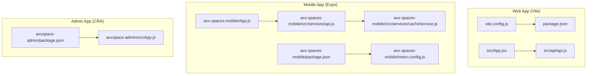
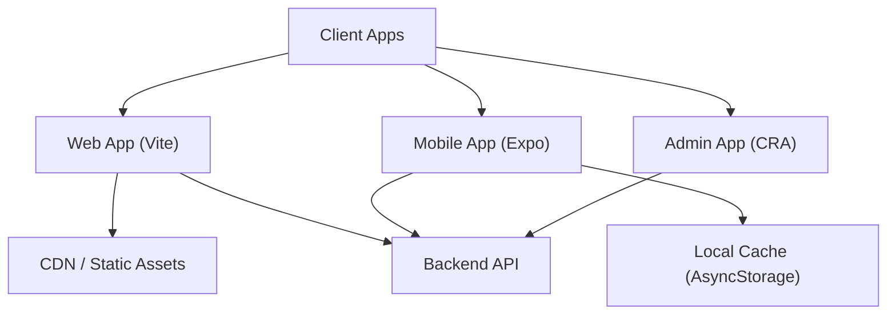
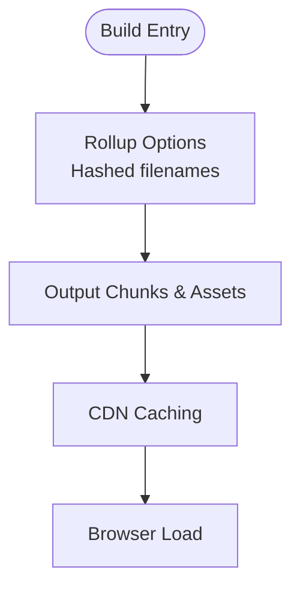
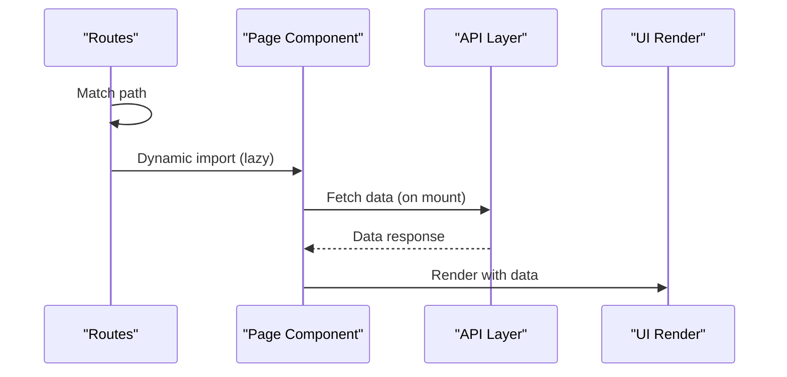
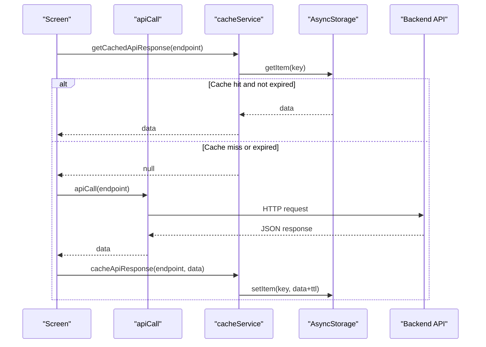
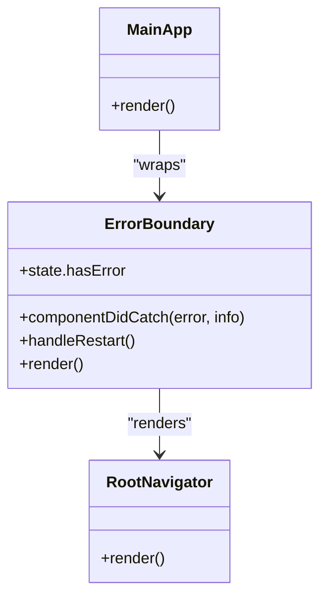
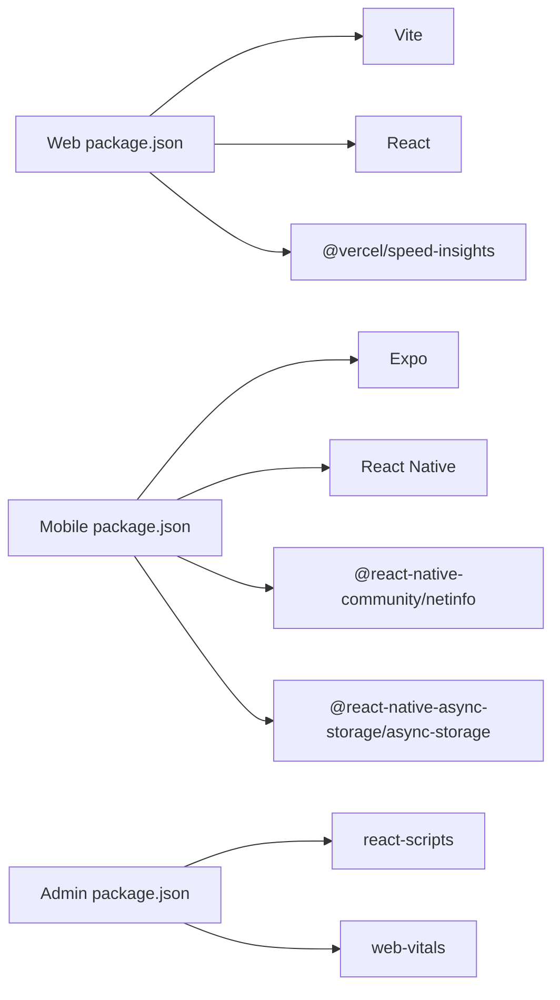

# Performance Optimization

<cite>
**Referenced Files in This Document**
- [package.json](file://package.json)
- [vite.config.js](file://vite.config.js)
- [App.jsx](file://src/App.jsx)
- [api.js](file://src/api/api.js)
- [package.json](file://axx-spaces-mobile/package.json)
- [metro.config.js](file://axx-spaces-mobile/metro.config.js)
- [App.js](file://axx-spaces-mobile/App.js)
- [api.js](file://axx-spaces-mobile/src/services/api.js)
- [cacheService.js](file://axx-spaces-mobile/src/services/cacheService.js)
- [package.json](file://axxspace-admin/package.json)
- [App.js](file://axxspace-admin/src/App.js)
</cite>

## Table of Contents
1. [Introduction](#introduction)
2. [Project Structure](#project-structure)
3. [Core Components](#core-components)
4. [Architecture Overview](#architecture-overview)
5. [Detailed Component Analysis](#detailed-component-analysis)
6. [Dependency Analysis](#dependency-analysis)
7. [Performance Considerations](#performance-considerations)
8. [Troubleshooting Guide](#troubleshooting-guide)
9. [Conclusion](#conclusion)

## Introduction
This document provides a comprehensive performance optimization guide for the multi-app frontend workspace, covering bundle optimization, lazy loading, image optimization, caching mechanisms, monitoring and profiling, mobile-specific considerations, memory management, battery optimization, and best practices across web (Vite/React), React Native (Expo), and admin app (Create React App). It includes concrete examples of code splitting, API call optimization, and load-time improvements with references to actual source files.

## Project Structure
The workspace contains three applications:
- Web app (Vite + React): optimized build configuration and route-based structure.
- Mobile app (Expo + React Native): native modules, navigation, and local caching.
- Admin app (Create React App): standard React toolchain with performance measurement dependency.

**Diagram sources**
- [vite.config.js:1-36](file://vite.config.js#L1-L36)
- [package.json:1-50](file://package.json#L1-L50)
- [App.jsx:1-495](file://src/App.jsx#L1-L495)
- [api.js](file://src/api/api.js)
- [package.json:1-41](file://axx-spaces-mobile/package.json#L1-L41)
- [metro.config.js:1-6](file://axx-spaces-mobile/metro.config.js#L1-L6)
- [App.js:1-110](file://axx-spaces-mobile/App.js#L1-L110)
- [api.js:1-194](file://axx-spaces-mobile/src/services/api.js#L1-L194)
- [cacheService.js:1-198](file://axx-spaces-mobile/src/services/cacheService.js#L1-L198)
- [package.json:1-44](file://axxspace-admin/package.json#L1-L44)
- [App.js:1-27](file://axxspace-admin/src/App.js#L1-L27)

**Section sources**
- [package.json:1-50](file://package.json#L1-L50)
- [vite.config.js:1-36](file://vite.config.js#L1-L36)
- [App.jsx:1-495](file://src/App.jsx#L1-L495)
- [api.js](file://src/api/api.js)
- [package.json:1-41](file://axx-spaces-mobile/package.json#L1-L41)
- [metro.config.js:1-6](file://axx-spaces-mobile/metro.config.js#L1-L6)
- [App.js:1-110](file://axx-spaces-mobile/App.js#L1-L110)
- [api.js:1-194](file://axx-spaces-mobile/src/services/api.js#L1-L194)
- [cacheService.js:1-198](file://axx-spaces-mobile/src/services/cacheService.js#L1-L198)
- [package.json:1-44](file://axxspace-admin/package.json#L1-L44)
- [App.js:1-27](file://axxspace-admin/src/App.js#L1-L27)

## Core Components
- Web app bundling and build: Vite configuration controls output hashing, sourcemaps, and dev server headers.
- Route-driven app shell: Central routing file defines public, dashboard, and protected routes.
- Mobile API client: Unified fetch wrapper with auth token injection and typed endpoints.
- Mobile cache service: TTL-based AsyncStorage cache with prefetching and invalidation utilities.
- Admin app: Standard CRA setup with web-vitals dependency for performance metrics.

Key responsibilities:
- Bundle size control via Vite rollup options and plugin usage.
- Lazy loading opportunities through route-based component organization.
- Network efficiency via centralized API client and caching strategies.
- Observability via speed-insights and web-vitals dependencies.

**Section sources**
- [vite.config.js:19-30](file://vite.config.js#L19-L30)
- [App.jsx:124-495](file://src/App.jsx#L124-L495)
- [api.js:1-194](file://axx-spaces-mobile/src/services/api.js#L1-L194)
- [cacheService.js:1-198](file://axx-spaces-mobile/src/services/cacheService.js#L1-L198)
- [package.json:12-33](file://package.json#L12-L33)
- [package.json:1-44](file://axxspace-admin/package.json#L1-L44)

## Architecture Overview
The system comprises three apps that share common performance goals:
- Web app uses Vite for fast builds and efficient chunking; routes are defined centrally.
- Mobile app uses Expo/Metro for bundling and implements a robust caching layer over AsyncStorage.
- Admin app leverages CRA’s default optimizations and includes web-vitals for monitoring.

[No sources needed since this diagram shows conceptual workflow, not actual code structure]

## Detailed Component Analysis

### Web App Bundle Optimization (Vite)
- Build outputs use hashed filenames for long-term caching.
- Sourcemaps disabled in production to reduce payload.
- Dev server sets security headers beneficial for performance and safety.

Recommendations:
- Enable dynamic imports for heavy pages or features to split bundles by route.
- Use Vite’s built-in code splitting and analyze chunks to identify large dependencies.
- Configure externalization for large libraries if used sparingly.

**Diagram sources**
- [vite.config.js:19-30](file://vite.config.js#L19-L30)

**Section sources**
- [vite.config.js:1-36](file://vite.config.js#L1-L36)

### Web App Routing and Lazy Loading Strategy
- Centralized routes define public, dashboard, and protected views.
- Current imports are static at the top of the file; consider converting heavy page components to dynamic imports for on-demand loading.

Optimization steps:
- Convert heavy page imports to dynamic() calls within route definitions.
- Preload critical resources (e.g., fonts, initial images) using link rel="preload".
- Defer non-critical scripts and analytics initialization until after first paint.

**Diagram sources**
- [App.jsx:124-495](file://src/App.jsx#L124-L495)

**Section sources**
- [App.jsx:1-495](file://src/App.jsx#L1-L495)

### Mobile API Client and Caching Mechanism
- The mobile API client wraps fetch with authentication header injection and error handling.
- The cache service provides TTL-based storage, pattern invalidation, prefetching, and statistics.

Best practices:
- Integrate cache-first strategy for read-heavy endpoints (listings, profiles).
- Implement request deduplication and retry with exponential backoff.
- Use background sync for write operations when offline.

**Diagram sources**
- [api.js:1-194](file://axx-spaces-mobile/src/services/api.js#L1-L194)
- [cacheService.js:1-198](file://axx-spaces-mobile/src/services/cacheService.js#L1-L198)

**Section sources**
- [api.js:1-194](file://axx-spaces-mobile/src/services/api.js#L1-L194)
- [cacheService.js:1-198](file://axx-spaces-mobile/src/services/cacheService.js#L1-L198)

### Mobile App Shell and Error Boundary
- The root component wraps navigation with an error boundary to prevent crashes and provide recovery UX.
- Gesture handler is initialized early to ensure smooth interactions.

Optimization tips:
- Keep the root tree minimal; defer heavy initialization until after first render.
- Use platform-specific modules to avoid unnecessary overhead on web.

**Diagram sources**
- [App.js:1-110](file://axx-spaces-mobile/App.js#L1-L110)

**Section sources**
- [App.js:1-110](file://axx-spaces-mobile/App.js#L1-L110)

### Admin App Monitoring Setup
- The admin app includes web-vitals for measuring core web vitals (LCP, FID, CLS, etc.).
- CRA build pipeline applies default optimizations; consider customizing webpack via config override if needed.

Monitoring recommendations:
- Instrument web-vitals in the app entry point and send metrics to analytics.
- Track performance budgets and alert on regressions.

**Section sources**
- [package.json:1-44](file://axxspace-admin/package.json#L1-L44)
- [App.js:1-27](file://axxspace-admin/src/App.js#L1-L27)

## Dependency Analysis
- Web app depends on Vite, React, and optional speed-insights for performance telemetry.
- Mobile app depends on Expo, React Native, navigation libraries, and networking/storage packages.
- Admin app depends on CRA toolchain and web-vitals.

**Diagram sources**
- [package.json:12-48](file://package.json#L12-L48)
- [package.json:14-35](file://axx-spaces-mobile/package.json#L14-L35)
- [package.json:5-17](file://axxspace-admin/package.json#L5-L17)

**Section sources**
- [package.json:12-48](file://package.json#L12-L48)
- [package.json:14-35](file://axx-spaces-mobile/package.json#L14-L35)
- [package.json:5-17](file://axxspace-admin/package.json#L5-L17)

## Performance Considerations

### Bundle Optimization Techniques
- Use hashed asset names and disable sourcemaps in production to improve caching and reduce payload.
- Analyze bundle size with tools like vite-bundle-analyzer or webpack-bundle-analyzer (for CRA).
- Externalize large third-party libraries where appropriate and prefer tree-shaking-friendly packages.

References:
- Vite build configuration with hashed filenames and sourcemap settings.

**Section sources**
- [vite.config.js:19-30](file://vite.config.js#L19-L30)

### Lazy Loading Strategies
- Convert heavy page components to dynamic imports to split bundles per route.
- Defer non-critical features (analytics, chat widgets) until after initial render.
- Use Suspense boundaries to manage loading states during code splitting.

References:
- Centralized route definitions offer clear points for dynamic imports.

**Section sources**
- [App.jsx:124-495](file://src/App.jsx#L124-L495)

### Image Optimization
- Serve images in modern formats (WebP/AVIF) and provide responsive sizes.
- Implement lazy loading for offscreen images and use placeholders.
- Optimize image dimensions and compress assets before deployment.

[No sources needed since this section provides general guidance]

### Caching Mechanisms
- Implement cache-first strategies for read-only endpoints using TTL-based storage.
- Prefetch critical data during idle time and invalidate caches on mutations.
- Monitor cache size and periodically clean expired entries.

References:
- Mobile cache service with TTL, prefetching, and invalidation utilities.

**Section sources**
- [cacheService.js:1-198](file://axx-spaces-mobile/src/services/cacheService.js#L1-L198)

### Performance Monitoring and Profiling
- Integrate speed-insights in the web app to collect real-user metrics.
- Use web-vitals in the admin app to measure LCP, FID, CLS, and other core metrics.
- Profile React components with React DevTools and Flamegraphs; profile mobile with Flipper or React Native Debugger.

References:
- Dependencies include speed-insights and web-vitals.

**Section sources**
- [package.json:12-33](file://package.json#L12-L33)
- [package.json:1-44](file://axxspace-admin/package.json#L1-L44)

### Mobile Performance Considerations
- Minimize main-thread work; use reanimated for animations and avoid layout thrashing.
- Batch network requests and leverage connectivity checks to adapt behavior.
- Reduce memory pressure by releasing unused resources and avoiding large object graphs.

References:
- Mobile app initializes gesture handlers and navigation efficiently.

**Section sources**
- [App.js:1-110](file://axx-spaces-mobile/App.js#L1-L110)

### Memory Management and Battery Optimization
- Avoid long-lived closures and event listeners without cleanup.
- Throttle frequent updates (scroll, location) and debounce user inputs.
- Use background tasks judiciously and respect device power constraints.

[No sources needed since this section provides general guidance]

### Examples of Implementation

#### Code Splitting Example (Route-based)
- Identify heavy page components in the central router and replace static imports with dynamic imports.
- Add Suspense boundaries around dynamically loaded routes to show loading indicators.

References:
- Central route definitions provide clear targets for splitting.

**Section sources**
- [App.jsx:124-495](file://src/App.jsx#L124-L495)

#### Optimizing API Calls
- Wrap API calls with caching logic to serve from local storage when available.
- Implement retries with exponential backoff and circuit breakers for resilience.
- Deduplicate concurrent requests for the same endpoint.

References:
- Mobile API client and cache service demonstrate structured patterns.

**Section sources**
- [api.js:1-194](file://axx-spaces-mobile/src/services/api.js#L1-L194)
- [cacheService.js:1-198](file://axx-spaces-mobile/src/services/cacheService.js#L1-L198)

#### Improving Load Times Across Platforms
- Web: enable compression (gzip/brotli) at the CDN level and leverage HTTP/2 multiplexing.
- Mobile: prebuild native modules and minimize JS bundle size; use Hermes engine.
- Admin: configure performance budgets and monitor regressions with CI checks.

[No sources needed since this section provides general guidance]

## Troubleshooting Guide
Common issues and resolutions:
- Large bundle sizes: analyze chunks, remove unused dependencies, and apply code splitting.
- Slow API responses: implement caching, pagination, and request debouncing.
- Memory leaks: audit useEffect hooks and timers; ensure proper cleanup.
- Poor mobile performance: optimize animations, reduce re-renders, and limit heavy computations on the main thread.

Diagnostic tools:
- Web: Chrome DevTools Performance panel, Lighthouse, speed-insights.
- Mobile: Flipper, React Native Debugger, memory profilers.
- Admin: web-vitals reporting and browser performance APIs.

**Section sources**
- [App.jsx:124-495](file://src/App.jsx#L124-L495)
- [api.js:1-194](file://axx-spaces-mobile/src/services/api.js#L1-L194)
- [cacheService.js:1-198](file://axx-spaces-mobile/src/services/cacheService.js#L1-L198)

## Conclusion
By applying bundle optimization, lazy loading, image optimization, and robust caching strategies—alongside continuous monitoring and profiling—you can significantly improve load times and runtime performance across web, mobile, and admin platforms. Prioritize code splitting at route boundaries, integrate cache-first patterns for API calls, and adopt platform-specific optimizations to deliver a fast, reliable user experience.