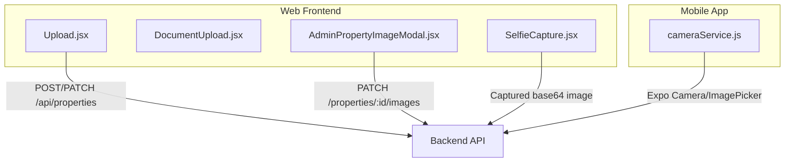
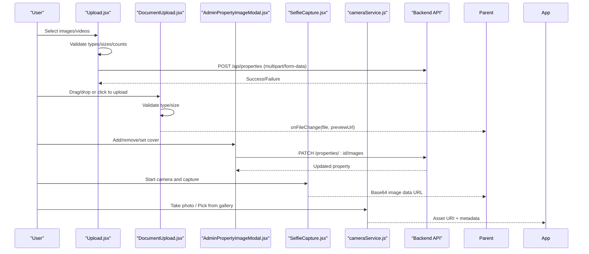
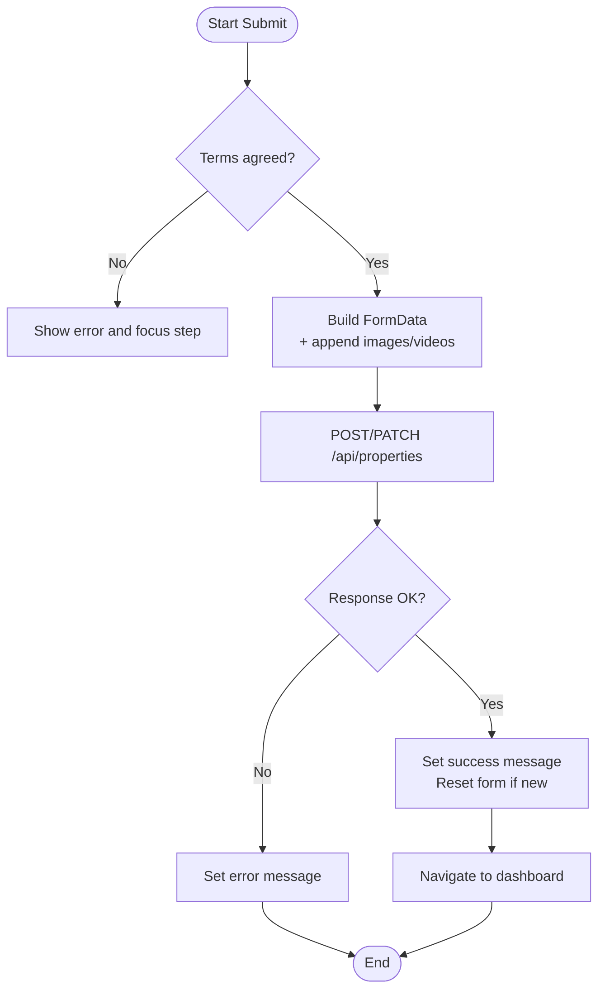
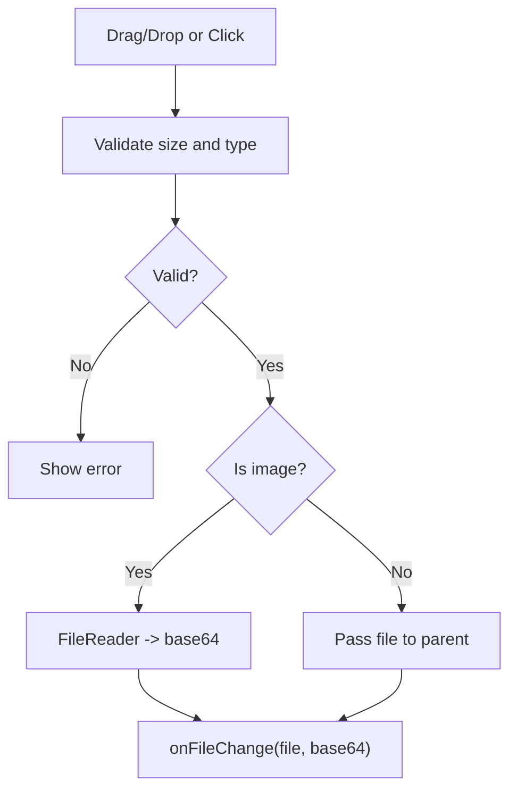
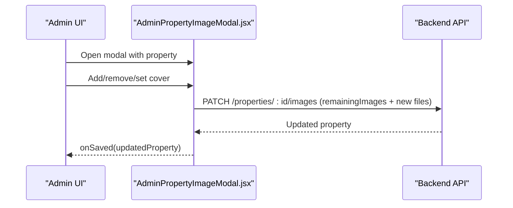
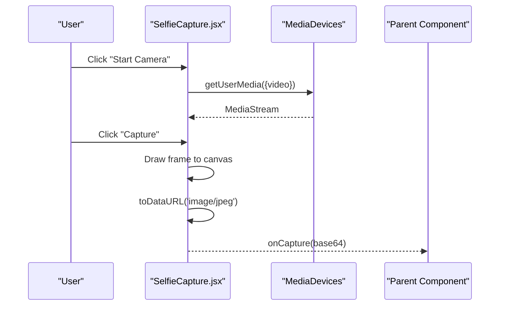
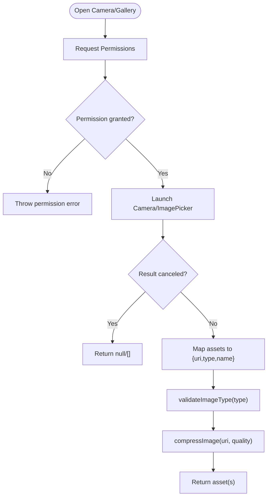
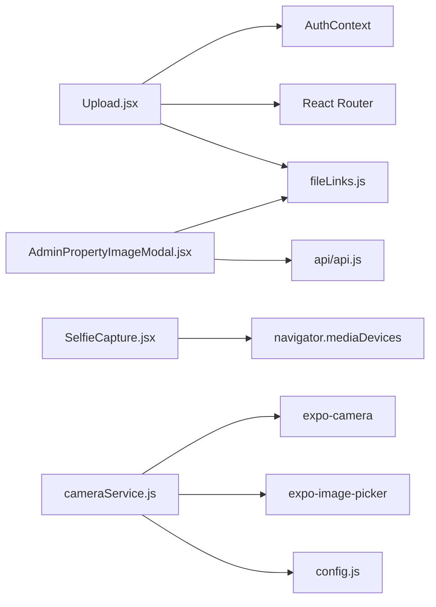

# Image Upload & Management

<cite>
**Referenced Files in This Document**
- [Upload.jsx](file://src/pages/Upload.jsx)
- [DocumentUpload.jsx](file://src/components/DocumentUpload.jsx)
- [AdminPropertyImageModal.jsx](file://src/components/AdminPropertyImageModal.jsx)
- [SelfieCapture.jsx](file://src/components/SelfieCapture.jsx)
- [cameraService.js](file://axx-spaces-mobile/src/services/cameraService.js)
</cite>

## Table of Contents
1. [Introduction](#introduction)
2. [Project Structure](#project-structure)
3. [Core Components](#core-components)
4. [Architecture Overview](#architecture-overview)
5. [Detailed Component Analysis](#detailed-component-analysis)
6. [Dependency Analysis](#dependency-analysis)
7. [Performance Considerations](#performance-considerations)
8. [Troubleshooting Guide](#troubleshooting-guide)
9. [Conclusion](#conclusion)

## Introduction
This document explains the image upload and management system across the web frontend and mobile app. It covers file selection, validation, preview, drag-and-drop, camera integration, submission flows, error handling, and progress feedback. It also provides guidance on extending supported formats, customizing UIs, and integrating with cloud storage services.

## Project Structure
The image upload functionality is implemented primarily in:
- A multi-step property listing form that handles images and videos for user submissions
- A reusable document uploader component supporting drag-and-drop and previews
- An admin modal for managing property photos (add/remove/set cover)
- A selfie capture component for identity verification
- A mobile camera service for Expo-based iOS/Android apps

**Diagram sources**
- [Upload.jsx:397-501](file://src/pages/Upload.jsx#L397-L501)
- [AdminPropertyImageModal.jsx:105-143](file://src/components/AdminPropertyImageModal.jsx#L105-L143)
- [SelfieCapture.jsx:48-64](file://src/components/SelfieCapture.jsx#L48-L64)
- [cameraService.js:18-46](file://axx-spaces-mobile/src/services/cameraService.js#L18-L46)

**Section sources**
- [Upload.jsx:1-105](file://src/pages/Upload.jsx#L1-L105)
- [DocumentUpload.jsx:1-12](file://src/components/DocumentUpload.jsx#L1-L12)
- [AdminPropertyImageModal.jsx:1-20](file://src/components/AdminPropertyImageModal.jsx#L1-L20)
- [SelfieCapture.jsx:1-16](file://src/components/SelfieCapture.jsx#L1-L16)
- [cameraService.js:1-16](file://axx-spaces-mobile/src/services/cameraService.js#L1-L16)

## Core Components
- Property listing uploader (web): Multi-step form collecting basic info, details, media (images/videos), and amenities; validates inputs; submits via multipart/form-data to the backend.
- Document uploader (web): Reusable component for single-file uploads with drag-and-drop, type/size validation, and image preview or PDF icon.
- Admin image manager (web): Modal to add/remove existing/new images, set cover photo, and persist changes via a dedicated endpoint.
- Selfie capture (web): Browser-based camera access to capture a selfie as base64 data URL.
- Mobile camera service (Expo): Permission handling, camera/gallery access, and placeholder compression/validation hooks.

Key responsibilities:
- File selection and validation (type, size, count)
- Preview generation (object URLs or FileReader)
- Drag-and-drop UX
- Submission orchestration and error handling
- Progress feedback and state transitions

**Section sources**
- [Upload.jsx:76-92](file://src/pages/Upload.jsx#L76-L92)
- [DocumentUpload.jsx:17-45](file://src/components/DocumentUpload.jsx#L17-L45)
- [AdminPropertyImageModal.jsx:52-73](file://src/components/AdminPropertyImageModal.jsx#L52-L73)
- [SelfieCapture.jsx:24-39](file://src/components/SelfieCapture.jsx#L24-L39)
- [cameraService.js:6-16](file://axx-spaces-mobile/src/services/cameraService.js#L6-L16)

## Architecture Overview
End-to-end flow for uploading property images and videos:

**Diagram sources**
- [Upload.jsx:320-357](file://src/pages/Upload.jsx#L320-L357)
- [Upload.jsx:397-501](file://src/pages/Upload.jsx#L397-L501)
- [DocumentUpload.jsx:47-83](file://src/components/DocumentUpload.jsx#L47-L83)
- [AdminPropertyImageModal.jsx:75-143](file://src/components/AdminPropertyImageModal.jsx#L75-L143)
- [SelfieCapture.jsx:48-64](file://src/components/SelfieCapture.jsx#L48-L64)
- [cameraService.js:18-77](file://axx-spaces-mobile/src/services/cameraService.js#L18-L77)

## Detailed Component Analysis

### Property Listing Uploader (Upload.jsx)
Responsibilities:
- Multi-step wizard with validation per step
- Image and video handling with previews and removal
- Geolocation assistance for pinning property location
- Form submission with multipart/form-data including images/videos and JSON-encoded arrays

Validation rules:
- Images: At least one required; maximum total images per listing enforced before submission
- Videos: Maximum count and size checks; only video MIME types accepted
- Basic info and details: Required fields validated per step
- Amenities and consent: Must select at least one amenity and agree to terms

Submission flow:
- Builds FormData with scalar fields, JSON-encoded arrays (amenities), and files (images/videos)
- In edit mode, includes remainingImages to preserve existing assets
- Sends POST (create) or PATCH (edit) to backend with Authorization header
- Handles success/error states and redirects based on user role

Progress tracking:
- Stepper UI shows current step and completion status
- Step-level errors are displayed inline and cleared when corrected

**Diagram sources**
- [Upload.jsx:397-501](file://src/pages/Upload.jsx#L397-L501)

**Section sources**
- [Upload.jsx:76-92](file://src/pages/Upload.jsx#L76-L92)
- [Upload.jsx:320-357](file://src/pages/Upload.jsx#L320-L357)
- [Upload.jsx:397-501](file://src/pages/Upload.jsx#L397-L501)

### Document Upload Component (DocumentUpload.jsx)
Features:
- Accepts configurable file types and max size
- Validates file size and MIME/type against allowed list
- Generates image previews using FileReader
- Supports drag-and-drop with visual feedback
- Renders either an image preview or a PDF icon with filename

Extensibility:
- Adjust acceptedTypes prop to support additional formats
- Modify maxSize prop to enforce different limits
- Replace preview logic to handle other media types

**Diagram sources**
- [DocumentUpload.jsx:17-83](file://src/components/DocumentUpload.jsx#L17-L83)

**Section sources**
- [DocumentUpload.jsx:17-83](file://src/components/DocumentUpload.jsx#L17-L83)
- [DocumentUpload.jsx:98-163](file://src/components/DocumentUpload.jsx#L98-L163)

### Admin Property Image Manager (AdminPropertyImageModal.jsx)
Capabilities:
- Displays existing images and newly added ones
- Enforces a maximum number of photos per property
- Allows removing images and setting cover photo (first image)
- Submits changes via a dedicated endpoint with remainingImages and new files

UX highlights:
- Drag-and-drop zone for adding images
- Visual indicators for cover photo and “From Device” additions
- Inline error and success messages

**Diagram sources**
- [AdminPropertyImageModal.jsx:52-73](file://src/components/AdminPropertyImageModal.jsx#L52-L73)
- [AdminPropertyImageModal.jsx:105-143](file://src/components/AdminPropertyImageModal.jsx#L105-L143)

**Section sources**
- [AdminPropertyImageModal.jsx:52-73](file://src/components/AdminPropertyImageModal.jsx#L52-L73)
- [AdminPropertyImageModal.jsx:105-143](file://src/components/AdminPropertyImageModal.jsx#L105-L143)

### Selfie Capture (SelfieCapture.jsx)
Functionality:
- Requests camera permissions and starts a live stream
- Captures a frame to a canvas and converts to base64 JPEG
- Shows captured image preview with retake option
- Cleans up media tracks on unmount

Integration notes:
- Emits base64 data URL to parent for further processing/upload
- Suitable for identity verification workflows

**Diagram sources**
- [SelfieCapture.jsx:24-39](file://src/components/SelfieCapture.jsx#L24-L39)
- [SelfieCapture.jsx:48-64](file://src/components/SelfieCapture.jsx#L48-L64)

**Section sources**
- [SelfieCapture.jsx:24-64](file://src/components/SelfieCapture.jsx#L24-L64)
- [SelfieCapture.jsx:67-85](file://src/components/SelfieCapture.jsx#L67-L85)

### Mobile Camera Service (cameraService.js)
Capabilities:
- Requests camera and gallery permissions
- Launches native camera or image picker with quality and aspect settings
- Returns asset URIs and metadata
- Provides placeholders for type validation and compression

Notes:
- Compression and size validation are marked as placeholders; integrate a library like react-native-image-resizer for production
- Uses Expo modules for cross-platform compatibility

**Diagram sources**
- [cameraService.js:6-16](file://axx-spaces-mobile/src/services/cameraService.js#L6-L16)
- [cameraService.js:18-77](file://axx-spaces-mobile/src/services/cameraService.js#L18-L77)
- [cameraService.js:79-96](file://axx-spaces-mobile/src/services/cameraService.js#L79-L96)

**Section sources**
- [cameraService.js:18-77](file://axx-spaces-mobile/src/services/cameraService.js#L18-L77)
- [cameraService.js:79-96](file://axx-spaces-mobile/src/services/cameraService.js#L79-L96)

## Dependency Analysis
- Upload.jsx depends on:
  - AuthContext for token and user info
  - React Router for navigation
  - Utility functions for resolving media URLs
- AdminPropertyImageModal.jsx depends on:
  - Centralized API client for authenticated requests
  - Utility function for resolving media URLs
- SelfieCapture.jsx depends on:
  - Browser MediaDevices API
- cameraService.js depends on:
  - Expo Camera and ImagePicker APIs
  - App configuration constants

**Diagram sources**
- [Upload.jsx:1-5](file://src/pages/Upload.jsx#L1-L5)
- [AdminPropertyImageModal.jsx:1-3](file://src/components/AdminPropertyImageModal.jsx#L1-L3)
- [SelfieCapture.jsx:24-39](file://src/components/SelfieCapture.jsx#L24-L39)
- [cameraService.js:1-3](file://axx-spaces-mobile/src/services/cameraService.js#L1-L3)

**Section sources**
- [Upload.jsx:1-5](file://src/pages/Upload.jsx#L1-L5)
- [AdminPropertyImageModal.jsx:1-3](file://src/components/AdminPropertyImageModal.jsx#L1-L3)
- [SelfieCapture.jsx:24-39](file://src/components/SelfieCapture.jsx#L24-L39)
- [cameraService.js:1-3](file://axx-spaces-mobile/src/services/cameraService.js#L1-L3)

## Performance Considerations
- Client-side validation reduces unnecessary network calls by rejecting invalid files early.
- Using object URLs for previews avoids loading large binary data into memory until needed.
- Video size limit prevents excessive bandwidth usage during upload.
- Mobile camera service sets quality and aspect ratio to reduce payload size.
- For production, implement server-side image optimization (resize, format conversion) and consider CDN delivery.

[No sources needed since this section provides general guidance]

## Troubleshooting Guide
Common issues and resolutions:
- No images selected: Ensure at least one image is attached before submitting.
- Too many images: Respect the maximum image count per listing or property.
- Invalid video file or oversized video: Only accept valid video MIME types and enforce size limits.
- Terms not agreed: Consent must be checked before submission.
- Camera permission denied: Prompt user to allow camera access or use gallery instead.
- Gallery permission denied: Request gallery permission before picking images.

Where to look:
- Validation and error messages in the property uploader
- File validation logic in the document uploader
- Permission and error handling in selfie capture and mobile camera service

**Section sources**
- [Upload.jsx:76-92](file://src/pages/Upload.jsx#L76-L92)
- [Upload.jsx:320-357](file://src/pages/Upload.jsx#L320-L357)
- [Upload.jsx:397-501](file://src/pages/Upload.jsx#L397-L501)
- [DocumentUpload.jsx:17-45](file://src/components/DocumentUpload.jsx#L17-L45)
- [SelfieCapture.jsx:24-39](file://src/components/SelfieCapture.jsx#L24-L39)
- [cameraService.js:6-16](file://axx-spaces-mobile/src/services/cameraService.js#L6-L16)

## Conclusion
The system provides robust image and video handling across web and mobile platforms with clear validation, preview, and submission flows. Extending supported formats, customizing UIs, and integrating cloud storage can be achieved by adjusting validation rules, leveraging the provided components, and connecting to backend endpoints or SDKs for storage services.

[No sources needed since this section summarizes without analyzing specific files]