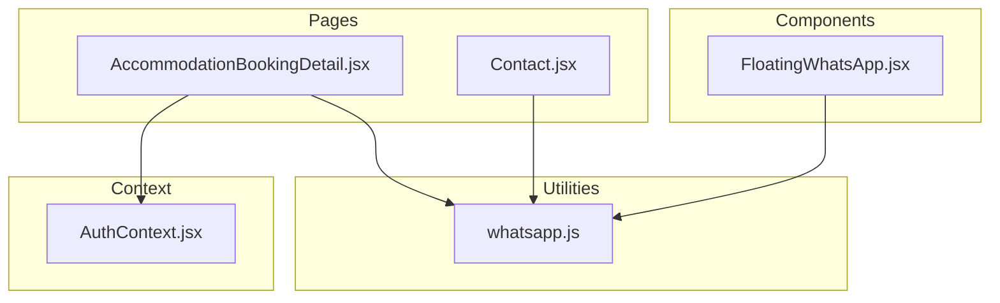
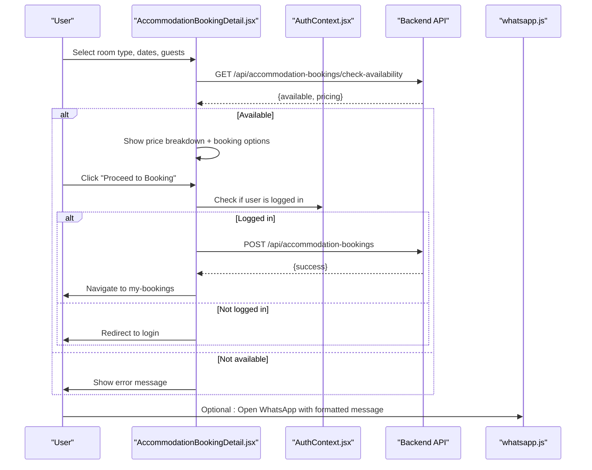
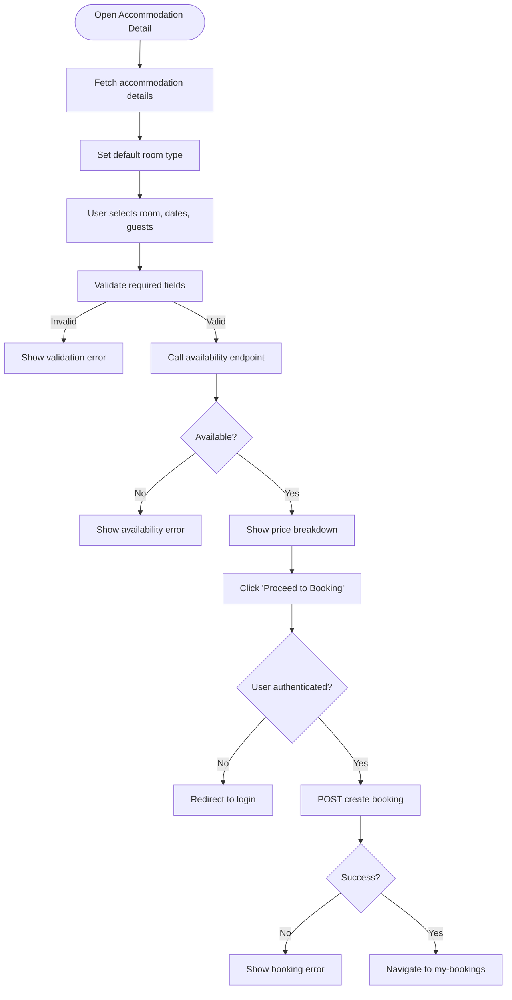
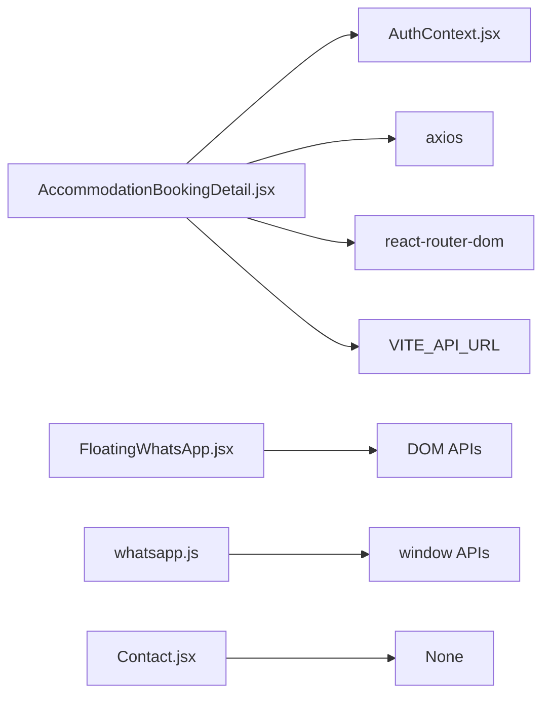

# Booking Form & Submission

<cite>
**Referenced Files in This Document**
- [AccommodationBookingDetail.jsx](file://src/pages/AccommodationBookingDetail.jsx)
- [whatsapp.js](file://src/utils/whatsapp.js)
- [FloatingWhatsApp.jsx](file://src/components/FloatingWhatsApp.jsx)
- [AuthContext.jsx](file://src/context/AuthContext.jsx)
- [Contact.jsx](file://src/pages/Contact.jsx)
</cite>

## Table of Contents
1. [Introduction](#introduction)
2. [Project Structure](#project-structure)
3. [Core Components](#core-components)
4. [Architecture Overview](#architecture-overview)
5. [Detailed Component Analysis](#detailed-component-analysis)
6. [Dependency Analysis](#dependency-analysis)
7. [Performance Considerations](#performance-considerations)
8. [Troubleshooting Guide](#troubleshooting-guide)
9. [Conclusion](#conclusion)
10. [Appendices](#appendices)

## Introduction
This document explains the booking form and submission functionality for accommodation listings. It covers the booking modal implementation, form fields (name, phone, move-in date, message), validation patterns, state management, and the end-to-end submission workflow that supports both authenticated and unauthenticated users. It also documents optional database storage via API calls and WhatsApp redirection with formatted messages. Guidance is provided for customizing forms, adding fields, integrating payment gateways, and implementing confirmation workflows. Error handling patterns, loading states, and success notifications are included.

## Project Structure
The booking feature centers around a detail page that renders an availability checker and a booking sidebar. A utility module provides WhatsApp URL generation and opening helpers. A floating WhatsApp button is available site-wide. Authentication context is used to determine user login status during booking.

**Diagram sources**
- [AccommodationBookingDetail.jsx:1-118](file://src/pages/AccommodationBookingDetail.jsx#L1-L118)
- [whatsapp.js:1-15](file://src/utils/whatsapp.js#L1-L15)
- [FloatingWhatsApp.jsx:1-103](file://src/components/FloatingWhatsApp.jsx#L1-L103)
- [AuthContext.jsx:1-200](file://src/context/AuthContext.jsx#L1-L200)

**Section sources**
- [AccommodationBookingDetail.jsx:1-118](file://src/pages/AccommodationBookingDetail.jsx#L1-L118)
- [whatsapp.js:1-15](file://src/utils/whatsapp.js#L1-L15)
- [FloatingWhatsApp.jsx:1-103](file://src/components/FloatingWhatsApp.jsx#L1-L103)
- [AuthContext.jsx:1-200](file://src/context/AuthContext.jsx#L1-L200)

## Core Components
- AccommodationBookingDetail.jsx
  - Renders property details, room selection, availability checking, pricing breakdown, and a booking sidebar.
  - Manages local state for check-in/check-out dates, number of guests, selected room type, availability/pricing results, and UI flags.
  - Calls backend endpoints for fetching accommodation data, checking availability, and creating bookings.
  - Redirects unauthenticated users to login when attempting to book.

- whatsapp.js
  - Provides functions to generate and open WhatsApp links with properly formatted phone numbers and pre-filled messages.

- FloatingWhatsApp.jsx
  - Injects a floating chat button into the DOM that opens WhatsApp with a default support message.

- AuthContext.jsx
  - Supplies current user information used by the booking flow to gate protected actions.

- Contact.jsx
  - Demonstrates a generic contact form pattern with validation, loading, and success states that can be adapted for booking confirmations or messaging.

**Section sources**
- [AccommodationBookingDetail.jsx:1-118](file://src/pages/AccommodationBookingDetail.jsx#L1-L118)
- [whatsapp.js:1-15](file://src/utils/whatsapp.js#L1-L15)
- [FloatingWhatsApp.jsx:1-103](file://src/components/FloatingWhatsApp.jsx#L1-L103)
- [AuthContext.jsx:1-200](file://src/context/AuthContext.jsx#L1-L200)
- [Contact.jsx:1-150](file://src/pages/Contact.jsx#L1-L150)

## Architecture Overview
The booking flow integrates UI state, authentication checks, availability verification, and optional backend persistence.

**Diagram sources**
- [AccommodationBookingDetail.jsx:52-118](file://src/pages/AccommodationBookingDetail.jsx#L52-L118)
- [whatsapp.js:1-15](file://src/utils/whatsapp.js#L1-L15)

## Detailed Component Analysis

### AccommodationBookingDetail.jsx
Responsibilities:
- Fetches accommodation details and sets defaults.
- Validates inputs before checking availability.
- Calls availability endpoint and displays pricing breakdown.
- Handles booking creation with authentication gating.
- Shows loading, error, and success flows.

Key behaviors:
- Availability check requires room type, check-in, and check-out; otherwise shows a validation error.
- On successful availability, reveals pricing and enables proceeding to booking.
- If not authenticated, redirects to login; otherwise posts booking with Authorization header.
- Displays errors from availability or booking attempts.

State variables:
- accommodation, loading, error
- selectedRoomType, checkIn, checkOut, guests
- availability, pricing, checkingAvailability, bookingError, showBookingForm, currentImageIndex

Validation patterns:
- Client-side validation ensures required fields are present before calling availability.
- Backend returns availability and pricing; client enforces minimum date constraints via input attributes.

Error handling:
- Network or server errors set user-facing messages.
- Unauthenticated booking attempts redirect rather than fail silently.

Loading states:
- Loading indicator while fetching accommodation details.
- Disabled “Check Availability” button while checking.

Success flows:
- After successful booking creation, navigates to “my-bookings”.

Customization points:
- Add additional fields (e.g., name, phone, message) to the booking payload and UI.
- Integrate payment gateway between availability check and final booking creation.
- Replace navigation with a confirmation modal or redirect to a confirmation page.

**Diagram sources**
- [AccommodationBookingDetail.jsx:28-118](file://src/pages/AccommodationBookingDetail.jsx#L28-L118)

**Section sources**
- [AccommodationBookingDetail.jsx:28-118](file://src/pages/AccommodationBookingDetail.jsx#L28-L118)

### whatsapp.js
Responsibilities:
- Normalizes phone numbers to Kenyan format.
- Generates WhatsApp URLs with encoded messages.
- Opens WhatsApp in a new tab safely.

Usage examples:
- Generate link for property-specific inquiries.
- Pre-fill messages with booking details.

Integration notes:
- Use after successful booking or as an alternative channel for manual booking.
- Combine with user-provided phone numbers from property data.

**Section sources**
- [whatsapp.js:1-15](file://src/utils/whatsapp.js#L1-L15)

### FloatingWhatsApp.jsx
Responsibilities:
- Dynamically injects a floating WhatsApp button into the DOM.
- Uses a default support phone and message.

Customization:
- Update phone and message constants to match business needs.
- Style adjustments can be made within the injected styles.

**Section sources**
- [FloatingWhatsApp.jsx:1-103](file://src/components/FloatingWhatsApp.jsx#L1-L103)

### AuthContext.jsx
Responsibilities:
- Provides current user object to components.
- Used to gate protected actions like booking creation.

Integration:
- AccommodationBookingDetail.jsx reads user from context to decide whether to proceed or redirect.

**Section sources**
- [AuthContext.jsx:1-200](file://src/context/AuthContext.jsx#L1-L200)

### Contact.jsx
Relevance:
- Demonstrates a robust form pattern with validation, loading, and success states.
- Useful template for building booking confirmation messages or post-booking feedback forms.

Patterns to adopt:
- Controlled inputs with onChange handlers.
- Submit handler with async simulation or real API call.
- Success state with reset capability.

**Section sources**
- [Contact.jsx:1-150](file://src/pages/Contact.jsx#L1-L150)

## Dependency Analysis
- AccommodationBookingDetail.jsx depends on:
  - React hooks and routing utilities.
  - Axios for HTTP requests.
  - AuthContext for user state.
  - Environment variable for API base URL.

- whatsapp.js is a pure utility with no external dependencies beyond window APIs.

- FloatingWhatsApp.jsx manipulates DOM directly and relies on global styles injection.

- Contact.jsx is self-contained and demonstrates form UX patterns.

**Diagram sources**
- [AccommodationBookingDetail.jsx:1-10](file://src/pages/AccommodationBookingDetail.jsx#L1-L10)
- [FloatingWhatsApp.jsx:1-103](file://src/components/FloatingWhatsApp.jsx#L1-L103)
- [whatsapp.js:1-15](file://src/utils/whatsapp.js#L1-L15)

**Section sources**
- [AccommodationBookingDetail.jsx:1-10](file://src/pages/AccommodationBookingDetail.jsx#L1-L10)
- [FloatingWhatsApp.jsx:1-103](file://src/components/FloatingWhatsApp.jsx#L1-L103)
- [whatsapp.js:1-15](file://src/utils/whatsapp.js#L1-L15)

## Performance Considerations
- Debounce availability checks if users frequently change dates.
- Cache accommodation details locally to avoid repeated fetches.
- Minimize re-renders by memoizing derived values (pricing, nights).
- Avoid heavy DOM manipulation in FloatingWhatsApp.jsx; consider using React portals or component-based overlays for better performance.

[No sources needed since this section provides general guidance]

## Troubleshooting Guide
Common issues and resolutions:
- Availability check fails:
  - Ensure room type, check-in, and check-out are selected.
  - Verify network connectivity and API availability.
  - Inspect error messages displayed in the booking sidebar.

- Booking creation fails:
  - Confirm user is authenticated; unauthenticated users are redirected to login.
  - Check Authorization header presence and validity.
  - Review backend response for specific error details.

- WhatsApp redirection not working:
  - Validate phone number formatting and ensure it starts with correct country code.
  - Confirm browser allows pop-ups for new tabs.

- Loading states stuck:
  - Ensure finally blocks clear loading flags.
  - Check for unhandled promise rejections.

**Section sources**
- [AccommodationBookingDetail.jsx:52-118](file://src/pages/AccommodationBookingDetail.jsx#L52-L118)
- [whatsapp.js:1-15](file://src/utils/whatsapp.js#L1-L15)

## Conclusion
The booking feature provides a clear path from property exploration to reservation, with robust validation, availability checks, and secure booking creation for authenticated users. The WhatsApp utilities enable flexible communication channels, while the floating button offers quick support access. By extending the form fields, integrating payments, and adding confirmation workflows, teams can tailor the experience to their operational needs.

[No sources needed since this section summarizes without analyzing specific files]

## Appendices

### Customizing Booking Forms
- Add fields:
  - Extend local state to include name, phone, message.
  - Render corresponding inputs in the booking sidebar.
  - Include these fields in the availability or booking payloads as required by your backend.

- Validation:
  - Enforce required fields before calling availability or submitting bookings.
  - Provide inline error messages near each field.

- Payment integration:
  - Insert a payment step between availability confirmation and final booking creation.
  - Handle payment success/failure states and update UI accordingly.

- Confirmation workflow:
  - After successful booking, navigate to a confirmation page or show a modal with booking summary.
  - Optionally send a WhatsApp notification using whatsapp.js with formatted details.

**Section sources**
- [AccommodationBookingDetail.jsx:52-118](file://src/pages/AccommodationBookingDetail.jsx#L52-L118)
- [whatsapp.js:1-15](file://src/utils/whatsapp.js#L1-L15)