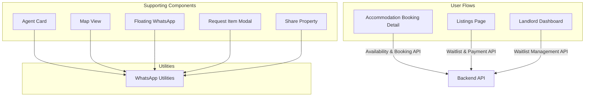
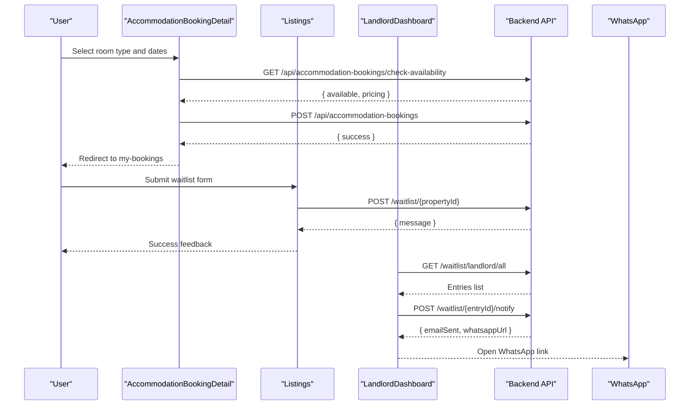
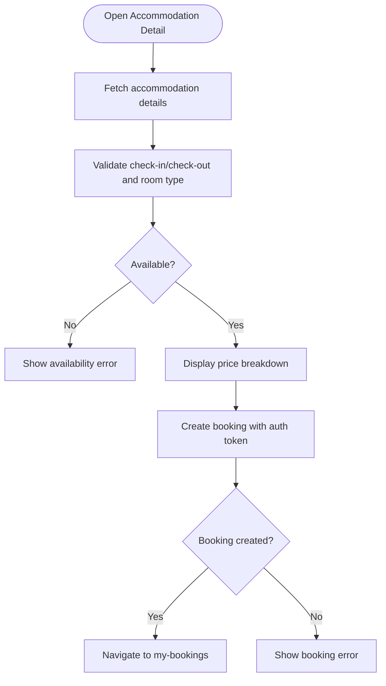
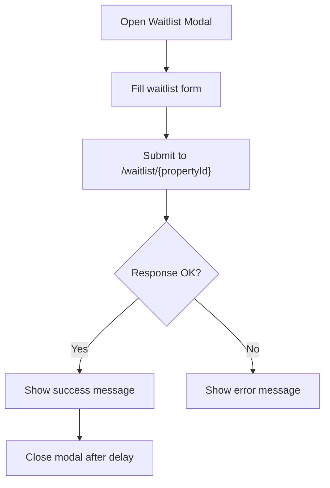
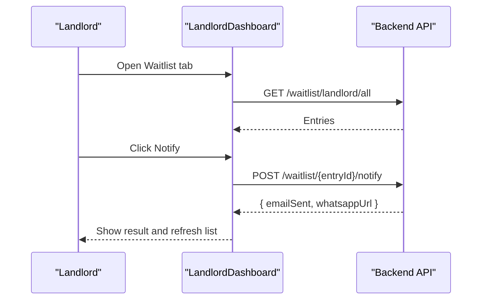
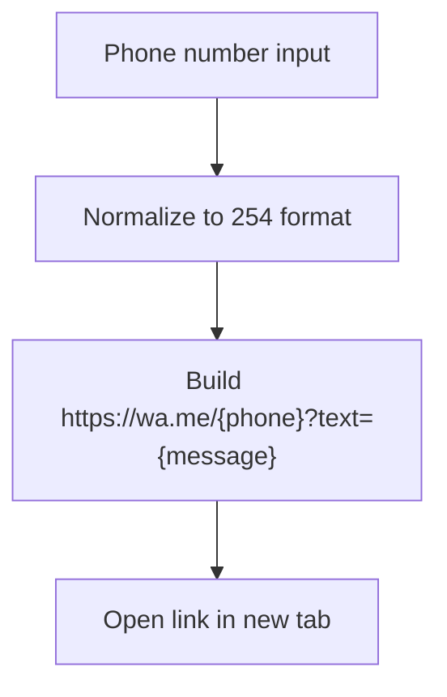
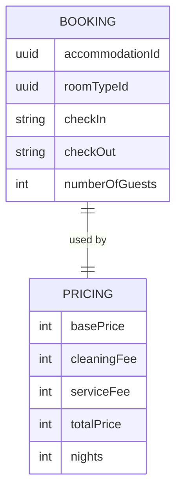
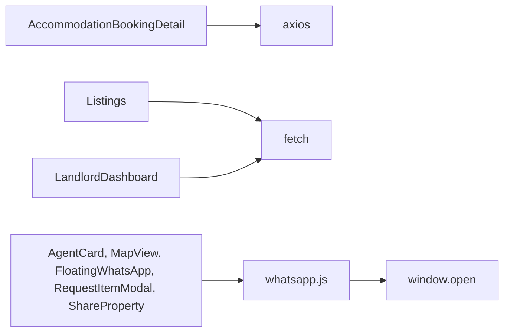

# Booking Integration

<cite>
**Referenced Files in This Document**   
- [AccommodationBookingDetail.jsx](file://src/pages/AccommodationBookingDetail.jsx)
- [Listings.jsx](file://src/pages/Listings.jsx)
- [LandlordDashboard.jsx](file://src/pages/LandlordDashboard.jsx)
- [whatsapp.js](file://src/utils/whatsapp.js)
- [AgentCard.jsx](file://src/components/AgentCard.jsx)
- [MapView.jsx](file://src/components/MapView.jsx)
- [FloatingWhatsApp.jsx](file://src/components/FloatingWhatsApp.jsx)
- [RequestItemModal.jsx](file://src/components/RequestItemModal.jsx)
- [ShareProperty.jsx](file://src/components/ShareProperty.jsx)
- [AccommodationGuestDashboard.jsx](file://src/pages/AccommodationGuestDashboard.jsx)
</cite>

## Table of Contents
1. [Introduction](#introduction)
2. [Project Structure](#project-structure)
3. [Core Components](#core-components)
4. [Architecture Overview](#architecture-overview)
5. [Detailed Component Analysis](#detailed-component-analysis)
6. [Dependency Analysis](#dependency-analysis)
7. [Performance Considerations](#performance-considerations)
8. [Troubleshooting Guide](#troubleshooting-guide)
9. [Conclusion](#conclusion)
10. [Appendices](#appendices)

## Introduction
This document explains the booking integration across the frontend application, focusing on:
- The accommodation booking workflow with availability checks and booking creation
- The rental listing waitlist system for fully booked properties
- WhatsApp redirection utilities used throughout the app
- Error handling patterns, success notifications, and data flows
- Practical guidance for customizing forms, adding payment methods, and implementing confirmation workflows

The goal is to make the booking experience clear for both users and developers while providing a reliable path from property discovery to confirmed bookings or waitlist enrollment.

## Project Structure
The booking-related functionality spans several pages and components:
- Accommodation booking detail page handles room selection, availability checks, pricing display, and booking submission
- Listings page manages rental search, contact actions, payments, and waitlist enrollment
- Landlord dashboard provides waitlist management and notification capabilities
- WhatsApp utilities provide reusable URL generation and opening helpers
- Supporting components integrate WhatsApp into agent cards, map views, floating chat, request modals, and sharing flows

**Diagram sources**
- [AccommodationBookingDetail.jsx:52-118](file://src/pages/AccommodationBookingDetail.jsx#L52-L118)
- [Listings.jsx:383-406](file://src/pages/Listings.jsx#L383-L406)
- [LandlordDashboard.jsx:408-460](file://src/pages/LandlordDashboard.jsx#L408-L460)
- [whatsapp.js:1-15](file://src/utils/whatsapp.js#L1-L15)

**Section sources**
- [AccommodationBookingDetail.jsx:1-118](file://src/pages/AccommodationBookingDetail.jsx#L1-L118)
- [Listings.jsx:353-406](file://src/pages/Listings.jsx#L353-L406)
- [LandlordDashboard.jsx:143-149](file://src/pages/LandlordDashboard.jsx#L143-L149)
- [whatsapp.js:1-15](file://src/utils/whatsapp.js#L1-L15)

## Core Components
- Accommodation booking detail page:
  - Fetches accommodation details
  - Validates dates and room type
  - Checks availability and calculates pricing
  - Creates bookings with authentication headers
  - Shows errors and redirects after successful booking
- Listings page:
  - Manages waitlist form state and submission
  - Integrates M-Pesa payment flow via backend endpoint
  - Provides WhatsApp contact redirections
- Landlord dashboard:
  - Lists all waitlist entries
  - Sends notifications (email + WhatsApp URL)
  - Removes entries from the waitlist
- WhatsApp utilities:
  - Normalizes phone numbers
  - Generates and opens WhatsApp links

**Section sources**
- [AccommodationBookingDetail.jsx:32-118](file://src/pages/AccommodationBookingDetail.jsx#L32-L118)
- [Listings.jsx:383-406](file://src/pages/Listings.jsx#L383-L406)
- [LandlordDashboard.jsx:408-460](file://src/pages/LandlordDashboard.jsx#L408-L460)
- [whatsapp.js:1-15](file://src/utils/whatsapp.js#L1-L15)

## Architecture Overview
The booking architecture connects user interactions to backend endpoints and external messaging channels:

**Diagram sources**
- [AccommodationBookingDetail.jsx:52-118](file://src/pages/AccommodationBookingDetail.jsx#L52-L118)
- [Listings.jsx:383-406](file://src/pages/Listings.jsx#L383-L406)
- [LandlordDashboard.jsx:408-460](file://src/pages/LandlordDashboard.jsx#L408-L460)

## Detailed Component Analysis

### Accommodation Booking Workflow
The accommodation booking flow includes:
- Loading accommodation details and default room type
- Validating check-in/check-out dates and selected room type
- Checking availability and displaying pricing breakdown
- Creating a booking with authorization header
- Handling errors and redirecting upon success

**Diagram sources**
- [AccommodationBookingDetail.jsx:32-118](file://src/pages/AccommodationBookingDetail.jsx#L32-L118)

Key implementation points:
- Availability check endpoint: `/api/accommodation-bookings/check-availability`
- Booking creation endpoint: `/api/accommodation-bookings`
- Authorization header uses a stored token
- Errors are surfaced via UI messages

**Section sources**
- [AccommodationBookingDetail.jsx:32-118](file://src/pages/AccommodationBookingDetail.jsx#L32-L118)

### Waitlist System for Fully Booked Properties
The waitlist system allows users to join when a property is fully occupied:
- Form fields include name, email, phone, move-in date, lease duration, occupants, and message
- Submission sends a POST request to `/waitlist/{propertyId}`
- Success shows a temporary confirmation and closes the modal
- Errors are displayed inline

**Diagram sources**
- [Listings.jsx:383-406](file://src/pages/Listings.jsx#L383-L406)

Landlord-side waitlist management:
- Fetches all waitlist entries for the landlord
- Sends notifications per entry, receiving an email status and WhatsApp URL
- Allows removal of entries

**Diagram sources**
- [LandlordDashboard.jsx:408-460](file://src/pages/LandlordDashboard.jsx#L408-L460)

**Section sources**
- [Listings.jsx:383-406](file://src/pages/Listings.jsx#L383-L406)
- [LandlordDashboard.jsx:408-460](file://src/pages/LandlordDashboard.jsx#L408-L460)

### WhatsApp Redirection Patterns
WhatsApp redirection is implemented through utility functions and direct calls:
- Utility function normalizes phone numbers and generates URLs
- Components open WhatsApp links using `window.open`
- Predefined messages can be included for context

**Diagram sources**
- [whatsapp.js:1-15](file://src/utils/whatsapp.js#L1-L15)

Integration examples:
- Agent card uses the utility to generate WhatsApp links
- Map view opens WhatsApp with a contextual message
- Floating WhatsApp component constructs and opens links
- Request item modal supports WhatsApp as preferred contact
- Share property shares via WhatsApp

**Section sources**
- [whatsapp.js:1-15](file://src/utils/whatsapp.js#L1-L15)
- [AgentCard.jsx:1-3](file://src/components/AgentCard.jsx#L1-L3)
- [MapView.jsx:106-106](file://src/components/MapView.jsx#L106-L106)
- [FloatingWhatsApp.jsx:9-9](file://src/components/FloatingWhatsApp.jsx#L9-L9)
- [RequestItemModal.jsx:65-65](file://src/components/RequestItemModal.jsx#L65-L65)
- [ShareProperty.jsx:25-25](file://src/components/ShareProperty.jsx#L25-L25)

### Booking Data Structure
Based on the frontend usage, the booking payload includes:
- `accommodationId`: Identifier of the accommodation
- `roomTypeId`: Selected room type identifier
- `checkIn`: Check-in date string
- `checkOut`: Check-out date string
- `numberOfGuests`: Number of guests

The availability response includes:
- `available`: Boolean indicating availability
- `pricing`: Object containing base price, cleaning fee, service fee, total price, and nights count

**Diagram sources**
- [AccommodationBookingDetail.jsx:88-118](file://src/pages/AccommodationBookingDetail.jsx#L88-L118)
- [AccommodationBookingDetail.jsx:488-510](file://src/pages/AccommodationBookingDetail.jsx#L488-L510)

**Section sources**
- [AccommodationBookingDetail.jsx:88-118](file://src/pages/AccommodationBookingDetail.jsx#L88-L118)
- [AccommodationBookingDetail.jsx:488-510](file://src/pages/AccommodationBookingDetail.jsx#L488-L510)

### Error Handling Patterns
Common error handling patterns include:
- Displaying inline error messages for validation failures
- Catching network errors and showing user-friendly messages
- Using try/catch blocks around API calls
- Disabling buttons during loading states to prevent duplicate submissions

Examples:
- Availability check errors surface a message and reset availability state
- Booking creation errors show detailed error text if provided by the backend
- Waitlist submission errors set an error state and keep the modal open

**Section sources**
- [AccommodationBookingDetail.jsx:52-86](file://src/pages/AccommodationBookingDetail.jsx#L52-L86)
- [AccommodationBookingDetail.jsx:88-118](file://src/pages/AccommodationBookingDetail.jsx#L88-L118)
- [Listings.jsx:383-406](file://src/pages/Listings.jsx#L383-L406)

### Success Notifications
Success notifications are typically:
- Temporary messages that auto-dismiss after a delay
- Used to confirm successful operations like waitlist enrollment or payment prompts
- Paired with UI transitions such as closing modals or navigating to other pages

Examples:
- Waitlist success message appears briefly before closing the modal
- Payment success indicates STK prompt sent and closes the payment modal after a delay

**Section sources**
- [Listings.jsx:383-406](file://src/pages/Listings.jsx#L383-L406)
- [Listings.jsx:722-752](file://src/pages/Listings.jsx#L722-L752)

## Dependency Analysis
The booking integration depends on:
- React state management for form inputs and UI states
- Axios and fetch for API communication
- Environment variables for API base URLs
- Local storage for tokens and user preferences
- External services for WhatsApp redirection and payment processing

**Diagram sources**
- [AccommodationBookingDetail.jsx:1-3](file://src/pages/AccommodationBookingDetail.jsx#L1-L3)
- [Listings.jsx:1-3](file://src/pages/Listings.jsx#L1-L3)
- [LandlordDashboard.jsx:1-3](file://src/pages/LandlordDashboard.jsx#L1-L3)
- [whatsapp.js:1-15](file://src/utils/whatsapp.js#L1-L15)

**Section sources**
- [AccommodationBookingDetail.jsx:1-3](file://src/pages/AccommodationBookingDetail.jsx#L1-L3)
- [Listings.jsx:1-3](file://src/pages/Listings.jsx#L1-L3)
- [LandlordDashboard.jsx:1-3](file://src/pages/LandlordDashboard.jsx#L1-L3)
- [whatsapp.js:1-15](file://src/utils/whatsapp.js#L1-L15)

## Performance Considerations
- Debounce availability checks if users frequently change dates
- Cache accommodation details locally to reduce repeated requests
- Use skeleton loaders for better perceived performance
- Optimize image galleries with lazy loading and pagination
- Minimize re-renders by memoizing derived data and splitting components

[No sources needed since this section provides general guidance]

## Troubleshooting Guide
Common issues and resolutions:
- Availability check fails due to invalid dates:
  - Ensure check-in is before check-out and within allowed ranges
  - Verify room type capacity matches guest count
- Booking creation fails due to authentication:
  - Confirm token exists and is valid
  - Re-authenticate if necessary
- Waitlist submission errors:
  - Validate required fields and phone number format
  - Check network connectivity and backend availability
- WhatsApp link not opening:
  - Ensure phone number is correctly formatted
  - Verify device has WhatsApp installed or browser supports wa.me links

**Section sources**
- [AccommodationBookingDetail.jsx:52-118](file://src/pages/AccommodationBookingDetail.jsx#L52-L118)
- [Listings.jsx:383-406](file://src/pages/Listings.jsx#L383-L406)
- [whatsapp.js:1-15](file://src/utils/whatsapp.js#L1-L15)

## Conclusion
The booking integration combines robust form validation, API-driven availability checks, and seamless WhatsApp redirections. The waitlist system ensures users remain engaged even when properties are fully booked, while the landlord dashboard provides tools to manage and notify waitlist participants. By following the patterns outlined here, you can customize forms, extend payment options, and implement comprehensive confirmation workflows tailored to your needs.

[No sources needed since this section summarizes without analyzing specific files]

## Appendices

### Customizing Booking Forms
- Add additional fields (e.g., special requests) to the booking payload
- Implement client-side validation for new fields
- Update the availability check to consider new constraints
- Reflect changes in the pricing calculation if applicable

**Section sources**
- [AccommodationBookingDetail.jsx:88-118](file://src/pages/AccommodationBookingDetail.jsx#L88-L118)

### Integrating Additional Payment Methods
- Extend the payment modal to support multiple providers
- Route payment initiation to appropriate backend endpoints
- Handle provider-specific callbacks and confirmations
- Provide fallback messaging if a provider is unavailable

**Section sources**
- [Listings.jsx:722-752](file://src/pages/Listings.jsx#L722-L752)

### Implementing Booking Confirmation Workflows
- After successful booking, navigate to a confirmation page
- Send confirmation emails and WhatsApp messages
- Allow users to cancel or modify bookings via dedicated endpoints
- Track booking status updates in real-time if supported

**Section sources**
- [AccommodationBookingDetail.jsx:88-118](file://src/pages/AccommodationBookingDetail.jsx#L88-L118)
- [AccommodationGuestDashboard.jsx:34-57](file://src/pages/AccommodationGuestDashboard.jsx#L34-L57)