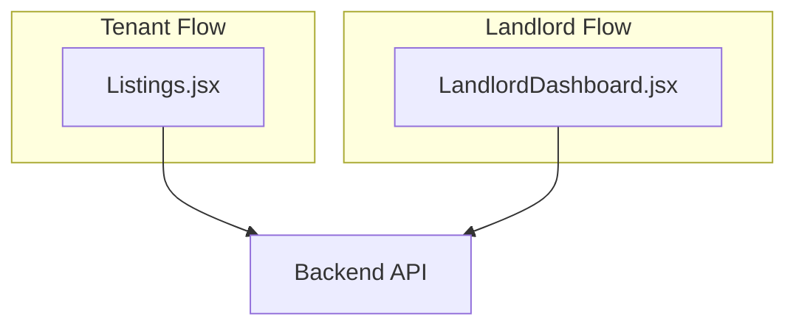
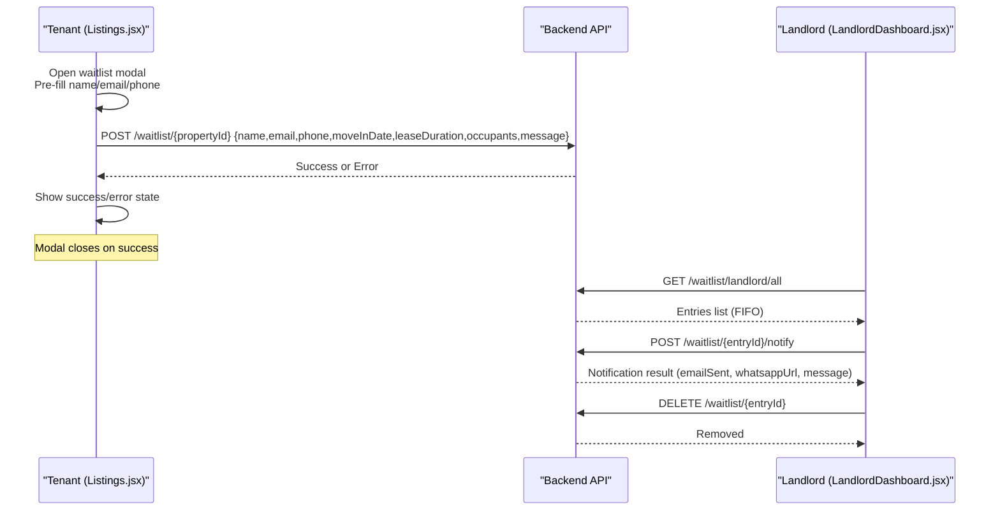
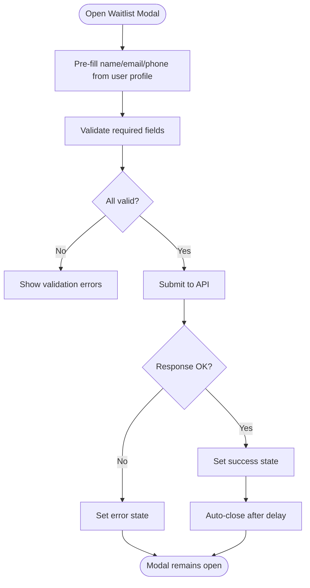
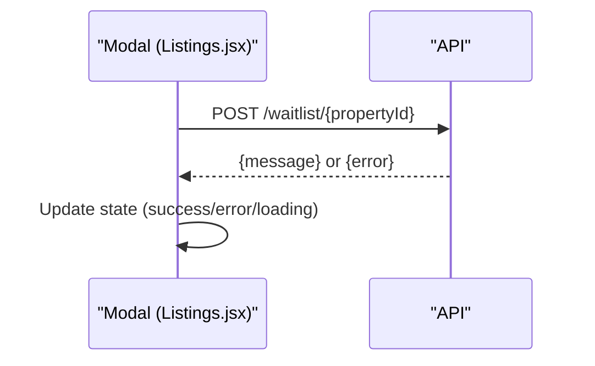
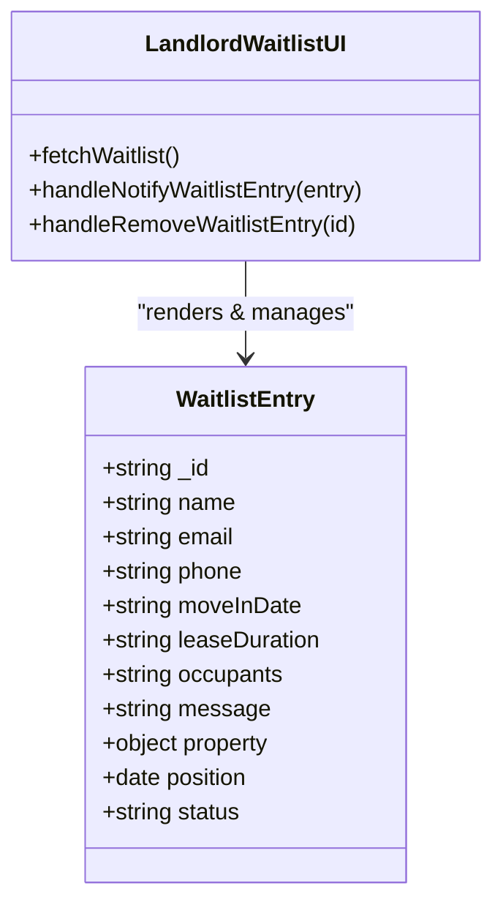
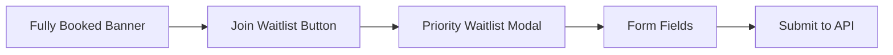
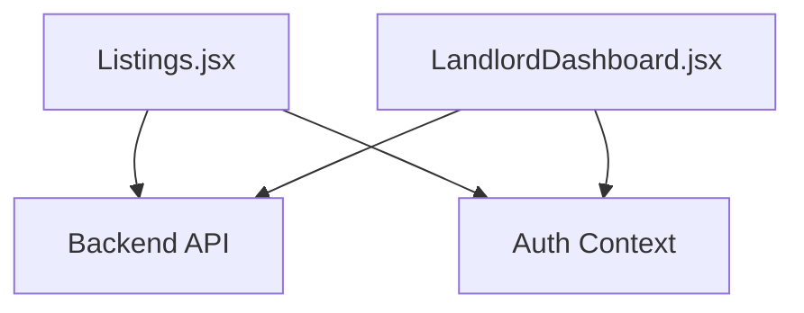

# Waitlist System for Fully Booked Properties

<cite>
**Referenced Files in This Document**
- [Listings.jsx](file://src/pages/Listings.jsx)
- [LandlordDashboard.jsx](file://src/pages/LandlordDashboard.jsx)
</cite>

## Table of Contents
1. [Introduction](#introduction)
2. [Project Structure](#project-structure)
3. [Core Components](#core-components)
4. [Architecture Overview](#architecture-overview)
5. [Detailed Component Analysis](#detailed-component-analysis)
6. [Dependency Analysis](#dependency-analysis)
7. [Performance Considerations](#performance-considerations)
8. [Troubleshooting Guide](#troubleshooting-guide)
9. [Conclusion](#conclusion)
10. [Appendices](#appendices)

## Introduction
This document explains the waitlist system designed for fully booked properties. It covers:
- The waitlist modal and form fields (name, email, phone, move-in date, lease duration, occupants, message).
- Validation rules and user experience design.
- API integration for submitting waitlist entries, error handling, success feedback, and data persistence.
- UI components including the fully booked banner, priority queue messaging, and responsive patterns.
- Customization guidance for forms, extending endpoints, implementing notifications, and managing priorities.

## Project Structure
The waitlist feature spans two primary pages:
- Listings page: tenant-facing flow to join a waitlist when a property is fully occupied.
- Landlord dashboard: landlord-facing view to manage waitlist entries, notify applicants, and remove entries.

**Diagram sources**
- [Listings.jsx:354-406](file://src/pages/Listings.jsx#L354-L406)
- [LandlordDashboard.jsx:408-460](file://src/pages/LandlordDashboard.jsx#L408-L460)

**Section sources**
- [Listings.jsx:354-406](file://src/pages/Listings.jsx#L354-L406)
- [LandlordDashboard.jsx:408-460](file://src/pages/LandlordDashboard.jsx#L408-L460)

## Core Components
- Waitlist Modal (tenant): A portal-rendered modal that appears when a property is fully booked. It collects applicant details and preferences, validates inputs, and submits them via an API call. On success, it shows a confirmation and auto-closes after a short delay.
- Waitlist Management (landlord): A dedicated dashboard tab listing all waitlist entries in FIFO order, with detail panel, notification actions, and removal controls.

Key responsibilities:
- Tenant side: open modal, populate defaults from user profile, validate, submit, handle errors/success.
- Landlord side: fetch all entries, display queue, send availability notifications, remove entries.

**Section sources**
- [Listings.jsx:354-406](file://src/pages/Listings.jsx#L354-L406)
- [LandlordDashboard.jsx:408-460](file://src/pages/LandlordDashboard.jsx#L408-L460)

## Architecture Overview
End-to-end flow for joining a waitlist and managing it:

**Diagram sources**
- [Listings.jsx:383-406](file://src/pages/Listings.jsx#L383-L406)
- [LandlordDashboard.jsx:408-460](file://src/pages/LandlordDashboard.jsx#L408-L460)

## Detailed Component Analysis

### Waitlist Modal and Form Fields
- Trigger: When a property is fully booked, a banner invites users to join the waitlist.
- Modal behavior: Rendered via portal; includes header, reassurance banner, success/error states, and a form.
- Form fields:
  - Full Name (required)
  - Phone / WhatsApp (required; Kenya prefix shown)
  - Email Address (required)
  - Target Move-in (select: Immediately, Within 2 Weeks, Next Month (1st), Within 1–2 Months, Flexible)
  - Lease Duration (select: 1 Year+, 6 Months, 3–6 Months, Flexible/Short-term)
  - Number of Occupants (select: 1 Person, 2 People, Family/3+ People)
  - Special Requests / Notes (optional textarea)
- Validation: HTML required attributes enforce presence for name, phone, email. Additional client-side validation can be added if needed.
- UX: Clear labels, inline hints, privacy note, disabled submit while loading, success screen with auto-close.

**Diagram sources**
- [Listings.jsx:2058-2291](file://src/pages/Listings.jsx#L2058-L2291)
- [Listings.jsx:383-406](file://src/pages/Listings.jsx#L383-L406)

**Section sources**
- [Listings.jsx:2058-2291](file://src/pages/Listings.jsx#L2058-L2291)
- [Listings.jsx:354-406](file://src/pages/Listings.jsx#L354-L406)

### Waitlist Submission API Integration
- Endpoint: POST /waitlist/{propertyId}
- Payload: name, email, phone, moveInDate, leaseDuration, occupants, message
- Headers: Content-Type application/json
- Behavior:
  - On success: set success message, close modal after delay
  - On failure: set error message, keep modal open
- Data persistence: Handled by backend; frontend does not persist locally beyond transient state.

**Diagram sources**
- [Listings.jsx:383-406](file://src/pages/Listings.jsx#L383-L406)

**Section sources**
- [Listings.jsx:383-406](file://src/pages/Listings.jsx#L383-L406)

### Landlord Waitlist Management
- Fetch all entries: GET /waitlist/landlord/all
- Display: FIFO list with position badge, next-in-line indicator, status badges (notified)
- Detail panel: Shows contact info, rental preferences, message, and action buttons
- Actions:
  - Send availability notification: POST /waitlist/{entryId}/notify
  - Remove entry: DELETE /waitlist/{entryId}
- Feedback: Loading indicators, success/error messages, refresh button

**Diagram sources**
- [LandlordDashboard.jsx:408-460](file://src/pages/LandlordDashboard.jsx#L408-L460)
- [LandlordDashboard.jsx:1184-1425](file://src/pages/LandlordDashboard.jsx#L1184-L1425)

**Section sources**
- [LandlordDashboard.jsx:408-460](file://src/pages/LandlordDashboard.jsx#L408-L460)
- [LandlordDashboard.jsx:1184-1425](file://src/pages/LandlordDashboard.jsx#L1184-L1425)

### UI Components and Responsive Design
- Fully booked banner: Appears in the property detail area when availableUnits equals zero, prompting users to join the waitlist.
- Priority queue messaging: Reassurance banner explaining first-come, first-served queue and landlord contact channels.
- Responsive patterns:
  - Modal uses fixed overlay with backdrop blur and scrollable content.
  - Grid layouts adapt to mobile and desktop.
  - Touch-friendly buttons and clear visual hierarchy.

**Diagram sources**
- [Listings.jsx:2058-2070](file://src/pages/Listings.jsx#L2058-L2070)
- [Listings.jsx:2072-2291](file://src/pages/Listings.jsx#L2072-L2291)

**Section sources**
- [Listings.jsx:2058-2070](file://src/pages/Listings.jsx#L2058-L2070)
- [Listings.jsx:2072-2291](file://src/pages/Listings.jsx#L2072-L2291)

## Dependency Analysis
- Listings.jsx depends on:
  - Auth context for pre-filling user data
  - API base URL configuration
  - React DOM portal for modal rendering
- LandlordDashboard.jsx depends on:
  - Auth context for authorization headers
  - Backend endpoints for waitlist management

**Diagram sources**
- [Listings.jsx:9-13](file://src/pages/Listings.jsx#L9-L13)
- [LandlordDashboard.jsx:1-15](file://src/pages/LandlordDashboard.jsx#L1-L15)

**Section sources**
- [Listings.jsx:9-13](file://src/pages/Listings.jsx#L9-L13)
- [LandlordDashboard.jsx:1-15](file://src/pages/LandlordDashboard.jsx#L1-L15)

## Performance Considerations
- Avoid unnecessary re-renders by keeping modal state local and minimizing prop drilling.
- Debounce any repeated API calls during rapid interactions.
- Use skeleton loaders for better perceived performance when fetching waitlist entries.
- Optimize images and assets in the listings page to reduce initial load time.

[No sources needed since this section provides general guidance]

## Troubleshooting Guide
Common issues and resolutions:
- Modal does not open: Ensure the fully booked condition is met and the trigger button is visible.
- Form submission fails: Check network connectivity, verify payload structure, and inspect error messages returned by the API.
- Success message not closing: Confirm timeout logic and ensure no blocking operations prevent modal closure.
- Landlord cannot see entries: Verify authentication headers and endpoint permissions.
- Notifications fail: Inspect backend response for email sending errors and review provided WhatsApp URL.

**Section sources**
- [Listings.jsx:383-406](file://src/pages/Listings.jsx#L383-L406)
- [LandlordDashboard.jsx:408-460](file://src/pages/LandlordDashboard.jsx#L408-L460)

## Conclusion
The waitlist system provides a streamlined tenant experience for fully booked properties and a robust landlord interface to manage and prioritize waitlist entries. It integrates cleanly with backend APIs, offers clear feedback, and supports responsive design. Extensibility points include additional form fields, custom notification channels, and advanced prioritization logic.

[No sources needed since this section summarizes without analyzing specific files]

## Appendices

### Customizing Waitlist Forms
- Add new fields by extending the waitlistData state and corresponding input elements in the modal.
- Update validation logic to accommodate new fields.
- Adjust the payload sent to the API to include new fields.

**Section sources**
- [Listings.jsx:354-406](file://src/pages/Listings.jsx#L354-L406)
- [Listings.jsx:2139-2286](file://src/pages/Listings.jsx#L2139-L2286)

### Extending API Endpoints
- New endpoints can be added for features like:
  - Bulk operations (e.g., notify multiple entries)
  - Advanced filtering (e.g., by move-in date or lease duration)
  - Analytics (e.g., conversion metrics per property)

**Section sources**
- [Listings.jsx:383-406](file://src/pages/Listings.jsx#L383-L406)
- [LandlordDashboard.jsx:408-460](file://src/pages/LandlordDashboard.jsx#L408-L460)

### Implementing Waitlist Notifications
- Current implementation sends an availability notification and returns a WhatsApp URL for direct communication.
- Extend to support SMS, email templates, or in-app notifications.

**Section sources**
- [LandlordDashboard.jsx:425-444](file://src/pages/LandlordDashboard.jsx#L425-L444)
- [LandlordDashboard.jsx:1341-1371](file://src/pages/LandlordDashboard.jsx#L1341-L1371)

### Managing Waitlist Priorities
- Default behavior is FIFO based on request timestamp.
- To implement custom priorities:
  - Introduce a priority field in the payload.
  - Sort entries by priority before displaying.
  - Provide landlord controls to adjust priority.

**Section sources**
- [LandlordDashboard.jsx:1184-1266](file://src/pages/LandlordDashboard.jsx#L1184-L1266)