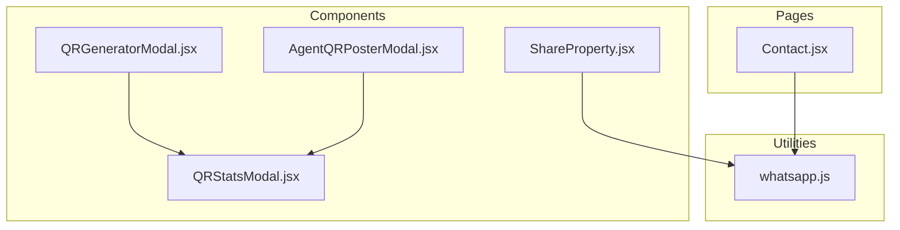
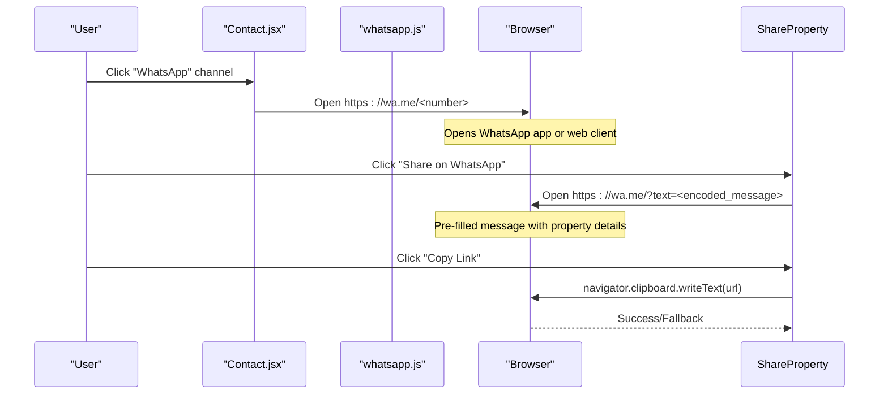
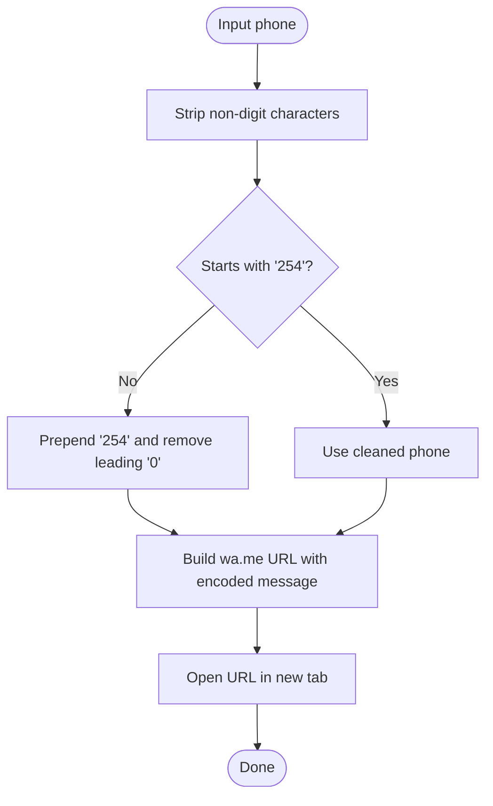
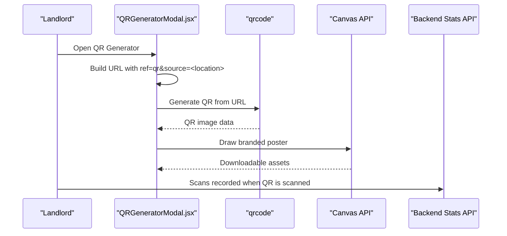
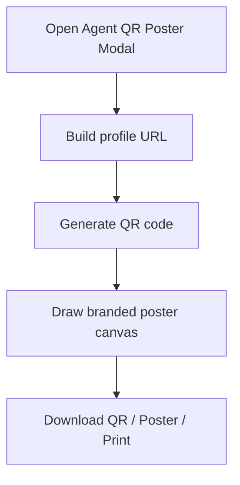
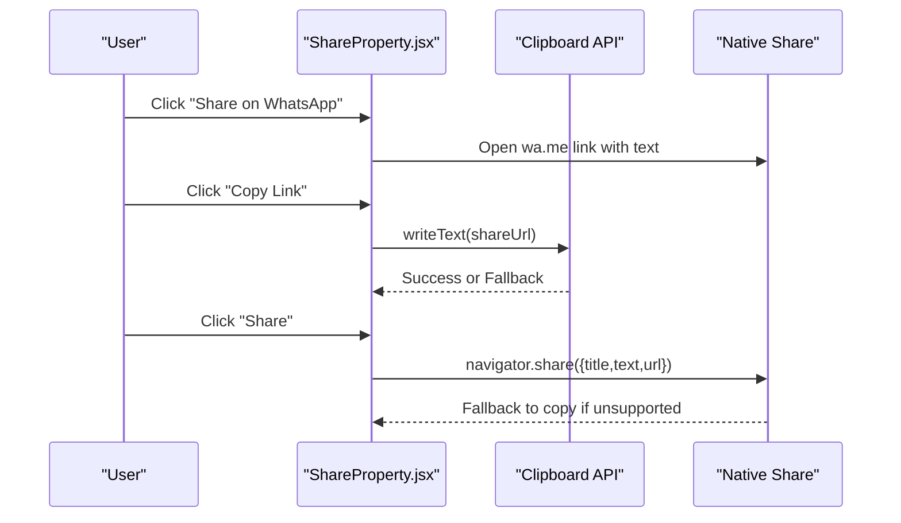
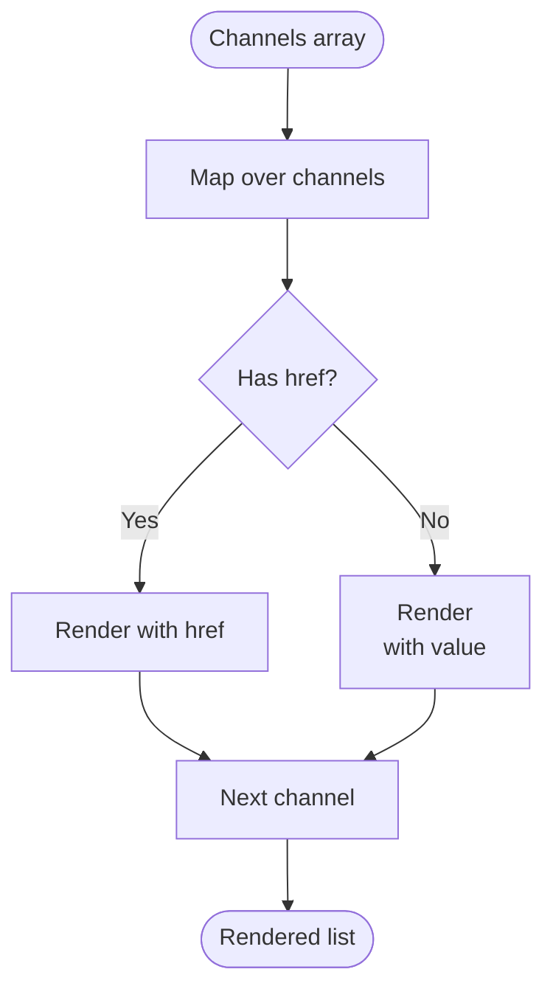
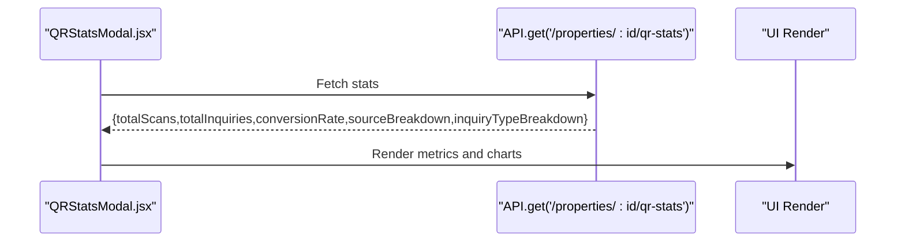
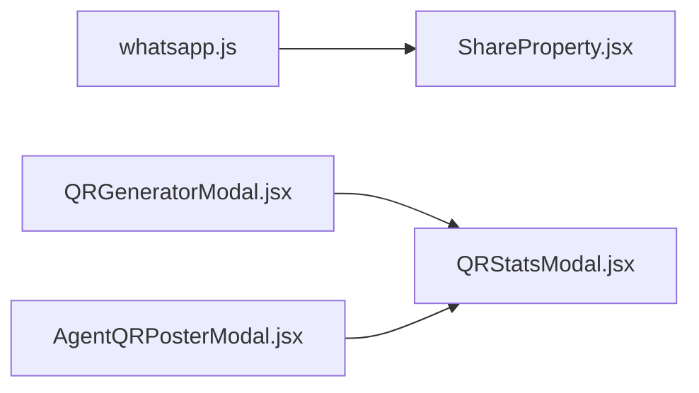

# Contact & Sharing Features

<cite>
**Referenced Files in This Document**
- [whatsapp.js](file://src/utils/whatsapp.js)
- [ShareProperty.jsx](file://src/components/ShareProperty.jsx)
- [Contact.jsx](file://src/pages/Contact.jsx)
- [QRGeneratorModal.jsx](file://src/components/QRGeneratorModal.jsx)
- [AgentQRPosterModal.jsx](file://src/components/AgentQRPosterModal.jsx)
- [QRStatsModal.jsx](file://src/components/QRStatsModal.jsx)
</cite>

## Table of Contents
1. [Introduction](#introduction)
2. [Project Structure](#project-structure)
3. [Core Components](#core-components)
4. [Architecture Overview](#architecture-overview)
5. [Detailed Component Analysis](#detailed-component-analysis)
6. [Dependency Analysis](#dependency-analysis)
7. [Performance Considerations](#performance-considerations)
8. [Troubleshooting Guide](#troubleshooting-guide)
9. [Conclusion](#conclusion)
10. [Appendices](#appendices)

## Introduction
This document explains the contact and sharing features implemented in the frontend application. It covers:
- WhatsApp integration with phone number formatting and direct messaging
- Direct calling functionality via tel links
- QR code generation, poster creation, and tracking analytics
- Sharing capabilities including social media integration, copy-to-clipboard, and embedded property links
- Contact method selection logic, user interaction tracking hooks, and analytics integration points
- Examples for adding new contact methods, customizing share templates, and implementing referral tracking systems

## Project Structure
The relevant modules are organized by feature:
- Utilities: WhatsApp URL builder and launcher
- Pages: Contact page with channels and form
- Components: Property sharing, QR generation and posters, agent QR posters, and QR analytics modal

**Diagram sources**
- [whatsapp.js:1-15](file://src/utils/whatsapp.js#L1-L15)
- [Contact.jsx:20-24](file://src/pages/Contact.jsx#L20-L24)
- [ShareProperty.jsx:23-58](file://src/components/ShareProperty.jsx#L23-L58)
- [QRGeneratorModal.jsx:381-409](file://src/components/QRGeneratorModal.jsx#L381-L409)
- [AgentQRPosterModal.jsx:373-393](file://src/components/AgentQRPosterModal.jsx#L373-L393)
- [QRStatsModal.jsx:31-47](file://src/components/QRStatsModal.jsx#L31-L47)

**Section sources**
- [whatsapp.js:1-15](file://src/utils/whatsapp.js#L1-L15)
- [Contact.jsx:20-24](file://src/pages/Contact.jsx#L20-L24)
- [ShareProperty.jsx:23-58](file://src/components/ShareProperty.jsx#L23-L58)
- [QRGeneratorModal.jsx:381-409](file://src/components/QRGeneratorModal.jsx#L381-L409)
- [AgentQRPosterModal.jsx:373-393](file://src/components/AgentQRPosterModal.jsx#L373-L393)
- [QRStatsModal.jsx:31-47](file://src/components/QRStatsModal.jsx#L31-L47)

## Core Components
- WhatsApp utility: Builds normalized URLs to open WhatsApp chats with a pre-filled message and standardized Kenyan phone numbers.
- Share property component: Provides WhatsApp sharing, native share API, and clipboard copy with fallbacks.
- Contact page: Presents multiple contact channels (email, support, WhatsApp) and a contact form.
- QR generator modal: Generates QR codes for properties with source attribution and downloadable posters.
- Agent QR poster modal: Generates QR codes linking to an agent profile with branded posters.
- QR stats modal: Displays scan counts, inquiry breakdowns, and conversion metrics.

**Section sources**
- [whatsapp.js:1-15](file://src/utils/whatsapp.js#L1-L15)
- [ShareProperty.jsx:6-58](file://src/components/ShareProperty.jsx#L6-L58)
- [Contact.jsx:20-24](file://src/pages/Contact.jsx#L20-L24)
- [QRGeneratorModal.jsx:381-409](file://src/components/QRGeneratorModal.jsx#L381-L409)
- [AgentQRPosterModal.jsx:373-393](file://src/components/AgentQRPosterModal.jsx#L373-L393)
- [QRStatsModal.jsx:31-47](file://src/components/QRStatsModal.jsx#L31-L47)

## Architecture Overview
The contact and sharing features follow a modular architecture:
- Utility layer provides reusable functions for WhatsApp URL construction and launching.
- Page-level components aggregate contact channels and present forms.
- Feature components encapsulate sharing and QR generation logic.
- Analytics modal consumes backend statistics to visualize performance.

**Diagram sources**
- [Contact.jsx:20-24](file://src/pages/Contact.jsx#L20-L24)
- [ShareProperty.jsx:23-58](file://src/components/ShareProperty.jsx#L23-L58)

## Detailed Component Analysis

### WhatsApp Integration and Phone Formatting
- The utility normalizes phone numbers by stripping non-digits and ensuring Kenyan format starting with 254.
- It constructs a wa.me link with an optional pre-filled message.
- The launcher opens the URL in a new window with security flags.

**Diagram sources**
- [whatsapp.js:1-15](file://src/utils/whatsapp.js#L1-L15)

**Section sources**
- [whatsapp.js:1-15](file://src/utils/whatsapp.js#L1-L15)

### Direct Calling Functionality
- The contact page includes email channels using mailto links.
- For direct calls, integrate tel links alongside existing channels. Example pattern: href="tel:+254745689773".
- Ensure consistent formatting and accessibility labels for screen readers.

Implementation guidance:
- Add a new channel entry with value formatted as a phone number and href using the tel scheme.
- Provide a label indicating "Call" and ensure mobile devices trigger the dialer.

**Section sources**
- [Contact.jsx:20-24](file://src/pages/Contact.jsx#L20-L24)

### QR Code Tracking and Poster Generation
- QR generator creates a unique URL per property with query parameters for ref and source.
- Uses a QR library to render high-quality images and supports downloading both standalone QR and branded posters.
- Source attribution enables analytics to attribute scans to physical locations.

**Diagram sources**
- [QRGeneratorModal.jsx:381-409](file://src/components/QRGeneratorModal.jsx#L381-L409)

**Section sources**
- [QRGeneratorModal.jsx:381-409](file://src/components/QRGeneratorModal.jsx#L381-L409)

### Agent QR Posters
- Mirrors landlord poster design but targets agent profiles.
- Generates QR linking to /agent/profile/{id}.
- Supports download and print actions for marketing materials.

**Diagram sources**
- [AgentQRPosterModal.jsx:373-393](file://src/components/AgentQRPosterModal.jsx#L373-L393)

**Section sources**
- [AgentQRPosterModal.jsx:373-393](file://src/components/AgentQRPosterModal.jsx#L373-L393)

### Sharing Capabilities
- WhatsApp sharing: Opens a chat with a pre-filled message containing property highlights and a link.
- Native share: Uses navigator.share where available; falls back to copy link.
- Copy-to-clipboard: Attempts modern clipboard API with fallback for older browsers.
- Embedded property links: Share URL includes highlight parameter to focus the listing.

**Diagram sources**
- [ShareProperty.jsx:23-58](file://src/components/ShareProperty.jsx#L23-L58)

**Section sources**
- [ShareProperty.jsx:23-58](file://src/components/ShareProperty.jsx#L23-L58)

### Contact Method Selection Logic
- Channels are defined as an array of objects with icon, label, value, and href.
- Rendering conditionally renders anchor tags when href exists; otherwise displays plain text.
- Extensible structure allows adding new channels like SMS, Telegram, or direct call links.

**Diagram sources**
- [Contact.jsx:20-24](file://src/pages/Contact.jsx#L20-L24)

**Section sources**
- [Contact.jsx:20-24](file://src/pages/Contact.jsx#L20-L24)

### User Interaction Tracking and Analytics Integration
- QR stats modal fetches analytics data from a backend endpoint and displays totals, conversion rates, and breakdowns by source and inquiry type.
- Inquiry types include WhatsApp, call, and booking, enabling measurement of conversion paths.
- To integrate analytics events:
  - Track share button clicks (WhatsApp, copy, native share).
  - Track QR poster downloads and prints.
  - Track channel interactions (mailto, tel, wa.me).

**Diagram sources**
- [QRStatsModal.jsx:31-47](file://src/components/QRStatsModal.jsx#L31-L47)

**Section sources**
- [QRStatsModal.jsx:31-47](file://src/components/QRStatsModal.jsx#L31-L47)

## Dependency Analysis
- whatsapp.js is consumed by ShareProperty.jsx and can be used across the app for consistent phone handling.
- QRGeneratorModal.jsx and AgentQRPosterModal.jsx depend on qrcode library and Canvas API for rendering.
- QRStatsModal.jsx depends on API service to retrieve analytics data.

**Diagram sources**
- [whatsapp.js:1-15](file://src/utils/whatsapp.js#L1-L15)
- [ShareProperty.jsx:23-58](file://src/components/ShareProperty.jsx#L23-L58)
- [QRGeneratorModal.jsx:381-409](file://src/components/QRGeneratorModal.jsx#L381-L409)
- [AgentQRPosterModal.jsx:373-393](file://src/components/AgentQRPosterModal.jsx#L373-L393)
- [QRStatsModal.jsx:31-47](file://src/components/QRStatsModal.jsx#L31-L47)

**Section sources**
- [whatsapp.js:1-15](file://src/utils/whatsapp.js#L1-L15)
- [ShareProperty.jsx:23-58](file://src/components/ShareProperty.jsx#L23-L58)
- [QRGeneratorModal.jsx:381-409](file://src/components/QRGeneratorModal.jsx#L381-L409)
- [AgentQRPosterModal.jsx:373-393](file://src/components/AgentQRPosterModal.jsx#L373-L393)
- [QRStatsModal.jsx:31-47](file://src/components/QRStatsModal.jsx#L31-L47)

## Performance Considerations
- Prefer navigator.share for native sharing to reduce overhead and improve UX on supported platforms.
- Debounce QR generation triggers to avoid redundant computations when props change rapidly.
- Cache generated QR images and poster canvases to prevent re-rendering costs.
- Use lazy loading for QR modals to defer heavy operations until needed.

[No sources needed since this section provides general guidance]

## Troubleshooting Guide
- WhatsApp link not opening:
  - Verify phone normalization ensures 254 prefix and no leading zero.
  - Confirm device has WhatsApp installed or web client accessible.
- Clipboard copy fails:
  - Ensure HTTPS context for clipboard API; fallback implementation handles older browsers.
- QR code not generating:
  - Check qrcode library availability and canvas permissions.
  - Validate URL parameters for ref and source.
- Stats modal shows error:
  - Inspect network request to /properties/:id/qr-stats and verify backend response shape.

**Section sources**
- [whatsapp.js:1-15](file://src/utils/whatsapp.js#L1-L15)
- [ShareProperty.jsx:30-46](file://src/components/ShareProperty.jsx#L30-L46)
- [QRGeneratorModal.jsx:381-409](file://src/components/QRGeneratorModal.jsx#L381-L409)
- [QRStatsModal.jsx:31-47](file://src/components/QRStatsModal.jsx#L31-L47)

## Conclusion
The contact and sharing features provide robust mechanisms for connecting users with properties and agents through WhatsApp, direct calls, and QR-based marketing materials. The modular design supports extensibility for additional channels, customizable share templates, and comprehensive analytics tracking. By following the patterns outlined here, teams can add new contact methods, refine sharing flows, and implement referral tracking systems effectively.

[No sources needed since this section summarizes without analyzing specific files]

## Appendices

### Adding New Contact Methods
- Extend the channels array in the contact page with entries for new methods (e.g., SMS, Telegram, direct call).
- Use appropriate href schemes:
  - Email: mailto:address@example.com
  - Call: tel:+254745689773
  - Messaging apps: use their deep links or universal links where supported.

**Section sources**
- [Contact.jsx:20-24](file://src/pages/Contact.jsx#L20-L24)

### Customizing Share Templates
- Modify the share text template in the share component to include more property details or branding.
- Adjust the share URL parameters to embed campaign identifiers or UTM tags for analytics.

**Section sources**
- [ShareProperty.jsx:11-21](file://src/components/ShareProperty.jsx#L11-L21)

### Implementing Referral Tracking Systems
- Append ref and source query parameters to share URLs and QR URLs to track campaigns.
- Log user interactions at key touchpoints (share click, copy, QR download/print, channel click).
- Correlate frontend events with backend analytics endpoints to measure conversion rates.

**Section sources**
- [QRGeneratorModal.jsx:381-383](file://src/components/QRGeneratorModal.jsx#L381-L383)
- [QRStatsModal.jsx:31-47](file://src/components/QRStatsModal.jsx#L31-L47)