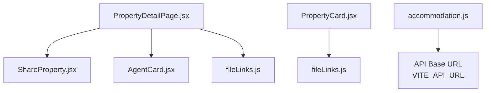
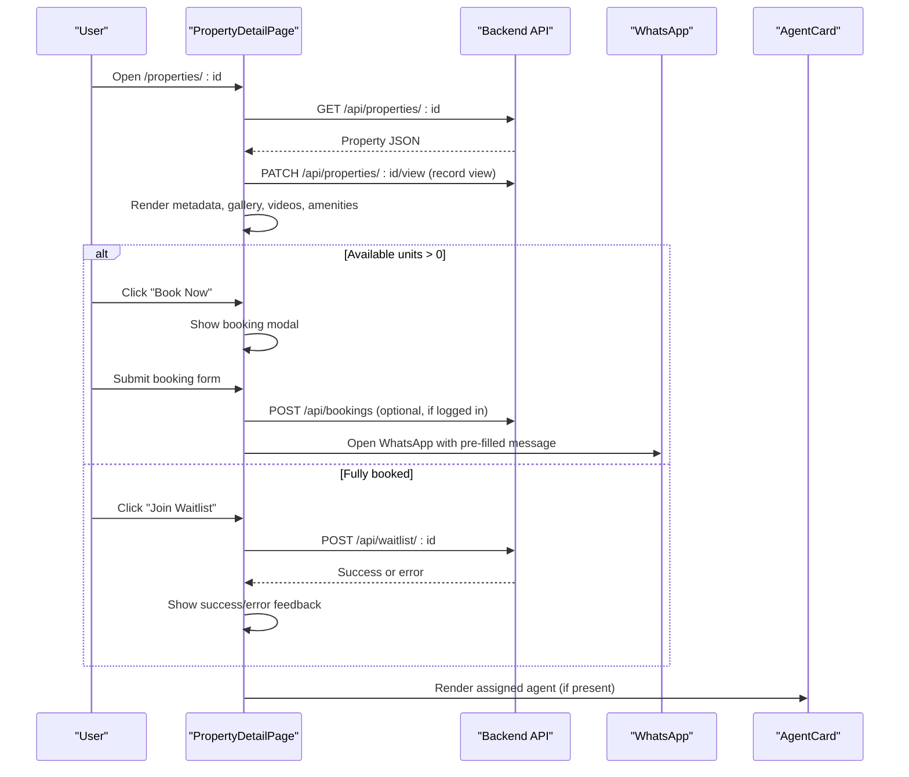
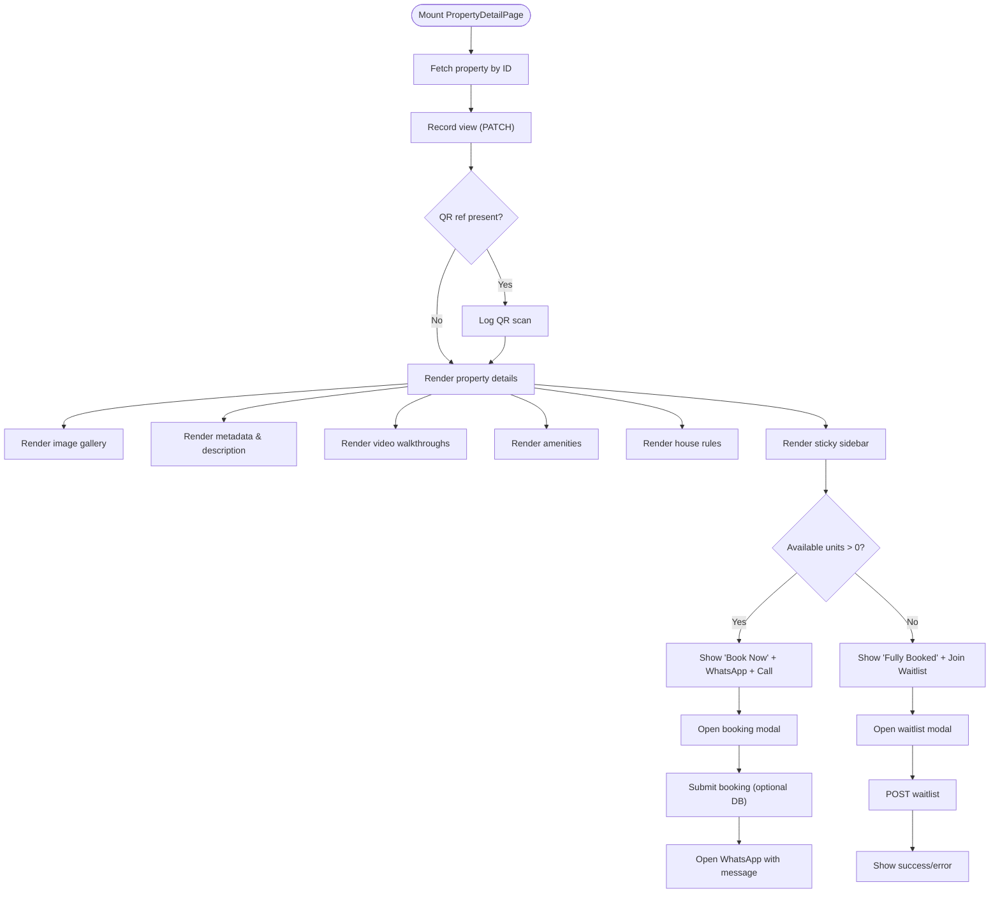
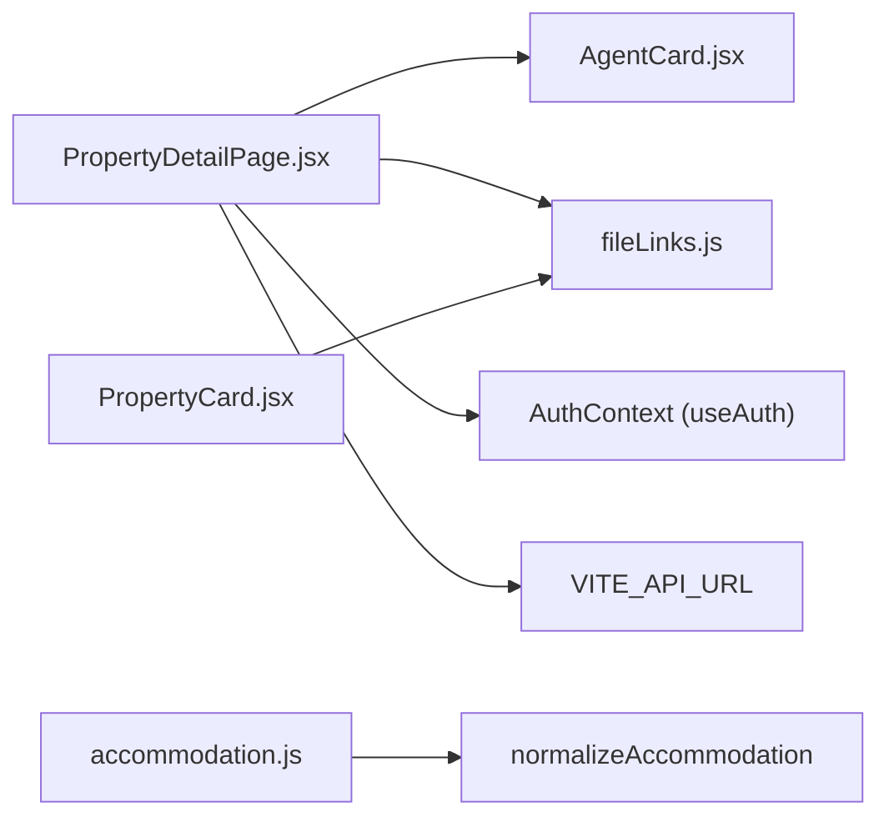

# Property Detail Pages

<cite>
**Referenced Files in This Document**
- [PropertyDetailPage.jsx](file://src/pages/PropertyDetailPage.jsx)
- [ShareProperty.jsx](file://src/components/ShareProperty.jsx)
- [AgentCard.jsx](file://src/components/AgentCard.jsx)
- [accommodation.js](file://src/api/accommodation.js)
- [PropertyCard.jsx](file://src/features/accommodation/components/PropertyCard.jsx)
- [fileLinks.js](file://src/utils/fileLinks.js)
</cite>

## Table of Contents
1. [Introduction](#introduction)
2. [Project Structure](#project-structure)
3. [Core Components](#core-components)
4. [Architecture Overview](#architecture-overview)
5. [Detailed Component Analysis](#detailed-component-analysis)
6. [Dependency Analysis](#dependency-analysis)
7. [Performance Considerations](#performance-considerations)
8. [Troubleshooting Guide](#troubleshooting-guide)
9. [Conclusion](#conclusion)
10. [Appendices](#appendices)

## Introduction
This document explains the property detail page functionality across the frontend codebase. It covers how comprehensive property information is displayed, how image galleries and video tours work, how booking and waitlist flows integrate with WhatsApp and optional database persistence, how agent contact features are implemented, and how sharing works. It also documents the data flow from API to UI components for metadata, pricing, availability, and location details, and provides guidance on customizing layouts, adding new attributes, and extending booking workflows.

## Project Structure
The property detail feature spans a primary page component, reusable UI components for sharing and agent contact, an accommodation API helper, and utility functions for media resolution. The listing card component demonstrates related gallery behavior used elsewhere in the app.

**Diagram sources**
- [PropertyDetailPage.jsx:1-10](file://src/pages/PropertyDetailPage.jsx#L1-L10)
- [ShareProperty.jsx:1-10](file://src/components/ShareProperty.jsx#L1-L10)
- [AgentCard.jsx:1-10](file://src/components/AgentCard.jsx#L1-L10)
- [PropertyCard.jsx:1-10](file://src/features/accommodation/components/PropertyCard.jsx#L1-L10)
- [accommodation.js:1-10](file://src/api/accommodation.js#L1-L10)
- [fileLinks.js:1-10](file://src/utils/fileLinks.js#L1-L10)

**Section sources**
- [PropertyDetailPage.jsx:1-10](file://src/pages/PropertyDetailPage.jsx#L1-L10)
- [ShareProperty.jsx:1-10](file://src/components/ShareProperty.jsx#L1-L10)
- [AgentCard.jsx:1-10](file://src/components/AgentCard.jsx#L1-L10)
- [PropertyCard.jsx:1-10](file://src/features/accommodation/components/PropertyCard.jsx#L1-L10)
- [accommodation.js:1-10](file://src/api/accommodation.js#L1-L10)
- [fileLinks.js:1-10](file://src/utils/fileLinks.js#L1-L10)

## Core Components
- PropertyDetailPage.jsx: Main page that fetches property data, renders metadata, images, videos, amenities, house rules, pricing, availability, booking/waitlist modals, and integrates agent contact via AgentCard.
- ShareProperty.jsx: Reusable share UI that builds a shareable link and supports WhatsApp, copy-to-clipboard, and native share.
- AgentCard.jsx: Displays assigned agent info, verification status, WhatsApp contact, and report modal.
- accommodation.js: Centralized API client for accommodations, including normalization helpers and endpoints.
- PropertyCard.jsx: Listing card with auto-cycling image gallery and badges; demonstrates gallery patterns reused conceptually by detail pages.
- fileLinks.js: Utility to resolve relative media URLs into absolute URLs using VITE_API_URL.

Key responsibilities:
- Data fetching and error handling for property detail
- Image gallery navigation and video playback
- Booking workflow with optional DB save and WhatsApp redirect
- Waitlist enrollment for fully booked properties
- Agent contact and reporting
- Sharing via multiple channels

**Section sources**
- [PropertyDetailPage.jsx:32-129](file://src/pages/PropertyDetailPage.jsx#L32-L129)
- [ShareProperty.jsx:6-86](file://src/components/ShareProperty.jsx#L6-L86)
- [AgentCard.jsx:5-77](file://src/components/AgentCard.jsx#L5-L77)
- [accommodation.js:34-77](file://src/api/accommodation.js#L34-L77)
- [PropertyCard.jsx:1-271](file://src/features/accommodation/components/PropertyCard.jsx#L1-L271)
- [fileLinks.js:4-8](file://src/utils/fileLinks.js#L4-L8)

## Architecture Overview
The property detail page follows a straightforward React component architecture:
- The page component fetches property data directly from the backend using a base API URL configured via environment variables.
- It manages local state for loading, errors, current image index, and modals for booking and waitlist.
- It renders a responsive grid layout with main content and a sticky sidebar containing price, availability, and action buttons.
- It conditionally shows a fully booked banner and waitlist CTA when no units are available.
- It integrates agent contact through AgentCard if an assigned agent exists.
- It uses utilities for media URL resolution and WhatsApp integration.

**Diagram sources**
- [PropertyDetailPage.jsx:80-129](file://src/pages/PropertyDetailPage.jsx#L80-L129)
- [PropertyDetailPage.jsx:160-232](file://src/pages/PropertyDetailPage.jsx#L160-L232)
- [PropertyDetailPage.jsx:536-634](file://src/pages/PropertyDetailPage.jsx#L536-L634)
- [PropertyDetailPage.jsx:639-642](file://src/pages/PropertyDetailPage.jsx#L639-L642)

## Detailed Component Analysis

### PropertyDetailPage.jsx
Responsibilities:
- Fetches property by ID and records a view increment.
- Handles QR scan logging and conversion tracking.
- Renders image gallery with navigation and count indicator.
- Displays property metadata: title, location, bedrooms, bathrooms, furnished status, views.
- Shows description, amenities, videos, and house rules.
- Presents pricing and availability in a sticky sidebar.
- Provides booking modal with optional DB persistence and WhatsApp redirection.
- Provides waitlist modal for fully booked properties with rich form fields and validation feedback.
- Integrates AgentCard when an assigned agent exists.

Data flow highlights:
- API base URL is read from environment variable with fallback.
- Property data is normalized by direct usage of returned fields (title, location, county, price, availableUnits, etc.).
- Media URLs are resolved via utility function for Cloudinary and relative paths.

Error handling:
- Loading and error states render friendly messages and navigation back to listings.
- Optional DB booking save failure does not block WhatsApp flow.
- Waitlist submission shows success or error messages.

Customization points:
- Layout grid and responsive breakpoints can be adjusted in inline styles.
- New property attributes can be added to the metadata section and sidebar.
- Booking and waitlist forms can be extended with additional fields and validation.

**Diagram sources**
- [PropertyDetailPage.jsx:80-129](file://src/pages/PropertyDetailPage.jsx#L80-L129)
- [PropertyDetailPage.jsx:282-354](file://src/pages/PropertyDetailPage.jsx#L282-L354)
- [PropertyDetailPage.jsx:356-519](file://src/pages/PropertyDetailPage.jsx#L356-L519)
- [PropertyDetailPage.jsx:521-634](file://src/pages/PropertyDetailPage.jsx#L521-L634)
- [PropertyDetailPage.jsx:647-712](file://src/pages/PropertyDetailPage.jsx#L647-L712)
- [PropertyDetailPage.jsx:714-931](file://src/pages/PropertyDetailPage.jsx#L714-L931)

**Section sources**
- [PropertyDetailPage.jsx:1-10](file://src/pages/PropertyDetailPage.jsx#L1-L10)
- [PropertyDetailPage.jsx:32-129](file://src/pages/PropertyDetailPage.jsx#L32-L129)
- [PropertyDetailPage.jsx:234-264](file://src/pages/PropertyDetailPage.jsx#L234-L264)
- [PropertyDetailPage.jsx:282-354](file://src/pages/PropertyDetailPage.jsx#L282-L354)
- [PropertyDetailPage.jsx:356-519](file://src/pages/PropertyDetailPage.jsx#L356-L519)
- [PropertyDetailPage.jsx:521-634](file://src/pages/PropertyDetailPage.jsx#L521-L634)
- [PropertyDetailPage.jsx:647-712](file://src/pages/PropertyDetailPage.jsx#L647-L712)
- [PropertyDetailPage.jsx:714-931](file://src/pages/PropertyDetailPage.jsx#L714-L931)

### ShareProperty.jsx
Responsibilities:
- Builds a shareable URL pointing to listings with a highlight parameter.
- Composes a formatted text summary including title, location, price, beds/baths, and availability.
- Supports three sharing methods:
  - WhatsApp open with encoded text
  - Copy link to clipboard with fallback for older browsers
  - Native Web Share API when available

Usage example:
- Include <ShareProperty property={selectedProperty} /> inside any modal or detail view to expose sharing options.

**Section sources**
- [ShareProperty.jsx:6-86](file://src/components/ShareProperty.jsx#L6-L86)

### AgentCard.jsx
Responsibilities:
- Displays agent name, photo, verification status, county, and bio.
- Provides a WhatsApp contact button only when the agent is verified and has a phone number.
- Logs inquiry events when contacting via WhatsApp.
- Includes a report modal to submit reports about agents with reason, details, and reporter contact.

Integration:
- Used within PropertyDetailPage when an assigned agent is present in the property data.

**Section sources**
- [AgentCard.jsx:5-77](file://src/components/AgentCard.jsx#L5-L77)
- [AgentCard.jsx:77-155](file://src/components/AgentCard.jsx#L77-L155)
- [AgentCard.jsx:157-225](file://src/components/AgentCard.jsx#L157-L225)

### accommodation.js
Responsibilities:
- Centralizes API calls for accommodations.
- Normalizes accommodation objects to a consistent shape (id, price, category, location, images, videos, rating, reviews, color, tag, amenities).
- Provides endpoints for browsing, featured listings, stats, single item retrieval, owner profile management, and review submission.

Normalization highlights:
- Converts various image formats (string or object) into a uniform array.
- Cleans and standardizes video URLs.
- Derives location string from address or coordinates.

Note:
- While PropertyDetailPage fetches properties directly, this module demonstrates a standardized approach for other parts of the app.

**Section sources**
- [accommodation.js:7-18](file://src/api/accommodation.js#L7-L18)
- [accommodation.js:20-30](file://src/api/accommodation.js#L20-L30)
- [accommodation.js:34-77](file://src/api/accommodation.js#L34-L77)
- [accommodation.js:81-114](file://src/api/accommodation.js#L81-L114)
- [accommodation.js:118-191](file://src/api/accommodation.js#L118-L191)

### PropertyCard.jsx
Responsibilities:
- Renders a compact listing card with an auto-cycling image gallery.
- Shows tags, booking URL indicators, video tour badges, verification badges, amenities, price, and rating.
- Provides navigation controls for multi-image galleries and dot indicators.

Relevance:
- Demonstrates gallery UX patterns and badge rendering that can inspire enhancements in detail pages.

**Section sources**
- [PropertyCard.jsx:1-271](file://src/features/accommodation/components/PropertyCard.jsx#L1-L271)

### fileLinks.js
Responsibilities:
- Resolves relative media URLs to absolute URLs based on VITE_API_URL.
- Provides helpers for protected file access and pricelist downloads.

Usage:
- PropertyDetailPage uses it to ensure images and videos load correctly regardless of storage provider.

**Section sources**
- [fileLinks.js:1-8](file://src/utils/fileLinks.js#L1-L8)
- [fileLinks.js:10-17](file://src/utils/fileLinks.js#L10-L17)
- [fileLinks.js:19-41](file://src/utils/fileLinks.js#L19-L41)

## Dependency Analysis
Component relationships and dependencies:
- PropertyDetailPage depends on:
  - Environment configuration for API base URL
  - Auth context for user and token
  - Utilities for media URL resolution
  - AgentCard for agent display and contact
  - ShareProperty for sharing capabilities (can be integrated)
- Accommodation API module is independent but provides normalization patterns and endpoints used elsewhere.
- PropertyCard is standalone and demonstrates gallery UX.

**Diagram sources**
- [PropertyDetailPage.jsx:1-10](file://src/pages/PropertyDetailPage.jsx#L1-L10)
- [AgentCard.jsx:1-10](file://src/components/AgentCard.jsx#L1-L10)
- [fileLinks.js:1-8](file://src/utils/fileLinks.js#L1-L8)
- [accommodation.js:34-77](file://src/api/accommodation.js#L34-L77)
- [PropertyCard.jsx:1-10](file://src/features/accommodation/components/PropertyCard.jsx#L1-L10)

**Section sources**
- [PropertyDetailPage.jsx:1-10](file://src/pages/PropertyDetailPage.jsx#L1-L10)
- [AgentCard.jsx:1-10](file://src/components/AgentCard.jsx#L1-L10)
- [fileLinks.js:1-8](file://src/utils/fileLinks.js#L1-L8)
- [accommodation.js:34-77](file://src/api/accommodation.js#L34-L77)
- [PropertyCard.jsx:1-10](file://src/features/accommodation/components/PropertyCard.jsx#L1-L10)

## Performance Considerations
- Image gallery:
  - Avoid heavy animations; use simple opacity transitions as shown in PropertyCard.
  - Lazy-load images where possible to reduce initial payload.
- Video playback:
  - Use preload="metadata" to avoid large downloads until play.
  - Normalize video URLs to ensure compatibility with web players.
- API calls:
  - Record views asynchronously without blocking UI.
  - Debounce repeated actions like QR scan logging if needed.
- State management:
  - Keep modal state minimal and reset on close to prevent memory leaks.
- Responsive layout:
  - Use CSS grid with minmax constraints for better performance on small screens.

[No sources needed since this section provides general guidance]

## Troubleshooting Guide
Common issues and resolutions:
- Property not found:
  - The page renders a friendly error and a button to browse listings.
  - Verify the property ID and backend availability.
- Images not loading:
  - Ensure media URLs are absolute or resolvable via fileLinks utility.
  - Check Cloudinary URL normalization for video formats.
- Booking fails to save to DB:
  - The flow continues to WhatsApp even if DB save fails; check network logs for auth headers.
- Waitlist submission errors:
  - Validate required fields and server response; show error messages to users.
- Agent contact unavailable:
  - WhatsApp button appears only for verified agents with phone numbers; verify agent status.

**Section sources**
- [PropertyDetailPage.jsx:234-264](file://src/pages/PropertyDetailPage.jsx#L234-L264)
- [PropertyDetailPage.jsx:160-206](file://src/pages/PropertyDetailPage.jsx#L160-L206)
- [PropertyDetailPage.jsx:208-232](file://src/pages/PropertyDetailPage.jsx#L208-L232)
- [AgentCard.jsx:18-37](file://src/components/AgentCard.jsx#L18-L37)

## Conclusion
The property detail page provides a comprehensive, user-friendly experience for exploring property information, interacting with media, initiating bookings or waitlist enrollments, contacting agents, and sharing listings. Its modular design allows easy customization of layouts, addition of new attributes, and extension of booking workflows. By leveraging shared utilities and components, the implementation remains maintainable and scalable.

[No sources needed since this section summarizes without analyzing specific files]

## Appendices

### Customizing Detail Layouts
- Adjust the responsive grid by modifying the CSS class and media queries in the page’s style block.
- Add new attribute rows in the metadata section by inserting JSX elements alongside existing ones.
- Extend the sidebar with additional call-to-action buttons or informational blocks.

**Section sources**
- [PropertyDetailPage.jsx:268-280](file://src/pages/PropertyDetailPage.jsx#L268-L280)
- [PropertyDetailPage.jsx:356-395](file://src/pages/PropertyDetailPage.jsx#L356-L395)
- [PropertyDetailPage.jsx:521-534](file://src/pages/PropertyDetailPage.jsx#L521-L534)

### Adding New Property Attributes
- Introduce new fields in the metadata area by referencing property data keys.
- Update the sidebar to reflect availability or pricing changes based on new attributes.
- Ensure any new fields are handled in API responses and normalization logic if applicable.

**Section sources**
- [PropertyDetailPage.jsx:378-395](file://src/pages/PropertyDetailPage.jsx#L378-L395)
- [PropertyDetailPage.jsx:521-534](file://src/pages/PropertyDetailPage.jsx#L521-L534)
- [accommodation.js:34-77](file://src/api/accommodation.js#L34-L77)

### Implementing Booking Workflows
- Extend the booking modal with additional fields and validation.
- Integrate payment providers by adding steps before WhatsApp redirection.
- Persist booking attempts to analytics or CRM systems via additional API calls.

**Section sources**
- [PropertyDetailPage.jsx:647-712](file://src/pages/PropertyDetailPage.jsx#L647-L712)
- [PropertyDetailPage.jsx:160-206](file://src/pages/PropertyDetailPage.jsx#L160-L206)

### Review Integration
- While the detail page does not currently render reviews, you can add a reviews section by integrating with the accommodation review endpoint and displaying aggregated ratings and comments.

**Section sources**
- [accommodation.js:181-191](file://src/api/accommodation.js#L181-L191)