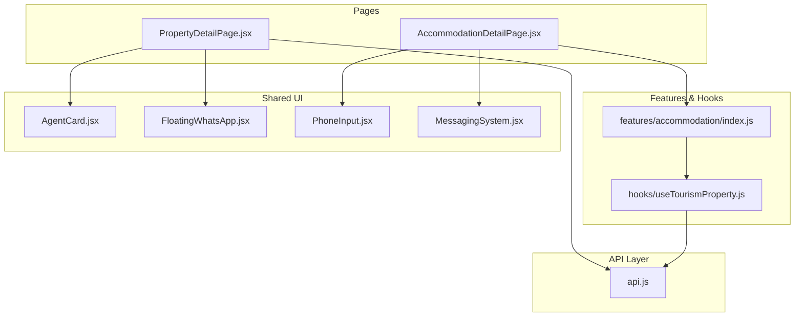
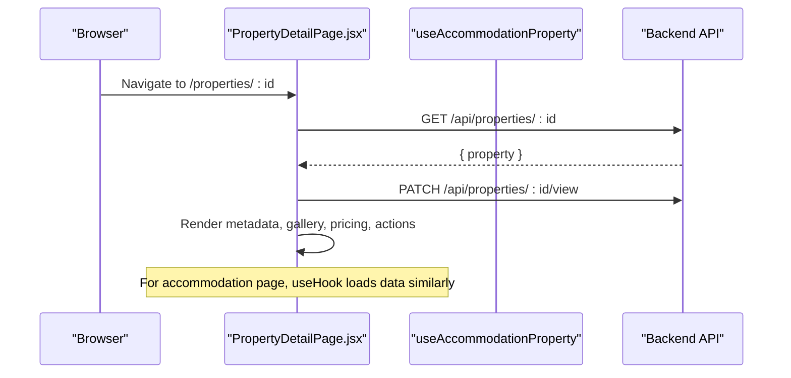
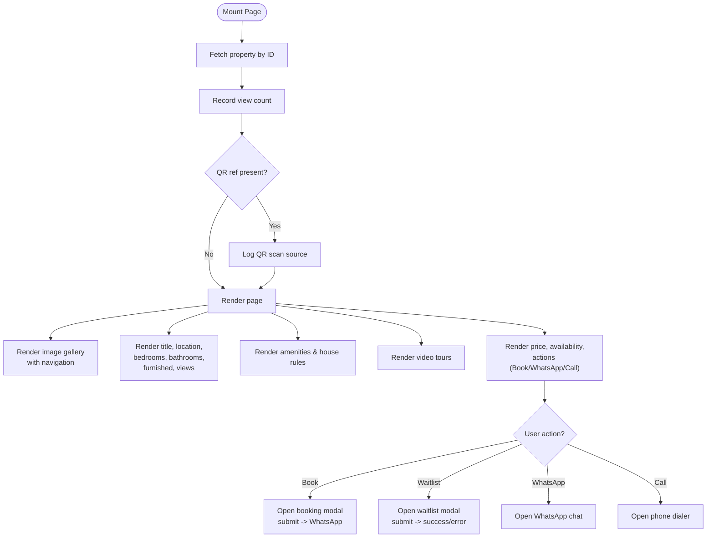
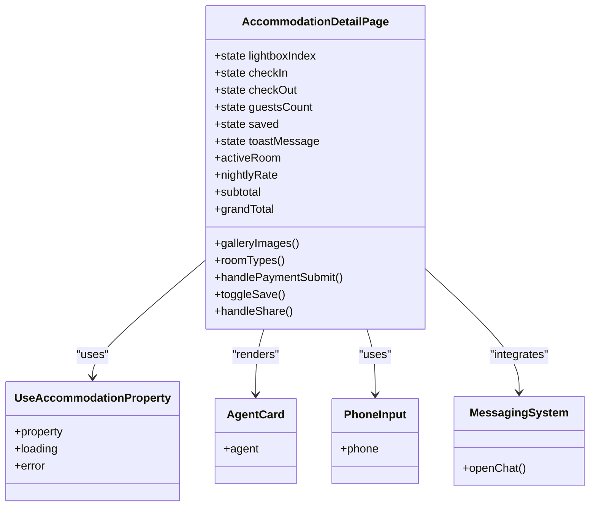
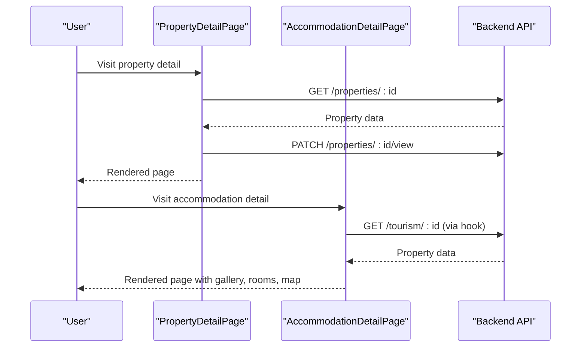

# Property Information Display

<cite>
**Referenced Files in This Document**
- [PropertyDetailPage.jsx](file://src/pages/PropertyDetailPage.jsx)
- [AccommodationDetailPage.jsx](file://src/pages/accommodation/AccommodationDetailPage.jsx)
- [api.js](file://src/api/api.js)
- [accommodation.js](file://src/features/accommodation/index.js)
- [useTourismProperty.js](file://src/features/accommodation/hooks/useTourismProperty.js)
- [AgentCard.jsx](file://src/components/AgentCard.jsx)
- [FloatingWhatsApp.jsx](file://src/components/FloatingWhatsApp.jsx)
- [PhoneInput.jsx](file://src/components/PhoneInput.jsx)
- [MessagingSystem.jsx](file://src/components/MessagingSystem.jsx)
</cite>

## Table of Contents
1. [Introduction](#introduction)
2. [Project Structure](#project-structure)
3. [Core Components](#core-components)
4. [Architecture Overview](#architecture-overview)
5. [Detailed Component Analysis](#detailed-component-analysis)
6. [Dependency Analysis](#dependency-analysis)
7. [Performance Considerations](#performance-considerations)
8. [Troubleshooting Guide](#troubleshooting-guide)
9. [Conclusion](#conclusion)
10. [Appendices](#appendices)

## Introduction
This document explains how property information is displayed on the detail pages, focusing on metadata rendering (title, location, bedrooms, bathrooms, furnished status), pricing and availability, view counts, image galleries with navigation, video tour integration, amenities display, and house rules presentation. It also documents the data flow from API responses to UI components and provides guidance for customizing attribute displays, adding new fields, and implementing responsive layouts across screen sizes.

Two primary implementations are covered:
- General rental property detail page
- Accommodation/tourism detail page with richer media, room selection, and booking flows

## Project Structure
The property information display functionality lives primarily in two React pages:
- A general rental property detail page that fetches a single property by ID and renders core details, gallery, videos, amenities, house rules, and sidebar actions
- An accommodation/tourism detail page that uses a feature hook to load property data and renders an enhanced layout with bento-style gallery, scroll-spy navigation, room selection, map, policies, reviews, host info, and messaging

**Diagram sources**
- [PropertyDetailPage.jsx:1-129](file://src/pages/PropertyDetailPage.jsx#L1-L129)
- [AccommodationDetailPage.jsx:1-20](file://src/pages/accommodation/AccommodationDetailPage.jsx#L1-L20)
- [accommodation.js:1-200](file://src/features/accommodation/index.js#L1-L200)
- [useTourismProperty.js:1-200](file://src/features/accommodation/hooks/useTourismProperty.js#L1-L200)
- [api.js:1-200](file://src/api/api.js#L1-L200)

**Section sources**
- [PropertyDetailPage.jsx:1-129](file://src/pages/PropertyDetailPage.jsx#L1-L129)
- [AccommodationDetailPage.jsx:1-20](file://src/pages/accommodation/AccommodationDetailPage.jsx#L1-L20)

## Core Components
- PropertyDetailPage.jsx: Renders title, location, key attributes (bedrooms, bathrooms, furnished), price, availability, description, amenities, house rules, image gallery with navigation, video tours, and sidebar actions including booking, WhatsApp, call, and waitlist flows. It records views and QR scans.
- AccommodationDetailPage.jsx: Renders a premium accommodation showcase with bento gallery, lightbox, scroll-spy navigation, room types and pricing, amenities, walkthrough section, location map, policies, reviews, host badges, and integrated messaging. It supports wishlist, share, and M-Pesa payment initiation.

Key responsibilities:
- Data fetching and normalization
- Rendering property metadata and pricing
- Handling user interactions (booking, waitlist, messaging, sharing)
- Managing media (images, videos) and accessibility

**Section sources**
- [PropertyDetailPage.jsx:32-129](file://src/pages/PropertyDetailPage.jsx#L32-L129)
- [AccommodationDetailPage.jsx:117-200](file://src/pages/accommodation/AccommodationDetailPage.jsx#L117-L200)

## Architecture Overview
The detail pages follow a unidirectional data flow:
- Page component mounts and fetches property data from the backend via REST endpoints or feature hooks
- State holds the loaded property object and UI flags (loading, error, modals)
- Render logic maps property fields to UI sections: header, gallery, attributes, description, amenities, house rules, pricing sidebar, and actions
- User actions trigger side effects like recording views, opening WhatsApp, submitting bookings/waitlists, or initiating payments

**Diagram sources**
- [PropertyDetailPage.jsx:80-129](file://src/pages/PropertyDetailPage.jsx#L80-L129)
- [AccommodationDetailPage.jsx:117-121](file://src/pages/accommodation/AccommodationDetailPage.jsx#L117-L121)

## Detailed Component Analysis

### Property Detail Page (General Rental)
This page focuses on clarity and conversion:
- Title and location are prominently displayed
- Key attributes include bedrooms, bathrooms, furnished status, and view count
- Pricing and availability are shown in a sticky sidebar with action buttons
- Image gallery supports left/right navigation and counter
- Video tours are embedded with normalized URLs
- Amenities and house rules are presented as readable sections
- Waitlist modal appears when fully booked

Data flow highlights:
- Fetches property by ID
- Records a view increment
- Optionally logs QR scan source and conversions
- Opens WhatsApp with pre-filled message
- Submits booking form and redirects to WhatsApp
- Submits waitlist form and shows success/error states

Responsive behavior:
- Uses CSS grid with a breakpoint at 768px to stack columns on smaller screens
- Sticky sidebar remains accessible on desktop; stacks below content on mobile

Customization points:
- Attribute rows can be extended to show additional fields (e.g., area, parking, pet policy)
- Gallery can be replaced with a carousel/lightbox library
- Video section can integrate external players or thumbnails

**Diagram sources**
- [PropertyDetailPage.jsx:80-129](file://src/pages/PropertyDetailPage.jsx#L80-L129)
- [PropertyDetailPage.jsx:266-519](file://src/pages/PropertyDetailPage.jsx#L266-L519)
- [PropertyDetailPage.jsx:521-635](file://src/pages/PropertyDetailPage.jsx#L521-L635)
- [PropertyDetailPage.jsx:647-935](file://src/pages/PropertyDetailPage.jsx#L647-L935)

**Section sources**
- [PropertyDetailPage.jsx:80-129](file://src/pages/PropertyDetailPage.jsx#L80-L129)
- [PropertyDetailPage.jsx:266-519](file://src/pages/PropertyDetailPage.jsx#L266-L519)
- [PropertyDetailPage.jsx:521-635](file://src/pages/PropertyDetailPage.jsx#L521-L635)
- [PropertyDetailPage.jsx:647-935](file://src/pages/PropertyDetailPage.jsx#L647-L935)

### Accommodation Detail Page (Luxury Stay)
This page offers a rich, immersive experience:
- Bento-style gallery with lightbox and keyboard navigation
- Scroll-spy navigation highlighting active sections
- Room types and dynamic pricing based on selected suite and nights
- Amenities grid with default fallbacks if none provided
- Walkthrough section for video tours
- Location map with custom pin icon
- Policies, reviews, and host badges
- Integrated messaging system and M-Pesa payment initiation

Data flow highlights:
- Uses useAccommodationProperty hook to load property data
- Normalizes images, coordinates, and room types
- Computes stay duration and totals
- Handles wishlist toggling and sharing
- Initiates STK push payment flow

Responsive behavior:
- Section-based layout adapts to mobile with drawer and compact controls
- Lightbox supports arrow keys and escape to close
- Sticky top strip and floating nav improve usability

Customization points:
- Replace default review set with real data
- Extend room types and pricing logic
- Customize badge imagery and verification statuses

**Diagram sources**
- [AccommodationDetailPage.jsx:117-200](file://src/pages/accommodation/AccommodationDetailPage.jsx#L117-L200)
- [AccommodationDetailPage.jsx:308-320](file://src/pages/accommodation/AccommodationDetailPage.jsx#L308-L320)
- [AccommodationDetailPage.jsx:322-366](file://src/pages/accommodation/AccommodationDetailPage.jsx#L322-L366)
- [AccommodationDetailPage.jsx:412-620](file://src/pages/accommodation/AccommodationDetailPage.jsx#L412-L620)

**Section sources**
- [AccommodationDetailPage.jsx:117-200](file://src/pages/accommodation/AccommodationDetailPage.jsx#L117-L200)
- [AccommodationDetailPage.jsx:308-320](file://src/pages/accommodation/AccommodationDetailPage.jsx#L308-L320)
- [AccommodationDetailPage.jsx:322-366](file://src/pages/accommodation/AccommodationDetailPage.jsx#L322-L366)
- [AccommodationDetailPage.jsx:412-620](file://src/pages/accommodation/AccommodationDetailPage.jsx#L412-L620)

## Dependency Analysis
- PropertyDetailPage depends on:
  - Auth context for token and user
  - File utilities for resolving media URLs
  - Floating WhatsApp component
  - Agent card component when assigned
- AccommodationDetailPage depends on:
  - Feature index exports for navigation, loading blocks, error alerts, theme
  - Phone input and messaging system components
  - Leaflet for map rendering
  - Auth context for token and user

External integrations:
- Backend REST endpoints for properties, views, bookings, waitlist, and payments
- WhatsApp API for direct messaging
- M-Pesa STK push for secure payments

Potential coupling:
- Both pages directly call fetch against environment-configured API base URL
- Media URL resolution relies on utility functions; ensure consistent handling across platforms

Circular dependencies:
- No circular imports detected between pages and shared components

**Section sources**
- [PropertyDetailPage.jsx:1-6](file://src/pages/PropertyDetailPage.jsx#L1-L6)
- [AccommodationDetailPage.jsx:1-20](file://src/pages/accommodation/AccommodationDetailPage.jsx#L1-L20)

## Performance Considerations
- Lazy-load images and videos where possible
- Avoid heavy computations in render paths; memoize derived values (as done in the accommodation page)
- Debounce or throttle user interactions like gallery navigation and scroll-spy updates
- Prefer server-side pagination for large amenity lists or reviews
- Minimize re-renders by keeping state local to relevant sections

[No sources needed since this section provides general guidance]

## Troubleshooting Guide
Common issues and resolutions:
- Property not found: The page shows a friendly error and a link back to listings
- View recording failures: Non-fatal errors are logged; continue rendering
- QR scan logging failures: Logged but do not block main flow
- Video playback issues: Ensure normalized URLs and supported formats; provide fallback messages
- Payment initiation errors: Validate token and phone number; surface clear error messages
- Map marker icons broken: Ensure Leaflet assets are correctly resolved in Vite bundles

Actionable checks:
- Verify API_BASE configuration and network connectivity
- Inspect console for failed requests and error messages
- Confirm media URLs resolve correctly across environments
- Test responsive breakpoints on multiple devices

**Section sources**
- [PropertyDetailPage.jsx:234-264](file://src/pages/PropertyDetailPage.jsx#L234-L264)
- [PropertyDetailPage.jsx:95-129](file://src/pages/PropertyDetailPage.jsx#L95-L129)
- [AccommodationDetailPage.jsx:20-26](file://src/pages/accommodation/AccommodationDetailPage.jsx#L20-L26)
- [AccommodationDetailPage.jsx:322-366](file://src/pages/accommodation/AccommodationDetailPage.jsx#L322-L366)

## Conclusion
The property information display functionality is implemented through two complementary pages:
- A straightforward rental property detail page focused on essential metadata, pricing, availability, and conversion-oriented actions
- A feature-rich accommodation detail page offering advanced media, room selection, mapping, and integrated messaging/payment flows

Both pages normalize data, handle errors gracefully, and provide responsive layouts. Customization points allow extending attributes, enhancing galleries, and adapting layouts for different screen sizes.

[No sources needed since this section summarizes without analyzing specific files]

## Appendices

### Data Flow: From API to UI
- General rental property:
  - Fetch property by ID
  - Record view count
  - Render title, location, attributes, description, amenities, house rules, gallery, videos, and sidebar actions
- Accommodation property:
  - Load via feature hook
  - Normalize images, coordinates, room types
  - Compute stay totals and render enhanced layout with scroll-spy navigation

**Diagram sources**
- [PropertyDetailPage.jsx:80-129](file://src/pages/PropertyDetailPage.jsx#L80-L129)
- [AccommodationDetailPage.jsx:117-121](file://src/pages/accommodation/AccommodationDetailPage.jsx#L117-L121)

### Customizing Property Attribute Displays
- Add new fields:
  - Extend the rendered attribute row to include new property fields (e.g., area, parking, pet policy)
  - Ensure conditional rendering for optional fields
- Format values:
  - Use helper functions to format currency, dates, and phone numbers consistently
- Accessibility:
  - Provide meaningful labels and ARIA attributes for interactive elements

[No sources needed since this section provides general guidance]

### Adding New Property Fields
- Identify the field in the API response
- Update state and validation if required
- Render the field in the appropriate section (header, attributes, sidebar)
- Test edge cases (missing values, nulls, arrays)

[No sources needed since this section provides general guidance]

### Implementing Responsive Layouts
- Use CSS grid with breakpoints to switch from multi-column to single-column layouts
- Make sticky elements adaptive (e.g., sidebar becomes inline on mobile)
- Optimize touch targets and font sizes for small screens
- Test on common breakpoints (mobile, tablet, desktop)

**Section sources**
- [PropertyDetailPage.jsx:268-280](file://src/pages/PropertyDetailPage.jsx#L268-L280)