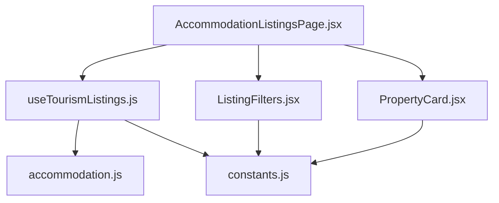
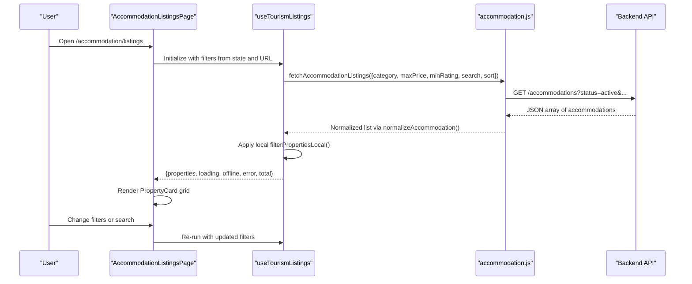
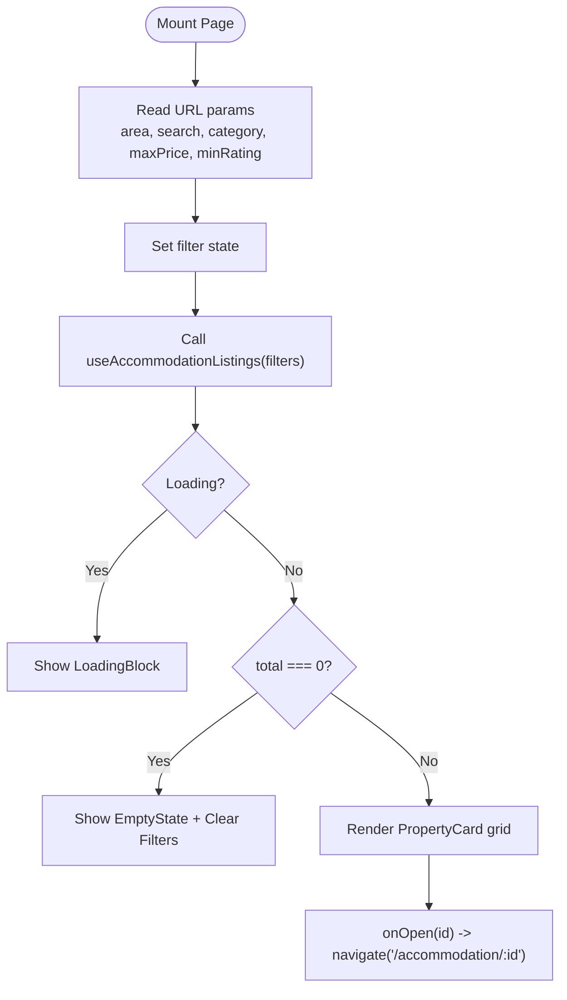
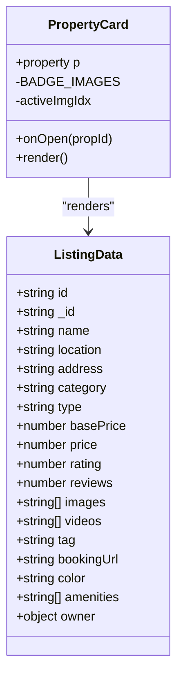
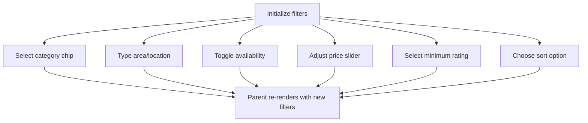
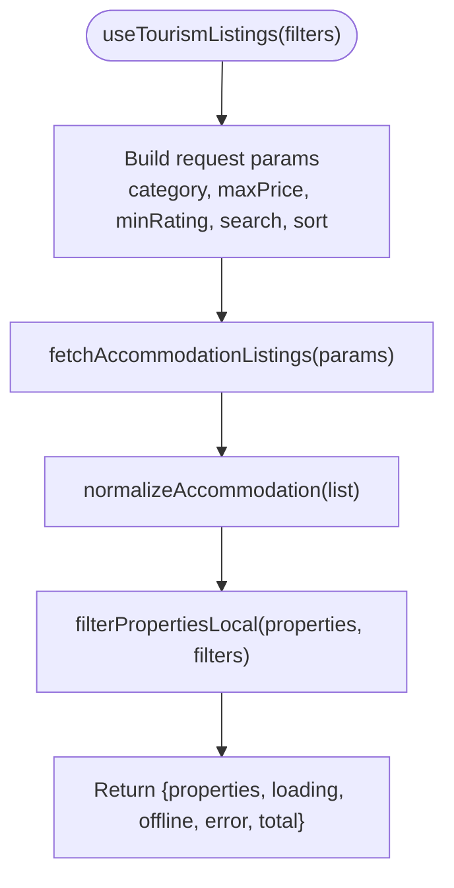
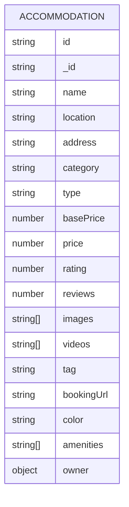
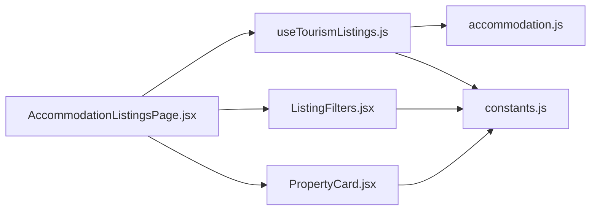

# Property Listings Management

<cite>
**Referenced Files in This Document**
- [AccommodationListingsPage.jsx](file://src/pages/accommodation/AccommodationListingsPage.jsx)
- [PropertyCard.jsx](file://src/features/accommodation/components/PropertyCard.jsx)
- [ListingFilters.jsx](file://src/features/accommodation/components/ListingFilters.jsx)
- [useTourismListings.js](file://src/features/accommodation/hooks/useTourismListings.js)
- [constants.js](file://src/features/accommodation/constants.js)
- [accommodation.js](file://src/api/accommodation.js)
- [index.js](file://src/features/accommodation/index.js)
</cite>

## Table of Contents
1. [Introduction](#introduction)
2. [Project Structure](#project-structure)
3. [Core Components](#core-components)
4. [Architecture Overview](#architecture-overview)
5. [Detailed Component Analysis](#detailed-component-analysis)
6. [Dependency Analysis](#dependency-analysis)
7. [Performance Considerations](#performance-considerations)
8. [Troubleshooting Guide](#troubleshooting-guide)
9. [Conclusion](#conclusion)
10. [Appendices](#appendices)

## Introduction
This document explains how the property listings management system works in the frontend application. It focuses on how properties are displayed, filtered, searched, and managed in the main listings interface. It also documents the PropertyCard component structure, listing data models, search and filtering behavior, sorting options, pagination handling, and integration with the backend API. Finally, it provides guidance for adding new property types, customizing listing displays, optimizing performance for large datasets, and ensuring responsive design.

## Project Structure
The accommodation listings feature is organized into pages, reusable components, hooks, constants, and an API layer:
- Page: AccommodationListingsPage orchestrates the UI state, filters, and grid rendering.
- Components: PropertyCard renders individual listings; ListingFilters provides category, price, rating, area, availability, and sort controls.
- Hooks: useTourismListings fetches and normalizes listings, applies server-side and client-side filters, and exposes loading/offline/error states.
- Constants: Centralized configuration for categories, sorting mappings, amenity lists, fallback data, and local filtering logic.
- API: accommodation.js handles HTTP requests, response normalization, and provider endpoints.

**Diagram sources**
- [AccommodationListingsPage.jsx:1-163](file://src/pages/accommodation/AccommodationListingsPage.jsx#L1-L163)
- [useTourismListings.js:1-51](file://src/features/accommodation/hooks/useTourismListings.js#L1-L51)
- [PropertyCard.jsx:1-271](file://src/features/accommodation/components/PropertyCard.jsx#L1-L271)
- [ListingFilters.jsx:1-92](file://src/features/accommodation/components/ListingFilters.jsx#L1-L92)
- [constants.js:1-211](file://src/features/accommodation/constants.js#L1-L211)
- [accommodation.js:1-191](file://src/api/accommodation.js#L1-L191)

**Section sources**
- [AccommodationListingsPage.jsx:1-163](file://src/pages/accommodation/AccommodationListingsPage.jsx#L1-L163)
- [index.js:1-19](file://src/features/accommodation/index.js#L1-L19)

## Core Components
- AccommodationListingsPage: Main page that composes navigation, filters, and a responsive grid of PropertyCard instances. It manages filter state (category, sort, maxPrice, minRating, search, area, availability), reads URL parameters, and navigates to detail pages.
- PropertyCard: Displays a single property with image carousel, tags, owner verification badges, amenities, pricing, ratings, and call-to-action buttons.
- ListingFilters: Provides user controls for category chips, area input, availability toggles, price slider, minimum rating selector, and sort dropdown.
- useTourismListings: Hook that calls the backend API, maps UI sort labels to API sort keys, normalizes responses, and applies local filters for category, price, rating, and search text.
- constants.js: Defines sort mapping, category options, amenity lists, fallback data, and the local filtering function used by the hook.
- accommodation.js: API module that performs network requests, normalizes accommodation objects, and exposes endpoints for browsing, viewing, registration, updates, and reviews.

**Section sources**
- [AccommodationListingsPage.jsx:1-163](file://src/pages/accommodation/AccommodationListingsPage.jsx#L1-L163)
- [PropertyCard.jsx:1-271](file://src/features/accommodation/components/PropertyCard.jsx#L1-L271)
- [ListingFilters.jsx:1-92](file://src/features/accommodation/components/ListingFilters.jsx#L1-L92)
- [useTourismListings.js:1-51](file://src/features/accommodation/hooks/useTourismListings.js#L1-L51)
- [constants.js:1-211](file://src/features/accommodation/constants.js#L1-L211)
- [accommodation.js:1-191](file://src/api/accommodation.js#L1-L191)

## Architecture Overview
The listings flow integrates UI state, a data-fetching hook, and an API layer:

**Diagram sources**
- [AccommodationListingsPage.jsx:39-163](file://src/pages/accommodation/AccommodationListingsPage.jsx#L39-L163)
- [useTourismListings.js:5-50](file://src/features/accommodation/hooks/useTourismListings.js#L5-L50)
- [accommodation.js:81-91](file://src/api/accommodation.js#L81-L91)

## Detailed Component Analysis

### AccommodationListingsPage
Responsibilities:
- Manages filter state and URL synchronization.
- Renders desktop sidebar and mobile drawer for ListingFilters.
- Displays loading, offline errors, empty state, and the property grid.
- Navigates to property details when a card is clicked.

Key behaviors:
- Reads query parameters for area, search, category, maxPrice, and minRating.
- Passes filters to useAccommodationListings (aliased from useTourismListings).
- Uses CSS grid for responsive layout with breakpoints at 900px, 768px, 480px, and 380px.

**Diagram sources**
- [AccommodationListingsPage.jsx:39-163](file://src/pages/accommodation/AccommodationListingsPage.jsx#L39-L163)

**Section sources**
- [AccommodationListingsPage.jsx:1-163](file://src/pages/accommodation/AccommodationListingsPage.jsx#L1-L163)

### PropertyCard
Responsibilities:
- Display property images with auto-cycling carousel and manual controls.
- Show tags, booking links, video tour indicators, location, name, category, amenities, price, rating, and review count.
- Render owner verification badges if present.
- Provide “View Details” or “View & Book” actions.

Data model expectations:
- id/_id: string identifier.
- images: array of strings or objects with imageUrl/url.
- videos: array of normalized URLs.
- name, location/address/county, category/type.
- basePrice/price: numeric.
- rating/reviews: numeric.
- tag, bookingUrl, color, amenities, owner.verificationBadges.

**Diagram sources**
- [PropertyCard.jsx:1-271](file://src/features/accommodation/components/PropertyCard.jsx#L1-L271)

**Section sources**
- [PropertyCard.jsx:1-271](file://src/features/accommodation/components/PropertyCard.jsx#L1-L271)

### ListingFilters
Responsibilities:
- Category selection using predefined options.
- Area/location text input.
- Availability toggles.
- Price range slider.
- Minimum rating selector.
- Sort dropdown mapped to API sort keys.
- Clear all filters action.

Integration:
- Consumes CATEGORY_OPTIONS, SORT_OPTIONS, and CATEGORY_ICONS from constants.
- Controlled by parent state in AccommodationListingsPage.

**Diagram sources**
- [ListingFilters.jsx:1-92](file://src/features/accommodation/components/ListingFilters.jsx#L1-L92)
- [constants.js:3-33](file://src/features/accommodation/constants.js#L3-L33)

**Section sources**
- [ListingFilters.jsx:1-92](file://src/features/accommodation/components/ListingFilters.jsx#L1-L92)
- [constants.js:1-211](file://src/features/accommodation/constants.js#L1-L211)

### useTourismListings Hook
Responsibilities:
- Fetch listings from the backend with current filters.
- Map UI sort labels to API sort keys using API_SORT.
- Normalize backend responses via normalizeAccommodation.
- Apply local filtering for category, price, rating, and search text.
- Expose properties, loading, offline, error, and total counts.

Behavioral notes:
- Only active/approved accommodations are requested from the backend.
- If the API fails, sets offline mode and clears properties.
- Local filtering uses filterPropertiesLocal for robust matching across category/type fields.

**Diagram sources**
- [useTourismListings.js:5-50](file://src/features/accommodation/hooks/useTourismListings.js#L5-L50)
- [accommodation.js:81-91](file://src/api/accommodation.js#L81-L91)
- [constants.js:178-211](file://src/features/accommodation/constants.js#L178-L211)

**Section sources**
- [useTourismListings.js:1-51](file://src/features/accommodation/hooks/useTourismListings.js#L1-L51)
- [constants.js:178-211](file://src/features/accommodation/constants.js#L178-L211)

### Data Models and Normalization
The API layer normalizes backend responses to a consistent shape consumed by components:
- Ensures id/_id presence.
- Normalizes price/basePrice to numbers.
- Formats category/type into readable strings.
- Normalizes images and videos arrays.
- Sets default rating and reviews when missing.
- Derives color and tag based on type and flags.

**Diagram sources**
- [accommodation.js:34-77](file://src/api/accommodation.js#L34-L77)

**Section sources**
- [accommodation.js:34-77](file://src/api/accommodation.js#L34-L77)

## Dependency Analysis
High-level dependencies between modules:

**Diagram sources**
- [AccommodationListingsPage.jsx:1-163](file://src/pages/accommodation/AccommodationListingsPage.jsx#L1-L163)
- [useTourismListings.js:1-51](file://src/features/accommodation/hooks/useTourismListings.js#L1-L51)
- [PropertyCard.jsx:1-271](file://src/features/accommodation/components/PropertyCard.jsx#L1-L271)
- [ListingFilters.jsx:1-92](file://src/features/accommodation/components/ListingFilters.jsx#L1-L92)
- [constants.js:1-211](file://src/features/accommodation/constants.js#L1-L211)
- [accommodation.js:1-191](file://src/api/accommodation.js#L1-L191)

**Section sources**
- [index.js:1-19](file://src/features/accommodation/index.js#L1-L19)

## Performance Considerations
- Server-side filtering and sorting: The hook sends category, maxPrice, minRating, search, and sort to the backend, reducing client workload. Ensure the backend indexes relevant fields for fast queries.
- Client-side filtering: filterPropertiesLocal is efficient for small to medium datasets. For very large lists, prefer server-side pagination and avoid heavy client-side operations.
- Image optimization: PropertyCard loads multiple images per card. Use lazy loading, responsive image sizes, and CDN caching. Consider thumbnail generation for listing grids.
- Carousel performance: Auto-cycling uses setInterval; ensure cleanup on unmount and avoid unnecessary re-renders by memoizing derived values where possible.
- Memoization: Wrap expensive computations with useMemo/useCallback in the hook and components to prevent redundant work during re-renders.
- Pagination: Currently, total reflects the length of the locally filtered list without explicit pagination. Implement server-side pagination (limit/offset or cursor) to handle large datasets efficiently.
- Network resilience: Offline detection is handled; consider retry strategies and cached fallbacks for improved UX.

[No sources needed since this section provides general guidance]

## Troubleshooting Guide
Common issues and resolutions:
- No listings shown:
  - Verify backend returns active accommodations and the API endpoint is reachable.
  - Check URL parameters and filter state; clear filters to confirm baseline results.
- Incorrect sorting:
  - Confirm UI sort label maps to correct API_SORT key.
  - Validate backend supports the requested sort field.
- Images not displaying:
  - Ensure images array contains valid URLs or objects with imageUrl/url.
  - Check CORS and CDN access rules.
- Owner badges not visible:
  - Confirm owner.verificationBadges exists and includes supported badge IDs.
- Offline mode:
  - When API fails, the hook sets offline=true and clears properties. Inspect error messages and network connectivity.

**Section sources**
- [useTourismListings.js:12-42](file://src/features/accommodation/hooks/useTourismListings.js#L12-L42)
- [PropertyCard.jsx:14-18](file://src/features/accommodation/components/PropertyCard.jsx#L14-L18)
- [PropertyCard.jsx:208-246](file://src/features/accommodation/components/PropertyCard.jsx#L208-L246)

## Conclusion
The property listings management system combines a responsive UI, a flexible filtering interface, and a robust data layer that normalizes backend responses. The PropertyCard component presents rich property information, while ListingFilters provide intuitive controls. The useTourismListings hook coordinates server-side and client-side filtering and sorting. To scale effectively, implement server-side pagination, optimize media delivery, and leverage memoization. Adding new property types and customizing displays can be achieved through constants and component props, while integrating with the backend relies on the accommodation API module.

[No sources needed since this section summarizes without analyzing specific files]

## Appendices

### How to Add New Property Types
- Update CATEGORY_OPTIONS and PROPERTY_CATEGORIES in constants.js to include the new type.
- Optionally add icons in CATEGORY_ICONS for display in filters.
- Ensure backend categorization aligns with the new type so filtering and sorting behave correctly.

**Section sources**
- [constants.js:11-33](file://src/features/accommodation/constants.js#L11-L33)
- [constants.js:55-121](file://src/features/accommodation/constants.js#L55-L121)

### How to Customize Listing Displays
- Adjust PropertyCard styling and content sections to highlight different attributes (e.g., additional badges, promotional tags).
- Extend ListingFilters to support new filter dimensions (e.g., pet-friendly, family rooms) and wire them into useTourismListings and backend queries.

**Section sources**
- [PropertyCard.jsx:37-269](file://src/features/accommodation/components/PropertyCard.jsx#L37-L269)
- [ListingFilters.jsx:18-82](file://src/features/accommodation/components/ListingFilters.jsx#L18-L82)

### Integrating With the Backend API
- Configure VITE_API_URL in environment variables to point to your backend.
- Use accommodation.js functions for fetching, registering, updating, and reviewing accommodations.
- Ensure authentication tokens are passed for protected routes and provider endpoints.

**Section sources**
- [accommodation.js:1-191](file://src/api/accommodation.js#L1-L191)