# Property Management System

<cite>
**Referenced Files in This Document**
- [RegisterPropertyPage.jsx](file://src/pages/accommodation/RegisterPropertyPage.jsx)
- [EditPropertyPage.jsx](file://src/pages/accommodation/EditPropertyPage.jsx)
- [AccommodationDetailPage.jsx](file://src/pages/accommodation/AccommodationDetailPage.jsx)
- [AccommodationListingsPage.jsx](file://src/pages/accommodation/AccommodationListingsPage.jsx)
- [accommodation.js](file://src/api/accommodation.js)
- [constants.js](file://src/features/accommodation/constants.js)
- [useTourismListings.js](file://src/features/accommodation/hooks/useTourismListings.js)
- [useProviderListings.js](file://src/features/accommodation/hooks/useProviderListings.js)
- [index.js](file://src/features/accommodation/index.js)
- [PropertyCard.jsx](file://src/features/accommodation/components/PropertyCard.jsx)
- [AgentCard.jsx](file://src/components/AgentCard.jsx)
- [MessagingSystem.jsx](file://src/components/MessagingSystem.jsx)
- [AccommodationSearch.jsx](file://src/pages/AccommodationSearch.jsx)
- [AccommodationBookingDetail.jsx](file://src/pages/AccommodationBookingDetail.jsx)
</cite>

## Table of Contents
1. [Introduction](#introduction)
2. [Project Structure](#project-structure)
3. [Core Components](#core-components)
4. [Architecture Overview](#architecture-overview)
5. [Detailed Component Analysis](#detailed-component-analysis)
6. [Dependency Analysis](#dependency-analysis)
7. [Performance Considerations](#performance-considerations)
8. [Troubleshooting Guide](#troubleshooting-guide)
9. [Conclusion](#conclusion)
10. [Appendices](#appendices)

## Introduction
This document explains the property management system for accommodations, covering listing creation, editing, search and filtering, media handling, location-based discovery, detail page features, booking integration, and agent contact functionality. It also documents data models, validation rules, business logic, and extension points for adding custom fields or property types.

## Project Structure
The accommodation feature is organized into:
- Pages: user-facing flows for listing creation, editing, browsing, and details
- API layer: centralized backend calls and normalization
- Features: shared constants, hooks, components, and theme utilities
- Utilities: messaging and agent interaction components

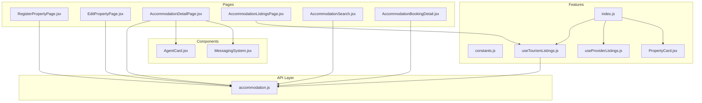

**Diagram sources**
- [RegisterPropertyPage.jsx:1-800](file://src/pages/accommodation/RegisterPropertyPage.jsx#L1-L800)
- [EditPropertyPage.jsx:1-800](file://src/pages/accommodation/EditPropertyPage.jsx#L1-L800)
- [AccommodationDetailPage.jsx:1-800](file://src/pages/accommodation/AccommodationDetailPage.jsx#L1-L800)
- [AccommodationListingsPage.jsx:1-163](file://src/pages/accommodation/AccommodationListingsPage.jsx#L1-L163)
- [accommodation.js:1-191](file://src/api/accommodation.js#L1-L191)
- [constants.js:1-211](file://src/features/accommodation/constants.js#L1-L211)
- [useTourismListings.js:1-51](file://src/features/accommodation/hooks/useTourismListings.js#L1-L51)
- [useProviderListings.js:1-40](file://src/features/accommodation/hooks/useProviderListings.js#L1-L40)
- [index.js:1-19](file://src/features/accommodation/index.js#L1-L19)
- [PropertyCard.jsx:1-271](file://src/features/accommodation/components/PropertyCard.jsx#L1-L271)
- [AgentCard.jsx:1-228](file://src/components/AgentCard.jsx#L1-L228)
- [MessagingSystem.jsx:1-337](file://src/components/MessagingSystem.jsx#L1-L337)

**Section sources**
- [RegisterPropertyPage.jsx:1-800](file://src/pages/accommodation/RegisterPropertyPage.jsx#L1-L800)
- [EditPropertyPage.jsx:1-800](file://src/pages/accommodation/EditPropertyPage.jsx#L1-L800)
- [AccommodationDetailPage.jsx:1-800](file://src/pages/accommodation/AccommodationDetailPage.jsx#L1-L800)
- [AccommodationListingsPage.jsx:1-163](file://src/pages/accommodation/AccommodationListingsPage.jsx#L1-L163)
- [accommodation.js:1-191](file://src/api/accommodation.js#L1-L191)
- [constants.js:1-211](file://src/features/accommodation/constants.js#L1-L211)
- [useTourismListings.js:1-51](file://src/features/accommodation/hooks/useTourismListings.js#L1-L51)
- [useProviderListings.js:1-40](file://src/features/accommodation/hooks/useProviderListings.js#L1-L40)
- [index.js:1-19](file://src/features/accommodation/index.js#L1-L19)
- [PropertyCard.jsx:1-271](file://src/features/accommodation/components/PropertyCard.jsx#L1-L271)
- [AgentCard.jsx:1-228](file://src/components/AgentCard.jsx#L1-L228)
- [MessagingSystem.jsx:1-337](file://src/components/MessagingSystem.jsx#L1-L337)

## Core Components
- Listing creation wizard with step-by-step validation, media upload (images/videos), amenities selection, pricing, and optional external booking URL redirection.
- Listing editor to update existing properties, manage images/videos, and adjust core details.
- Listings browser with filters (category, price, rating, area, availability) and sorting.
- Detail page with gallery, video walkthroughs, room/suite selection, M-Pesa payment flow, map, reviews, host info, and agent contact.
- API client with normalization, authentication headers, and endpoints for CRUD operations and owner profile/listings.
- Shared constants for categories, counties, amenities, steps, and initial form state.
- Hooks for listings and provider dashboards.
- Reusable components: PropertyCard, AgentCard, MessagingSystem.

**Section sources**
- [RegisterPropertyPage.jsx:1-800](file://src/pages/accommodation/RegisterPropertyPage.jsx#L1-L800)
- [EditPropertyPage.jsx:1-800](file://src/pages/accommodation/EditPropertyPage.jsx#L1-L800)
- [AccommodationListingsPage.jsx:1-163](file://src/pages/accommodation/AccommodationListingsPage.jsx#L1-L163)
- [AccommodationDetailPage.jsx:1-800](file://src/pages/accommodation/AccommodationDetailPage.jsx#L1-L800)
- [accommodation.js:1-191](file://src/api/accommodation.js#L1-L191)
- [constants.js:1-211](file://src/features/accommodation/constants.js#L1-L211)
- [useTourismListings.js:1-51](file://src/features/accommodation/hooks/useTourismListings.js#L1-L51)
- [useProviderListings.js:1-40](file://src/features/accommodation/hooks/useProviderListings.js#L1-L40)
- [PropertyCard.jsx:1-271](file://src/features/accommodation/components/PropertyCard.jsx#L1-L271)
- [AgentCard.jsx:1-228](file://src/components/AgentCard.jsx#L1-L228)
- [MessagingSystem.jsx:1-337](file://src/components/MessagingSystem.jsx#L1-L337)

## Architecture Overview
The system follows a React frontend architecture with:
- Pages orchestrating user workflows
- A dedicated API module for backend communication and data normalization
- Feature hooks encapsulating data fetching and local filtering
- Shared constants and UI components for consistency

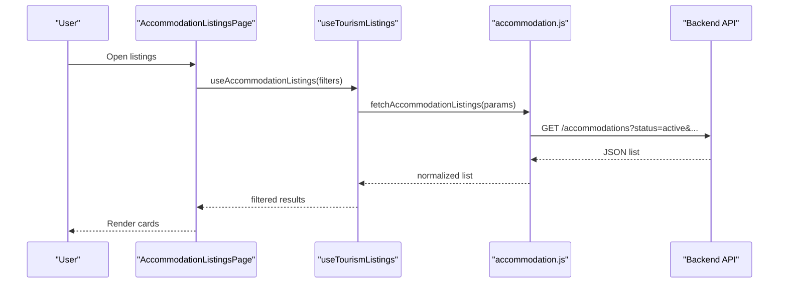

**Diagram sources**
- [AccommodationListingsPage.jsx:1-163](file://src/pages/accommodation/AccommodationListingsPage.jsx#L1-L163)
- [useTourismListings.js:1-51](file://src/features/accommodation/hooks/useTourismListings.js#L1-L51)
- [accommodation.js:81-110](file://src/api/accommodation.js#L81-L110)

## Detailed Component Analysis

### Listing Creation Workflow (RegisterPropertyPage)
Key responsibilities:
- Multi-step form: property info, location, media, amenities, pricing & booking URL
- Validation per step; required fields enforced before proceeding
- Media handling: image and video uploads with preview and size limits
- Location detection via geolocation API
- Submission builds FormData, maps display category to backend enum type, and posts to backend

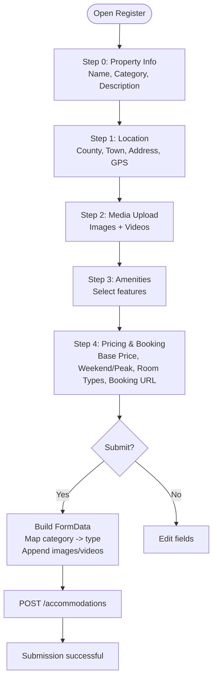

**Diagram sources**
- [RegisterPropertyPage.jsx:242-330](file://src/pages/accommodation/RegisterPropertyPage.jsx#L242-L330)
- [RegisterPropertyPage.jsx:403-800](file://src/pages/accommodation/RegisterPropertyPage.jsx#L403-L800)

Validation highlights:
- Required fields: name, category, description, county, town, address, lat/lng, basePrice
- Amenities must include at least one selection
- Video files limited to 100MB each; up to 10 videos; images up to 20

Business logic:
- Category mapping from display names to backend kebab-case types
- Optional external booking URL redirects guests to the property’s own booking site

Extension points:
- Add new categories by extending PROPERTY_CATEGORIES and categoryToTypeMap
- Add new amenities by updating AMENITIES_LIST
- Extend INITIAL_REGISTER_FORM for additional fields

**Section sources**
- [RegisterPropertyPage.jsx:1-800](file://src/pages/accommodation/RegisterPropertyPage.jsx#L1-L800)
- [constants.js:55-138](file://src/features/accommodation/constants.js#L55-L138)

### Listing Editing Workflow (EditPropertyPage)
Key responsibilities:
- Fetch owner listing by ID
- Populate editable fields (name, type, description, address, coordinates, pricing, policies, amenities)
- Manage media updates: add/remove images/videos
- Save changes via PATCH endpoint

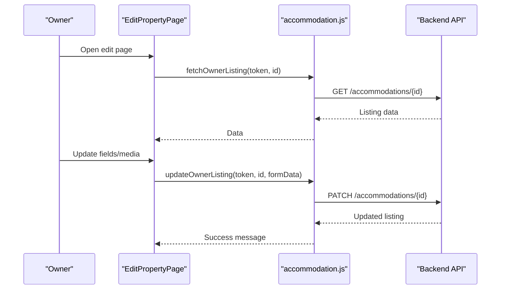

**Diagram sources**
- [EditPropertyPage.jsx:29-103](file://src/pages/accommodation/EditPropertyPage.jsx#L29-L103)
- [accommodation.js:163-179](file://src/api/accommodation.js#L163-L179)

**Section sources**
- [EditPropertyPage.jsx:1-800](file://src/pages/accommodation/EditPropertyPage.jsx#L1-L800)
- [accommodation.js:163-179](file://src/api/accommodation.js#L163-L179)

### Search and Filtering (AccommodationListingsPage + useTourismListings)
Capabilities:
- Filters: category, sort, maxPrice, minRating, area, availability
- URL query synchronization for shareable links
- Local filtering fallback using filterPropertiesLocal
- Sorting mapped via API_SORT

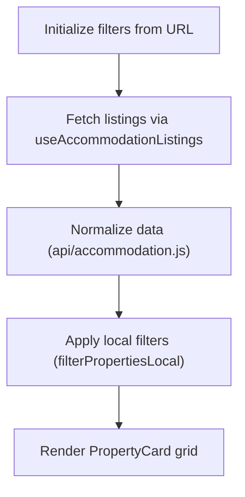

**Diagram sources**
- [AccommodationListingsPage.jsx:51-68](file://src/pages/accommodation/AccommodationListingsPage.jsx#L51-L68)
- [useTourismListings.js:12-49](file://src/features/accommodation/hooks/useTourismListings.js#L12-L49)
- [constants.js:178-210](file://src/features/accommodation/constants.js#L178-L210)

**Section sources**
- [AccommodationListingsPage.jsx:1-163](file://src/pages/accommodation/AccommodationListingsPage.jsx#L1-L163)
- [useTourismListings.js:1-51](file://src/features/accommodation/hooks/useTourismListings.js#L1-L51)
- [constants.js:1-211](file://src/features/accommodation/constants.js#L1-L211)

### Image and Video Handling
- Images: multiple selection, preview cards, primary cover indicator, removal
- Videos: drag-and-drop, live preview player, size limit enforcement (100MB), format support
- Normalization: URLs cleaned and converted to playable formats (e.g., .mp4)

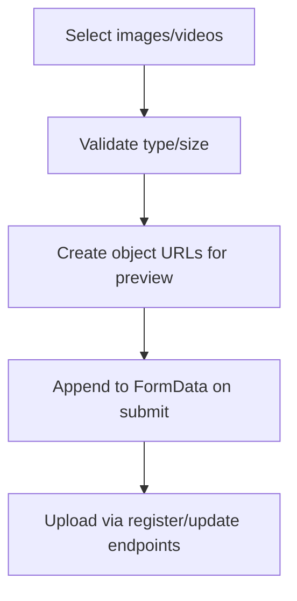

**Diagram sources**
- [RegisterPropertyPage.jsx:194-216](file://src/pages/accommodation/RegisterPropertyPage.jsx#L194-L216)
- [RegisterPropertyPage.jsx:498-691](file://src/pages/accommodation/RegisterPropertyPage.jsx#L498-L691)
- [accommodation.js:20-30](file://src/api/accommodation.js#L20-L30)

**Section sources**
- [RegisterPropertyPage.jsx:194-216](file://src/pages/accommodation/RegisterPropertyPage.jsx#L194-L216)
- [RegisterPropertyPage.jsx:498-691](file://src/pages/accommodation/RegisterPropertyPage.jsx#L498-L691)
- [accommodation.js:20-30](file://src/api/accommodation.js#L20-L30)

### Location-Based Discovery
- Geolocation auto-detect for latitude/longitude
- Coordinates required for accurate mapping
- Map rendering with Leaflet and custom marker icons
- Fallback coordinates if none provided

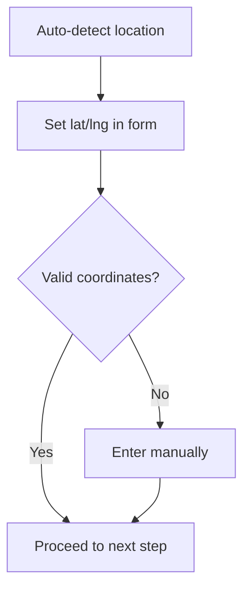

**Diagram sources**
- [RegisterPropertyPage.jsx:226-240](file://src/pages/accommodation/RegisterPropertyPage.jsx#L226-L240)
- [AccommodationDetailPage.jsx:291-306](file://src/pages/accommodation/AccommodationDetailPage.jsx#L291-L306)

**Section sources**
- [RegisterPropertyPage.jsx:226-240](file://src/pages/accommodation/RegisterPropertyPage.jsx#L226-L240)
- [AccommodationDetailPage.jsx:291-306](file://src/pages/accommodation/AccommodationDetailPage.jsx#L291-L306)

### Property Detail Page Features
Highlights:
- Rich gallery with lightbox navigation
- Video walkthrough playback with poster generation
- Section scroll spy for overview, amenities, rooms, location, policies, reviews, host
- Room/suite selection with dynamic pricing calculation
- M-Pesa payment modal initiating STK push
- Host information and verification badges
- Share and wishlist functionality

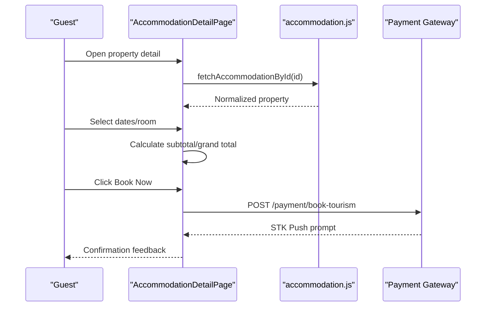

**Diagram sources**
- [AccommodationDetailPage.jsx:117-366](file://src/pages/accommodation/AccommodationDetailPage.jsx#L117-L366)
- [accommodation.js:107-110](file://src/api/accommodation.js#L107-L110)

**Section sources**
- [AccommodationDetailPage.jsx:1-800](file://src/pages/accommodation/AccommodationDetailPage.jsx#L1-L800)

### Booking Integration
Two booking paths exist:
- External booking URL: Guests are redirected to the property’s own booking site when provided during registration.
- Integrated M-Pesa flow: The detail page initiates an STK push to the guest’s phone number.

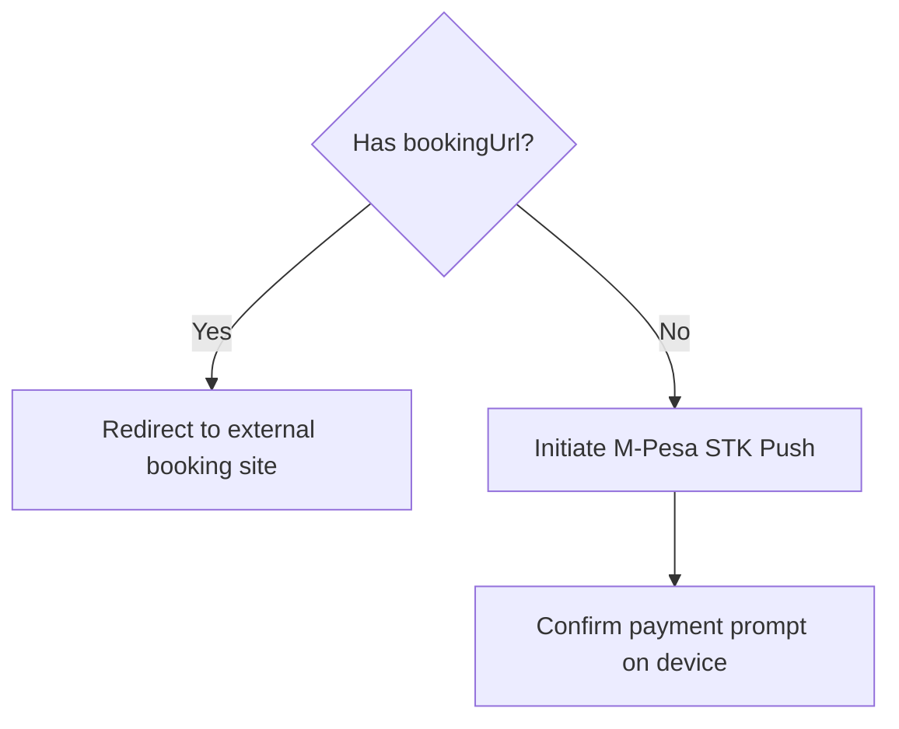

**Diagram sources**
- [RegisterPropertyPage.jsx:724-744](file://src/pages/accommodation/RegisterPropertyPage.jsx#L724-L744)
- [AccommodationDetailPage.jsx:322-366](file://src/pages/accommodation/AccommodationDetailPage.jsx#L322-L366)

**Section sources**
- [RegisterPropertyPage.jsx:724-744](file://src/pages/accommodation/RegisterPropertyPage.jsx#L724-L744)
- [AccommodationDetailPage.jsx:322-366](file://src/pages/accommodation/AccommodationDetailPage.jsx#L322-L366)

### Agent Contact Functionality
- AgentCard displays verified status, WhatsApp contact link, and report mechanism
- MessagingSystem provides in-app chat context tied to a property

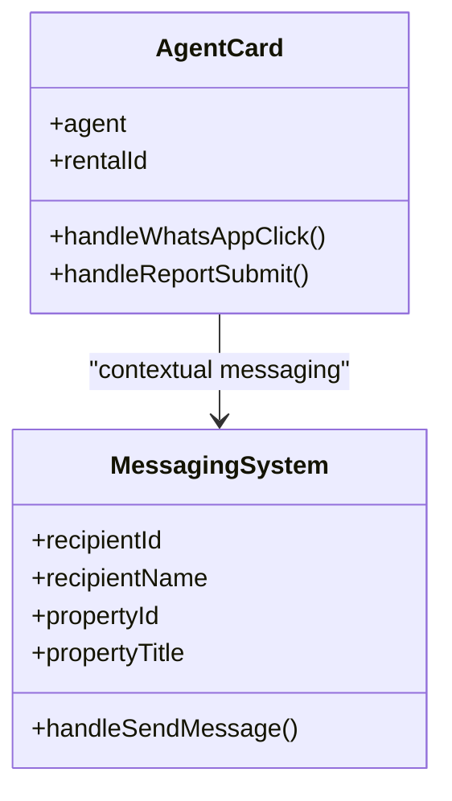

**Diagram sources**
- [AgentCard.jsx:1-228](file://src/components/AgentCard.jsx#L1-L228)
- [MessagingSystem.jsx:1-337](file://src/components/MessagingSystem.jsx#L1-L337)

**Section sources**
- [AgentCard.jsx:1-228](file://src/components/AgentCard.jsx#L1-L228)
- [MessagingSystem.jsx:1-337](file://src/components/MessagingSystem.jsx#L1-L337)

### Data Models and Normalization
Normalization ensures consistent shapes across backend responses:
- Fields: id, _id, price/basePrice, category/type, location/address, coordinates, images, videos, rating, reviews, color, tag, amenities
- Video URL cleaning for Cloudinary and other providers

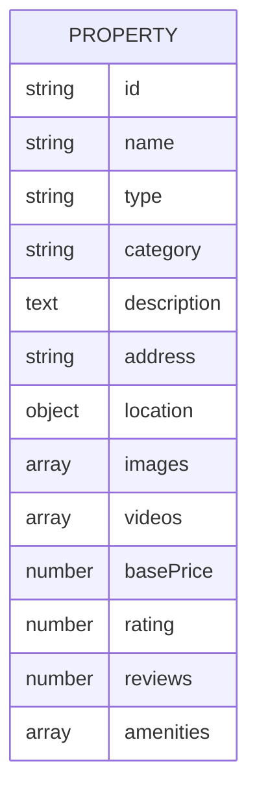

**Diagram sources**
- [accommodation.js:34-77](file://src/api/accommodation.js#L34-L77)

**Section sources**
- [accommodation.js:34-77](file://src/api/accommodation.js#L34-L77)

### Validation Rules and Business Logic
- Registration steps enforce required inputs and constraints
- Category-to-type mapping ensures backend compatibility
- Amenities require at least one selection
- Media limits: images up to 20, videos up to 10, each video ≤ 100MB
- Pricing fields validated numerically

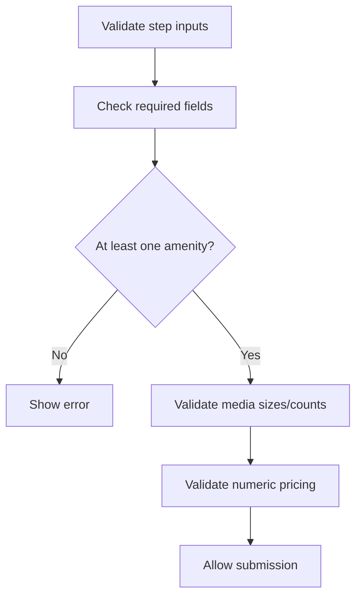

**Diagram sources**
- [RegisterPropertyPage.jsx:242-249](file://src/pages/accommodation/RegisterPropertyPage.jsx#L242-L249)
- [RegisterPropertyPage.jsx:194-216](file://src/pages/accommodation/RegisterPropertyPage.jsx#L194-L216)

**Section sources**
- [RegisterPropertyPage.jsx:242-249](file://src/pages/accommodation/RegisterPropertyPage.jsx#L242-L249)
- [RegisterPropertyPage.jsx:194-216](file://src/pages/accommodation/RegisterPropertyPage.jsx#L194-L216)

### Extending Property Types and Custom Fields
- Add new property types:
  - Extend PROPERTY_CATEGORIES in constants
  - Add mapping in RegisterPropertyPage categoryToTypeMap
- Add new amenities:
  - Extend AMENITIES_LIST in constants
- Add custom fields:
  - Update INITIAL_REGISTER_FORM
  - Add field handling in form update functions
  - Include in FormData construction and backend payload

**Section sources**
- [constants.js:55-138](file://src/features/accommodation/constants.js#L55-L138)
- [RegisterPropertyPage.jsx:265-316](file://src/pages/accommodation/RegisterPropertyPage.jsx#L265-L316)

## Dependency Analysis
Key relationships:
- Pages depend on API module for data operations
- Hooks encapsulate data fetching and local filtering
- index.js re-exports hooks and components for consistent imports
- PropertyCard renders normalized property data

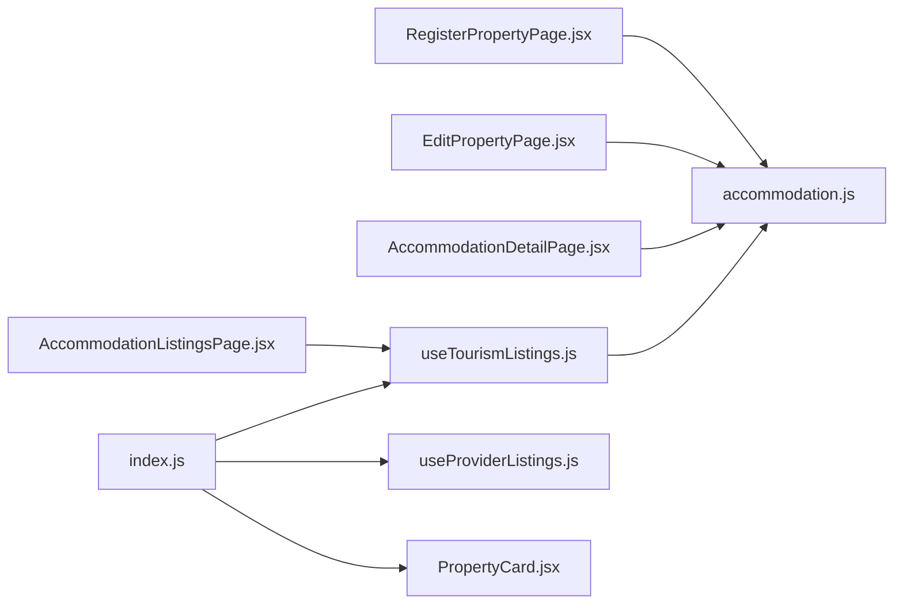

**Diagram sources**
- [index.js:1-19](file://src/features/accommodation/index.js#L1-L19)
- [useTourismListings.js:1-51](file://src/features/accommodation/hooks/useTourismListings.js#L1-L51)
- [useProviderListings.js:1-40](file://src/features/accommodation/hooks/useProviderListings.js#L1-L40)
- [accommodation.js:1-191](file://src/api/accommodation.js#L1-L191)

**Section sources**
- [index.js:1-19](file://src/features/accommodation/index.js#L1-L19)
- [useTourismListings.js:1-51](file://src/features/accommodation/hooks/useTourismListings.js#L1-L51)
- [useProviderListings.js:1-40](file://src/features/accommodation/hooks/useProviderListings.js#L1-L40)
- [accommodation.js:1-191](file://src/api/accommodation.js#L1-L191)

## Performance Considerations
- Use normalized data to avoid repeated transformations in components
- Limit media uploads to reasonable counts and sizes to reduce payload
- Prefer server-side filtering where possible; local filtering used as fallback
- Lazy-load images and videos; use posters for video previews
- Debounce search inputs to minimize network requests

[No sources needed since this section provides general guidance]

## Troubleshooting Guide
Common issues and resolutions:
- Submission errors: check token presence and required fields; verify category mapping
- Media upload failures: ensure file types and sizes comply with limits
- Geolocation not available: prompt manual coordinate entry
- Network errors: handle offline states and display user-friendly messages
- Payment initiation failures: validate phone number and token; retry with clear error feedback

**Section sources**
- [RegisterPropertyPage.jsx:251-330](file://src/pages/accommodation/RegisterPropertyPage.jsx#L251-L330)
- [AccommodationDetailPage.jsx:322-366](file://src/pages/accommodation/AccommodationDetailPage.jsx#L322-L366)
- [accommodation.js:7-14](file://src/api/accommodation.js#L7-L14)

## Conclusion
The property management system provides a comprehensive workflow for creating, editing, discovering, and booking accommodations. It supports rich media, location-based discovery, flexible pricing, and integrated payments while offering extensibility for new property types and custom fields. Robust normalization and shared hooks ensure consistent data handling across the application.

[No sources needed since this section summarizes without analyzing specific files]

## Appendices

### API Endpoints Summary
- GET /accommodations — browse listings (status=active)
- GET /accommodations/{id} — fetch single listing
- POST /accommodations — create listing with media
- PATCH /accommodations/{id} — update listing with media
- GET /accommodations/my-accommodations/all — owner listings
- GET /accommodations/owner/profile — owner profile
- PATCH /accommodations/owner/profile — update owner profile
- POST /accommodation-reviews — submit review
- POST /payment/book-tourism — initiate M-Pesa STK push

**Section sources**
- [accommodation.js:81-110](file://src/api/accommodation.js#L81-L110)
- [accommodation.js:129-179](file://src/api/accommodation.js#L129-L179)
- [accommodation.js:181-190](file://src/api/accommodation.js#L181-L190)