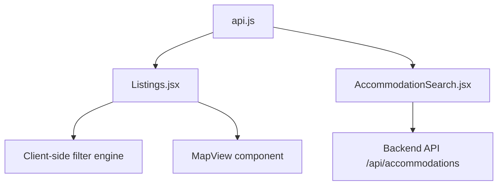
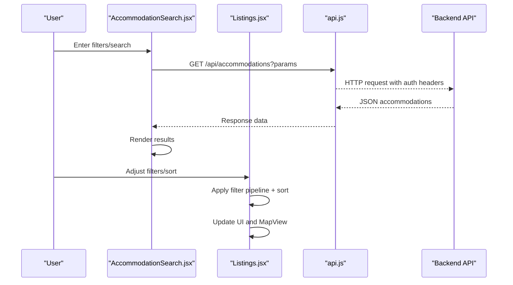
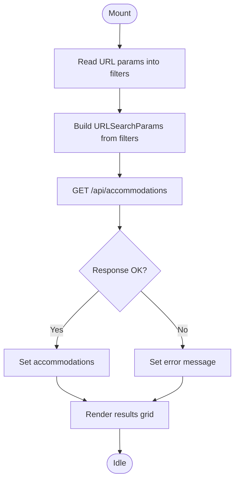
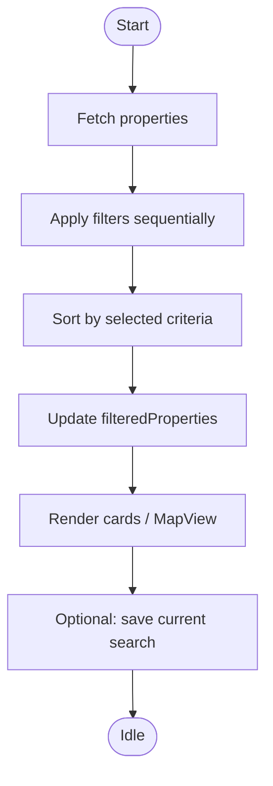
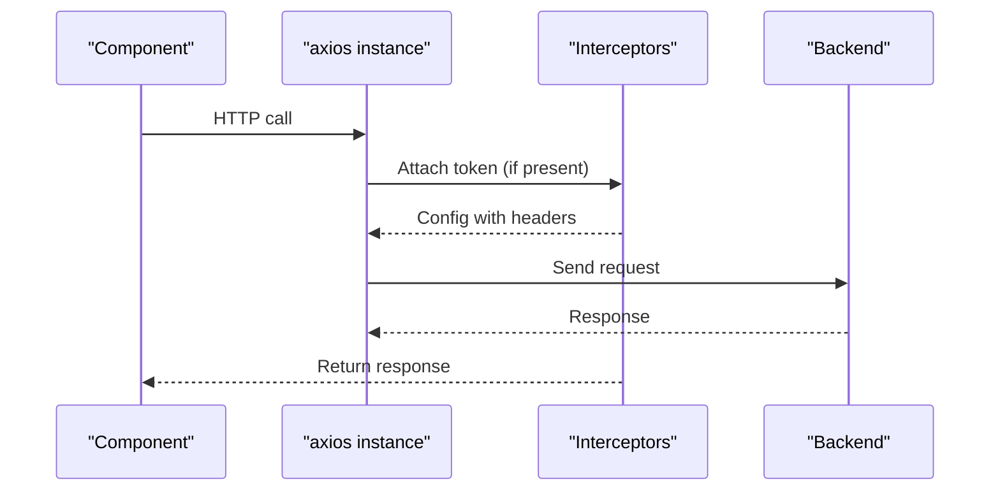
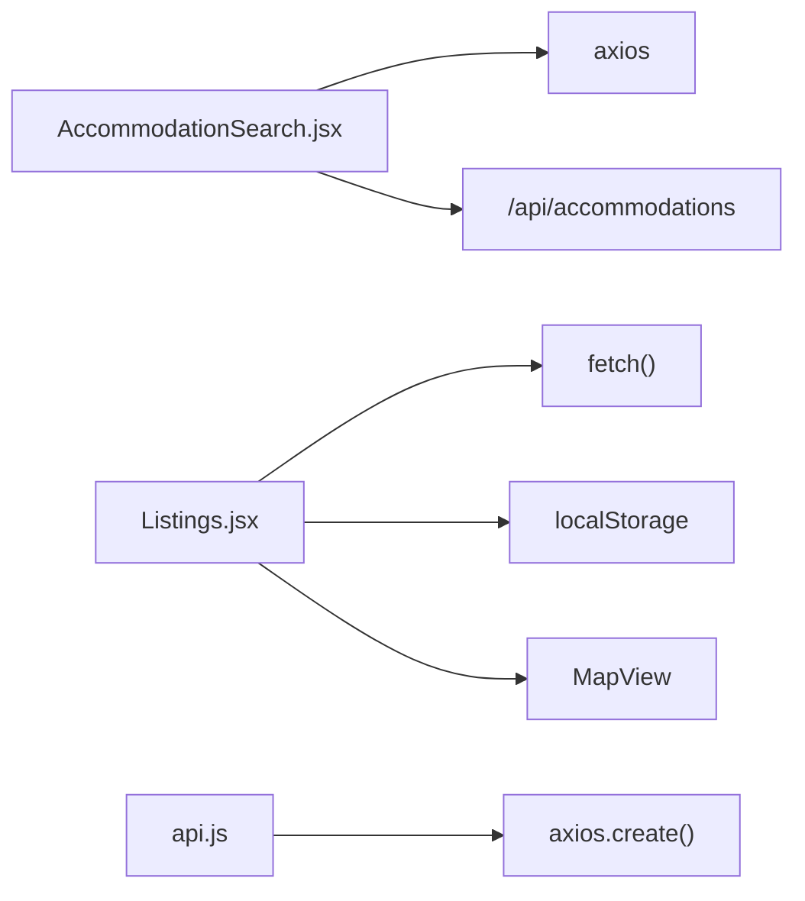

# Search & Filtering System

<cite>
**Referenced Files in This Document**
- [AccommodationSearch.jsx](file://src/pages/AccommodationSearch.jsx)
- [Listings.jsx](file://src/pages/Listings.jsx)
- [api.js](file://src/api/api.js)
</cite>

## Table of Contents
1. [Introduction](#introduction)
2. [Project Structure](#project-structure)
3. [Core Components](#core-components)
4. [Architecture Overview](#architecture-overview)
5. [Detailed Component Analysis](#detailed-component-analysis)
6. [Dependency Analysis](#dependency-analysis)
7. [Performance Considerations](#performance-considerations)
8. [Troubleshooting Guide](#troubleshooting-guide)
9. [Conclusion](#conclusion)
10. [Appendices](#appendices)

## Introduction
This document explains the search and filtering system across property types, focusing on how queries are constructed, filters applied, and results ranked. It covers advanced filtering options (price ranges, property types, amenities, location), real-time suggestions and autocomplete patterns, and search history. It also provides guidance for adding custom filters, optimizing performance, and implementing geo-location-based searches.

## Project Structure
The search and filtering functionality is implemented primarily in two pages:
- Accommodation search page that delegates filtering to a backend API.
- Listings page that performs client-side filtering and sorting over fetched properties.

**Diagram sources**
- [AccommodationSearch.jsx:29-49](file://src/pages/AccommodationSearch.jsx#L29-L49)
- [Listings.jsx:459-558](file://src/pages/Listings.jsx#L459-L558)
- [api.js:1-47](file://src/api/api.js#L1-L47)

**Section sources**
- [AccommodationSearch.jsx:1-329](file://src/pages/AccommodationSearch.jsx#L1-L329)
- [Listings.jsx:289-558](file://src/pages/Listings.jsx#L289-L558)
- [api.js:1-47](file://src/api/api.js#L1-L47)

## Core Components
- AccommodationSearch: Builds query parameters from user inputs and fetches accommodations from the backend. Supports type, search text, price range, max guests, and featured toggle. URL-synced filters via useSearchParams.
- Listings: Loads all properties once, then applies a comprehensive client-side filter pipeline (location, property type, bedrooms, bathrooms, furnished, pet-friendly, amenities, available-from date, price range). Provides sorting by recommended/price/bedrooms/newest. Includes saved searches and favorites.

Key responsibilities:
- Query construction: URL params for server-side; state-driven filters for client-side.
- Filter application: Sequential filtering with early exits for empty sets.
- Ranking/sorting: Client-side sort functions; server-side ranking not visible here.

**Section sources**
- [AccommodationSearch.jsx:15-64](file://src/pages/AccommodationSearch.jsx#L15-L64)
- [Listings.jsx:311-324](file://src/pages/Listings.jsx#L311-L324)
- [Listings.jsx:459-558](file://src/pages/Listings.jsx#L459-L558)

## Architecture Overview
End-to-end flow for both accommodation and rental listings:

**Diagram sources**
- [AccommodationSearch.jsx:29-49](file://src/pages/AccommodationSearch.jsx#L29-L49)
- [Listings.jsx:459-558](file://src/pages/Listings.jsx#L459-L558)
- [api.js:10-24](file://src/api/api.js#L10-L24)

## Detailed Component Analysis

### AccommodationSearch: Server-Side Filtering
- Query Construction:
  - Reads initial filters from URL search params.
  - Builds URLSearchParams with type, search, minPrice, maxPrice, maxGuests, featured.
  - Calls backend endpoint with constructed query string.
- Filter Application:
  - Delegates filtering logic to backend; frontend only passes parameters.
- Result Rendering:
  - Displays cards with primary image, type label, address, amenities preview, guest capacity, and rooms count.
- Error Handling:
  - Sets error message and loading states around requests.

**Diagram sources**
- [AccommodationSearch.jsx:25-49](file://src/pages/AccommodationSearch.jsx#L25-L49)

**Section sources**
- [AccommodationSearch.jsx:15-64](file://src/pages/AccommodationSearch.jsx#L15-L64)
- [AccommodationSearch.jsx:66-80](file://src/pages/AccommodationSearch.jsx#L66-L80)
- [AccommodationSearch.jsx:90-205](file://src/pages/AccommodationSearch.jsx#L90-L205)

### Listings: Client-Side Filtering and Sorting
- Data Loading:
  - Fetches all properties once on mount and computes availability.
- Filter Pipeline:
  - Location match against location, county, title.
  - Property type quick category or explicit filter.
  - Bedrooms/bathrooms exact or “+” thresholds.
  - Furnished/pet-friendly booleans.
  - Amenities substring match.
  - Available-from date comparison.
  - Price range inclusive bounds.
  - Favorites-only toggle.
- Sorting:
  - Recommended (default), price ascending/descending, bedrooms descending, newest first.
- Saved Searches:
  - Persist current filters to localStorage under a named entry.
  - Apply/delete saved searches.
- Map Integration:
  - Passes filtered properties to MapView when map mode is enabled.

**Diagram sources**
- [Listings.jsx:408-433](file://src/pages/Listings.jsx#L408-L433)
- [Listings.jsx:459-558](file://src/pages/Listings.jsx#L459-L558)
- [Listings.jsx:795-826](file://src/pages/Listings.jsx#L795-L826)

**Section sources**
- [Listings.jsx:408-433](file://src/pages/Listings.jsx#L408-L433)
- [Listings.jsx:459-558](file://src/pages/Listings.jsx#L459-L558)
- [Listings.jsx:631-673](file://src/pages/Listings.jsx#L631-L673)
- [Listings.jsx:795-826](file://src/pages/Listings.jsx#L795-L826)

### API Interceptor and Request Flow
- Central axios instance adds Authorization header if token exists.
- Logs request/response for debugging.
- Used by components that import it; direct fetch calls bypass interceptor.

**Diagram sources**
- [api.js:1-47](file://src/api/api.js#L1-L47)

**Section sources**
- [api.js:10-24](file://src/api/api.js#L10-L24)
- [api.js:26-44](file://src/api/api.js#L26-L44)

## Dependency Analysis
- AccommodationSearch depends on:
  - React Router for URL sync (useSearchParams).
  - Axios for HTTP calls.
  - Backend endpoint /api/accommodations.
- Listings depends on:
  - Direct fetch to /properties and related endpoints.
  - LocalStorage for favorites and saved searches.
  - MapView component for geospatial visualization.
- api.js provides centralized axios configuration used elsewhere but not directly imported by these two files.

**Diagram sources**
- [AccommodationSearch.jsx:1-5](file://src/pages/AccommodationSearch.jsx#L1-L5)
- [Listings.jsx:1-12](file://src/pages/Listings.jsx#L1-L12)
- [api.js:1-8](file://src/api/api.js#L1-L8)

**Section sources**
- [AccommodationSearch.jsx:1-5](file://src/pages/AccommodationSearch.jsx#L1-L5)
- [Listings.jsx:1-12](file://src/pages/Listings.jsx#L1-L12)
- [api.js:1-47](file://src/api/api.js#L1-L47)

## Performance Considerations
- Prefer server-side filtering for large datasets:
  - Use AccommodationSearch pattern to push heavy filtering to the backend.
- Minimize re-renders:
  - Memoize derived lists where possible (e.g., useMemo for active filter counts).
- Debounce input handlers:
  - For live search fields, debounce to reduce frequent state updates and network calls.
- Pagination and limits:
  - Add limit/offset or cursor-based pagination on backend endpoints.
- Image optimization:
  - Lazy-load images and use responsive sizes.
- Avoid unnecessary fetches:
  - Cache responses when appropriate and invalidate on filter changes.

[No sources needed since this section provides general guidance]

## Troubleshooting Guide
- No results returned:
  - Verify filter values and ensure they match expected field names/types.
  - Check backend endpoint behavior for each parameter.
- Network errors:
  - Inspect browser console for interceptor logs and status codes.
  - Confirm VITE_API_URL environment variable points to correct backend.
- Saved searches not persisting:
  - Ensure localStorage is accessible and not blocked by privacy settings.
- Map not updating:
  - Confirm filteredProperties array is passed to MapView and coordinates exist.

**Section sources**
- [api.js:26-44](file://src/api/api.js#L26-L44)
- [Listings.jsx:408-433](file://src/pages/Listings.jsx#L408-L433)

## Conclusion
The system offers two complementary approaches:
- Server-side filtering for accommodations via query parameters.
- Client-side filtering and sorting for rentals with rich UX features like saved searches and map view.
Adopting server-side filtering for large datasets, debouncing inputs, and leveraging pagination will improve responsiveness and scalability.

[No sources needed since this section summarizes without analyzing specific files]

## Appendices

### Advanced Filtering Options Reference
- Price ranges: minPrice/maxPrice supported in both pages.
- Property types:
  - AccommodationSearch: hotel, bnb, guesthouse, apartment.
  - Listings: apartment, bedsitter, maisonette, studio, house, hostel, commercial.
- Amenities:
  - Listings supports substring matching against amenities array.
- Location-based:
  - Listings matches location, county, and title substrings.
  - University hostels tab uses universityId query param to fetch relevant listings.

**Section sources**
- [AccommodationSearch.jsx:15-23](file://src/pages/AccommodationSearch.jsx#L15-L23)
- [Listings.jsx:463-539](file://src/pages/Listings.jsx#L463-L539)
- [Listings.jsx:560-592](file://src/pages/Listings.jsx#L560-L592)

### Real-Time Suggestions and Autocomplete
- Current implementation does not include dedicated autocomplete for search terms.
- Recommendations:
  - Implement debounced suggestions using a dedicated endpoint (e.g., /properties/suggest?q=...).
  - Cache popular suggestions locally to reduce latency.
  - Provide keyboard navigation and accessibility attributes for dropdown suggestions.

[No sources needed since this section proposes enhancements]

### Search History and Saved Searches
- Listings saves current filters to localStorage with a user-provided name.
- Users can apply or delete saved searches at any time.
- AccommodationSearch persists filters in URL params for shareable links.

**Section sources**
- [Listings.jsx:795-826](file://src/pages/Listings.jsx#L795-L826)
- [AccommodationSearch.jsx:52-64](file://src/pages/AccommodationSearch.jsx#L52-L64)

### Adding Custom Filters
- For client-side (Listings):
  - Extend filters state with new keys.
  - Add UI controls and update handleFilterChange.
  - Include new conditions in the filter pipeline.
- For server-side (AccommodationSearch):
  - Add new URLSearchParams entries.
  - Ensure backend supports the new parameters.

**Section sources**
- [Listings.jsx:311-324](file://src/pages/Listings.jsx#L311-L324)
- [Listings.jsx:647-656](file://src/pages/Listings.jsx#L647-L656)
- [Listings.jsx:459-558](file://src/pages/Listings.jsx#L459-L558)
- [AccommodationSearch.jsx:29-49](file://src/pages/AccommodationSearch.jsx#L29-L49)

### Optimizing Search Performance
- Debounce search inputs.
- Use server-side filtering for large result sets.
- Paginate results.
- Memoize expensive computations.
- Optimize images and lazy load media.

[No sources needed since this section provides general guidance]

### Geo-Location Based Searches
- Listings includes a MapView integration and Google Maps links for individual properties with lat/lng.
- To implement proximity search:
  - Add lat/lng to query payload.
  - Use backend geospatial queries (e.g., MongoDB $near or PostGIS).
  - Display results sorted by distance.

**Section sources**
- [Listings.jsx:1378-1386](file://src/pages/Listings.jsx#L1378-L1386)
- [Listings.jsx:1907-1916](file://src/pages/Listings.jsx#L1907-L1916)