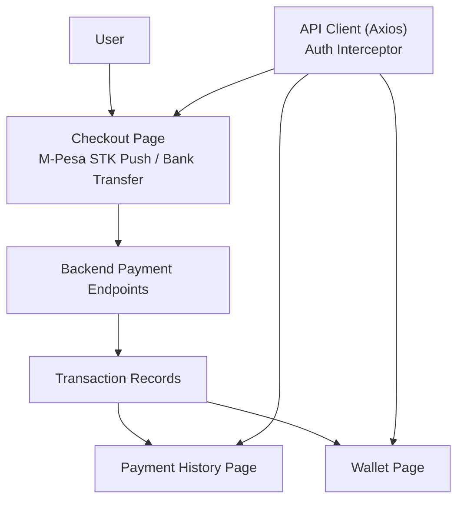
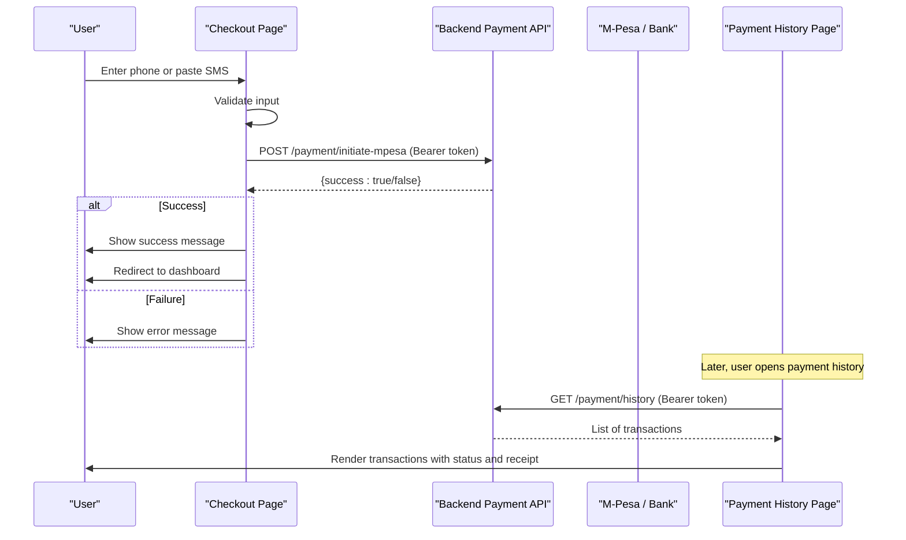
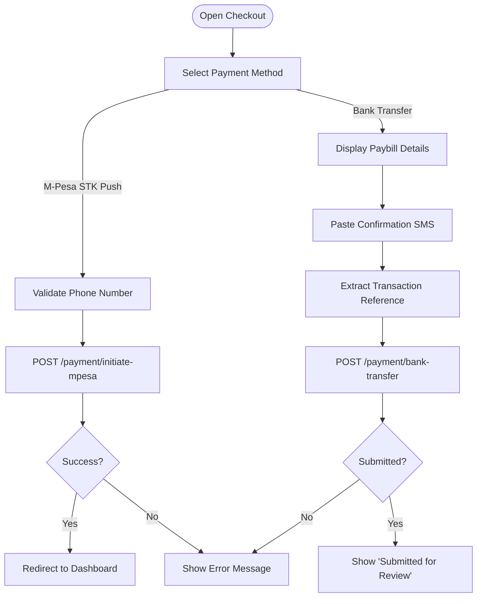
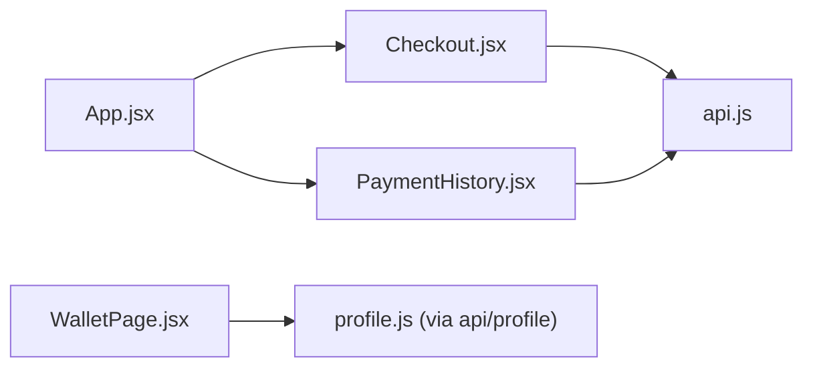

# Checkout & Payment Processing

<cite>
**Referenced Files in This Document**
- [Checkout.jsx](file://src/pages/Checkout.jsx)
- [PaymentHistory.jsx](file://src/pages/PaymentHistory.jsx)
- [api.js](file://src/api/api.js)
- [App.jsx](file://src/App.jsx)
- [WalletPage.jsx](file://src/pages/WalletPage.jsx)
</cite>

## Table of Contents
1. [Introduction](#introduction)
2. [Project Structure](#project-structure)
3. [Core Components](#core-components)
4. [Architecture Overview](#architecture-overview)
5. [Detailed Component Analysis](#detailed-component-analysis)
6. [Dependency Analysis](#dependency-analysis)
7. [Performance Considerations](#performance-considerations)
8. [Troubleshooting Guide](#troubleshooting-guide)
9. [Conclusion](#conclusion)
10. [Appendices](#appendices)

## Introduction
This document explains the checkout and payment processing system implemented in the frontend application. It covers the end-to-end flow from cart selection to payment completion, supported payment methods, order confirmation behavior, transaction tracking, security considerations for sensitive data, error handling strategies, and guidance for customization such as adding new payment methods and updating order statuses. It also includes recommendations for mobile optimization, receipt generation, and post-purchase notifications.

## Project Structure
The checkout and payment features are primarily implemented in the following files:
- Checkout page handles M-Pesa STK push and manual bank transfer submission.
- Payment history page displays past transactions with status badges and receipt links.
- API client provides a centralized Axios instance with interceptors for authentication and logging.
- App routes connect the checkout and payment history pages into the application navigation.
- Wallet page shows user balance and transaction history sourced from profile data.

**Diagram sources**
- [Checkout.jsx:28-112](file://src/pages/Checkout.jsx#L28-L112)
- [PaymentHistory.jsx:22-49](file://src/pages/PaymentHistory.jsx#L22-L49)
- [api.js:1-47](file://src/api/api.js#L1-L47)
- [App.jsx:363-363](file://src/App.jsx#L363-L363)
- [App.jsx:436-436](file://src/App.jsx#L436-L436)

**Section sources**
- [Checkout.jsx:1-373](file://src/pages/Checkout.jsx#L1-L373)
- [PaymentHistory.jsx:1-336](file://src/pages/PaymentHistory.jsx#L1-L336)
- [api.js:1-47](file://src/api/api.js#L1-L47)
- [App.jsx:363-363](file://src/App.jsx#L363-L363)
- [App.jsx:436-436](file://src/App.jsx#L436-L436)
- [WalletPage.jsx:1-232](file://src/pages/WalletPage.jsx#L1-L232)

## Core Components
- Checkout Page: Collects phone number or bank transfer message, validates input, initiates payments via backend endpoints, and navigates to the appropriate dashboard after success.
- Payment History Page: Fetches and renders the user’s transactions, including amount, date, status, method, and optional receipt link.
- API Client: Centralized Axios configuration with request/response interceptors that attach authorization tokens and log requests/responses.
- Wallet Page: Displays wallet balance and transaction history derived from the user profile endpoint.

Key responsibilities:
- Input validation and user feedback on the checkout form.
- Secure transmission of payment initiation requests using bearer tokens.
- Robust error handling and user-facing messages.
- Displaying transaction history with status indicators and receipts.

**Section sources**
- [Checkout.jsx:28-112](file://src/pages/Checkout.jsx#L28-L112)
- [PaymentHistory.jsx:22-49](file://src/pages/PaymentHistory.jsx#L22-L49)
- [api.js:10-44](file://src/api/api.js#L10-L44)
- [WalletPage.jsx:16-32](file://src/pages/WalletPage.jsx#L16-L32)

## Architecture Overview
The checkout flow integrates the React frontend with backend payment endpoints. The UI collects inputs, validates them, and sends authenticated requests to initiate payments. After successful initiation, users are redirected to their dashboard. Transaction records are later displayed in the payment history and wallet views.

**Diagram sources**
- [Checkout.jsx:28-71](file://src/pages/Checkout.jsx#L28-L71)
- [PaymentHistory.jsx:22-49](file://src/pages/PaymentHistory.jsx#L22-L49)

## Detailed Component Analysis

### Checkout Flow: From Cart to Completion
The checkout page supports two payment methods:
- M-Pesa STK Push: Validates phone number, calls the backend to initiate an STK prompt, and redirects upon success.
- Manual Bank Transfer: Shows paybill details, accepts a pasted M-Pesa confirmation SMS, extracts a transaction reference, and submits it for verification.

**Diagram sources**
- [Checkout.jsx:28-112](file://src/pages/Checkout.jsx#L28-L112)

Implementation highlights:
- Input validation ensures phone length and SMS content meet expected formats before sending requests.
- Authorization is included via a bearer token retrieved from local storage.
- On success, the user is navigated to the role-based dashboard path.
- For bank transfers, the UI parses a transaction reference from the SMS and submits it along with the full message for admin verification.

**Section sources**
- [Checkout.jsx:28-112](file://src/pages/Checkout.jsx#L28-L112)
- [Checkout.jsx:114-131](file://src/pages/Checkout.jsx#L114-L131)

### Payment Method Integration
Supported methods:
- M-Pesa STK Push: Frontend triggers backend initiation; user completes prompt on device.
- Manual Bank Transfer (Paybill): User pays via M-Pesa Paybill and pastes confirmation SMS for verification.

Integration points:
- Backend endpoints:
  - `/payment/initiate-mpesa`
  - `/payment/bank-transfer`
- Request headers include `Authorization: Bearer <token>` for secure access.

Customization guidance:
- To add a new payment method, extend the method selector in the checkout UI and implement a corresponding handler that calls a new backend endpoint with required payload fields.
- Ensure consistent error handling and user feedback across all methods.

**Section sources**
- [Checkout.jsx:24-26](file://src/pages/Checkout.jsx#L24-L26)
- [Checkout.jsx:28-71](file://src/pages/Checkout.jsx#L28-L71)
- [Checkout.jsx:73-112](file://src/pages/Checkout.jsx#L73-L112)

### Order Confirmation and Status Updates
After initiating M-Pesa STK push, the frontend shows a success message and redirects to the dashboard. For bank transfers, the UI displays a “Submitted for Review” state indicating pending admin verification.

Status mapping in payment history:
- Completed/Success: Green badge
- Pending: Yellow badge
- Failed: Red badge

Receipt handling:
- If a receipt URL is present in the transaction record, the payment history page provides a button to open the receipt in a new tab.

Post-purchase notifications:
- The current implementation does not show explicit notification logic in these files; consider integrating a notification service to alert users when payment status changes.

**Section sources**
- [Checkout.jsx:57-64](file://src/pages/Checkout.jsx#L57-L64)
- [Checkout.jsx:114-131](file://src/pages/Checkout.jsx#L114-L131)
- [PaymentHistory.jsx:51-63](file://src/pages/PaymentHistory.jsx#L51-L63)
- [PaymentHistory.jsx:147-151](file://src/pages/PaymentHistory.jsx#L147-L151)

### Transaction Tracking
The payment history page fetches transactions via `/payment/history`, handles missing endpoints gracefully, and renders each transaction with:
- Description and date
- Amount and currency formatting
- Transaction ID or fallback to internal ID
- Property title (if available)
- Payment method (if available)
- Receipt link (if available)

The wallet page retrieves user profile data and displays:
- Wallet balance
- Total spent (sum of successful/completed transactions)
- Filterable transaction list by status

**Section sources**
- [PaymentHistory.jsx:22-49](file://src/pages/PaymentHistory.jsx#L22-L49)
- [PaymentHistory.jsx:102-154](file://src/pages/PaymentHistory.jsx#L102-L154)
- [WalletPage.jsx:16-32](file://src/pages/WalletPage.jsx#L16-L32)
- [WalletPage.jsx:44-50](file://src/pages/WalletPage.jsx#L44-L50)

## Dependency Analysis
The checkout and payment components depend on:
- React Router for navigation and route registration.
- AuthContext for user and token management.
- Axios API client for standardized HTTP requests with interceptors.

**Diagram sources**
- [Checkout.jsx:1-5](file://src/pages/Checkout.jsx#L1-L5)
- [PaymentHistory.jsx:1-4](file://src/pages/PaymentHistory.jsx#L1-L4)
- [api.js:1-47](file://src/api/api.js#L1-L47)
- [App.jsx:363-363](file://src/App.jsx#L363-L363)
- [App.jsx:436-436](file://src/App.jsx#L436-L436)

**Section sources**
- [api.js:1-47](file://src/api/api.js#L1-L47)
- [App.jsx:363-363](file://src/App.jsx#L363-L363)
- [App.jsx:436-436](file://src/App.jsx#L436-L436)

## Performance Considerations
- Use the centralized API client to avoid duplicating auth header logic and to benefit from consistent timeouts and logging.
- Debounce or throttle repeated network calls where applicable (e.g., search-driven flows).
- Minimize re-renders by memoizing expensive computations and splitting large components.
- Prefer server-side pagination for transaction lists if datasets grow large.
- Cache static configuration values (e.g., paybill details) to reduce unnecessary reflows.

[No sources needed since this section provides general guidance]

## Troubleshooting Guide
Common issues and resolutions:
- Missing or invalid phone number: Ensure the phone field meets minimum length requirements before submitting.
- Network errors: Check connectivity and verify that the backend endpoints are reachable; inspect console logs from the API interceptors.
- Authentication failures: Confirm that the bearer token exists and is valid; ensure the API interceptor attaches the token automatically.
- Endpoint not found: The payment history page treats a 404 response as an empty state; verify backend deployment and route availability.
- SMS parsing issues: When using bank transfer, ensure the pasted SMS contains a recognizable transaction reference pattern.

Operational tips:
- Enable detailed logging in development via the API interceptors to trace request/response payloads and errors.
- Provide clear user-facing messages for both success and failure paths to improve UX during payment attempts.

**Section sources**
- [api.js:10-44](file://src/api/api.js#L10-L44)
- [PaymentHistory.jsx:29-49](file://src/pages/PaymentHistory.jsx#L29-L49)
- [Checkout.jsx:31-34](file://src/pages/Checkout.jsx#L31-L34)
- [Checkout.jsx:65-70](file://src/pages/Checkout.jsx#L65-L70)

## Conclusion
The checkout and payment processing system provides a streamlined experience for initiating M-Pesa STK push payments and submitting manual bank transfer confirmations. It integrates securely via bearer tokens, offers robust error handling, and presents transaction history with status indicators and optional receipts. Extending the system with additional payment methods and notifications can be achieved by following the outlined integration patterns and ensuring consistent validation, error handling, and user feedback.

[No sources needed since this section summarizes without analyzing specific files]

## Appendices

### Customizing Payment Flows
- Add a new payment method:
  - Extend the method selector in the checkout UI.
  - Implement a handler that validates inputs and calls a new backend endpoint.
  - Handle success and error states consistently with existing methods.
  - Update navigation and confirmation messages accordingly.

- Implement order status updates:
  - Map backend status values to UI badges similar to the existing mapping.
  - Refresh transaction lists periodically or via websockets/polling if real-time updates are required.

### Mobile Payment Optimization
- Optimize input fields for mobile keyboards (numeric keypad for phone numbers).
- Reduce layout shifts by pre-sizing forms and avoiding dynamic height changes during loading.
- Provide concise instructions for pasting SMS content and highlight key fields like paybill number and account number.

### Receipt Generation
- Ensure backend generates a stable receipt URL per transaction.
- Expose the receipt URL in the transaction object so the payment history page can render a clickable link.

### Post-Purchase Notifications
- Integrate a notification service to inform users about payment status changes (pending, completed, failed).
- Send contextual messages referencing transaction IDs and amounts for clarity.

[No sources needed since this section provides general guidance]