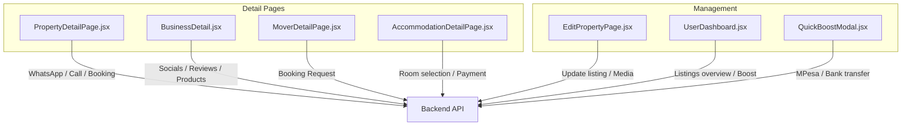
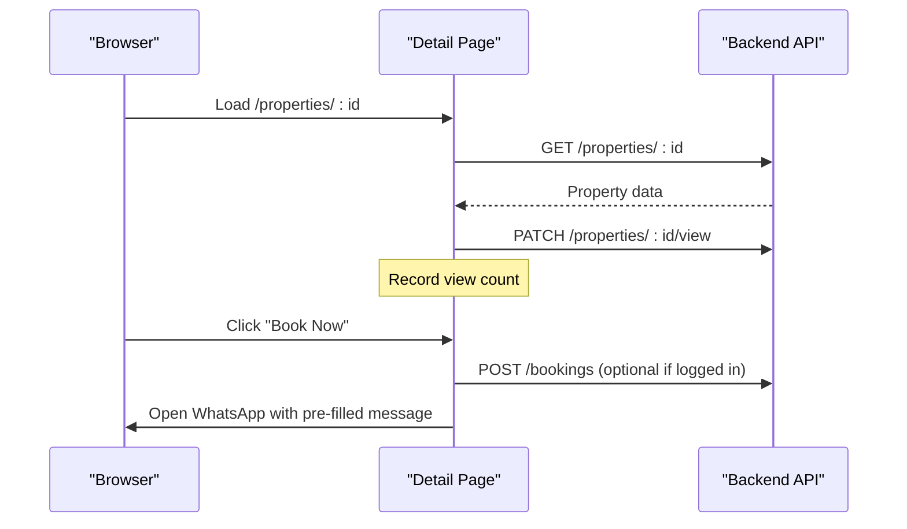
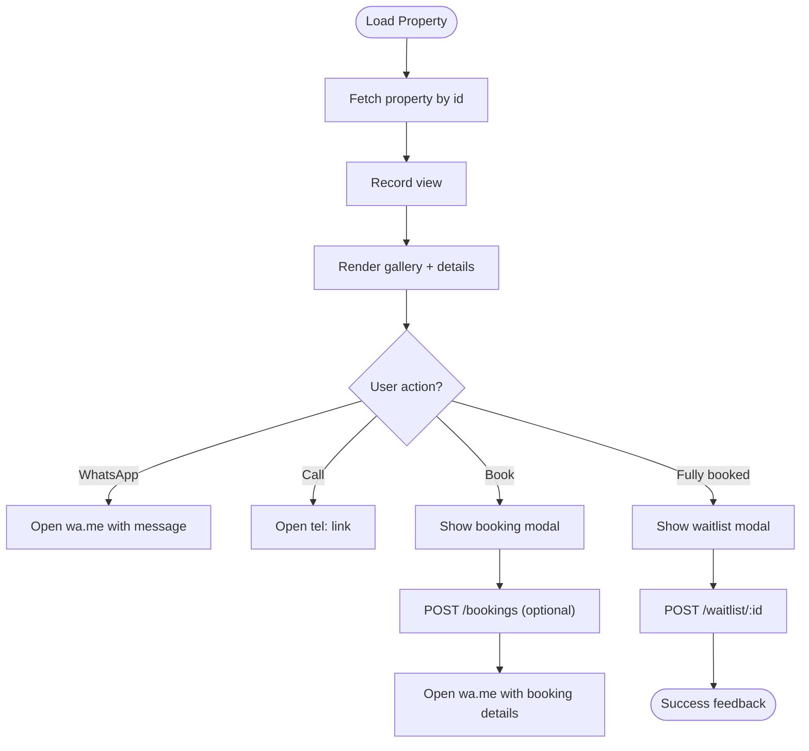
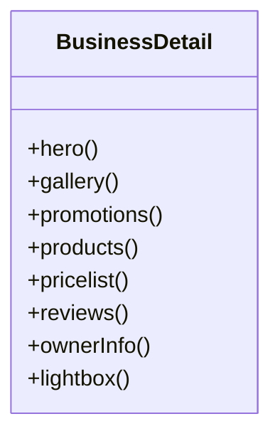
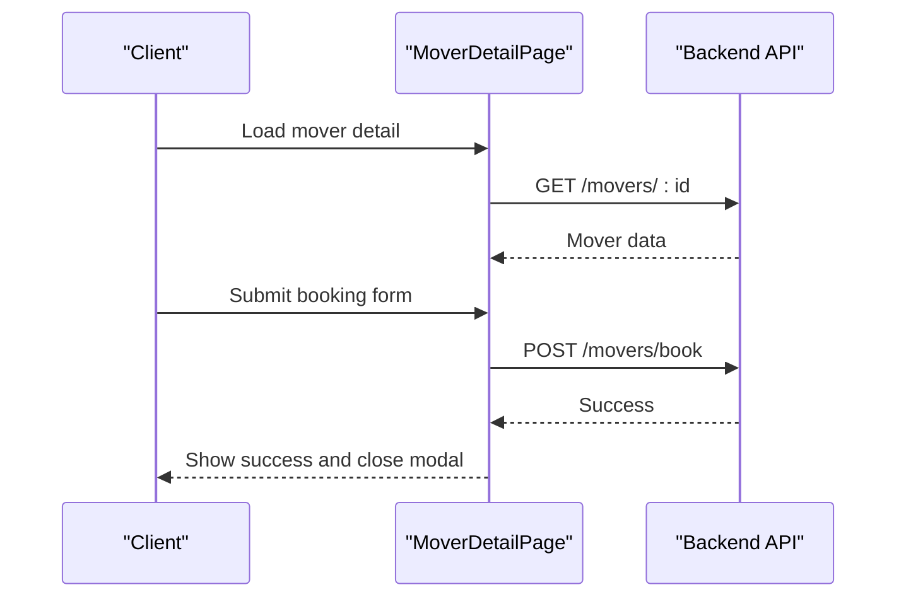
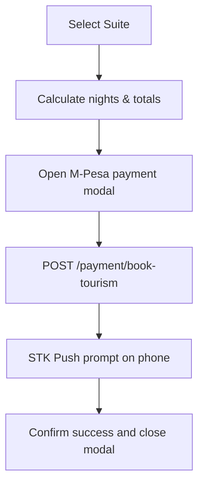
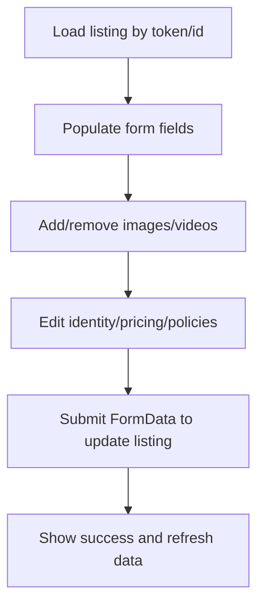
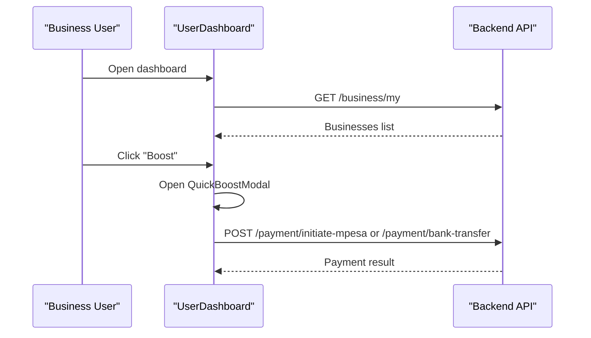
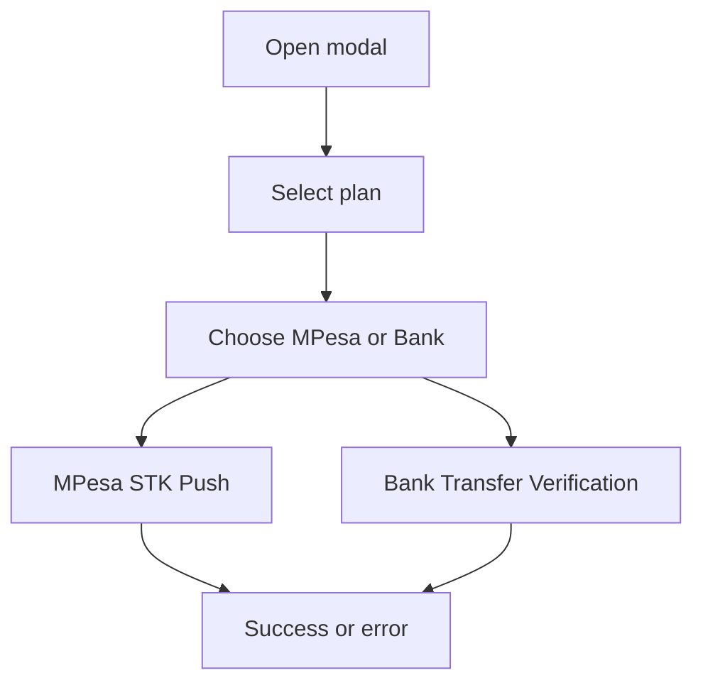
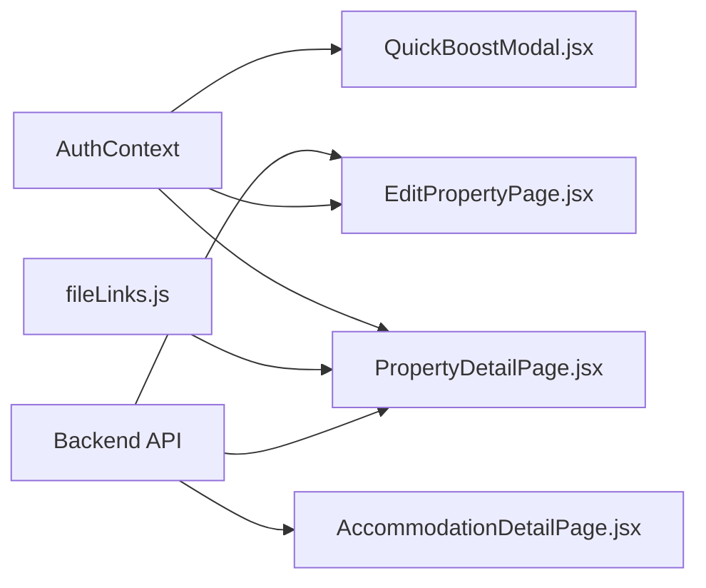

# Item Detail & Management

<cite>
**Referenced Files in This Document**
- [PropertyDetailPage.jsx](file://src/pages/PropertyDetailPage.jsx)
- [BusinessDetail.jsx](file://src/pages/BusinessDetail.jsx)
- [MoverDetailPage.jsx](file://src/pages/MoverDetailPage.jsx)
- [AccommodationDetailPage.jsx](file://src/pages/accommodation/AccommodationDetailPage.jsx)
- [EditPropertyPage.jsx](file://src/pages/accommodation/EditPropertyPage.jsx)
- [UserDashboard.jsx](file://src/pages/UserDashboard.jsx)
- [QuickBoostModal.jsx](file://src/components/QuickBoostModal.jsx)
</cite>

## Table of Contents
1. [Introduction](#introduction)
2. [Project Structure](#project-structure)
3. [Core Components](#core-components)
4. [Architecture Overview](#architecture-overview)
5. [Detailed Component Analysis](#detailed-component-analysis)
6. [Dependency Analysis](#dependency-analysis)
7. [Performance Considerations](#performance-considerations)
8. [Troubleshooting Guide](#troubleshooting-guide)
9. [Conclusion](#conclusion)
10. [Appendices](#appendices)

## Introduction
This document explains the item detail pages and management interfaces for listings such as properties, businesses, movers, and accommodations. It covers:
- Detail view features: image galleries, pricing, seller contact options, booking/waitlist actions, and promotional tools
- Seller editing capabilities: status management, media updates, amenities, policies, and previewing live listings
- Customization guidance: adapting layouts, adding fields to profiles, and implementing advanced search within details
- SEO optimization and social media integration patterns used across listing detail pages

## Project Structure
The frontend organizes detail pages by domain under src/pages, with shared components and utilities elsewhere. The key files for this documentation are:
- Property detail page (rentals)
- Business detail page (directory)
- Mover detail page (services)
- Accommodation detail page (hospitality)
- Accommodation edit page (seller management)
- User dashboard (business workspace)
- Quick boost modal (promotions/payments)

**Diagram sources**
- [PropertyDetailPage.jsx:80-129](file://src/pages/PropertyDetailPage.jsx#L80-L129)
- [BusinessDetail.jsx:1-120](file://src/pages/BusinessDetail.jsx#L1-L120)
- [MoverDetailPage.jsx:37-51](file://src/pages/MoverDetailPage.jsx#L37-L51)
- [AccommodationDetailPage.jsx:117-144](file://src/pages/accommodation/AccommodationDetailPage.jsx#L117-L144)
- [EditPropertyPage.jsx:29-61](file://src/pages/accommodation/EditPropertyPage.jsx#L29-L61)
- [UserDashboard.jsx:82-108](file://src/pages/UserDashboard.jsx#L82-L108)
- [QuickBoostModal.jsx:31-77](file://src/components/QuickBoostModal.jsx#L31-L77)

**Section sources**
- [PropertyDetailPage.jsx:1-129](file://src/pages/PropertyDetailPage.jsx#L1-L129)
- [BusinessDetail.jsx:1-120](file://src/pages/BusinessDetail.jsx#L1-L120)
- [MoverDetailPage.jsx:1-51](file://src/pages/MoverDetailPage.jsx#L1-L51)
- [AccommodationDetailPage.jsx:1-144](file://src/pages/accommodation/AccommodationDetailPage.jsx#L1-L144)
- [EditPropertyPage.jsx:1-61](file://src/pages/accommodation/EditPropertyPage.jsx#L1-L61)
- [UserDashboard.jsx:1-108](file://src/pages/UserDashboard.jsx#L1-L108)
- [QuickBoostModal.jsx:1-77](file://src/components/QuickBoostModal.jsx#L1-L77)

## Core Components
- Property detail page: gallery, description, amenities, videos, price sidebar, WhatsApp/call, booking modal, waitlist flow, QR scan tracking
- Business detail page: hero, badges, stats, gallery, promotions, products, pricelist, reviews, owner/support info, lightbox/modal UI
- Mover detail page: portfolio gallery, specialties/services, pricing/rating, booking form, WhatsApp/call
- Accommodation detail page: bento gallery, scroll-spy navigation, room/suite selection, M-Pesa payment modal, map, host/badges, wishlist/share
- Edit property page: media upload/remove, identity/description, pricing/capacity, check-in/out, house rules, amenities, status header, live preview link
- User dashboard: tabs for overview/listings/profile, business CRUD, quick boost trigger
- Quick boost modal: plan selection, MPesa STK push or bank transfer verification

**Section sources**
- [PropertyDetailPage.jsx:266-643](file://src/pages/PropertyDetailPage.jsx#L266-L643)
- [BusinessDetail.jsx:742-749](file://src/pages/BusinessDetail.jsx#L742-L749)
- [MoverDetailPage.jsx:137-424](file://src/pages/MoverDetailPage.jsx#L137-L424)
- [AccommodationDetailPage.jsx:412-800](file://src/pages/accommodation/AccommodationDetailPage.jsx#L412-L800)
- [EditPropertyPage.jsx:136-555](file://src/pages/accommodation/EditPropertyPage.jsx#L136-L555)
- [UserDashboard.jsx:147-200](file://src/pages/UserDashboard.jsx#L147-L200)
- [QuickBoostModal.jsx:132-265](file://src/components/QuickBoostModal.jsx#L132-L265)

## Architecture Overview
The detail pages follow a consistent pattern:
- Fetch data from backend on mount
- Render rich content sections (gallery, description, pricing, contact)
- Provide user actions (booking, waitlist, messaging, payments)
- Track analytics/events (views, QR scans, conversions)

**Diagram sources**
- [PropertyDetailPage.jsx:80-129](file://src/pages/PropertyDetailPage.jsx#L80-L129)
- [PropertyDetailPage.jsx:160-206](file://src/pages/PropertyDetailPage.jsx#L160-L206)

## Detailed Component Analysis

### Property Detail Page
Key capabilities:
- Image gallery with navigation and counter
- Description, amenities, videos, house rules
- Price sidebar with availability state
- Contact via WhatsApp and call
- Booking modal that optionally posts to DB and opens WhatsApp
- Waitlist modal when fully booked
- QR scan logging and conversion tracking

**Diagram sources**
- [PropertyDetailPage.jsx:80-129](file://src/pages/PropertyDetailPage.jsx#L80-L129)
- [PropertyDetailPage.jsx:146-206](file://src/pages/PropertyDetailPage.jsx#L146-L206)
- [PropertyDetailPage.jsx:208-232](file://src/pages/PropertyDetailPage.jsx#L208-L232)

Implementation highlights:
- Phone normalization helper ensures correct Kenyan format for WhatsApp links
- Video URL normalization supports Cloudinary video formats
- QR scan events recorded via dedicated endpoints

Customization examples:
- Add new fields to the detail layout by extending the render section after the description block
- Integrate advanced search within details by adding a search input that filters amenities or keywords client-side before rendering

SEO and social:
- Use descriptive alt text for images and include structured headings
- Shareable URLs are already present; integrate platform-specific meta tags at the app level

**Section sources**
- [PropertyDetailPage.jsx:9-30](file://src/pages/PropertyDetailPage.jsx#L9-L30)
- [PropertyDetailPage.jsx:80-129](file://src/pages/PropertyDetailPage.jsx#L80-L129)
- [PropertyDetailPage.jsx:146-206](file://src/pages/PropertyDetailPage.jsx#L146-L206)
- [PropertyDetailPage.jsx:208-232](file://src/pages/PropertyDetailPage.jsx#L208-L232)
- [PropertyDetailPage.jsx:266-643](file://src/pages/PropertyDetailPage.jsx#L266-L643)

### Business Detail Page
Key capabilities:
- Hero with logo, name, rating, chips, metadata
- Gallery with lightbox
- Promotions and product grid
- Pricelist download link
- Reviews summary and list
- Owner/support info and coordinates
- Global CSS injection for consistent dark theme

**Diagram sources**
- [BusinessDetail.jsx:742-749](file://src/pages/BusinessDetail.jsx#L742-L749)

Implementation highlights:
- Extensive inline CSS variables define a cohesive design system
- Social links and share actions are integrated into the UI
- Lightbox and modal components provide immersive media viewing

Customization examples:
- Extend the product grid to add new categories or filters
- Add custom review fields by modifying the review card template

SEO and social:
- Ensure each product/promotion has descriptive titles and alt text
- Link social channels using canonical URLs

**Section sources**
- [BusinessDetail.jsx:1-120](file://src/pages/BusinessDetail.jsx#L1-L120)
- [BusinessDetail.jsx:742-749](file://src/pages/BusinessDetail.jsx#L742-L749)

### Mover Detail Page
Key capabilities:
- Portfolio gallery with featured badge
- Specialties, services, languages, working hours
- Pricing display and rating
- Booking request form
- WhatsApp and call actions

**Diagram sources**
- [MoverDetailPage.jsx:37-51](file://src/pages/MoverDetailPage.jsx#L37-L51)
- [MoverDetailPage.jsx:65-101](file://src/pages/MoverDetailPage.jsx#L65-L101)

Customization examples:
- Add new service types to the booking dropdown
- Include additional fields like insurance type or vehicle capacity

SEO and social:
- Use semantic headings and descriptive image captions
- Add social sharing buttons similar to other detail pages

**Section sources**
- [MoverDetailPage.jsx:137-424](file://src/pages/MoverDetailPage.jsx#L137-L424)
- [MoverDetailPage.jsx:427-529](file://src/pages/MoverDetailPage.jsx#L427-L529)

### Accommodation Detail Page
Key capabilities:
- Bento-style gallery with lightbox and keyboard navigation
- Scroll-spy navigation for sections
- Room/suite selection with dynamic pricing
- M-Pesa payment modal for secure booking
- Map integration with custom pin icon
- Host profile with verification badges
- Wishlist and share functionality

**Diagram sources**
- [AccommodationDetailPage.jsx:123-144](file://src/pages/accommodation/AccommodationDetailPage.jsx#L123-L144)
- [AccommodationDetailPage.jsx:322-366](file://src/pages/accommodation/AccommodationDetailPage.jsx#L322-L366)

Customization examples:
- Add new suite types or dynamic pricing rules
- Extend amenities list and highlight premium features

SEO and social:
- Optimize gallery images with lazy loading and descriptive alt text
- Use share utility to generate platform-friendly links

**Section sources**
- [AccommodationDetailPage.jsx:117-144](file://src/pages/accommodation/AccommodationDetailPage.jsx#L117-L144)
- [AccommodationDetailPage.jsx:201-238](file://src/pages/accommodation/AccommodationDetailPage.jsx#L201-L238)
- [AccommodationDetailPage.jsx:308-320](file://src/pages/accommodation/AccommodationDetailPage.jsx#L308-L320)
- [AccommodationDetailPage.jsx:322-366](file://src/pages/accommodation/AccommodationDetailPage.jsx#L322-L366)
- [AccommodationDetailPage.jsx:412-800](file://src/pages/accommodation/AccommodationDetailPage.jsx#L412-L800)

### Edit Property Page (Seller Management)
Key capabilities:
- Status header with approval state and view counts
- Media management: add/remove photos/videos
- Identity and description editing
- Pricing and capacity configuration
- Check-in/out times and house rules
- Amenities selection
- Live preview link for approved listings

**Diagram sources**
- [EditPropertyPage.jsx:29-61](file://src/pages/accommodation/EditPropertyPage.jsx#L29-L61)
- [EditPropertyPage.jsx:73-103](file://src/pages/accommodation/EditPropertyPage.jsx#L73-L103)

Customization examples:
- Add new fields to the form and corresponding backend schema
- Extend amenities list and validation rules

Status management:
- Display status badge and messages
- Enable/disable live preview based on approval

**Section sources**
- [EditPropertyPage.jsx:136-555](file://src/pages/accommodation/EditPropertyPage.jsx#L136-L555)

### User Dashboard (Business Workspace)
Key capabilities:
- Tabs for overview, directory listings, and profile/KYC
- Business CRUD operations
- Quick boost trigger per business

**Diagram sources**
- [UserDashboard.jsx:82-108](file://src/pages/UserDashboard.jsx#L82-L108)
- [QuickBoostModal.jsx:31-77](file://src/components/QuickBoostModal.jsx#L31-L77)

**Section sources**
- [UserDashboard.jsx:147-200](file://src/pages/UserDashboard.jsx#L147-L200)

### Quick Boost Modal (Promotional Tools)
Key capabilities:
- Plan selection (3-day category priority, 7-day homepage spotlight)
- Payment methods: MPesa STK push or bank transfer verification
- Context-aware payload includes itemType and itemId

**Diagram sources**
- [QuickBoostModal.jsx:15-18](file://src/components/QuickBoostModal.jsx#L15-L18)
- [QuickBoostModal.jsx:31-77](file://src/components/QuickBoostModal.jsx#L31-L77)
- [QuickBoostModal.jsx:79-130](file://src/components/QuickBoostModal.jsx#L79-L130)

**Section sources**
- [QuickBoostModal.jsx:132-265](file://src/components/QuickBoostModal.jsx#L132-L265)

## Dependency Analysis
- Detail pages depend on:
  - Authentication context for optional protected actions
  - Utility functions for media URL resolution and phone formatting
  - Backend APIs for data retrieval, view tracking, bookings, waitlists, and payments
- Management pages depend on:
  - Token-based authentication
  - File upload handling for media
  - Payment gateways for promotions and bookings

**Diagram sources**
- [PropertyDetailPage.jsx:1-7](file://src/pages/PropertyDetailPage.jsx#L1-L7)
- [AccommodationDetailPage.jsx:1-14](file://src/pages/accommodation/AccommodationDetailPage.jsx#L1-L14)
- [EditPropertyPage.jsx:1-10](file://src/pages/accommodation/EditPropertyPage.jsx#L1-L10)
- [QuickBoostModal.jsx:1-4](file://src/components/QuickBoostModal.jsx#L1-L4)

**Section sources**
- [PropertyDetailPage.jsx:1-7](file://src/pages/PropertyDetailPage.jsx#L1-L7)
- [AccommodationDetailPage.jsx:1-14](file://src/pages/accommodation/AccommodationDetailPage.jsx#L1-L14)
- [EditPropertyPage.jsx:1-10](file://src/pages/accommodation/EditPropertyPage.jsx#L1-L10)
- [QuickBoostModal.jsx:1-4](file://src/components/QuickBoostModal.jsx#L1-L4)

## Performance Considerations
- Lazy-load gallery images and defer heavy components until needed
- Normalize and cache video URLs to avoid repeated transformations
- Debounce search inputs for advanced filtering within detail pages
- Minimize re-renders by memoizing computed values (e.g., nights, totals)
- Use efficient state updates for modals and lightboxes

[No sources needed since this section provides general guidance]

## Troubleshooting Guide
Common issues and resolutions:
- Property not found: verify ID and network connectivity; ensure backend endpoint returns valid JSON
- WhatsApp link failures: confirm phone number normalization and presence of country code
- Booking submission errors: check authentication token and payload structure
- Payment initiation failures: validate phone number length and network status; handle error messages gracefully
- Media upload issues: ensure file types are accepted and FormData is constructed correctly

**Section sources**
- [PropertyDetailPage.jsx:80-104](file://src/pages/PropertyDetailPage.jsx#L80-L104)
- [PropertyDetailPage.jsx:160-206](file://src/pages/PropertyDetailPage.jsx#L160-L206)
- [MoverDetailPage.jsx:65-101](file://src/pages/MoverDetailPage.jsx#L65-L101)
- [AccommodationDetailPage.jsx:322-366](file://src/pages/accommodation/AccommodationDetailPage.jsx#L322-L366)
- [EditPropertyPage.jsx:73-103](file://src/pages/accommodation/EditPropertyPage.jsx#L73-L103)

## Conclusion
The detail pages and management interfaces provide comprehensive tools for showcasing items, engaging buyers, and managing listings. Sellers can edit profiles, manage status, and use promotional tools to increase visibility. With careful customization, these pages can be adapted to support advanced search, additional fields, and robust SEO and social integrations.

[No sources needed since this section summarizes without analyzing specific files]

## Appendices

### Customization Examples

- Customize detail layouts:
  - Insert new sections after existing blocks (e.g., after description or amenities)
  - Reorder sidebar elements to prioritize key actions (booking, contact, waitlist)

- Add new fields to item profiles:
  - Extend form fields in the edit page and corresponding backend schema
  - Render new fields conditionally in the detail page based on availability

- Implement advanced search within details:
  - Add a search input that filters amenities, keywords, or attributes client-side
  - Highlight matches and debounce input to optimize performance

- SEO optimization for individual listings:
  - Use descriptive titles, alt text, and structured headings
  - Ensure shareable URLs and platform-specific meta tags are set at the app level

- Social media integration:
  - Leverage built-in share utilities and social link components
  - Add platform-specific sharing buttons where appropriate

[No sources needed since this section provides general guidance]