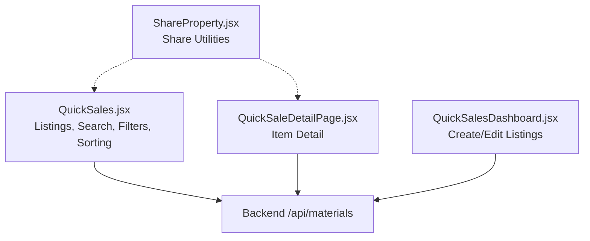
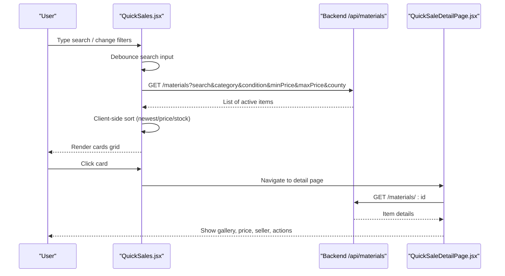
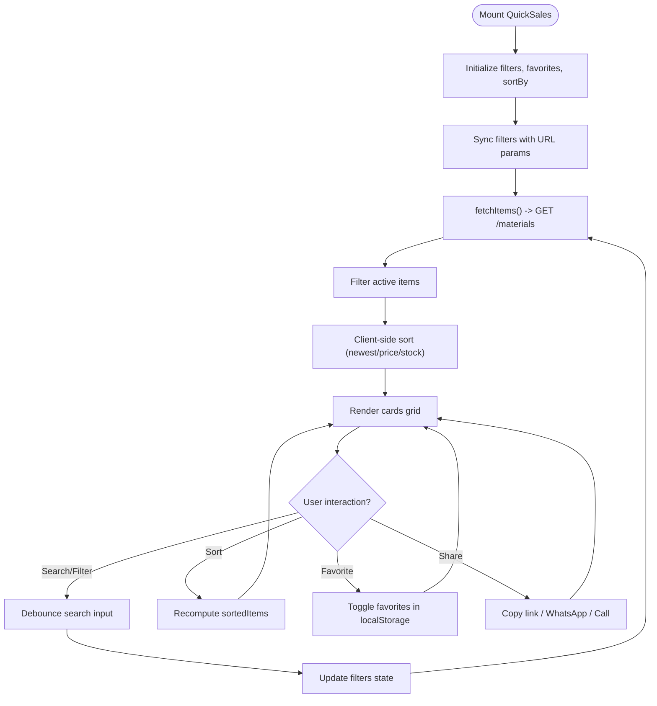
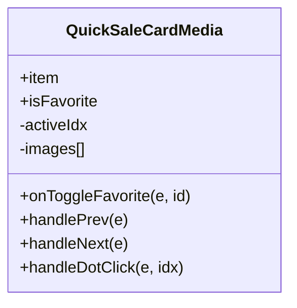
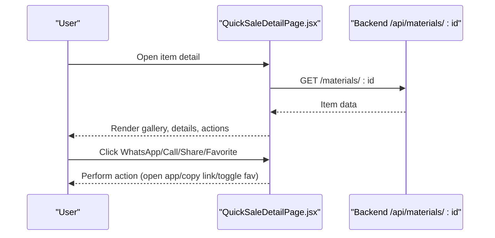
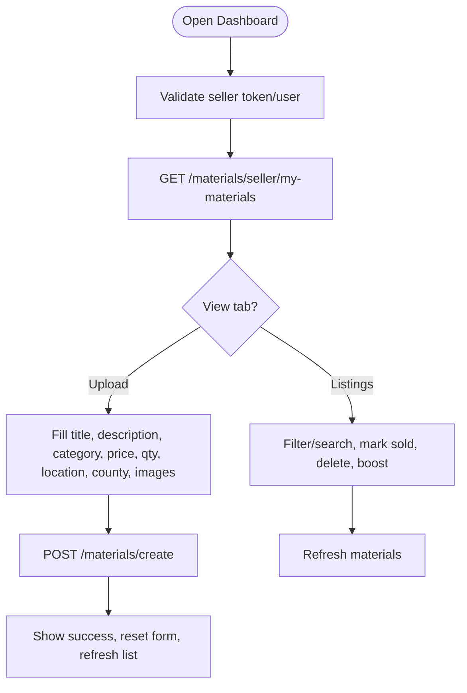
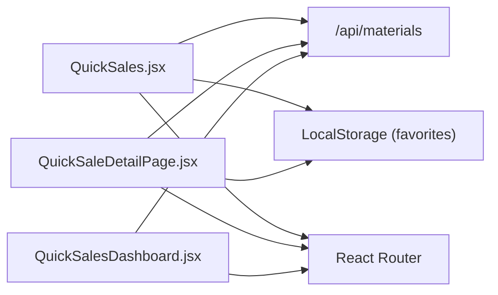

# Product Listings & Discovery

<cite>
**Referenced Files in This Document**
- [QuickSales.jsx](file://src/pages/QuickSales.jsx)
- [QuickSaleDetailPage.jsx](file://src/pages/QuickSaleDetailPage.jsx)
- [ShareProperty.jsx](file://src/components/ShareProperty.jsx)
- [QuickSalesDashboard.jsx](file://src/pages/QuickSalesDashboard.jsx)
</cite>

## Table of Contents
1. [Introduction](#introduction)
2. [Project Structure](#project-structure)
3. [Core Components](#core-components)
4. [Architecture Overview](#architecture-overview)
5. [Detailed Component Analysis](#detailed-component-analysis)
6. [Dependency Analysis](#dependency-analysis)
7. [Performance Considerations](#performance-considerations)
8. [Troubleshooting Guide](#troubleshooting-guide)
9. [Conclusion](#conclusion)
10. [Appendices](#appendices)

## Introduction
This document explains the Quick Sales marketplace product listings and discovery system. It covers how items are listed, discovered via search with debounced input, filtered by category, condition, price range, and county location, and presented through a responsive card grid. It also documents the card component architecture (image carousel, availability badges, favorites, social sharing), sorting mechanisms (newest, price ascending/descending, stock levels), and performance optimizations such as lazy loading images and client-side sorting.

## Project Structure
The Quick Sales feature spans several key files:
- The main listing and discovery page with search, filters, sorting, and cards
- A detail page for individual listings
- A reusable share utility used across features
- A seller dashboard for creating and managing listings

**Diagram sources**
- [QuickSales.jsx:345-372](file://src/pages/QuickSales.jsx#L345-L372)
- [QuickSaleDetailPage.jsx:50-64](file://src/pages/QuickSaleDetailPage.jsx#L50-L64)
- [QuickSalesDashboard.jsx:147-174](file://src/pages/QuickSalesDashboard.jsx#L147-L174)
- [ShareProperty.jsx:1-139](file://src/components/ShareProperty.jsx#L1-L139)

**Section sources**
- [QuickSales.jsx:1-34](file://src/pages/QuickSales.jsx#L1-L34)
- [QuickSaleDetailPage.jsx:1-463](file://src/pages/QuickSaleDetailPage.jsx#L1-L463)
- [ShareProperty.jsx:1-139](file://src/components/ShareProperty.jsx#L1-L139)
- [QuickSalesDashboard.jsx:1-507](file://src/pages/QuickSalesDashboard.jsx#L1-L507)

## Core Components
- Listing discovery page: Provides hero section, search bar with debounce, filter controls (category, condition, min/max price, county), quick category chips, results toolbar with sort options, and a responsive card grid.
- Card media component: Implements an image carousel with auto-play, navigation arrows, dot indicators, availability and condition badges, favorite toggle, and photo count overlay.
- Detail page: Displays full item details, gallery with thumbnails, pricing, seller info, and actions (WhatsApp, call, share, favorite).
- Seller dashboard: Allows sellers to create listings, manage inventory, mark items sold, delete listings, and boost visibility.

Key responsibilities:
- Data fetching and filtering from backend
- Client-side sorting and state management
- Local storage for favorites
- Social sharing and direct messaging integrations

**Section sources**
- [QuickSales.jsx:92-252](file://src/pages/QuickSales.jsx#L92-L252)
- [QuickSales.jsx:254-466](file://src/pages/QuickSales.jsx#L254-L466)
- [QuickSaleDetailPage.jsx:35-100](file://src/pages/QuickSaleDetailPage.jsx#L35-L100)
- [QuickSalesDashboard.jsx:56-174](file://src/pages/QuickSalesDashboard.jsx#L56-L174)

## Architecture Overview
The system follows a React-based frontend architecture with clear separation between pages and components:
- QuickSales.jsx orchestrates search, filters, sorting, and rendering of cards
- QuickSaleDetailPage.jsx renders detailed view and interactions
- QuickSalesDashboard.jsx handles seller operations (create, update, delete, mark sold)
- ShareProperty.jsx provides share utilities reused across features

**Diagram sources**
- [QuickSales.jsx:306-317](file://src/pages/QuickSales.jsx#L306-L317)
- [QuickSales.jsx:345-372](file://src/pages/QuickSales.jsx#L345-L372)
- [QuickSales.jsx:451-465](file://src/pages/QuickSales.jsx#L451-L465)
- [QuickSaleDetailPage.jsx:50-64](file://src/pages/QuickSaleDetailPage.jsx#L50-L64)

## Detailed Component Analysis

### Listing Page (QuickSales.jsx)
Responsibilities:
- Stateful search with debounced input to reduce network calls
- Filter synchronization with URL query parameters
- Fetching approved items from backend
- Client-side sorting by newest, price ascending/descending, and stock levels
- Rendering a responsive grid of cards with rich metadata and actions

Search and filters:
- Debounced search updates filters after a delay to avoid excessive requests
- Filters include category, condition, min/max price, and county
- Active filters are reflected in URL query params for shareability

Sorting:
- Newest first by createdAt
- Price ascending/descending by numeric price field
- Stock available by quantity descending

Card media component:
- Normalizes image arrays and supports object or string URLs
- Auto-cycles images every few seconds
- Navigation arrows and dot indicators
- Availability badge based on quantity
- Condition/category badge
- Favorite heart button toggling local favorites

Social sharing:
- Copy listing link to clipboard
- WhatsApp message pre-filled with item details
- Call seller via tel protocol

**Diagram sources**
- [QuickSales.jsx:281-317](file://src/pages/QuickSales.jsx#L281-L317)
- [QuickSales.jsx:345-372](file://src/pages/QuickSales.jsx#L345-L372)
- [QuickSales.jsx:451-465](file://src/pages/QuickSales.jsx#L451-L465)
- [QuickSales.jsx:391-431](file://src/pages/QuickSales.jsx#L391-L431)

**Section sources**
- [QuickSales.jsx:7-33](file://src/pages/QuickSales.jsx#L7-L33)
- [QuickSales.jsx:92-252](file://src/pages/QuickSales.jsx#L92-L252)
- [QuickSales.jsx:254-466](file://src/pages/QuickSales.jsx#L254-L466)
- [QuickSales.jsx:467-866](file://src/pages/QuickSales.jsx#L467-L866)

### Card Media Component (QuickSaleCardMedia)
Features:
- Image carousel with auto-play and manual navigation
- Lazy loading for non-first images
- Error handling for broken images
- Availability badge (Available/Low Stock/Sold Out)
- Condition/category badge
- New item tag based on creation time
- Favorite toggle with visual feedback

Complexity:
- Carousel index management is O(1) per interaction
- Image normalization iterates once over images array

**Diagram sources**
- [QuickSales.jsx:92-252](file://src/pages/QuickSales.jsx#L92-L252)

**Section sources**
- [QuickSales.jsx:92-252](file://src/pages/QuickSales.jsx#L92-L252)

### Detail Page (QuickSaleDetailPage.jsx)
Responsibilities:
- Fetch single item by ID
- Display gallery with thumbnails and navigation
- Show category emoji, condition, verified deal badge
- Pricing and stock display
- Seller information and contact actions (WhatsApp, call)
- Share and favorite functionality

**Diagram sources**
- [QuickSaleDetailPage.jsx:50-64](file://src/pages/QuickSaleDetailPage.jsx#L50-L64)
- [QuickSaleDetailPage.jsx:82-100](file://src/pages/QuickSaleDetailPage.jsx#L82-L100)

**Section sources**
- [QuickSaleDetailPage.jsx:1-463](file://src/pages/QuickSaleDetailPage.jsx#L1-L463)

### Share Utility (ShareProperty.jsx)
Responsibilities:
- Build shareable URL
- Provide WhatsApp share
- Copy link to clipboard with fallback
- Native share integration when available

Usage:
- Can be embedded in modals or detail views to enable sharing

**Section sources**
- [ShareProperty.jsx:1-139](file://src/components/ShareProperty.jsx#L1-L139)

### Seller Dashboard (QuickSalesDashboard.jsx)
Responsibilities:
- Authentication and role checks
- Fetch seller’s materials
- Create new listings with form validation and image upload
- Manage existing listings (delete, mark sold)
- Stats and analytics overview

Listing creation workflow:
- Validate required fields
- Build FormData with text fields and multiple images
- POST to backend create endpoint
- On success, reset form and refresh inventory

**Diagram sources**
- [QuickSalesDashboard.jsx:87-102](file://src/pages/QuickSalesDashboard.jsx#L87-L102)
- [QuickSalesDashboard.jsx:122-135](file://src/pages/QuickSalesDashboard.jsx#L122-L135)
- [QuickSalesDashboard.jsx:147-174](file://src/pages/QuickSalesDashboard.jsx#L147-L174)

**Section sources**
- [QuickSalesDashboard.jsx:1-507](file://src/pages/QuickSalesDashboard.jsx#L1-L507)

## Dependency Analysis
- QuickSales.jsx depends on:
  - Backend API endpoints for listing retrieval and filtering
  - LocalStorage for favorites persistence
  - Router for navigation to detail and login/dashboard
- QuickSaleDetailPage.jsx depends on:
  - Backend API for single item retrieval
  - Router for navigation back to listings
- QuickSalesDashboard.jsx depends on:
  - Backend API for seller-specific endpoints (my-materials, create, delete, mark sold)
  - Router for protected routes and redirects
- ShareProperty.jsx is a standalone utility with no internal dependencies beyond browser APIs

**Diagram sources**
- [QuickSales.jsx:345-372](file://src/pages/QuickSales.jsx#L345-L372)
- [QuickSaleDetailPage.jsx:50-64](file://src/pages/QuickSaleDetailPage.jsx#L50-L64)
- [QuickSalesDashboard.jsx:122-174](file://src/pages/QuickSalesDashboard.jsx#L122-L174)

**Section sources**
- [QuickSales.jsx:345-372](file://src/pages/QuickSales.jsx#L345-L372)
- [QuickSaleDetailPage.jsx:50-64](file://src/pages/QuickSaleDetailPage.jsx#L50-L64)
- [QuickSalesDashboard.jsx:122-174](file://src/pages/QuickSalesDashboard.jsx#L122-L174)

## Performance Considerations
- Debounced search input reduces unnecessary API calls during typing
- Lazy loading images for non-first slides improves initial load performance
- Client-side sorting avoids additional server requests for reordering
- Only active items are rendered, minimizing UI clutter and processing
- Favorites persisted in localStorage to avoid repeated network requests

Recommendations:
- Consider virtualization for very large result sets
- Preload critical images using eager loading for above-the-fold content
- Cache API responses with service workers or in-memory cache for faster navigation

[No sources needed since this section provides general guidance]

## Troubleshooting Guide
Common issues and resolutions:
- No listings match criteria: Clear filters or adjust search keywords
- Images not loading: Check image URLs; component hides broken images gracefully
- Favorites not persisting: Ensure localStorage is enabled and not blocked by browser settings
- WhatsApp link incorrect: Verify seller phone number formatting and country code
- Detail page not found: Confirm item exists and is accessible via ID

**Section sources**
- [QuickSales.jsx:725-753](file://src/pages/QuickSales.jsx#L725-L753)
- [QuickSaleDetailPage.jsx:112-135](file://src/pages/QuickSaleDetailPage.jsx#L112-L135)

## Conclusion
The Quick Sales marketplace provides a robust product discovery experience with efficient search, flexible filtering, and intuitive sorting. The card component offers rich media and user interactions, while the detail page enhances engagement through comprehensive item information and direct communication channels. The seller dashboard streamlines listing creation and management. Together, these components deliver a performant, user-friendly marketplace tailored to Kenyan buyers and sellers.

[No sources needed since this section summarizes without analyzing specific files]

## Appendices

### Extending Categories
To add a new category:
- Add the category name to the CATEGORIES array in QuickSales.jsx
- Optionally add a matching emoji mapping in QuickSaleDetailPage.jsx if you want consistent category emojis
- Ensure the seller dashboard includes the same category in its dropdown

**Section sources**
- [QuickSales.jsx:17-31](file://src/pages/QuickSales.jsx#L17-L31)
- [QuickSaleDetailPage.jsx:16-33](file://src/pages/QuickSaleDetailPage.jsx#L16-L33)
- [QuickSalesDashboard.jsx:22-36](file://src/pages/QuickSalesDashboard.jsx#L22-L36)

### Adding New Filters
To introduce a new filter (e.g., brand):
- Extend the filters state and URL sync logic in QuickSales.jsx
- Add a new input/select control bound to the filter
- Update fetchItems to append the new parameter to the query
- Adjust backend expectations accordingly

**Section sources**
- [QuickSales.jsx:281-317](file://src/pages/QuickSales.jsx#L281-L317)
- [QuickSales.jsx:345-372](file://src/pages/QuickSales.jsx#L345-L372)

### Customizing Listing Display
To customize card layout or detail presentation:
- Modify the card template and styles within QuickSales.jsx
- Adjust the modal or detail page structure in QuickSaleDetailPage.jsx
- Use CSS variables and classes defined inline for consistent theming

**Section sources**
- [QuickSales.jsx:755-866](file://src/pages/QuickSales.jsx#L755-L866)
- [QuickSaleDetailPage.jsx:151-463](file://src/pages/QuickSaleDetailPage.jsx#L151-L463)