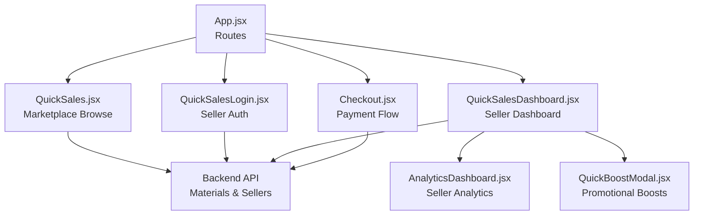
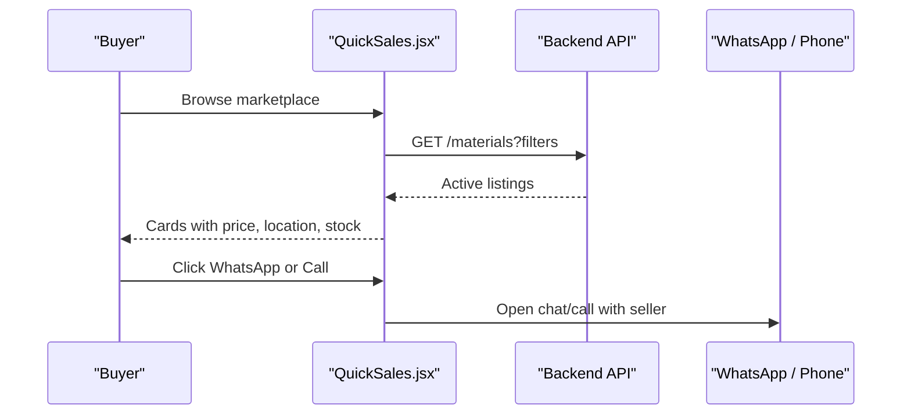
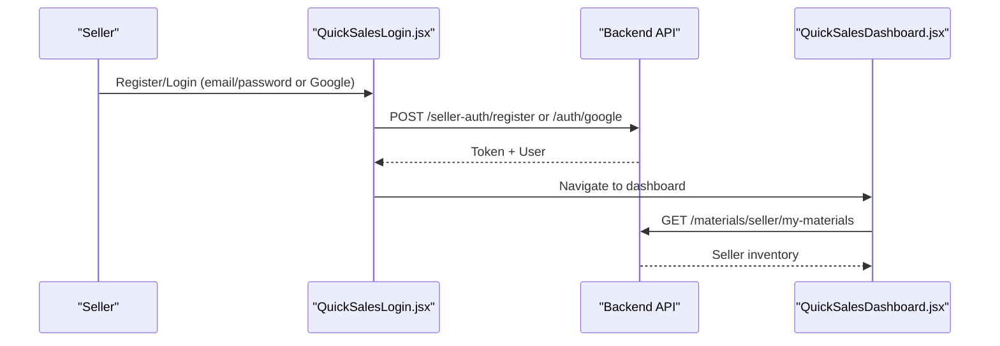
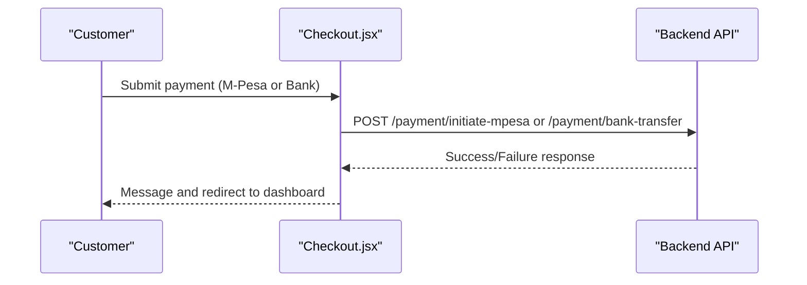
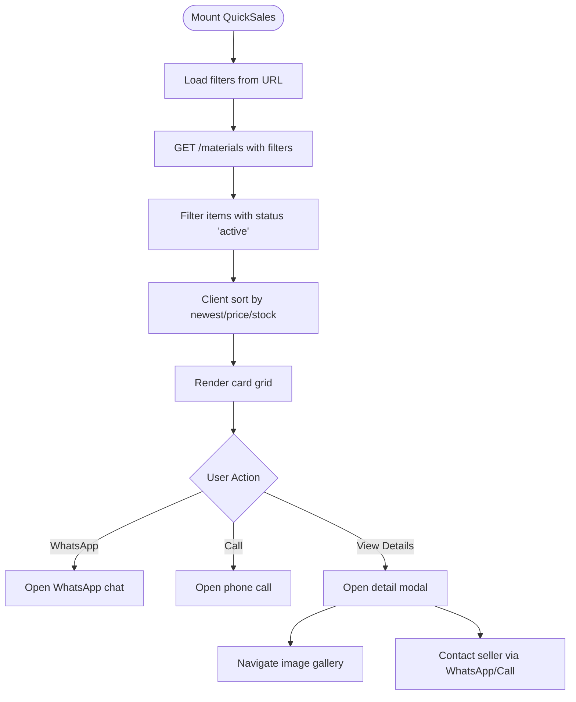
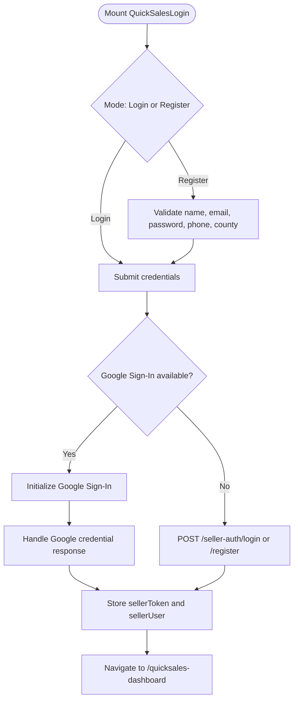
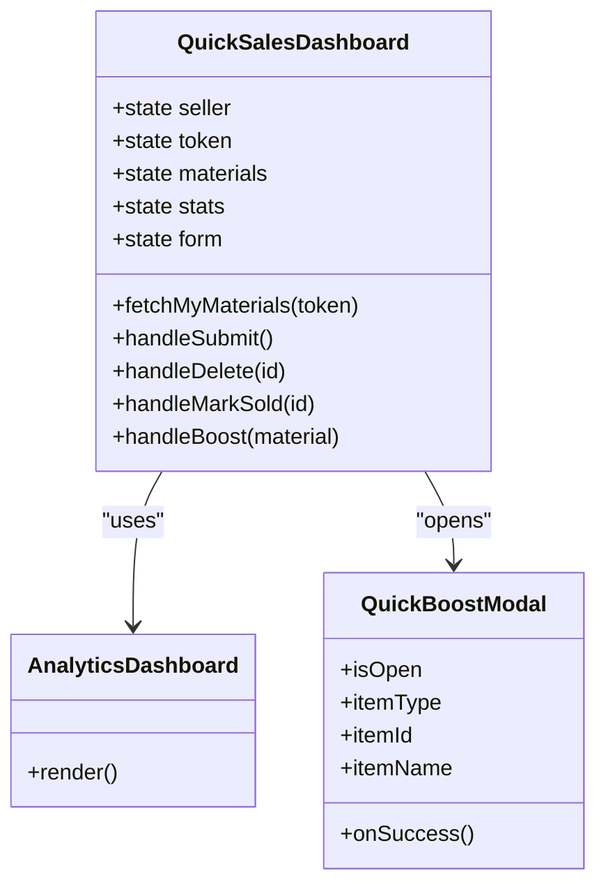
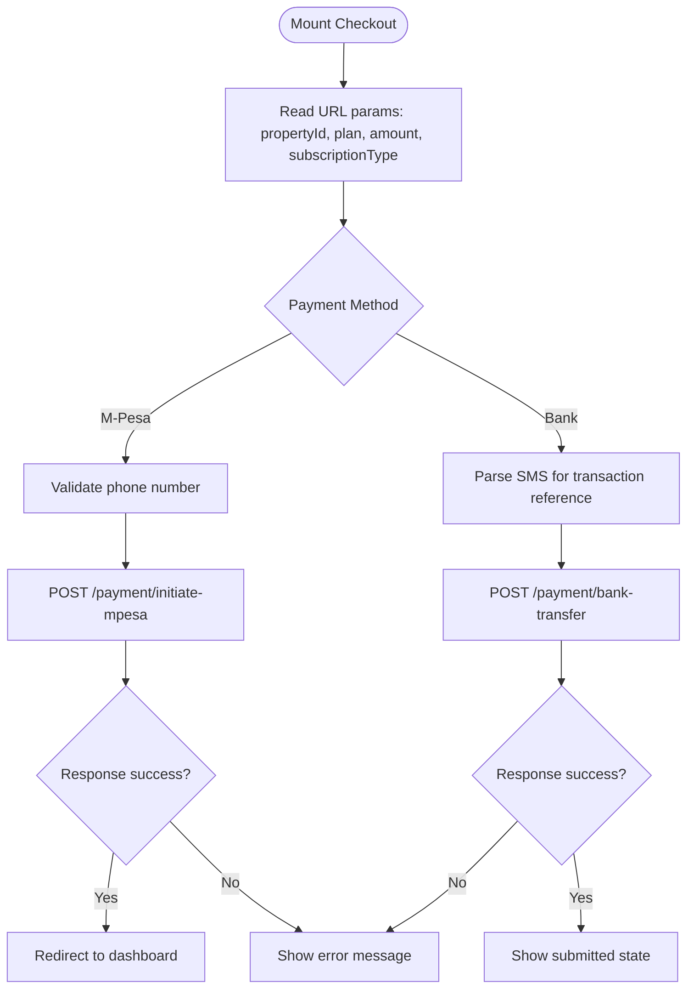
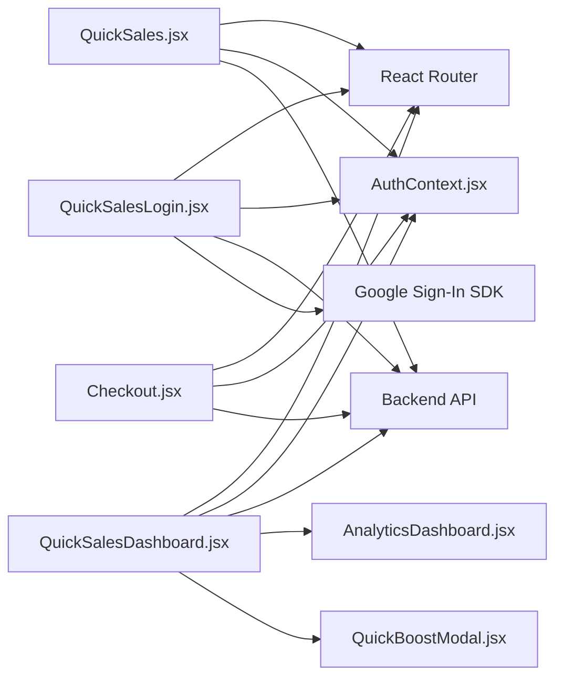

# Quick Sales Marketplace

<cite>
**Referenced Files in This Document**   
- [QuickSales.jsx](file://src/pages/QuickSales.jsx)
- [QuickSalesDashboard.jsx](file://src/pages/QuickSalesDashboard.jsx)
- [QuickSalesLogin.jsx](file://src/pages/QuickSalesLogin.jsx)
- [Checkout.jsx](file://src/pages/Checkout.jsx)
- [App.jsx](file://src/App.jsx)
- [AuthContext.jsx](file://src/context/AuthContext.jsx)
- [AnalyticsDashboard.jsx](file://src/components/AnalyticsDashboard.jsx)
- [QuickBoostModal.jsx](file://src/components/QuickBoostModal.jsx)
</cite>

## Table of Contents
1. [Introduction](#introduction)
2. [Project Structure](#project-structure)
3. [Core Components](#core-components)
4. [Architecture Overview](#architecture-overview)
5. [Detailed Component Analysis](#detailed-component-analysis)
6. [Dependency Analysis](#dependency-analysis)
7. [Performance Considerations](#performance-considerations)
8. [Troubleshooting Guide](#troubleshooting-guide)
9. [Conclusion](#conclusion)
10. [Appendices](#appendices)

## Introduction
The Quick Sales Marketplace is a seller-focused, Kenyan second-hand and liquidation marketplace built on the Axx Spaces frontend. It enables sellers to create product listings, manage inventory, track performance, and connect directly with buyers through WhatsApp or phone calls. Buyers browse verified listings, filter by category, condition, county, and price, and initiate direct contact with sellers. The system also includes a checkout flow for promotional services such as listing boosts and verification badges, integrating M-Pesa STK push and manual bank transfer submission.

This documentation explains:
- Product listing creation and management
- Sales browsing, filtering, and detail interaction
- Transaction processing and payment integration
- Order tracking concepts and dashboard analytics
- Inventory management, pricing strategies, and promotional tools
- Examples of extending marketplace features and customizing the sales experience

## Project Structure
The Quick Sales feature spans several pages and shared components:
- Public marketplace page for browsing and contacting sellers
- Seller authentication and registration
- Seller dashboard for inventory, analytics, and promotions
- Checkout page for payments related to boosts and verification
- Routing configuration that wires these pages into the application

**Diagram sources**
- [App.jsx:155-160](file://src/App.jsx#L155-L160)
- [App.jsx:301-305](file://src/App.jsx#L301-L305)
- [App.jsx:363-363](file://src/App.jsx#L363-L363)
- [QuickSales.jsx:345-372](file://src/pages/QuickSales.jsx#L345-L372)
- [QuickSalesDashboard.jsx:122-135](file://src/pages/QuickSalesDashboard.jsx#L122-L135)
- [Checkout.jsx:28-71](file://src/pages/Checkout.jsx#L28-L71)

**Section sources**
- [App.jsx:155-160](file://src/App.jsx#L155-L160)
- [App.jsx:301-305](file://src/App.jsx#L301-L305)
- [App.jsx:363-363](file://src/App.jsx#L363-L363)

## Core Components
- QuickSales.jsx: Public marketplace for browsing, filtering, and interacting with listings.
- QuickSalesLogin.jsx: Seller registration, login, Google Sign-In, password reset, and verification resend.
- QuickSalesDashboard.jsx: Seller inventory management, status handling, analytics, and promotional boosts.
- Checkout.jsx: Payment initiation for M-Pesa STK push and manual bank transfer submission.
- App.jsx: Route definitions connecting marketplace, dashboard, and checkout flows.
- AuthContext.jsx: Authentication context used across pages for token and user state.
- AnalyticsDashboard.jsx: Analytics visualization component used in the seller dashboard.
- QuickBoostModal.jsx: Promotional boost modal integrated into the dashboard.

Key responsibilities:
- Listing discovery and buyer-seller communication
- Seller account lifecycle and permissions
- Inventory CRUD and status transitions
- Payment initiation and submission workflows
- Analytics and reporting for sellers

**Section sources**
- [QuickSales.jsx:254-467](file://src/pages/QuickSales.jsx#L254-L467)
- [QuickSalesLogin.jsx:18-50](file://src/pages/QuickSalesLogin.jsx#L18-L50)
- [QuickSalesDashboard.jsx:56-120](file://src/pages/QuickSalesDashboard.jsx#L56-L120)
- [Checkout.jsx:9-27](file://src/pages/Checkout.jsx#L9-L27)
- [App.jsx:155-160](file://src/App.jsx#L155-L160)
- [App.jsx:301-305](file://src/App.jsx#L301-L305)
- [App.jsx:363-363](file://src/App.jsx#L363-L363)

## Architecture Overview
The Quick Sales Marketplace follows a React-based frontend architecture communicating with a backend API for materials and authentication. The public marketplace fetches active listings and supports rich filtering. Sellers authenticate via email/password or Google Sign-In, then access their dashboard to manage inventory and view analytics. Payments are initiated through M-Pesa STK push or submitted manually via bank transfer details.

**Diagram sources**
- [QuickSales.jsx:345-372](file://src/pages/QuickSales.jsx#L345-L372)
- [QuickSales.jsx:417-437](file://src/pages/QuickSales.jsx#L417-L437)

**Diagram sources**
- [QuickSalesLogin.jsx:179-247](file://src/pages/QuickSalesLogin.jsx#L179-L247)
- [QuickSalesLogin.jsx:107-151](file://src/pages/QuickSalesLogin.jsx#L107-L151)
- [QuickSalesDashboard.jsx:122-135](file://src/pages/QuickSalesDashboard.jsx#L122-L135)

**Diagram sources**
- [Checkout.jsx:28-71](file://src/pages/Checkout.jsx#L28-L71)
- [Checkout.jsx:73-112](file://src/pages/Checkout.jsx#L73-L112)

## Detailed Component Analysis

### QuickSales.jsx: Marketplace Browsing and Interaction
The marketplace page provides:
- Hero section with trust signals and actions
- Search and filter command center (search text, county, category, condition, price range)
- Category chips strip for quick filtering
- Results toolbar with sorting options
- Card grid with media carousel, availability badge, category/condition specs, seller info, and action buttons
- Detail modal with gallery, description, price banner, tags, and seller contact options

Key implementation highlights:
- Fetching active materials from the backend with query parameters
- Client-side sorting by newest, price ascending/descending, and stock
- Favorites persisted in localStorage
- WhatsApp and call integrations using normalized phone numbers
- Shareable listing links via URL parameters

**Diagram sources**
- [QuickSales.jsx:345-372](file://src/pages/QuickSales.jsx#L345-L372)
- [QuickSales.jsx:451-465](file://src/pages/QuickSales.jsx#L451-L465)
- [QuickSales.jsx:417-437](file://src/pages/QuickSales.jsx#L417-L437)
- [QuickSales.jsx:869-1062](file://src/pages/QuickSales.jsx#L869-L1062)

**Section sources**
- [QuickSales.jsx:254-467](file://src/pages/QuickSales.jsx#L254-L467)
- [QuickSales.jsx:800-1062](file://src/pages/QuickSales.jsx#L800-L1062)

### QuickSalesLogin.jsx: Seller Authentication and Account Management
The seller login page supports:
- Email/password login and registration
- Google Sign-In initialization and credential handling
- Password reset flow
- Verification resend functionality
- Local storage of seller token and user data
- Navigation to the seller dashboard upon successful authentication

Key implementation highlights:
- Dynamic loading of Google Sign-In script
- Decoding JWT payload for Google user info
- Role enforcement ("seller") during authentication
- Error and success messaging with UI feedback

**Diagram sources**
- [QuickSalesLogin.jsx:46-50](file://src/pages/QuickSalesLogin.jsx#L46-L50)
- [QuickSalesLogin.jsx:57-105](file://src/pages/QuickSalesLogin.jsx#L57-L105)
- [QuickSalesLogin.jsx:107-151](file://src/pages/QuickSalesLogin.jsx#L107-L151)
- [QuickSalesLogin.jsx:179-247](file://src/pages/QuickSalesLogin.jsx#L179-L247)

**Section sources**
- [QuickSalesLogin.jsx:18-50](file://src/pages/QuickSalesLogin.jsx#L18-L50)
- [QuickSalesLogin.jsx:179-247](file://src/pages/QuickSalesLogin.jsx#L179-L247)

### QuickSalesDashboard.jsx: Seller Inventory, Analytics, and Promotions
The seller dashboard provides:
- Tabs for My Stock, Upload Material, and Profile
- Stats cards for revenue, live listings, pending review, and views
- Inventory list with search, status filter, refresh, mark sold, delete, and boost actions
- Upload form for new materials including images and GPS coordinates
- Integration with AnalyticsDashboard for performance insights
- QuickBoostModal for promotional boosts

Key implementation highlights:
- Authorization check and role validation before rendering
- Status normalization for legacy "approved" values
- Earnings calculation based on sold items and quantities
- Image preview and FormData submission for material creation
- Filtering and sorting of materials locally

**Diagram sources**
- [QuickSalesDashboard.jsx:56-120](file://src/pages/QuickSalesDashboard.jsx#L56-L120)
- [QuickSalesDashboard.jsx:147-174](file://src/pages/QuickSalesDashboard.jsx#L147-L174)
- [QuickSalesDashboard.jsx:176-185](file://src/pages/QuickSalesDashboard.jsx#L176-L185)
- [QuickSalesDashboard.jsx:431-444](file://src/pages/QuickSalesDashboard.jsx#L431-L444)

**Section sources**
- [QuickSalesDashboard.jsx:56-120](file://src/pages/QuickSalesDashboard.jsx#L56-L120)
- [QuickSalesDashboard.jsx:147-185](file://src/pages/QuickSalesDashboard.jsx#L147-L185)
- [QuickSalesDashboard.jsx:383-444](file://src/pages/QuickSalesDashboard.jsx#L383-L444)

### Checkout.jsx: Payment Integration and Submission
The checkout page handles:
- M-Pesa STK push initiation
- Manual bank transfer submission with SMS confirmation parsing
- Plan and amount display for verification badges or boosts
- Redirect to appropriate dashboard after successful submission

Key implementation highlights:
- Phone number validation for M-Pesa
- Regex extraction of transaction reference from SMS
- Conditional navigation based on user role
- Clear error and success messaging

**Diagram sources**
- [Checkout.jsx:28-71](file://src/pages/Checkout.jsx#L28-L71)
- [Checkout.jsx:73-112](file://src/pages/Checkout.jsx#L73-L112)
- [Checkout.jsx:114-131](file://src/pages/Checkout.jsx#L114-L131)

**Section sources**
- [Checkout.jsx:9-27](file://src/pages/Checkout.jsx#L9-L27)
- [Checkout.jsx:28-112](file://src/pages/Checkout.jsx#L28-L112)
- [Checkout.jsx:114-131](file://src/pages/Checkout.jsx#L114-L131)

### App.jsx: Routing Configuration
The application routes define:
- Public marketplace route (/quicksales)
- Seller login route (/quicksales-login)
- Protected seller dashboard route (/quicksales-dashboard)
- Checkout route (/checkout)

These routes ensure proper layout wrapping and role-based protection.

**Section sources**
- [App.jsx:155-160](file://src/App.jsx#L155-L160)
- [App.jsx:301-305](file://src/App.jsx#L301-L305)
- [App.jsx:363-363](file://src/App.jsx#L363-L363)

## Dependency Analysis
The Quick Sales Marketplace depends on:
- React Router for navigation and protected routes
- AuthContext for global authentication state
- Backend API endpoints for materials, authentication, and payments
- External services for WhatsApp and phone calls
- Google Sign-In SDK for seller authentication

**Diagram sources**
- [QuickSales.jsx:1-3](file://src/pages/QuickSales.jsx#L1-L3)
- [QuickSalesLogin.jsx:1-4](file://src/pages/QuickSalesLogin.jsx#L1-L4)
- [QuickSalesDashboard.jsx:1-9](file://src/pages/QuickSalesDashboard.jsx#L1-L9)
- [Checkout.jsx:1-6](file://src/pages/Checkout.jsx#L1-L6)

**Section sources**
- [QuickSales.jsx:1-3](file://src/pages/QuickSales.jsx#L1-L3)
- [QuickSalesLogin.jsx:1-4](file://src/pages/QuickSalesLogin.jsx#L1-L4)
- [QuickSalesDashboard.jsx:1-9](file://src/pages/QuickSalesDashboard.jsx#L1-L9)
- [Checkout.jsx:1-6](file://src/pages/Checkout.jsx#L1-L6)

## Performance Considerations
- Debounced search input reduces unnecessary API calls during typing.
- Client-side sorting avoids server load for simple ordering operations.
- Lazy loading of images improves initial page load time.
- LocalStorage usage for favorites and seller tokens minimizes repeated authentication requests.
- Carousel auto-cycling uses intervals only when multiple images exist.

Recommendations:
- Implement pagination for large listing sets to reduce DOM size.
- Cache filtered results in memory or IndexedDB for faster re-renders.
- Optimize image sizes and use CDN for faster delivery.
- Add error boundaries around heavy components to prevent UI crashes.

[No sources needed since this section provides general guidance]

## Troubleshooting Guide
Common issues and resolutions:
- Authentication failures: Check network connectivity and verify credentials; ensure Google client ID is configured.
- Missing listings: Verify backend API availability and confirm item status is "active".
- Payment errors: Confirm M-Pesa phone number format and ensure sufficient balance; validate SMS content for bank transfers.
- Dashboard not loading: Ensure sellerToken exists and user role is "seller"; check authorization headers.

Operational tips:
- Use browser developer tools to inspect network requests and responses.
- Validate environment variables for API base URLs and Google client IDs.
- Monitor console logs for JavaScript errors and API response statuses.

**Section sources**
- [QuickSalesLogin.jsx:179-247](file://src/pages/QuickSalesLogin.jsx#L179-L247)
- [QuickSales.jsx:345-372](file://src/pages/QuickSales.jsx#L345-L372)
- [Checkout.jsx:28-112](file://src/pages/Checkout.jsx#L28-L112)

## Conclusion
The Quick Sales Marketplace provides a robust foundation for Kenyan second-hand and liquidation commerce. It combines a visually rich public marketplace with a powerful seller dashboard, enabling efficient inventory management, analytics, and promotional tools. The checkout flow integrates M-Pesa STK push and manual bank transfers, supporting both verification badges and listing boosts. With clear extension points and modular components, the platform can be customized to support additional payment methods, advanced analytics, and enhanced seller tools.

[No sources needed since this section summarizes without analyzing specific files]

## Appendices

### Extending Marketplace Features
- Add new categories or conditions by updating constants in QuickSales.jsx and QuickSalesDashboard.jsx.
- Integrate additional payment providers by extending Checkout.jsx with new API endpoints.
- Enhance analytics by expanding AnalyticsDashboard.jsx with custom metrics and charts.
- Implement order tracking by adding backend endpoints and UI components for order lifecycle states.

### Customizing the Sales Experience
- Modify hero messaging and trust signals in QuickSales.jsx to align with brand guidelines.
- Customize seller onboarding flows in QuickSalesLogin.jsx with additional fields or verification steps.
- Tailor dashboard layouts and stats in QuickSalesDashboard.jsx to highlight key performance indicators.
- Adjust promotional tools via QuickBoostModal.jsx to offer tiered boosts or targeted campaigns.

[No sources needed since this section provides general guidance]