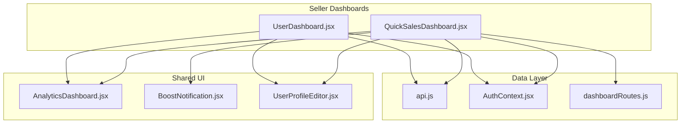
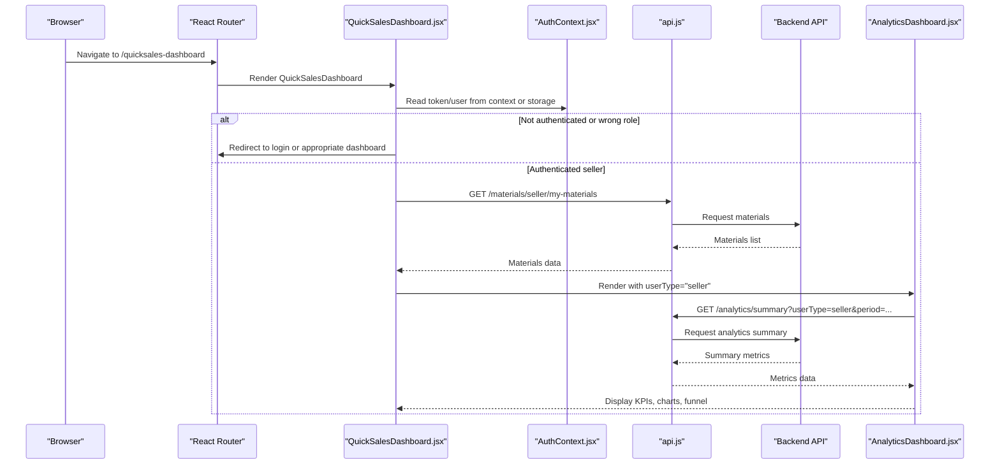
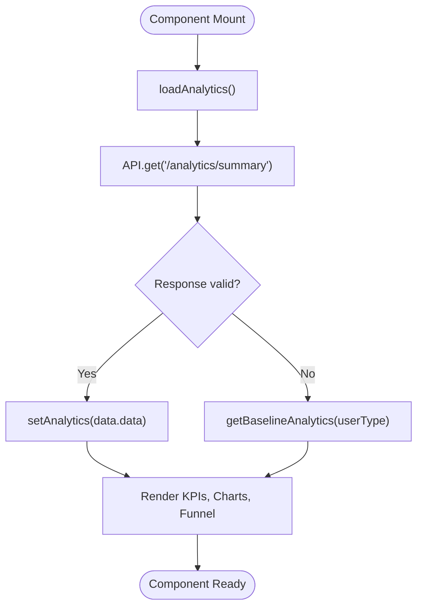
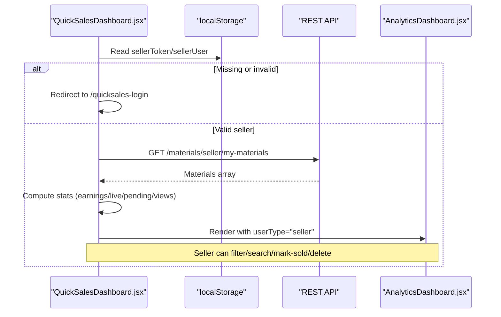
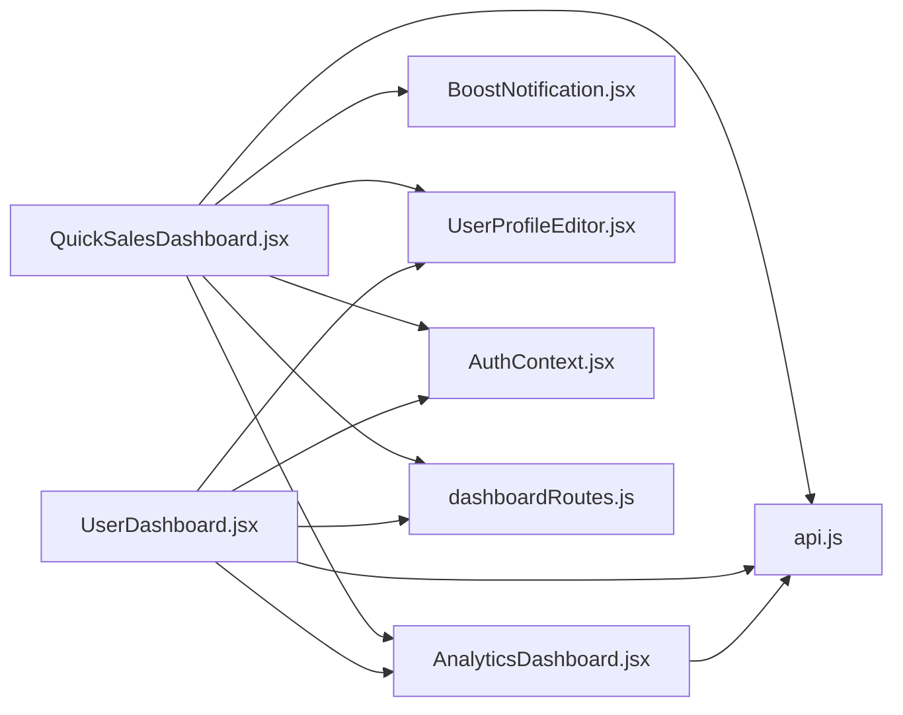

# Sales Dashboard & Analytics

<cite>
**Referenced Files in This Document**   
- [AnalyticsDashboard.jsx](file://src/components/AnalyticsDashboard.jsx)
- [QuickSalesDashboard.jsx](file://src/pages/QuickSalesDashboard.jsx)
- [UserDashboard.jsx](file://src/pages/UserDashboard.jsx)
- [api.js](file://src/api/api.js)
- [AuthContext.jsx](file://src/context/AuthContext.jsx)
- [BoostNotification.jsx](file://src/components/BoostNotification.jsx)
- [UserProfileEditor.jsx](file://src/features/profile/UserProfileEditor.jsx)
- [dashboardRoutes.js](file://src/utils/dashboardRoutes.js)
</cite>

## Table of Contents
1. [Introduction](#introduction)
2. [Project Structure](#project-structure)
3. [Core Components](#core-components)
4. [Architecture Overview](#architecture-overview)
5. [Detailed Component Analysis](#detailed-component-analysis)
6. [Dependency Analysis](#dependency-analysis)
7. [Performance Considerations](#performance-considerations)
8. [Troubleshooting Guide](#troubleshooting-guide)
9. [Conclusion](#conclusion)
10. [Appendices](#appendices)

## Introduction
This document explains the sales dashboard and analytics system for sellers, including seller authentication, sales performance metrics, inventory management tools, reporting capabilities, dashboard layout, key performance indicators (KPIs), sales charts, export considerations, customization patterns, real-time update strategies, data visualization patterns, and mobile-responsive design. It focuses on the frontend implementation that powers seller dashboards and analytics views.

## Project Structure
The sales dashboard is primarily implemented across:
- A reusable analytics component used by multiple dashboards
- A dedicated seller dashboard with inventory management
- A business dashboard that also renders analytics
- Shared API client and context utilities

**Diagram sources**
- [QuickSalesDashboard.jsx:56-102](file://src/pages/QuickSalesDashboard.jsx#L56-L102)
- [UserDashboard.jsx:52-94](file://src/pages/UserDashboard.jsx#L52-L94)
- [AnalyticsDashboard.jsx:4-11](file://src/components/AnalyticsDashboard.jsx#L4-L11)
- [BoostNotification.jsx:25-74](file://src/components/BoostNotification.jsx#L25-L74)
- [UserProfileEditor.jsx:242-242](file://src/features/profile/UserProfileEditor.jsx#L242-L242)
- [api.js:3-8](file://src/api/api.js#L3-L8)
- [dashboardRoutes.js:1-200](file://src/utils/dashboardRoutes.js#L1-L200)

**Section sources**
- [QuickSalesDashboard.jsx:56-102](file://src/pages/QuickSalesDashboard.jsx#L56-L102)
- [UserDashboard.jsx:52-94](file://src/pages/UserDashboard.jsx#L52-L94)
- [AnalyticsDashboard.jsx:4-11](file://src/components/AnalyticsDashboard.jsx#L4-L11)
- [api.js:3-8](file://src/api/api.js#L3-L8)

## Core Components
- AnalyticsDashboard: Reusable analytics view that fetches summary metrics, renders KPI cards, a time-range selector, a simple line chart, and a conversion funnel. It adapts to different user types, including seller-specific metrics.
- QuickSalesDashboard: Seller-focused dashboard providing inventory listing management, upload form, filtering, status updates, and embedded analytics.
- UserDashboard: Business-oriented dashboard that includes an overview panel and embeds the analytics view for business users.
- api.js: Centralized Axios instance with request/response interceptors for auth token injection and debugging.
- AuthContext: Provides authenticated user state and tokens used across dashboards.
- BoostNotification: Context-aware notification component that adapts messaging per user type, including sellers.
- UserProfileEditor: Profile editing tool used within dashboards; supports seller roles.

**Section sources**
- [AnalyticsDashboard.jsx:4-218](file://src/components/AnalyticsDashboard.jsx#L4-L218)
- [QuickSalesDashboard.jsx:56-447](file://src/pages/QuickSalesDashboard.jsx#L56-L447)
- [UserDashboard.jsx:52-319](file://src/pages/UserDashboard.jsx#L52-L319)
- [api.js:1-47](file://src/api/api.js#L1-L47)
- [AuthContext.jsx:1-200](file://src/context/AuthContext.jsx#L1-L200)
- [BoostNotification.jsx:1-120](file://src/components/BoostNotification.jsx#L1-L120)
- [UserProfileEditor.jsx:200-260](file://src/features/profile/UserProfileEditor.jsx#L200-L260)

## Architecture Overview
The system follows a React-based architecture where dashboards compose shared components and call backend APIs via a centralized HTTP client. Authentication is enforced at the page level, and analytics are rendered through a reusable component.

**Diagram sources**
- [QuickSalesDashboard.jsx:87-102](file://src/pages/QuickSalesDashboard.jsx#L87-L102)
- [QuickSalesDashboard.jsx:122-135](file://src/pages/QuickSalesDashboard.jsx#L122-L135)
- [AnalyticsDashboard.jsx:9-28](file://src/components/AnalyticsDashboard.jsx#L9-L28)
- [api.js:10-24](file://src/api/api.js#L10-L24)

## Detailed Component Analysis

### AnalyticsDashboard
Responsibilities:
- Fetch analytics summary based on user type and selected time range
- Provide baseline fallback data when API fails or returns empty
- Render KPI cards (views, inquiries, bookings/jobs, revenue)
- Show additional metrics tailored to user type (landlord, mover, seller)
- Visualize performance over time using a simple bar chart
- Display a conversion funnel (views → inquiries → bookings)

Key behaviors:
- Time range selector toggles between 7d, 30d, 90d
- Error handling falls back to baseline analytics
- Seller-specific metrics include items sold and average order value

**Diagram sources**
- [AnalyticsDashboard.jsx:9-28](file://src/components/AnalyticsDashboard.jsx#L9-L28)
- [AnalyticsDashboard.jsx:30-65](file://src/components/AnalyticsDashboard.jsx#L30-L65)
- [AnalyticsDashboard.jsx:79-218](file://src/components/AnalyticsDashboard.jsx#L79-L218)

**Section sources**
- [AnalyticsDashboard.jsx:4-218](file://src/components/AnalyticsDashboard.jsx#L4-L218)

### QuickSalesDashboard (Seller Inventory & Reporting)
Responsibilities:
- Authenticate seller via stored token and user object
- Enforce role checks and redirect if not a seller
- Fetch and manage seller’s materials (inventory)
- Provide upload form for new listings
- Filter and search inventory by title/location/counties/status
- Mark items as sold, delete listings, refresh status
- Embed analytics view for seller metrics
- Integrate boost notifications and quick boost modal

Key flows:
- On mount, read token/user from localStorage or context; validate role
- Fetch materials via REST endpoint with Authorization header
- Compute stats (earnings, live items, pending, views)
- Render analytics view under listings tab
- Provide controls for filtering and refreshing

**Diagram sources**
- [QuickSalesDashboard.jsx:87-102](file://src/pages/QuickSalesDashboard.jsx#L87-L102)
- [QuickSalesDashboard.jsx:122-135](file://src/pages/QuickSalesDashboard.jsx#L122-L135)
- [QuickSalesDashboard.jsx:147-174](file://src/pages/QuickSalesDashboard.jsx#L147-L174)
- [QuickSalesDashboard.jsx:176-185](file://src/pages/QuickSalesDashboard.jsx#L176-L185)
- [QuickSalesDashboard.jsx:187-193](file://src/pages/QuickSalesDashboard.jsx#L187-L193)
- [QuickSalesDashboard.jsx:258-291](file://src/pages/QuickSalesDashboard.jsx#L258-L291)

**Section sources**
- [QuickSalesDashboard.jsx:56-447](file://src/pages/QuickSalesDashboard.jsx#L56-L447)

### UserDashboard (Business Overview & Analytics)
Responsibilities:
- Guard access by checking token and role (business/admin)
- Load business directory listings
- Render overview panel with quick actions
- Embed analytics view for business users

Key behaviors:
- Uses getDashboardPath to redirect non-business roles
- Loads businesses via API and displays them in a grid
- Renders AnalyticsDashboard with userType derived from user.role

**Section sources**
- [UserDashboard.jsx:52-94](file://src/pages/UserDashboard.jsx#L52-L94)
- [UserDashboard.jsx:96-108](file://src/pages/UserDashboard.jsx#L96-L108)
- [UserDashboard.jsx:182-218](file://src/pages/UserDashboard.jsx#L182-L218)

### API Client (api.js)
Responsibilities:
- Create Axios instance with configurable baseURL and timeout
- Inject Authorization header from localStorage on requests
- Log request/response details for debugging
- Reject errors consistently

Usage:
- Used by AnalyticsDashboard to fetch analytics summaries
- Can be used by other pages for authenticated requests

**Section sources**
- [api.js:1-47](file://src/api/api.js#L1-L47)

### Authentication & Role Guards
- QuickSalesDashboard reads token/user from localStorage or context and enforces seller role; otherwise redirects to login or appropriate dashboard path.
- UserDashboard ensures only business/admin roles can access its dashboard.
- AuthContext provides user/token state consumed by dashboards.

**Section sources**
- [QuickSalesDashboard.jsx:87-102](file://src/pages/QuickSalesDashboard.jsx#L87-L102)
- [UserDashboard.jsx:82-94](file://src/pages/UserDashboard.jsx#L82-L94)
- [AuthContext.jsx:1-200](file://src/context/AuthContext.jsx#L1-L200)
- [dashboardRoutes.js:1-200](file://src/utils/dashboardRoutes.js#L1-L200)

## Dependency Analysis

**Diagram sources**
- [QuickSalesDashboard.jsx:56-102](file://src/pages/QuickSalesDashboard.jsx#L56-L102)
- [UserDashboard.jsx:52-94](file://src/pages/UserDashboard.jsx#L52-L94)
- [AnalyticsDashboard.jsx:4-11](file://src/components/AnalyticsDashboard.jsx#L4-L11)
- [api.js:3-8](file://src/api/api.js#L3-L8)

**Section sources**
- [QuickSalesDashboard.jsx:56-102](file://src/pages/QuickSalesDashboard.jsx#L56-L102)
- [UserDashboard.jsx:52-94](file://src/pages/UserDashboard.jsx#L52-L94)
- [AnalyticsDashboard.jsx:4-11](file://src/components/AnalyticsDashboard.jsx#L4-L11)
- [api.js:3-8](file://src/api/api.js#L3-L8)

## Performance Considerations
- AnalyticsDashboard uses local state and conditional rendering; consider memoization for large datasets.
- Chart generation is deterministic and lightweight; avoid unnecessary re-renders by stabilizing props.
- API calls should be debounced or cached where possible to reduce network load.
- Use responsive grids and CSS media queries already present in dashboards to optimize mobile performance.

[No sources needed since this section provides general guidance]

## Troubleshooting Guide
Common issues and resolutions:
- Analytics not loading: Check API connectivity and response structure; verify userType and period parameters.
- Seller dashboard redirecting unexpectedly: Ensure sellerToken and sellerUser exist in localStorage and have role "seller".
- Unauthorized requests: Confirm Authorization header is set via api.js interceptor or manual headers.
- Incorrect role routing: Verify getDashboardPath logic and ensure correct redirection for non-seller roles.

**Section sources**
- [AnalyticsDashboard.jsx:13-28](file://src/components/AnalyticsDashboard.jsx#L13-L28)
- [QuickSalesDashboard.jsx:87-102](file://src/pages/QuickSalesDashboard.jsx#L87-L102)
- [api.js:10-24](file://src/api/api.js#L10-L24)
- [dashboardRoutes.js:1-200](file://src/utils/dashboardRoutes.js#L1-L200)

## Conclusion
The sales dashboard and analytics system combines a reusable analytics component with role-specific dashboards to deliver seller insights, inventory management, and reporting. The architecture emphasizes clear separation of concerns, robust authentication guards, and flexible UI composition. Extensibility points include adding new metrics, integrating third-party reporting tools, and enhancing real-time updates.

[No sources needed since this section summarizes without analyzing specific files]

## Appendices

### Customizing Analytics Views
- Add new KPIs: Extend the metrics grid in AnalyticsDashboard and adjust baseline data for relevant user types.
- Customize charts: Replace SimpleLineChart with a charting library while preserving data shape.
- Tailor funnel steps: Modify ConversionFunnel steps to reflect domain-specific conversions.

**Section sources**
- [AnalyticsDashboard.jsx:102-145](file://src/components/AnalyticsDashboard.jsx#L102-L145)
- [AnalyticsDashboard.jsx:279-316](file://src/components/AnalyticsDashboard.jsx#L279-L316)

### Adding New Metrics
- For sellers: Include itemsSold and averageOrderValue in baseline and server responses.
- For landlords/movers: Add role-specific fields like propertiesListed, averageRating, repeatCustomers.

**Section sources**
- [AnalyticsDashboard.jsx:30-65](file://src/components/AnalyticsDashboard.jsx#L30-L65)
- [AnalyticsDashboard.jsx:147-215](file://src/components/AnalyticsDashboard.jsx#L147-L215)

### Integrating Third-Party Reporting Tools
- Export functionality: Implement CSV/PDF export by serializing analytics data and triggering downloads.
- External dashboards: Embed third-party widgets by passing computed metrics into their SDKs.

[No sources needed since this section provides general guidance]

### Real-Time Updates
- Polling: Use setInterval to periodically refresh analytics and inventory data.
- WebSockets: Introduce WebSocket connections for live updates on sales and inventory changes.

**Section sources**
- [QuickSalesDashboard.jsx:122-135](file://src/pages/QuickSalesDashboard.jsx#L122-L135)
- [AnalyticsDashboard.jsx:9-11](file://src/components/AnalyticsDashboard.jsx#L9-L11)

### Data Visualization Patterns
- Bar chart: SimpleLineChart renders bars with hover tooltips and dynamic heights.
- Conversion funnel: ConversionFunnel visualizes drop-offs between stages.

**Section sources**
- [AnalyticsDashboard.jsx:233-277](file://src/components/AnalyticsDashboard.jsx#L233-L277)
- [AnalyticsDashboard.jsx:279-316](file://src/components/AnalyticsDashboard.jsx#L279-L316)

### Mobile-Responsive Dashboard Design
- Grid layouts adapt via CSS media queries and flexbox/grid.
- Tabs scroll horizontally on small screens for better navigation.

**Section sources**
- [QuickSalesDashboard.jsx:450-468](file://src/pages/QuickSalesDashboard.jsx#L450-L468)
- [UserDashboard.jsx:346-354](file://src/pages/UserDashboard.jsx#L346-L354)