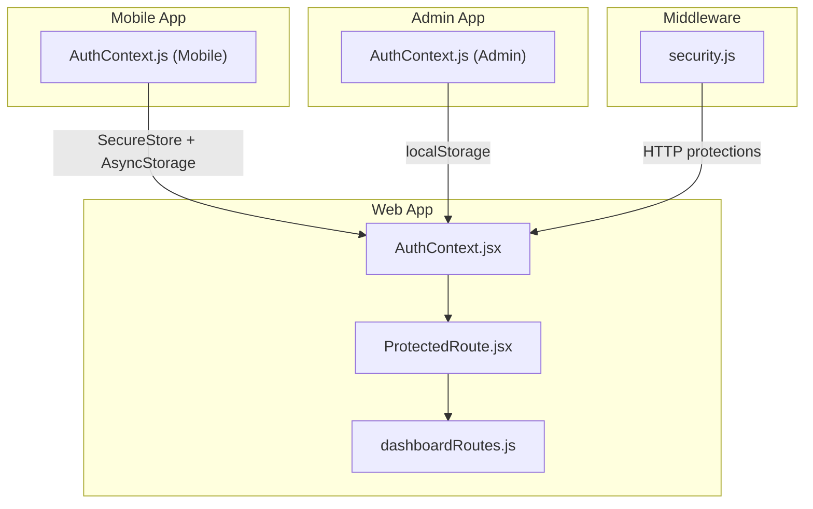
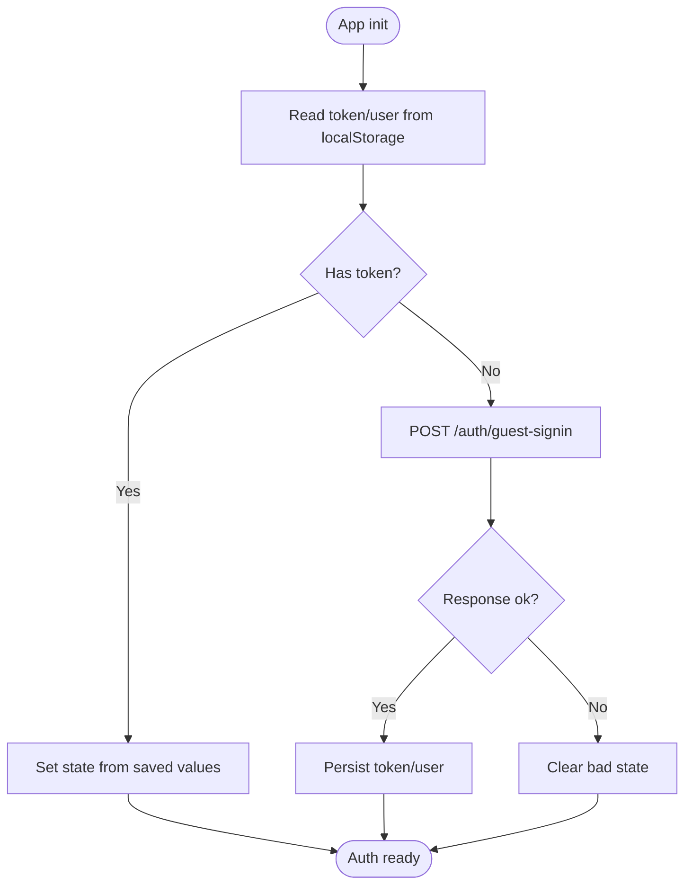
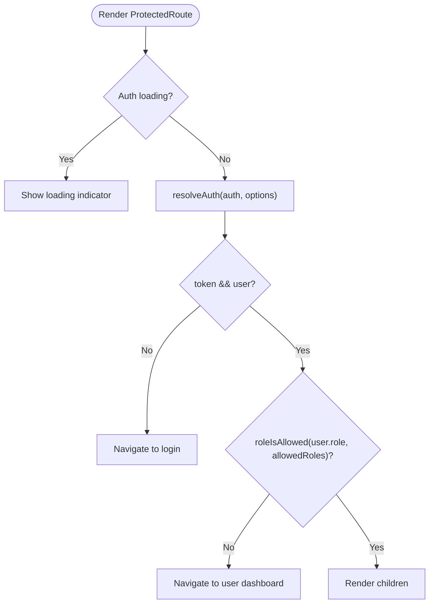
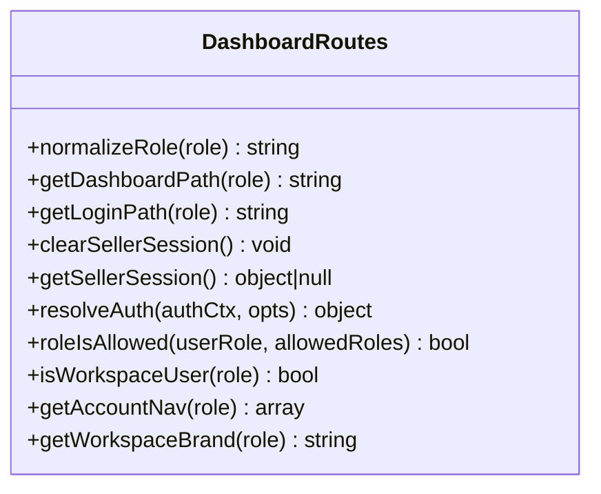
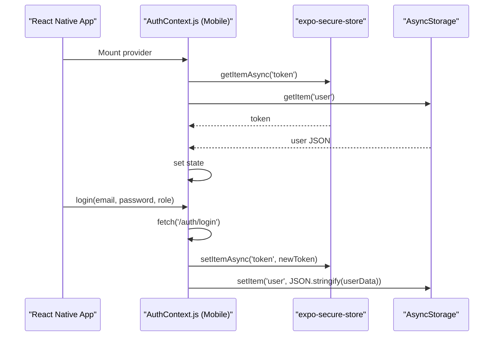
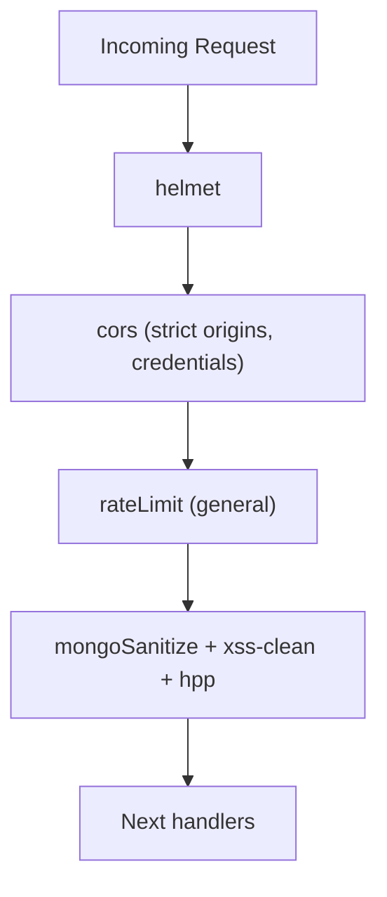
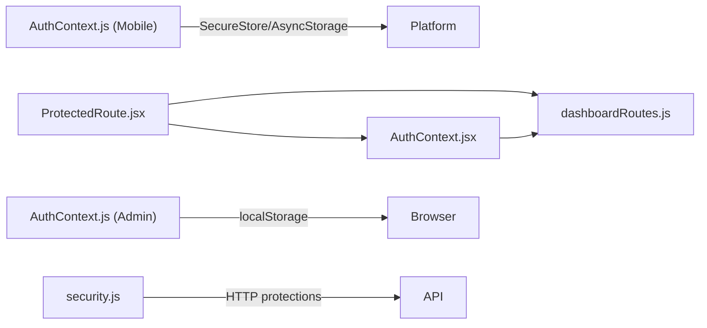

# Authentication Security

<cite>
**Referenced Files in This Document**
- [AuthContext.jsx](file://src/context/AuthContext.jsx)
- [ProtectedRoute.jsx](file://src/components/ProtectedRoute.jsx)
- [dashboardRoutes.js](file://src/utils/dashboardRoutes.js)
- [AuthContext.js (Mobile)](file://axx-spaces-mobile/src/context/AuthContext.js)
- [AuthContext.js (Admin)](file://axxspace-admin/src/context/AuthContext.js)
- [security.js](file://middleware/security.js)
</cite>

## Table of Contents
1. [Introduction](#introduction)
2. [Project Structure](#project-structure)
3. [Core Components](#core-components)
4. [Architecture Overview](#architecture-overview)
5. [Detailed Component Analysis](#detailed-component-analysis)
6. [Dependency Analysis](#dependency-analysis)
7. [Performance Considerations](#performance-considerations)
8. [Troubleshooting Guide](#troubleshooting-guide)
9. [Conclusion](#conclusion)

## Introduction
This document explains the authentication and authorization implementation across the frontend applications, focusing on:
- JWT token lifecycle and storage
- Secure storage mechanisms for web and mobile clients
- Role-based access control (RBAC), permission checks, and route protection
- End-to-end authentication flow from login to session management
- Guidance for implementing custom guards, token refresh, and securing sensitive data
- Common vulnerabilities and mitigation strategies

The analysis is based on the provided frontend codebase and middleware configuration.

## Project Structure
Authentication-related logic spans multiple apps within this repository:
- Web app: React context for auth state, protected routes, and role utilities
- Mobile app: React Native context with secure storage
- Admin app: Lightweight auth context using localStorage
- Middleware: HTTP security headers, CORS, rate limiting, and input sanitization



**Diagram sources**
- [AuthContext.jsx:1-157](file://src/context/AuthContext.jsx#L1-L157)
- [ProtectedRoute.jsx:1-57](file://src/components/ProtectedRoute.jsx#L1-L57)
- [dashboardRoutes.js:1-183](file://src/utils/dashboardRoutes.js#L1-L183)
- [AuthContext.js (Mobile):1-136](file://axx-spaces-mobile/src/context/AuthContext.js#L1-L136)
- [AuthContext.js (Admin):1-84](file://axxspace-admin/src/context/AuthContext.js#L1-L84)
- [security.js:1-61](file://middleware/security.js#L1-L61)

**Section sources**
- [AuthContext.jsx:1-157](file://src/context/AuthContext.jsx#L1-L157)
- [ProtectedRoute.jsx:1-57](file://src/components/ProtectedRoute.jsx#L1-L57)
- [dashboardRoutes.js:1-183](file://src/utils/dashboardRoutes.js#L1-L183)
- [AuthContext.js (Mobile):1-136](file://axx-spaces-mobile/src/context/AuthContext.js#L1-L136)
- [AuthContext.js (Admin):1-84](file://axxspace-admin/src/context/AuthContext.js#L1-L84)
- [security.js:1-61](file://middleware/security.js#L1-L61)

## Core Components
- AuthContext (Web): Manages user/token state, persistence via localStorage, guest auto-login, and logout behavior.
- ProtectedRoute: Route-level guard enforcing authentication and RBAC.
- dashboardRoutes: Role mappings, path resolution, and helper functions for navigation and permissions.
- AuthContext (Mobile): Secure token storage using expo-secure-store and AsyncStorage for user data.
- AuthContext (Admin): Simple localStorage-based auth state for admin UI.
- security.js: Server-side HTTP hardening (CORS, rate limits, XSS/mongo injection protection).

Key responsibilities:
- Token lifecycle: creation, persistence, restoration, invalidation
- Session initialization: restore or guest sign-in
- Authorization: role checks and route redirection
- Storage security: platform-appropriate secure storage

**Section sources**
- [AuthContext.jsx:17-157](file://src/context/AuthContext.jsx#L17-L157)
- [ProtectedRoute.jsx:11-56](file://src/components/ProtectedRoute.jsx#L11-L56)
- [dashboardRoutes.js:1-183](file://src/utils/dashboardRoutes.js#L1-L183)
- [AuthContext.js (Mobile):8-136](file://axx-spaces-mobile/src/context/AuthContext.js#L8-L136)
- [AuthContext.js (Admin):5-84](file://axxspace-admin/src/context/AuthContext.js#L5-L84)
- [security.js:13-54](file://middleware/security.js#L13-L54)

## Architecture Overview
The authentication architecture combines client-side state management with server-side HTTP protections:

```mermaid
sequenceDiagram
participant U as "User"
participant W as "Web App<br/>AuthContext.jsx"
participant M as "Mobile App<br/>AuthContext.js"
participant A as "Admin App<br/>AuthContext.js"
participant R as "Router<br/>ProtectedRoute.jsx"
participant D as "Role Utils<br/>dashboardRoutes.js"
participant S as "Server<br/>security.js"
U->>W : Open app
W->>W : Restore token/user from localStorage
alt No token
W->>S : POST /auth/guest-signin
S-->>W : {token, user}
W->>W : Persist token/user
end
U->>R : Navigate to protected route
R->>D : resolveAuth() + roleIsAllowed()
alt Not authenticated or unauthorized
R->>U : Redirect to login or dashboard
else Authorized
R-->>U : Render protected content
end
Note over W,M,A : Each app persists tokens securely per platform
```

**Diagram sources**
- [AuthContext.jsx:52-97](file://src/context/AuthContext.jsx#L52-L97)
- [ProtectedRoute.jsx:41-55](file://src/components/ProtectedRoute.jsx#L41-L55)
- [dashboardRoutes.js:70-99](file://src/utils/dashboardRoutes.js#L70-L99)
- [security.js:30-54](file://middleware/security.js#L30-L54)

## Detailed Component Analysis

### Web Auth Context (JWT Lifecycle and Storage)
Responsibilities:
- Initialize auth by restoring token and user from localStorage
- Guest auto-login when no token exists
- Provide login/updateUser/logout methods
- Maintain loading state and splash screen integration

Security notes:
- Tokens are stored in localStorage; consider moving to httpOnly cookies or a more secure mechanism
- No explicit token expiration handling or refresh flow is implemented here



**Diagram sources**
- [AuthContext.jsx:52-97](file://src/context/AuthContext.jsx#L52-L97)

**Section sources**
- [AuthContext.jsx:17-157](file://src/context/AuthContext.jsx#L17-L157)

### Protected Route Guard (RBAC Enforcement)
Responsibilities:
- Wait for auth state to be ready
- Resolve active session (main vs seller)
- Enforce allowed roles and redirect accordingly

RBAC helpers:
- roleIsAllowed: compares normalized roles
- getDashboardPath/getLoginPath: map roles to paths



**Diagram sources**
- [ProtectedRoute.jsx:15-56](file://src/components/ProtectedRoute.jsx#L15-L56)
- [dashboardRoutes.js:70-99](file://src/utils/dashboardRoutes.js#L70-L99)

**Section sources**
- [ProtectedRoute.jsx:11-56](file://src/components/ProtectedRoute.jsx#L11-L56)
- [dashboardRoutes.js:31-99](file://src/utils/dashboardRoutes.js#L31-L99)

### Role Utilities and Navigation
Responsibilities:
- Normalize roles and map them to dashboards/logins
- Determine workspace users and account navigation
- Provide helpers for resolving sessions and permissions



**Diagram sources**
- [dashboardRoutes.js:1-183](file://src/utils/dashboardRoutes.js#L1-L183)

**Section sources**
- [dashboardRoutes.js:1-183](file://src/utils/dashboardRoutes.js#L1-L183)

### Mobile Auth Context (Secure Storage)
Responsibilities:
- Load persisted token and user on startup
- Login flow that stores token securely
- Logout clears secure storage and user data

Security highlights:
- Uses expo-secure-store for token persistence
- Uses AsyncStorage for user profile data



**Diagram sources**
- [AuthContext.js (Mobile):17-59](file://axx-spaces-mobile/src/context/AuthContext.js#L17-L59)

**Section sources**
- [AuthContext.js (Mobile):8-136](file://axx-spaces-mobile/src/context/AuthContext.js#L8-L136)

### Admin Auth Context (Simple Persistence)
Responsibilities:
- Restore token/user from localStorage
- Provide login/updateUser/logout
- Minimal UX while loading

Security note:
- Uses localStorage for both token and user; not recommended for production without additional protections

**Section sources**
- [AuthContext.js (Admin):5-84](file://axxspace-admin/src/context/AuthContext.js#L5-L84)

### Middleware Security Controls
Responsibilities:
- Apply helmet, CORS, rate limiting, mongo-sanitize, xss-clean, hpp
- Configure strict CORS origins and credentials
- Rate limit general and auth endpoints



**Diagram sources**
- [security.js:13-54](file://middleware/security.js#L13-L54)

**Section sources**
- [security.js:13-54](file://middleware/security.js#L13-L54)

## Dependency Analysis
The following diagram shows how components depend on each other:



**Diagram sources**
- [AuthContext.jsx:1-157](file://src/context/AuthContext.jsx#L1-L157)
- [ProtectedRoute.jsx:1-57](file://src/components/ProtectedRoute.jsx#L1-L57)
- [dashboardRoutes.js:1-183](file://src/utils/dashboardRoutes.js#L1-L183)
- [AuthContext.js (Mobile):1-136](file://axx-spaces-mobile/src/context/AuthContext.js#L1-L136)
- [AuthContext.js (Admin):1-84](file://axxspace-admin/src/context/AuthContext.js#L1-L84)
- [security.js:1-61](file://middleware/security.js#L1-L61)

**Section sources**
- [AuthContext.jsx:1-157](file://src/context/AuthContext.jsx#L1-L157)
- [ProtectedRoute.jsx:1-57](file://src/components/ProtectedRoute.jsx#L1-L57)
- [dashboardRoutes.js:1-183](file://src/utils/dashboardRoutes.js#L1-L183)
- [AuthContext.js (Mobile):1-136](file://axx-spaces-mobile/src/context/AuthContext.js#L1-L136)
- [AuthContext.js (Admin):1-84](file://axxspace-admin/src/context/AuthContext.js#L1-L84)
- [security.js:1-61](file://middleware/security.js#L1-L61)

## Performance Considerations
- Avoid unnecessary re-renders by memoizing auth callbacks and checking for shallow changes before updating state.
- Defer heavy operations until after auth is initialized to prevent blocking UI.
- Use minimal payloads for guest sign-in and avoid redundant network calls during app bootstrap.
- Centralize token validation and refresh logic to reduce repeated checks.

[No sources needed since this section provides general guidance]

## Troubleshooting Guide
Common issues and resolutions:
- Stale or corrupted token/user in storage:
  - Clear stored token/user and force re-authentication.
  - Validate token presence and structure before use.
- Unauthorized redirects loop:
  - Ensure role normalization matches backend-provided roles.
  - Verify allowedRoles on protected routes match expected roles.
- Mobile token not persisting:
  - Confirm expo-secure-store availability and permissions.
  - Validate AsyncStorage usage for user data.
- CORS or CSRF errors:
  - Review CORS configuration and ensure credentials are enabled where required.
  - Ensure only trusted origins are allowed.

**Section sources**
- [AuthContext.jsx:82-90](file://src/context/AuthContext.jsx#L82-L90)
- [ProtectedRoute.jsx:41-55](file://src/components/ProtectedRoute.jsx#L41-L55)
- [dashboardRoutes.js:31-99](file://src/utils/dashboardRoutes.js#L31-L99)
- [AuthContext.js (Mobile):17-29](file://axx-spaces-mobile/src/context/AuthContext.js#L17-L29)
- [security.js:18-28](file://middleware/security.js#L18-L28)

## Conclusion
The current implementation provides:
- Functional JWT lifecycle management with local persistence
- Role-based route protection and navigation helpers
- Secure token storage on mobile via expo-secure-store
- Server-side HTTP hardening through middleware

Recommendations for improvement:
- Move tokens to httpOnly cookies or a secure storage layer to mitigate XSS risks
- Implement token refresh and expiration handling
- Add centralized request interceptors for consistent auth headers and error handling
- Enforce stricter CORS policies and consider CSRF protections
- Introduce fine-grained permission checks beyond roles where necessary

[No sources needed since this section summarizes without analyzing specific files]