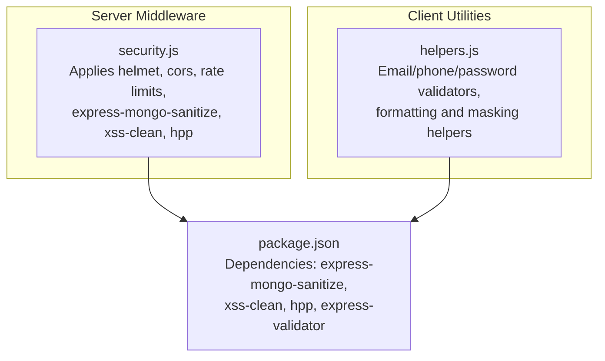
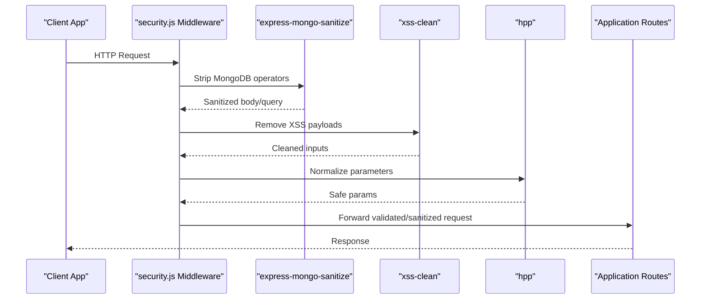
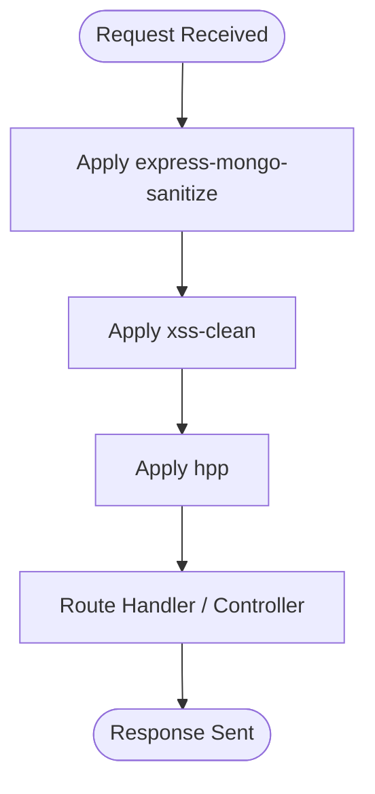
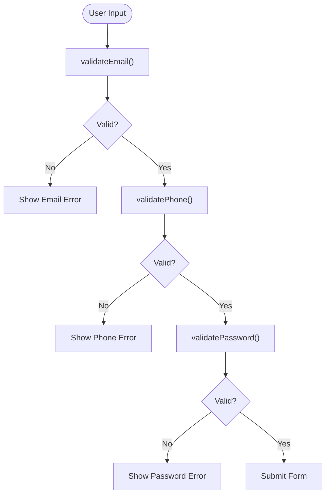
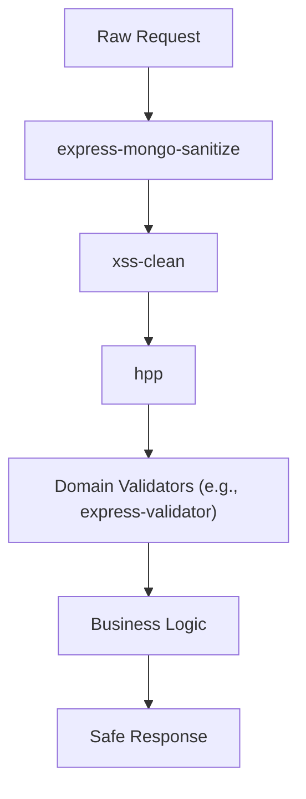
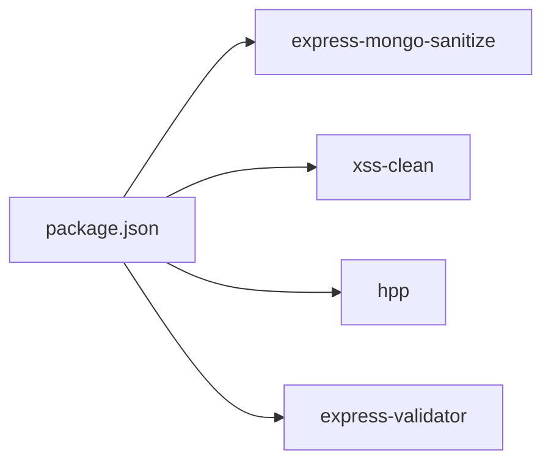

# Input Validation & Sanitization

<cite>
**Referenced Files in This Document**
- [security.js](file://middleware/security.js)
- [package.json](file://package.json)
- [helpers.js](file://axx-spaces-mobile/src/utils/helpers.js)
</cite>

## Table of Contents
1. [Introduction](#introduction)
2. [Project Structure](#project-structure)
3. [Core Components](#core-components)
4. [Architecture Overview](#architecture-overview)
5. [Detailed Component Analysis](#detailed-component-analysis)
6. [Dependency Analysis](#dependency-analysis)
7. [Performance Considerations](#performance-considerations)
8. [Troubleshooting Guide](#troubleshooting-guide)
9. [Conclusion](#conclusion)

## Introduction
This document explains the input validation and sanitization strategy implemented across the project, focusing on:
- MongoDB injection prevention using express-mongo-sanitize
- XSS attack protection using xss-clean
- HTTP parameter pollution prevention using hpp
- Form validation patterns for both client-side (mobile helpers) and server-side middleware
- Data type enforcement strategies and secure data processing pipelines

The goal is to ensure that all incoming data is validated, sanitized, and processed securely before reaching application logic or databases.

## Project Structure
Security-related middleware is centralized under middleware/security.js and applied early in the request pipeline. Client-side validation utilities are provided in axx-spaces-mobile/src/utils/helpers.js. Dependencies for security libraries are declared in package.json.

**Diagram sources**
- [security.js:1-61](file://middleware/security.js#L1-L61)
- [package.json:12-33](file://package.json#L12-L33)
- [helpers.js:49-64](file://axx-spaces-mobile/src/utils/helpers.js#L49-L64)

**Section sources**
- [security.js:1-61](file://middleware/security.js#L1-L61)
- [package.json:12-33](file://package.json#L12-L33)
- [helpers.js:49-64](file://axx-spaces-mobile/src/utils/helpers.js#L49-L64)

## Core Components
- Server-side security middleware:
  - express-mongo-sanitize: Prevents MongoDB operator injection by stripping dangerous keys from request bodies.
  - xss-clean: Removes potentially malicious scripts from request inputs to prevent XSS.
  - hpp: Prevents HTTP Parameter Pollution by handling duplicate parameters safely.
- Client-side validation utilities:
  - Email, phone, and password validators with clear rules.
  - Formatting and masking helpers to standardize and protect sensitive data at rest/display.

These components work together to enforce strict input validation and sanitization across the full stack.

**Section sources**
- [security.js:8-10](file://middleware/security.js#L8-L10)
- [security.js:44-51](file://middleware/security.js#L44-L51)
- [helpers.js:49-64](file://axx-spaces-mobile/src/utils/helpers.js#L49-L64)

## Architecture Overview
The request lifecycle includes multiple layers of validation and sanitization:

**Diagram sources**
- [security.js:44-51](file://middleware/security.js#L44-L51)

## Detailed Component Analysis

### Server-Side Security Middleware (security.js)
- Purpose: Centralizes security controls and applies them globally to the Express app.
- Key behaviors:
  - Applies helmet, CORS, and rate limiting.
  - Uses express-mongo-sanitize to strip dangerous MongoDB query operators from request bodies and queries.
  - Uses xss-clean to sanitize user inputs against XSS attacks.
  - Uses hpp to prevent HTTP parameter pollution by normalizing duplicate parameters.

**Diagram sources**
- [security.js:44-51](file://middleware/security.js#L44-L51)

**Section sources**
- [security.js:1-61](file://middleware/security.js#L1-L61)

### Client-Side Validation Utilities (helpers.js)
- Purpose: Provide reusable validation functions for forms and data normalization in the mobile app.
- Key validators:
  - validateEmail: Ensures a valid email format.
  - validatePhone: Normalizes and validates phone number length.
  - validatePassword: Enforces minimum length and complexity requirements.

**Diagram sources**
- [helpers.js:49-64](file://axx-spaces-mobile/src/utils/helpers.js#L49-L64)

**Section sources**
- [helpers.js:49-64](file://axx-spaces-mobile/src/utils/helpers.js#L49-L64)

### Custom Validators and Error Handling Patterns
- Custom validators:
  - Email validation uses a regex pattern to ensure proper structure.
  - Phone validation cleans non-numeric characters and checks length constraints.
  - Password validation enforces minimum length and mixed character types.
- Error handling:
  - Client-side errors should be surfaced to users with clear messages.
  - Server-side middleware returns safe, sanitized data; invalid or malicious inputs are either stripped or blocked before reaching business logic.

Best practices:
- Always validate on both client and server sides.
- Use consistent error messages and field-level feedback.
- Avoid exposing internal error details to clients.

**Section sources**
- [helpers.js:49-64](file://axx-spaces-mobile/src/utils/helpers.js#L49-L64)

### Secure Data Processing Pipelines
- Pipeline stages:
  1. Receive raw request.
  2. Strip MongoDB operators via express-mongo-sanitize.
  3. Remove XSS payloads via xss-clean.
  4. Normalize parameters via hpp.
  5. Apply domain-specific validation (e.g., express-validator rules).
  6. Process sanitized and validated data in route handlers.

[No sources needed since this diagram shows conceptual workflow, not actual code structure]

## Dependency Analysis
The following dependencies are declared and used to implement input validation and sanitization:

- express-mongo-sanitize: Strips MongoDB operators from request bodies and queries.
- xss-clean: Removes XSS payloads from request inputs.
- hpp: Prevents HTTP parameter pollution by handling duplicate parameters.
- express-validator: Available for structured validation rules in route handlers.

**Diagram sources**
- [package.json:12-33](file://package.json#L12-L33)

**Section sources**
- [package.json:12-33](file://package.json#L12-L33)

## Performance Considerations
- Middleware order matters: apply sanitization early to minimize processing overhead downstream.
- Rate limiting reduces abuse and protects resources during high-volume requests.
- Keep validation rules concise and focused to avoid unnecessary CPU usage.
- Prefer streaming and efficient parsing where possible for large payloads.

[No sources needed since this section provides general guidance]

## Troubleshooting Guide
Common issues and resolutions:
- Requests blocked unexpectedly:
  - Check rate limiter thresholds and adjust if necessary.
  - Verify allowed origins in CORS configuration.
- Unexpected null or missing fields:
  - Confirm that express-mongo-sanitize is not stripping legitimate fields due to naming conflicts with MongoDB operators.
- XSS warnings or content removal:
  - Ensure xss-clean is applied and review any custom sanitization logic.
- Duplicate parameter behavior:
  - Review hpp configuration and how your routes handle arrays vs. single values.

Operational tips:
- Log middleware application success and failures for visibility.
- Add field-level validation in route handlers to provide precise error messages.
- Use consistent error response formats for clients.

**Section sources**
- [security.js:44-53](file://middleware/security.js#L44-L53)

## Conclusion
The project implements a robust input validation and sanitization strategy:
- Server-side middleware ensures protection against MongoDB injection, XSS, and HTTP parameter pollution.
- Client-side validators provide immediate feedback and reduce invalid submissions.
- Clear separation of concerns between middleware and domain validators improves maintainability and security posture.

Adhering to these patterns helps build a secure, reliable system that processes only safe and well-formed data.