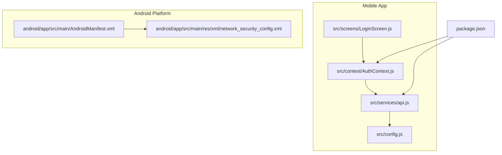
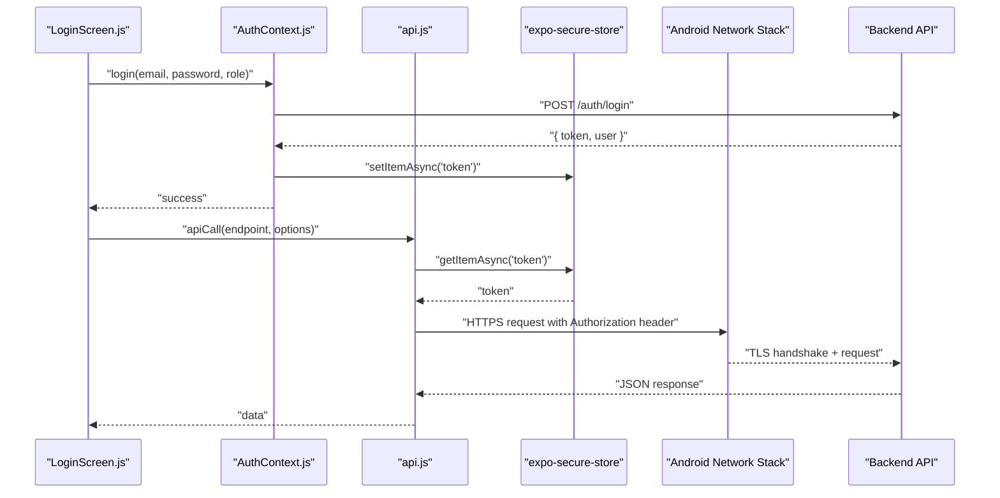
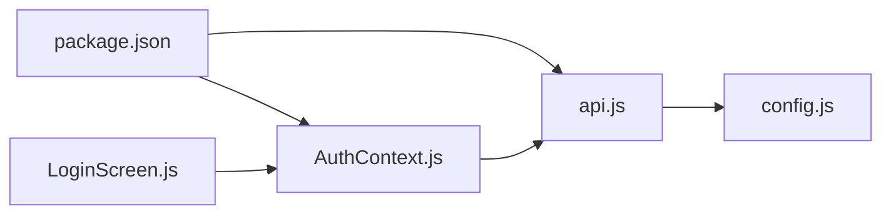

# Mobile Application Security

<cite>
**Referenced Files in This Document**
- [package.json](file://axx-spaces-mobile/package.json)
- [config.js](file://axx-spaces-mobile/src/config.js)
- [api.js](file://axx-spaces-mobile/src/services/api.js)
- [AuthContext.js](file://axx-spaces-mobile/src/context/AuthContext.js)
- [LoginScreen.js](file://axx-spaces-mobile/src/screens/LoginScreen.js)
- [AndroidManifest.xml](file://axx-spaces-mobile/android/app/src/main/AndroidManifest.xml)
- [network_security_config.xml](file://axx-spaces-mobile/android/app/src/main/res/xml/network_security_config.xml)
</cite>

## Table of Contents
1. [Introduction](#introduction)
2. [Project Structure](#project-structure)
3. [Core Components](#core-components)
4. [Architecture Overview](#architecture-overview)
5. [Detailed Component Analysis](#detailed-component-analysis)
6. [Dependency Analysis](#dependency-analysis)
7. [Performance Considerations](#performance-considerations)
8. [Troubleshooting Guide](#troubleshooting-guide)
9. [Conclusion](#conclusion)

## Introduction
This document provides comprehensive mobile security guidance for the React Native application, focusing on secure API communication, local storage encryption, certificate pinning, authentication flows, biometric integration, secure device storage, network security configuration, SSL/TLS setup, and secure file handling. It also includes best practices and testing recommendations to identify and mitigate vulnerabilities in mobile applications.

## Project Structure
The mobile app is built with Expo and React Native. Key directories include:
- Android native configuration under android/app/src/main
- App source code under src (services, context, screens, config)
- Dependencies declared in package.json

**Diagram sources**
- [api.js:1-194](file://axx-spaces-mobile/src/services/api.js#L1-L194)
- [AuthContext.js:1-136](file://axx-spaces-mobile/src/context/AuthContext.js#L1-L136)
- [LoginScreen.js:1-209](file://axx-spaces-mobile/src/screens/LoginScreen.js#L1-L209)
- [config.js:1-44](file://axx-spaces-mobile/src/config.js#L1-L44)
- [AndroidManifest.xml:1-54](file://axx-spaces-mobile/android/app/src/main/AndroidManifest.xml#L1-L54)
- [network_security_config.xml:1-15](file://axx-spaces-mobile/android/app/src/main/res/xml/network_security_config.xml#L1-L15)
- [package.json:1-41](file://axx-spaces-mobile/package.json#L1-L41)

**Section sources**
- [package.json:1-41](file://axx-spaces-mobile/package.json#L1-L41)
- [config.js:1-44](file://axx-spaces-mobile/src/config.js#L1-L44)

## Core Components
- Secure API client: Centralized HTTP layer that attaches tokens and handles errors.
- Authentication context: Manages login, registration, logout, and persistence of sensitive data.
- Login screen: User-facing entry point for authentication.
- Android manifest and network security config: Define permissions and TLS behavior.
- Configuration: Environment-aware API base URL and feature flags.

Key responsibilities:
- api.js: Builds requests, injects Authorization headers, and routes domain-specific calls.
- AuthContext.js: Stores tokens securely using expo-secure-store and user data in AsyncStorage; orchestrates login/register/logout.
- LoginScreen.js: Collects credentials and triggers authentication flow.
- AndroidManifest.xml: Declares permissions and integrates network security config.
- network_security_config.xml: Controls cleartext traffic and trusted certificates.
- config.js: Provides environment-specific API endpoints.

**Section sources**
- [api.js:1-194](file://axx-spaces-mobile/src/services/api.js#L1-L194)
- [AuthContext.js:1-136](file://axx-spaces-mobile/src/context/AuthContext.js#L1-L136)
- [LoginScreen.js:1-209](file://axx-spaces-mobile/src/screens/LoginScreen.js#L1-L209)
- [AndroidManifest.xml:1-54](file://axx-spaces-mobile/android/app/src/main/AndroidManifest.xml#L1-L54)
- [network_security_config.xml:1-15](file://axx-spaces-mobile/android/app/src/main/res/xml/network_security_config.xml#L1-L15)
- [config.js:1-44](file://axx-spaces-mobile/src/config.js#L1-L44)

## Architecture Overview
The mobile app communicates with a backend via HTTPS. Tokens are stored securely and attached to authenticated requests. Network policies are enforced at the Android platform level.

**Diagram sources**
- [LoginScreen.js:23-36](file://axx-spaces-mobile/src/screens/LoginScreen.js#L23-L36)
- [AuthContext.js:31-59](file://axx-spaces-mobile/src/context/AuthContext.js#L31-L59)
- [api.js:7-45](file://axx-spaces-mobile/src/services/api.js#L7-L45)
- [api.js:47-56](file://axx-spaces-mobile/src/services/api.js#L47-L56)
- [AndroidManifest.xml:36-36](file://axx-spaces-mobile/android/app/src/main/AndroidManifest.xml#L36-L36)
- [network_security_config.xml:1-15](file://axx-spaces-mobile/android/app/src/main/res/xml/network_security_config.xml#L1-L15)

## Detailed Component Analysis

### Secure API Communication
- The API client centralizes request construction, error handling, and token injection.
- Token retrieval uses expo-secure-store to minimize exposure risk.
- All production endpoints use HTTPS configured via environment variables.

Recommendations:
- Enforce HTTPS-only endpoints in production.
- Add retry logic with exponential backoff for transient failures.
- Implement request/response logging only in debug builds.
- Validate server responses strictly and sanitize inputs.

**Section sources**
- [api.js:7-45](file://axx-spaces-mobile/src/services/api.js#L7-L45)
- [api.js:47-56](file://axx-spaces-mobile/src/services/api.js#L47-L56)
- [config.js:2-6](file://axx-spaces-mobile/src/config.js#L2-L6)

### Local Storage Encryption and Secure Device Storage
- Sensitive tokens are stored using expo-secure-store, which leverages platform keychains/keystores.
- Non-sensitive user metadata is persisted in AsyncStorage.

Best practices:
- Never store secrets in AsyncStorage.
- Use expo-secure-store for tokens, keys, and sensitive payloads.
- Clear sensitive data on logout and when the app is backgrounded for extended periods.
- Avoid logging or printing stored values.

**Section sources**
- [AuthContext.js:17-29](file://axx-spaces-mobile/src/context/AuthContext.js#L17-L29)
- [AuthContext.js:52-53](file://axx-spaces-mobile/src/context/AuthContext.js#L52-L53)
- [AuthContext.js:105-114](file://axx-spaces-mobile/src/context/AuthContext.js#L105-L114)
- [api.js:47-56](file://axx-spaces-mobile/src/services/api.js#L47-L56)

### Certificate Pinning
- Current configuration trusts system and user CA certificates and allows cleartext for specific domains.
- To implement certificate pinning:
  - Generate and embed the server’s public key or certificate fingerprint.
  - Configure the networking library to validate the pinned certificate during TLS handshake.
  - Provide an update mechanism for certificate rotation without requiring app updates.

Note: The current Android network security configuration does not enforce pinning.

**Section sources**
- [network_security_config.xml:1-15](file://axx-spaces-mobile/android/app/src/main/res/xml/network_security_config.xml#L1-L15)

### Mobile-Specific Authentication Flows and Biometric Integration
- The app performs username/password login and stores tokens securely.
- For enhanced security, integrate biometric authentication (fingerprint/face) to unlock the app or authorize sensitive actions.
- Use platform-native biometric APIs through a React Native bridge or library.

Implementation outline:
- Prompt biometrics before accessing sensitive features.
- On success, allow access; on failure, fall back to PIN/password if supported.
- Invalidate sessions after biometric lockout or repeated failures.

[No sources needed since this section provides general guidance]

### Network Security Configuration and SSL/TLS Setup
- AndroidManifest enables internet access and references the network security config.
- network_security_config.xml currently permits cleartext for development domains and trusts system/user CAs.

Hardening steps:
- Disable cleartext in production by setting cleartextTrafficPermitted="false".
- Restrict allowed domains to production hosts only.
- Remove user CA trust anchors in production builds.
- Enforce TLS 1.2+ and disable weak cipher suites.

**Section sources**
- [AndroidManifest.xml:1-11](file://axx-spaces-mobile/android/app/src/main/AndroidManifest.xml#L1-L11)
- [AndroidManifest.xml:36-36](file://axx-spaces-mobile/android/app/src/main/AndroidManifest.xml#L36-L36)
- [network_security_config.xml:1-15](file://axx-spaces-mobile/android/app/src/main/res/xml/network_security_config.xml#L1-L15)

### Secure File Handling
- The app uses camera and image picker capabilities; ensure files are handled securely:
  - Store temporary media in app-scoped directories.
  - Avoid writing sensitive images to external storage.
  - Apply content restrictions and delete temporary files promptly.
  - Validate file types and sizes before processing.

[No sources needed since this section provides general guidance]

### Example Implementation Patterns
- Secure token attachment to API requests:
  - Retrieve token from secure storage and attach Authorization header.
- Safe logout and session cleanup:
  - Delete tokens from secure storage and clear non-sensitive user data.

**Section sources**
- [api.js:15-25](file://axx-spaces-mobile/src/services/api.js#L15-L25)
- [AuthContext.js:105-114](file://axx-spaces-mobile/src/context/AuthContext.js#L105-L114)

## Dependency Analysis
The app depends on:
- Networking: fetch-based API client
- Secure storage: expo-secure-store
- General storage: @react-native-async-storage/async-storage
- Navigation and UI libraries

**Diagram sources**
- [package.json:14-35](file://axx-spaces-mobile/package.json#L14-L35)
- [api.js:1-4](file://axx-spaces-mobile/src/services/api.js#L1-L4)
- [AuthContext.js:1-4](file://axx-spaces-mobile/src/context/AuthContext.js#L1-L4)
- [LoginScreen.js:14-21](file://axx-spaces-mobile/src/screens/LoginScreen.js#L14-L21)
- [config.js:1-6](file://axx-spaces-mobile/src/config.js#L1-L6)

**Section sources**
- [package.json:14-35](file://axx-spaces-mobile/package.json#L14-L35)

## Performance Considerations
- Minimize synchronous operations around secure storage to avoid UI jank.
- Cache non-sensitive data with TTL and size limits to reduce network calls.
- Batch API requests where possible and debounce user inputs.
- Profile memory usage when handling large images or media.

[No sources needed since this section provides general guidance]

## Troubleshooting Guide
Common issues and resolutions:
- Cleartext traffic blocked in production:
  - Ensure all endpoints use HTTPS and remove cleartext allowances in network security config.
- Certificate validation failures:
  - Verify server certificate chain and consider implementing certificate pinning.
- Token not found on app restart:
  - Confirm secure storage initialization and read/write paths.
- Permission denied for storage or camera:
  - Check AndroidManifest permissions and runtime permission prompts.

**Section sources**
- [network_security_config.xml:1-15](file://axx-spaces-mobile/android/app/src/main/res/xml/network_security_config.xml#L1-L15)
- [AndroidManifest.xml:1-11](file://axx-spaces-mobile/android/app/src/main/AndroidManifest.xml#L1-L11)

## Conclusion
The mobile application implements foundational security measures including secure token storage, HTTPS-based API communication, and Android network security configuration. To further harden the app, adopt certificate pinning, restrict cleartext and user CA trust in production, integrate biometric authentication for sensitive actions, and follow secure file handling practices. Continuous testing and monitoring will help maintain a strong security posture.