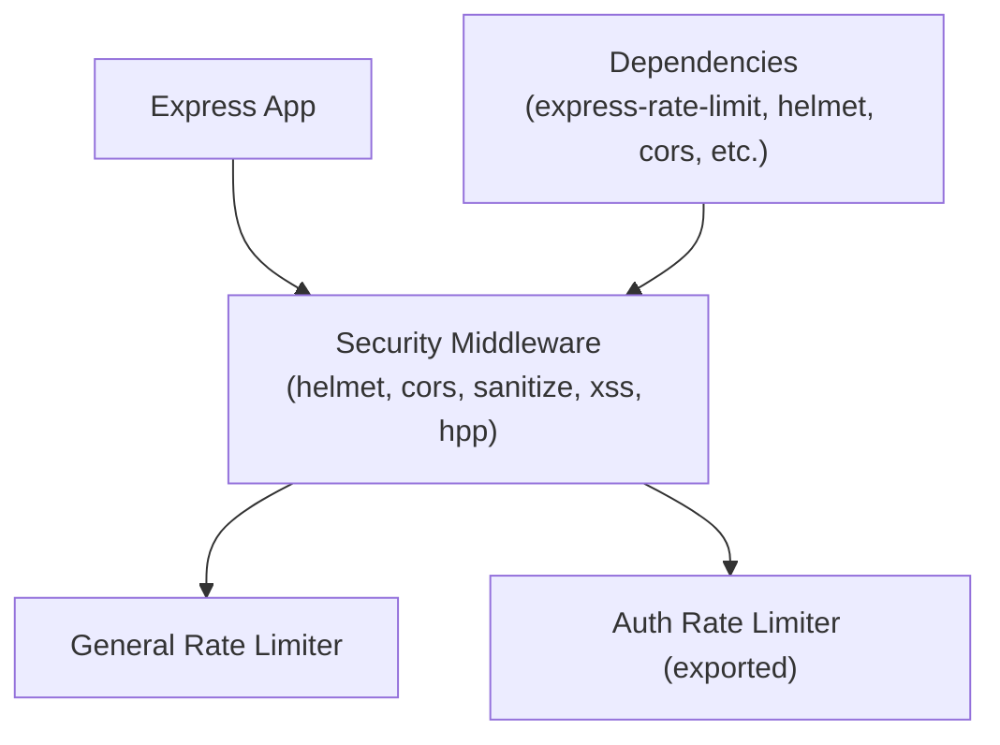
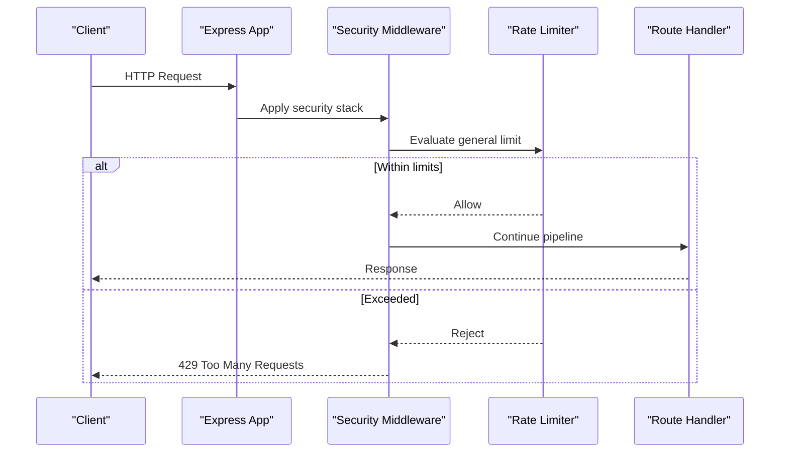
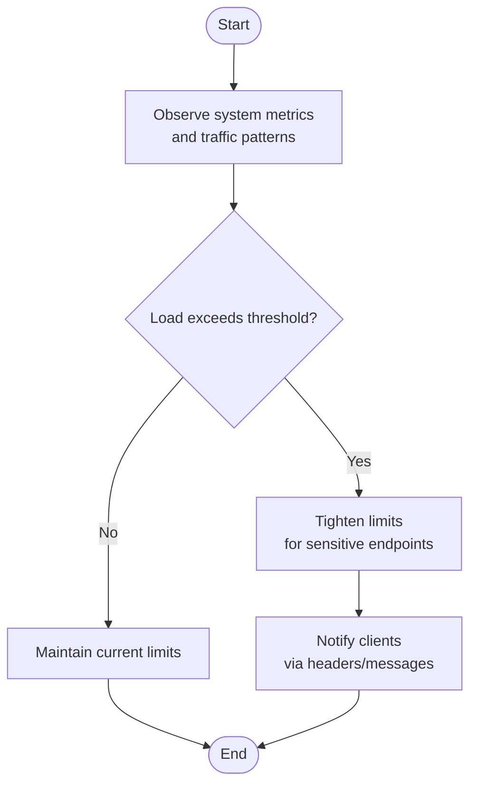
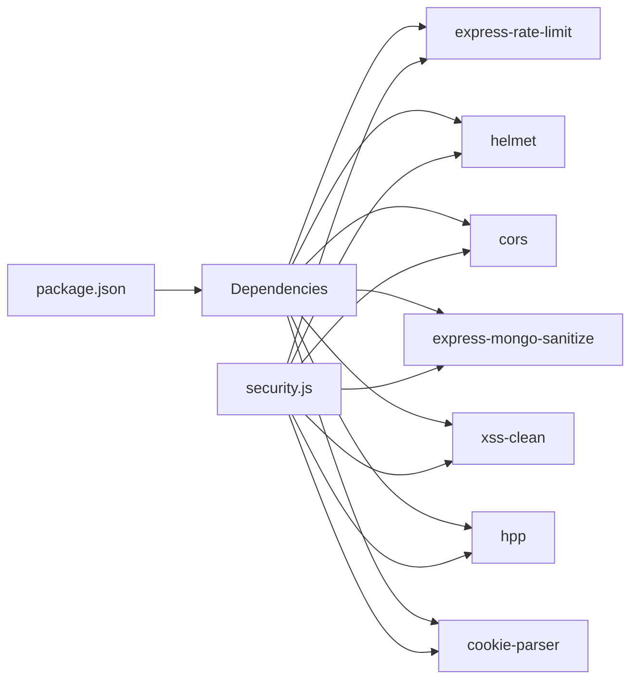

# Rate Limiting & Brute Force Protection

<cite>
**Referenced Files in This Document**
- [security.js](file://middleware/security.js)
- [package.json](file://package.json)
</cite>

## Table of Contents
1. [Introduction](#introduction)
2. [Project Structure](#project-structure)
3. [Core Components](#core-components)
4. [Architecture Overview](#architecture-overview)
5. [Detailed Component Analysis](#detailed-component-analysis)
6. [Dependency Analysis](#dependency-analysis)
7. [Performance Considerations](#performance-considerations)
8. [Troubleshooting Guide](#troubleshooting-guide)
9. [Conclusion](#conclusion)

## Introduction
This document explains the rate limiting and brute force protection implemented in the project, focusing on general request throttling, authentication-specific limits, and IP-based throttling. It also provides guidance for configuring per-endpoint limits, implementing custom handlers, monitoring usage, and integrating with caching layers to support adaptive rate limiting and high-volume legitimate traffic.

## Project Structure
The security middleware is centralized under a dedicated module that configures HTTP hardening, CORS, sanitization, and rate limiting. The application’s dependencies declare the use of express-rate-limit and related packages.

**Diagram sources**
- [security.js:13-51](file://middleware/security.js#L13-L51)
- [package.json:12-32](file://package.json#L12-L32)

**Section sources**
- [security.js:1-61](file://middleware/security.js#L1-L61)
- [package.json:1-50](file://package.json#L1-L50)

## Core Components
- General request limiter: Applies a global cap across all routes to mitigate abuse and protect resources.
- Authentication limiter: Exposed as a separate limiter instance intended for sensitive endpoints such as login or password reset.
- Security stack: Helmet, CORS, mongoSanitize, XSS cleanup, and HPP are applied alongside rate limiting.

Key behaviors:
- Global window and max requests are defined for general traffic.
- A stricter window and lower max are defined for authentication flows.
- Standard headers are enabled for the general limiter to aid client-side retry logic.

**Section sources**
- [security.js:30-42](file://middleware/security.js#L30-L42)
- [security.js:44-51](file://middleware/security.js#L44-L51)

## Architecture Overview
The middleware applies a layered defense:
- Request enters Express.
- Security utilities run (CORS, cookie parsing, header hardening).
- General rate limiter evaluates request frequency by IP.
- Additional sanitizers prevent injection and parameter pollution.
- Auth-specific limiter can be mounted on sensitive routes to enforce tighter controls.

**Diagram sources**
- [security.js:44-51](file://middleware/security.js#L44-L51)
- [security.js:30-42](file://middleware/security.js#L30-L42)

## Detailed Component Analysis

### General Request Limiting
- Purpose: Protects the entire application from excessive traffic and resource exhaustion.
- Behavior: Enforced via a shared limiter instance applied globally.
- Headers: Standard headers are enabled to expose rate limit state to clients.

Configuration highlights:
- Window duration and maximum request count are set for general traffic.
- Error message is returned when the limit is exceeded.

Operational notes:
- Use this limiter as the baseline protection for all endpoints.
- Clients should respect standard headers for backoff and retry strategies.

**Section sources**
- [security.js:30-36](file://middleware/security.js#L30-L36)
- [security.js:44-51](file://middleware/security.js#L44-L51)

### Authentication-Specific Rate Limits
- Purpose: Mitigates brute force attacks on login and other sensitive auth endpoints.
- Behavior: A stricter limiter instance is exported for targeted mounting on auth routes.
- Strategy: Lower max attempts within the same window to reduce credential guessing.

Implementation guidance:
- Mount the exported auth limiter only on authentication-related routes.
- Combine with account lockout policies and CAPTCHA where appropriate.

**Section sources**
- [security.js:38-42](file://middleware/security.js#L38-L42)
- [security.js:56-60](file://middleware/security.js#L56-L60)

### IP-Based Throttling
- Mechanism: The rate limiter uses the client IP address to track request counts.
- Scope: Both general and auth limiters operate per IP by default.
- Implication: Shared proxies or NAT may cause multiple users to share an IP; consider advanced key resolvers if needed.

Best practices:
- Ensure trusted proxy configuration so the correct client IP is used.
- Monitor for false positives due to shared IPs.

**Section sources**
- [security.js:30-42](file://middleware/security.js#L30-L42)

### Endpoint Configuration Options
- Global protection: The general limiter is applied to all routes.
- Sensitive endpoints: Mount the auth limiter specifically on login/register/reset-password routes.
- Custom per-route limits: Create additional limiter instances with tailored windows and max values for specific endpoints (e.g., search, upload).

Recommendations:
- Keep general limits generous enough for normal user behavior.
- Tighten limits on write-heavy or expensive operations.
- Use different windows for bursty vs. sustained traffic patterns.

**Section sources**
- [security.js:44-51](file://middleware/security.js#L44-L51)
- [security.js:30-42](file://middleware/security.js#L30-L42)

### Custom Rate Limit Handlers
- Current behavior: Default error responses are returned when limits are exceeded.
- Extensibility: Implement a custom handler to tailor responses, log events, or integrate with alerting systems.
- Integration points: Hook into the limiter’s response path to add metrics, structured logs, or admin notifications.

Example approach:
- Replace default messages with JSON payloads containing retry-after hints.
- Emit telemetry events for dashboards and alerts.

**Section sources**
- [security.js:30-42](file://middleware/security.js#L30-L42)

### Monitoring Approaches
- Metrics to collect:
  - Total requests per IP and per endpoint.
  - Number of 429 responses over time.
  - Peak and average request rates.
- Tools:
  - Centralized logging with correlation IDs.
  - Time-series metrics for dashboards and alerting.
- Operational tips:
  - Track both allowed and rejected requests.
  - Segment by route and feature area to identify hotspots.

[No sources needed since this section provides general guidance]

### Adaptive Rate Limiting
Conceptual flow:
- Collect real-time metrics (error rates, latency, queue depth).
- Adjust thresholds dynamically based on system health and load.
- Communicate changes to clients via headers or API responses.

[No sources needed since this diagram shows conceptual workflow, not actual code structure]

### Handling Legitimate High-Volume Requests
Strategies:
- Whitelist known partners or service accounts using a higher-tier limiter.
- Provide API keys or tokens to distinguish bulk consumers.
- Offer tiered quotas per plan or subscription level.
- Use pagination and server-side caching to reduce repeated work.

Integration ideas:
- Map API keys to distinct rate limit buckets.
- Store quota metadata in a fast store (e.g., Redis) for quick checks.

[No sources needed since this section provides general guidance]

### Integrating with Caching Layers
Benefits:
- Cache frequent reads to reduce backend load and avoid unnecessary rate limit consumption.
- Serve cached responses quickly while preserving overall throughput.

Patterns:
- Cache at the edge (CDN) for public content.
- Use in-memory or distributed caches for authenticated data.
- Invalidate caches on writes to maintain consistency.

[No sources needed since this section provides general guidance]

## Dependency Analysis
The security middleware depends on several packages for robustness and safety.

**Diagram sources**
- [package.json:12-32](file://package.json#L12-L32)
- [security.js:5-11](file://middleware/security.js#L5-L11)

**Section sources**
- [package.json:12-32](file://package.json#L12-L32)
- [security.js:5-11](file://middleware/security.js#L5-L11)

## Performance Considerations
- Choose window sizes that balance responsiveness and protection.
- Avoid overly aggressive limits that impact legitimate users.
- Offload heavy operations behind caching and queues.
- Monitor memory and CPU usage when scaling rate limit storage.
- Prefer stateless designs where possible; use external stores for distributed environments.

[No sources needed since this section provides general guidance]

## Troubleshooting Guide
Common issues and resolutions:
- 429 Too Many Requests:
  - Verify client retry logic respects retry-after headers.
  - Check for shared IPs causing unintended throttling.
- Misconfigured CORS:
  - Ensure allowed origins include your frontend domains.
- Injection or parameter pollution:
  - Confirm sanitizers are active and configured correctly.
- Cookie handling:
  - Validate cookie parser setup and secure flags.

Operational checks:
- Review logs for spikes in 429 responses.
- Inspect rate limit headers to understand client-side state.
- Validate environment variables for frontend URLs and other settings.

**Section sources**
- [security.js:18-28](file://middleware/security.js#L18-L28)
- [security.js:44-51](file://middleware/security.js#L44-L51)

## Conclusion
The project implements a solid foundation for rate limiting and brute force protection through a centralized security middleware. General and authentication-specific limiters provide baseline defenses, while the modular design allows for per-endpoint tuning, custom handlers, and integration with caching and monitoring systems. Adopting adaptive strategies and clear operational practices will further strengthen resilience against abuse while maintaining a smooth experience for legitimate users.