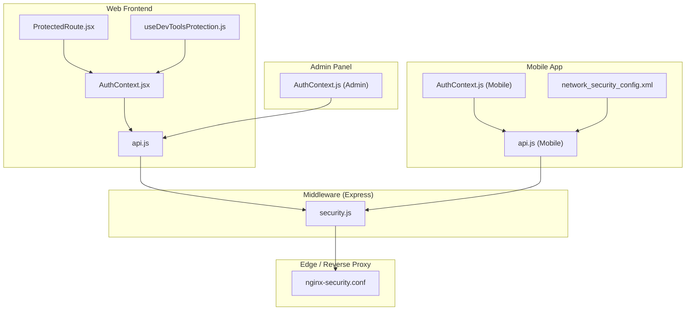
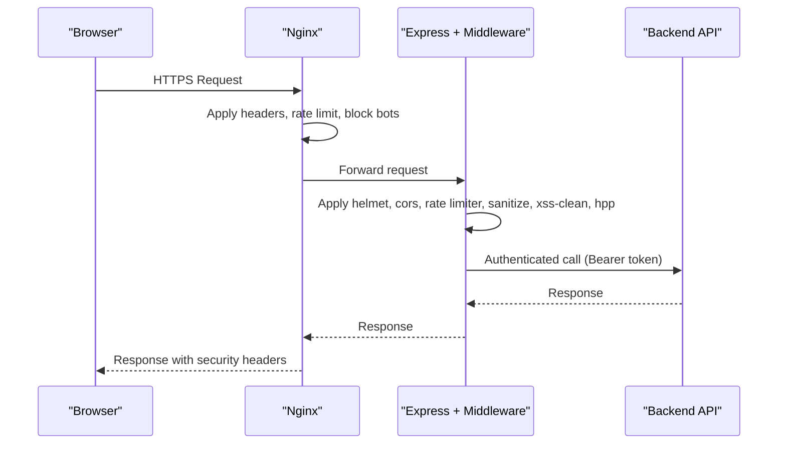
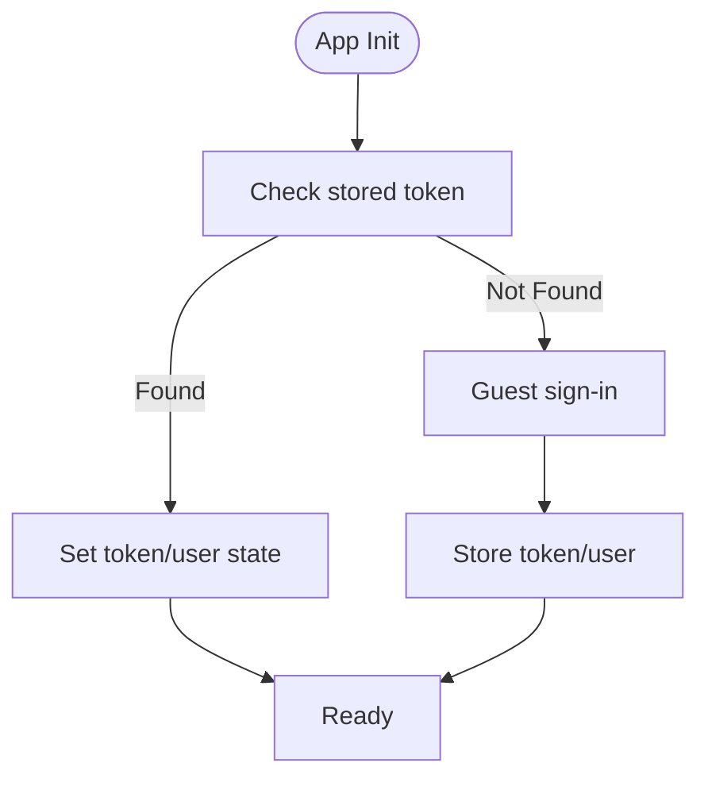
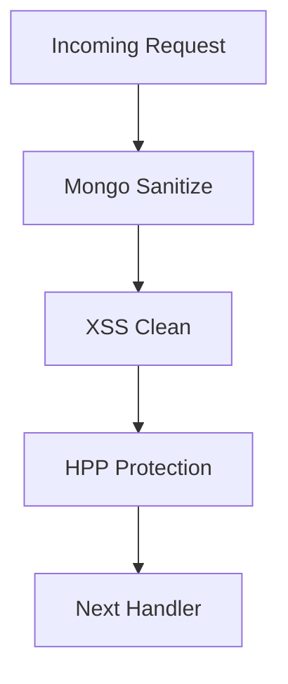
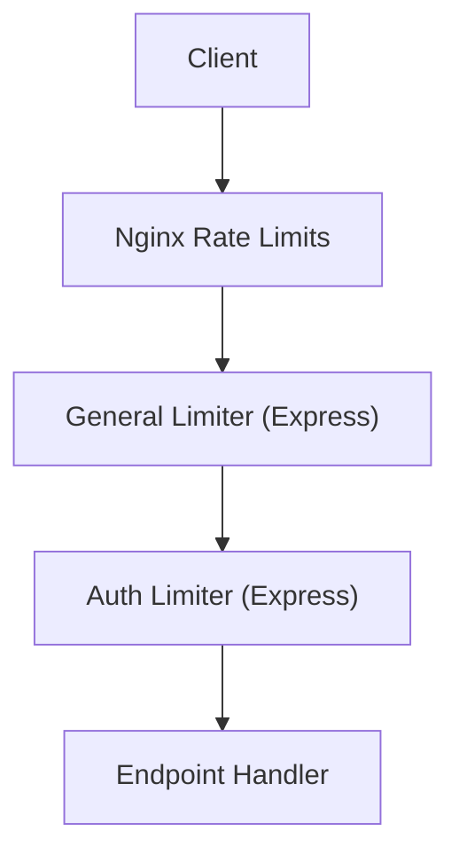
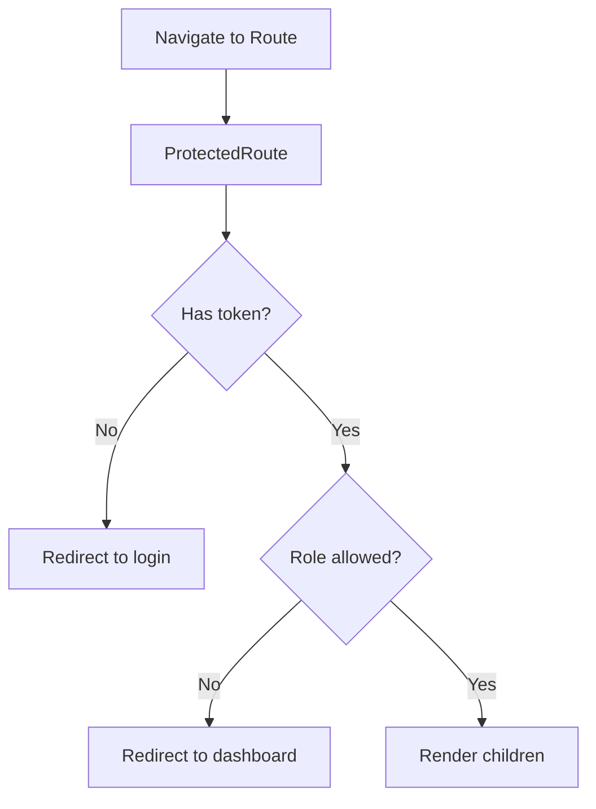
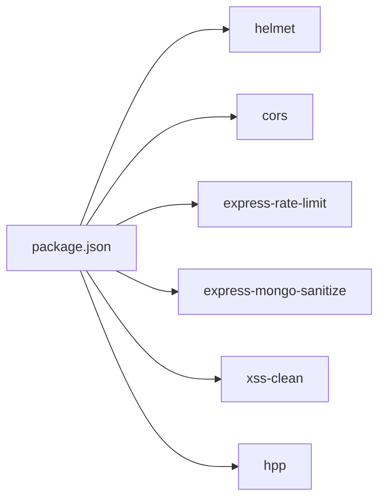

# Security Implementation

<cite>
**Referenced Files in This Document**
- [security.js](file://middleware/security.js)
- [nginx-security.conf](file://nginx-security.conf)
- [AuthContext.jsx](file://src/context/AuthContext.jsx)
- [api.js](file://src/api/api.js)
- [ProtectedRoute.jsx](file://src/components/ProtectedRoute.jsx)
- [useDevToolsProtection.js](file://src/hooks/useDevToolsProtection.js)
- [AuthContext.js (Mobile)](file://axx-spaces-mobile/src/context/AuthContext.js)
- [api.js (Mobile)](file://axx-spaces-mobile/src/services/api.js)
- [network_security_config.xml](file://axx-spaces-mobile/android/app/src/main/res/xml/network_security_config.xml)
- [AuthContext.js (Admin)](file://axxspace-admin/src/context/AuthContext.js)
- [package.json](file://package.json)
</cite>

## Table of Contents
1. [Introduction](#introduction)
2. [Project Structure](#project-structure)
3. [Core Components](#core-components)
4. [Architecture Overview](#architecture-overview)
5. [Detailed Component Analysis](#detailed-component-analysis)
6. [Dependency Analysis](#dependency-analysis)
7. [Performance Considerations](#performance-considerations)
8. [Troubleshooting Guide](#troubleshooting-guide)
9. [Conclusion](#conclusion)
10. [Appendices](#appendices)

## Introduction
This document provides a comprehensive security analysis of the frontend and related middleware configurations for the AXX Spaces application. It covers authentication security, input validation, XSS protection, rate limiting, security headers, secure coding practices, vulnerability mitigation strategies, security monitoring considerations, mobile security, data encryption at rest/in transit, and secure communication protocols. It also includes examples of implementing custom security measures and guidance for conducting security audits.

## Project Structure
The repository contains:
- A React web frontend with API clients and route guards
- An Express middleware layer that applies security controls
- Nginx configuration for TLS, headers, and rate limiting
- Mobile app code using secure storage and network security configuration
- Admin panel with its own auth context

**Diagram sources**
- [security.js:1-61](file://middleware/security.js#L1-L61)
- [nginx-security.conf:1-74](file://nginx-security.conf#L1-L74)
- [AuthContext.jsx:1-157](file://src/context/AuthContext.jsx#L1-L157)
- [api.js:1-47](file://src/api/api.js#L1-L47)
- [ProtectedRoute.jsx:1-57](file://src/components/ProtectedRoute.jsx#L1-L57)
- [useDevToolsProtection.js:1-72](file://src/hooks/useDevToolsProtection.js#L1-L72)
- [AuthContext.js (Mobile):1-136](file://axx-spaces-mobile/src/context/AuthContext.js#L1-L136)
- [api.js (Mobile):1-194](file://axx-spaces-mobile/src/services/api.js#L1-L194)
- [network_security_config.xml:1-15](file://axx-spaces-mobile/android/app/src/main/res/xml/network_security_config.xml#L1-L15)
- [AuthContext.js (Admin):1-84](file://axxspace-admin/src/context/AuthContext.js#L1-L84)

**Section sources**
- [security.js:1-61](file://middleware/security.js#L1-L61)
- [nginx-security.conf:1-74](file://nginx-security.conf#L1-L74)
- [AuthContext.jsx:1-157](file://src/context/AuthContext.jsx#L1-L157)
- [api.js:1-47](file://src/api/api.js#L1-L47)
- [ProtectedRoute.jsx:1-57](file://src/components/ProtectedRoute.jsx#L1-L57)
- [useDevToolsProtection.js:1-72](file://src/hooks/useDevToolsProtection.js#L1-L72)
- [AuthContext.js (Mobile):1-136](file://axx-spaces-mobile/src/context/AuthContext.js#L1-L136)
- [api.js (Mobile):1-194](file://axx-spaces-mobile/src/services/api.js#L1-L194)
- [network_security_config.xml:1-15](file://axx-spaces-mobile/android/app/src/main/res/xml/network_security_config.xml#L1-L15)
- [AuthContext.js (Admin):1-84](file://axxspace-admin/src/context/AuthContext.js#L1-L84)

## Core Components
- Middleware security layer: Applies Helmet, CORS, rate limiting, input sanitization, and parameter pollution protection.
- Nginx reverse proxy: Enforces TLS, security headers, rate limits, bot blocking, and request size limits.
- Web authentication context: Manages tokens and user state; supports guest auto-login and token persistence.
- Web API client: Centralized Axios instance with interceptors to attach Authorization headers and log requests/responses.
- Route guard: Protects routes based on authentication and role authorization.
- DevTools protection hook: Detects developer tools usage and warns users in production.
- Mobile authentication context: Uses secure storage for tokens and AsyncStorage for user data.
- Mobile API client: Adds Bearer tokens from secure storage and handles errors.
- Android network security config: Defines cleartext and trust anchors for development and specific domains.
- Admin authentication context: Stores tokens and user data in localStorage.

**Section sources**
- [security.js:1-61](file://middleware/security.js#L1-L61)
- [nginx-security.conf:1-74](file://nginx-security.conf#L1-L74)
- [AuthContext.jsx:1-157](file://src/context/AuthContext.jsx#L1-L157)
- [api.js:1-47](file://src/api/api.js#L1-L47)
- [ProtectedRoute.jsx:1-57](file://src/components/ProtectedRoute.jsx#L1-L57)
- [useDevToolsProtection.js:1-72](file://src/hooks/useDevToolsProtection.js#L1-L72)
- [AuthContext.js (Mobile):1-136](file://axx-spaces-mobile/src/context/AuthContext.js#L1-L136)
- [api.js (Mobile):1-194](file://axx-spaces-mobile/src/services/api.js#L1-L194)
- [network_security_config.xml:1-15](file://axx-spaces-mobile/android/app/src/main/res/xml/network_security_config.xml#L1-L15)
- [AuthContext.js (Admin):1-84](file://axxspace-admin/src/context/AuthContext.js#L1-L84)

## Architecture Overview
Security is enforced across multiple layers:
- Edge (Nginx): TLS termination, strict headers, rate limiting, bad bot blocking, path restrictions.
- Application server middleware: Helmet, CORS, rate limiting, input sanitization, XSS cleaning, HPP protection.
- Client applications: Secure token handling, protected routes, API interceptors, dev tool warnings.

**Diagram sources**
- [nginx-security.conf:1-74](file://nginx-security.conf#L1-L74)
- [security.js:1-61](file://middleware/security.js#L1-L61)
- [api.js:1-47](file://src/api/api.js#L1-L47)

## Detailed Component Analysis

### Authentication Security
- Web frontend stores tokens in localStorage and attaches them via an Axios interceptor. Guest auto-login is supported during initialization.
- Mobile app stores tokens in expo-secure-store and user data in AsyncStorage, adding Bearer tokens to API calls.
- Admin panel stores tokens and user data in localStorage.

**Diagram sources**
- [AuthContext.jsx:52-97](file://src/context/AuthContext.jsx#L52-L97)
- [api.js:10-24](file://src/api/api.js#L10-L24)
- [AuthContext.js (Mobile):17-59](file://axx-spaces-mobile/src/context/AuthContext.js#L17-L59)
- [api.js (Mobile):47-56](file://axx-spaces-mobile/src/services/api.js#L47-L56)
- [AuthContext.js (Admin):10-31](file://axxspace-admin/src/context/AuthContext.js#L10-L31)

**Section sources**
- [AuthContext.jsx:52-97](file://src/context/AuthContext.jsx#L52-L97)
- [api.js:10-24](file://src/api/api.js#L10-L24)
- [AuthContext.js (Mobile):17-59](file://axx-spaces-mobile/src/context/AuthContext.js#L17-L59)
- [api.js (Mobile):47-56](file://axx-spaces-mobile/src/services/api.js#L47-L56)
- [AuthContext.js (Admin):10-31](file://axxspace-admin/src/context/AuthContext.js#L10-L31)

### Input Validation and Sanitization
- Mongo injection sanitization is applied globally.
- XSS cleaning is enabled.
- HTTP Parameter Pollution (HPP) protection is active.
- These are configured in the middleware layer.

**Diagram sources**
- [security.js:44-51](file://middleware/security.js#L44-L51)

**Section sources**
- [security.js:44-51](file://middleware/security.js#L44-L51)

### XSS Protection
- XSS cleaning middleware is applied globally.
- Nginx sets legacy XSS protection header for older browsers.

**Section sources**
- [security.js:49-50](file://middleware/security.js#L49-L50)
- [nginx-security.conf:33](file://nginx-security.conf#L33)

### Rate Limiting
- Two Express rate limiters: general and stricter auth limiter.
- Nginx defines per-zone rate limits for API, auth, and upload endpoints.

**Diagram sources**
- [security.js:30-42](file://middleware/security.js#L30-L42)
- [nginx-security.conf:4-8](file://nginx-security.conf#L4-L8)
- [nginx-security.conf:51-64](file://nginx-security.conf#L51-L64)

**Section sources**
- [security.js:30-42](file://middleware/security.js#L30-L42)
- [nginx-security.conf:4-8](file://nginx-security.conf#L4-L8)
- [nginx-security.conf:51-64](file://nginx-security.conf#L51-L64)

### Security Headers
- Helmet is used to set common security headers.
- Nginx adds additional headers including HSTS, X-Frame-Options, X-Content-Type-Options, Referrer-Policy, Permissions-Policy.

**Section sources**
- [security.js:13-16](file://middleware/security.js#L13-L16)
- [nginx-security.conf:29-35](file://nginx-security.conf#L29-L35)

### Secure Communication Protocols
- TLS 1.2/1.3 enforced with strong cipher suites.
- HTTP-to-HTTPS redirect is configured.
- Android network security config allows cleartext for specific domains and trusts system plus user certificates.

**Section sources**
- [nginx-security.conf:17-27](file://nginx-security.conf#L17-L27)
- [nginx-security.conf:67-73](file://nginx-security.conf#L67-L73)
- [network_security_config.xml:1-15](file://axx-spaces-mobile/android/app/src/main/res/xml/network_security_config.xml#L1-L15)

### Data Encryption and Storage
- Mobile app uses secure storage for tokens and standard storage for user profile data.
- Web and admin apps store tokens in localStorage.

**Section sources**
- [AuthContext.js (Mobile):17-59](file://axx-spaces-mobile/src/context/AuthContext.js#L17-L59)
- [api.js (Mobile):47-56](file://axx-spaces-mobile/src/services/api.js#L47-L56)
- [AuthContext.jsx:52-97](file://src/context/AuthContext.jsx#L52-L97)
- [AuthContext.js (Admin):10-31](file://axxspace-admin/src/context/AuthContext.js#L10-L31)

### Protected Routes and Role-Based Access Control
- Route guard enforces authentication and optional role checks, redirecting unauthorized users.

**Diagram sources**
- [ProtectedRoute.jsx:15-55](file://src/components/ProtectedRoute.jsx#L15-L55)

**Section sources**
- [ProtectedRoute.jsx:15-55](file://src/components/ProtectedRoute.jsx#L15-L55)

### Anti-Debugging and Developer Tools Protection
- Hook detects developer tools usage and displays warnings in production builds.

**Section sources**
- [useDevToolsProtection.js:1-72](file://src/hooks/useDevToolsProtection.js#L1-L72)

### API Interceptors and Token Handling
- Axios interceptor attaches Authorization header when token exists.
- Mobile API helper retrieves token from secure storage and attaches it to requests.

**Section sources**
- [api.js:10-24](file://src/api/api.js#L10-L24)
- [api.js (Mobile):47-56](file://axx-spaces-mobile/src/services/api.js#L47-L56)

### CORS Configuration
- CORS is configured to allow specified origins and methods with credentials.

**Section sources**
- [security.js:18-28](file://middleware/security.js#L18-L28)

### Bad Bot Blocking and Path Restrictions
- Nginx maps suspicious user agents and blocks them.
- Dangerous paths are blocked.

**Section sources**
- [nginx-security.conf:10-15](file://nginx-security.conf#L10-L15)
- [nginx-security.conf:41-49](file://nginx-security.conf#L41-L49)

## Dependency Analysis
Key security-related dependencies include Helmet, CORS, express-rate-limit, express-mongo-sanitize, xss-clean, and hpp.

**Diagram sources**
- [package.json:12-33](file://package.json#L12-L33)

**Section sources**
- [package.json:12-33](file://package.json#L12-L33)

## Performance Considerations
- Rate limiting protects against abuse but may impact legitimate traffic; tune window sizes and max values according to expected load.
- Nginx-level rate limiting reduces load on the backend by dropping excessive requests early.
- Avoid overly broad CORS allowlists to minimize unnecessary preflight overhead.

[No sources needed since this section provides general guidance]

## Troubleshooting Guide
- If requests are being blocked due to rate limits, check both Nginx zones and Express limiters.
- Verify CORS settings if cross-origin requests fail.
- Ensure tokens are present in storage and attached to requests.
- For mobile issues, confirm secure store access and network security configuration for the target domain.

**Section sources**
- [security.js:30-42](file://middleware/security.js#L30-L42)
- [nginx-security.conf:4-8](file://nginx-security.conf#L4-L8)
- [api.js:10-24](file://src/api/api.js#L10-L24)
- [api.js (Mobile):47-56](file://axx-spaces-mobile/src/services/api.js#L47-L56)
- [network_security_config.xml:1-15](file://axx-spaces-mobile/android/app/src/main/res/xml/network_security_config.xml#L1-L15)

## Conclusion
The application implements layered security controls across the edge, middleware, and client layers. Key protections include TLS enforcement, security headers, rate limiting, input sanitization, XSS cleaning, and role-based route guards. Mobile-specific measures include secure token storage and network security configuration. Recommendations include tightening CORS policies, enabling Content-Security-Policy via Helmet, and adopting more robust token storage mechanisms where feasible.

[No sources needed since this section summarizes without analyzing specific files]

## Appendices

### Custom Security Measures Examples
- Implementing a per-endpoint rate limiter in middleware.
- Adding a custom request validator before sanitization.
- Extending Nginx rules to block specific IP ranges or enforce geo-restrictions.

[No sources needed since this section provides general guidance]

### Security Audit Checklist
- Review and validate CORS allowlist and credentials policy.
- Confirm all sensitive endpoints require authentication and authorization.
- Validate rate limiting thresholds and monitor logs for abuse patterns.
- Ensure no secrets are logged; remove debug logging in production.
- Test mobile app behavior under restricted network conditions and certificate pinning scenarios.

[No sources needed since this section provides general guidance]