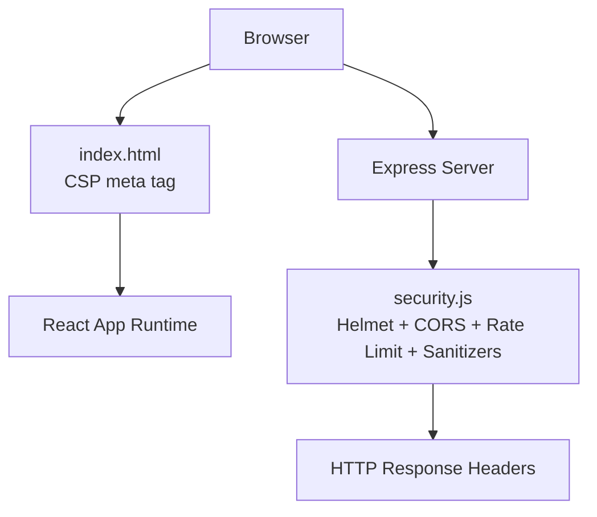
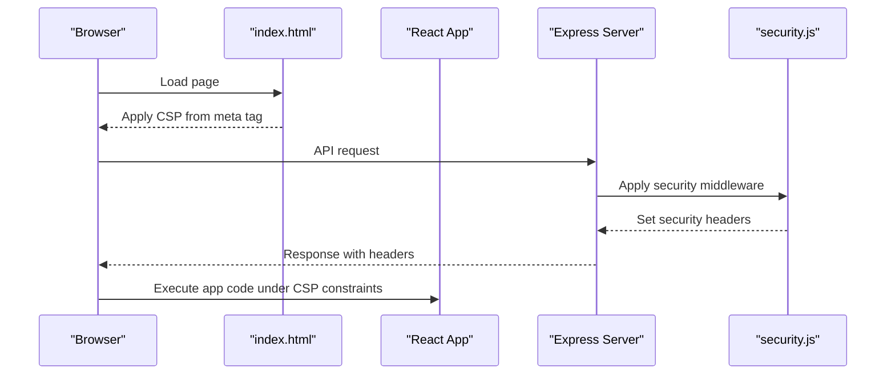
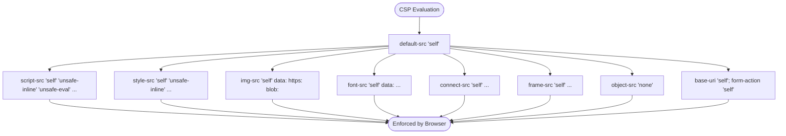
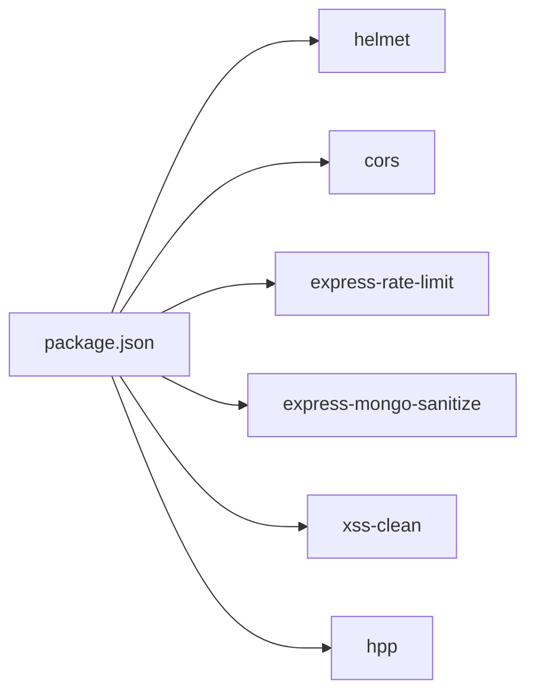

# XSS Protection & Content Security

<cite>
**Referenced Files in This Document**
- [index.html](file://index.html)
- [security.js](file://middleware/security.js)
- [package.json](file://package.json)
- [FloatingWhatsApp.jsx](file://src/components/FloatingWhatsApp.jsx)
- [AdminDashboard.jsx](file://src/pages/AdminDashboard.jsx)
- [WebsitePoster.jsx](file://axxspace-admin/src/components/WebsitePoster.jsx)
</cite>

## Table of Contents
1. [Introduction](#introduction)
2. [Project Structure](#project-structure)
3. [Core Components](#core-components)
4. [Architecture Overview](#architecture-overview)
5. [Detailed Component Analysis](#detailed-component-analysis)
6. [Dependency Analysis](#dependency-analysis)
7. [Performance Considerations](#performance-considerations)
8. [Troubleshooting Guide](#troubleshooting-guide)
9. [Conclusion](#conclusion)

## Introduction
This document explains how Cross-Site Scripting (XSS) protection is implemented across the frontend and backend layers, focusing on:
- Helmet configuration for security headers
- Content Security Policy (CSP) implementation
- Output encoding and safe HTML rendering practices
- DOM manipulation security
- Third-party script handling

It also provides actionable guidance to tighten CSP directives, sanitize user-generated content, and prevent script injection attacks.

## Project Structure
The XSS protections are primarily defined in two places:
- Frontend HTML entry point defines a strict CSP via meta tag and includes third-party scripts with explicit allowlists.
- Backend middleware applies Helmet and other security middleware to HTTP responses.

**Diagram sources**
- [index.html:18-56](file://index.html#L18-L56)
- [security.js:13-50](file://middleware/security.js#L13-L50)

**Section sources**
- [index.html:1-147](file://index.html#L1-L147)
- [security.js:1-61](file://middleware/security.js#L1-L61)

## Core Components
- Frontend CSP via meta tag in the HTML entry point.
- Backend Helmet configuration that sets security headers but disables its own CSP generator.
- Additional backend security middleware: CORS, rate limiting, request sanitization, and parameter pollution protection.
- React components that perform direct DOM manipulation or inject HTML.

Key responsibilities:
- index.html: Declares CSP policy and allowslist for third-party resources.
- middleware/security.js: Applies Helmet and other security middleware to all requests.
- React components: Manage UI elements and may manipulate DOM or inject HTML.

**Section sources**
- [index.html:18-56](file://index.html#L18-L56)
- [security.js:13-50](file://middleware/security.js#L13-L50)

## Architecture Overview
The application uses a layered defense-in-depth approach:
- The server sets broad security headers using Helmet and additional middleware.
- The browser enforces CSP from the HTML meta tag.
- The React app avoids unsafe patterns where possible and uses controlled DOM APIs.

**Diagram sources**
- [index.html:18-56](file://index.html#L18-L56)
- [security.js:44-50](file://middleware/security.js#L44-L50)

## Detailed Component Analysis

### Helmet Configuration and Security Headers
- Helmet is configured to disable its built-in CSP generator because CSP is managed via the HTML meta tag.
- Other Helmet defaults remain active unless explicitly disabled.
- Additional middleware adds CORS, rate limiting, MongoDB input sanitization, XSS cleaning, and header parameter pollution protection.

Recommendations:
- Prefer setting CSP via Helmet response headers instead of meta tags for stronger enforcement.
- Keep `contentSecurityPolicy` enabled in Helmet and remove the meta tag CSP to avoid conflicts.
- Ensure CSP directives match the exact domains used by third-party services.

**Section sources**
- [security.js:13-16](file://middleware/security.js#L13-L16)
- [security.js:44-50](file://middleware/security.js#L44-L50)

### Content Security Policy Implementation
The frontend declares CSP in the HTML head before any scripts load. It includes:
- Default allowlist for self-hosted resources.
- Explicit allowlists for analytics, authentication, fonts, styles, images, frames, and connections.
- Strict settings for object embedding and base URI/form actions.

Current characteristics:
- Allows inline scripts and eval via unsafe tokens.
- Allows inline styles via unsafe-inline.
- Permits data URIs for images and fonts.
- Restricts object embedding and form submissions.

Recommended tightening:
- Remove `'unsafe-inline'` for scripts and styles; use nonces or hashes for legitimate inline content.
- Replace `'unsafe-eval'` with safer alternatives; avoid dynamic code execution.
- Narrow connect-src to only required endpoints.
- Use strict-dynamic for modern script loading if needed.

**Diagram sources**
- [index.html:18-56](file://index.html#L18-L56)

**Section sources**
- [index.html:18-56](file://index.html#L18-L56)

### Safe HTML Rendering and Output Encoding
Potential risks identified:
- A component injects CSS into a style element using innerHTML.
- Another component injects an SVG icon into a button using innerHTML.
- An admin dashboard renders dynamic CSS via dangerouslySetInnerHTML.

Guidance:
- Avoid innerHTML and dangerouslySetInnerHTML when rendering untrusted content.
- For trusted static assets (e.g., SVG icons), prefer React.createElement or JSX to construct nodes safely.
- If dynamic styles are necessary, generate them at build time or use a controlled stylesheet manager with validation.

Mitigation examples:
- Replace innerHTML assignments with DOM APIs like createElement, setAttribute, and appendChild.
- Validate and sanitize any dynamic content through a dedicated sanitizer library before insertion.
- Use React’s text content properties (textContent) for plain text output.

**Section sources**
- [FloatingWhatsApp.jsx:16-86](file://src/components/FloatingWhatsApp.jsx#L16-L86)
- [AdminDashboard.jsx:625-625](file://src/pages/AdminDashboard.jsx#L625-L625)

### DOM Manipulation Security
Observations:
- Floating WhatsApp component creates and manipulates DOM elements directly, including injecting a style block and an SVG icon.
- Website poster prints a new window and writes HTML via document.write.

Best practices:
- Prefer declarative UI frameworks (React) over imperative DOM manipulation.
- When imperative DOM access is unavoidable, validate and sanitize inputs and avoid executing arbitrary code.
- Avoid document.write; use modern DOM APIs to insert content safely.

**Section sources**
- [FloatingWhatsApp.jsx:11-92](file://src/components/FloatingWhatsApp.jsx#L11-L92)
- [WebsitePoster.jsx:29-60](file://axxspace-admin/src/components/WebsitePoster.jsx#L29-L60)

### Third-Party Script Handling
Third-party scripts are loaded in the HTML head:
- Google Analytics and Tag Manager
- Microsoft Clarity
- Google Identity Services

CSP allowlists include these domains. Recommendations:
- Pin subresource integrity (SRI) where supported.
- Use nonce-based CSP for third-party scripts to reduce reliance on unsafe-inline.
- Monitor and audit third-party dependencies regularly.

**Section sources**
- [index.html:114-138](file://index.html#L114-L138)
- [index.html:18-56](file://index.html#L18-L56)

## Dependency Analysis
The project depends on several security-related packages:
- helmet: Sets security headers.
- cors: Controls cross-origin resource sharing.
- express-rate-limit: Limits request rates.
- express-mongo-sanitize: Sanitizes MongoDB query operators.
- xss-clean: Basic XSS cleaning for incoming requests.
- hpp: Protects against HTTP parameter pollution.

**Diagram sources**
- [package.json:12-33](file://package.json#L12-L33)

**Section sources**
- [package.json:12-33](file://package.json#L12-L33)
- [security.js:5-11](file://middleware/security.js#L5-L11)

## Performance Considerations
- CSP evaluation can impact performance; keep allowlists minimal and accurate.
- Avoid heavy inline styles and scripts; prefer external assets and caching.
- Minimize third-party scripts and defer loading where possible.
- Use SRI and caching strategies to reduce overhead.

[No sources needed since this section provides general guidance]

## Troubleshooting Guide
Common issues and resolutions:
- CSP blocking resources:
  - Verify domain allowlists in CSP match actual endpoints.
  - Check console errors for blocked script/style/image loads.
  - Temporarily enable logging/report-only CSP to diagnose without breaking functionality.
- Inline scripts/styles blocked:
  - Replace unsafe-inline with nonces/hashes.
  - Move inline logic to external files.
- Dynamic styles/scripts blocked:
  - Avoid eval and dynamic code generation.
  - Use build-time generation or validated templates.
- Third-party integrations failing:
  - Confirm network connectivity and correct URLs.
  - Add appropriate connect-src/frame-src/script-src entries.

Operational checks:
- Inspect response headers to confirm Helmet is applied.
- Validate CSP in browser DevTools.
- Review component usage of innerHTML/dangerouslySetInnerHTML and refactor to safe patterns.

**Section sources**
- [index.html:18-56](file://index.html#L18-L56)
- [security.js:44-50](file://middleware/security.js#L44-L50)

## Conclusion
The application implements a multi-layered XSS defense strategy:
- Backend security headers via Helmet and complementary middleware.
- Frontend CSP enforced via meta tag with explicit allowlists.
- Areas exist to improve safety by removing unsafe tokens, avoiding dangerous DOM APIs, and centralizing CSP management in Helmet.

Adopting the recommended changes will strengthen protection against script injection while maintaining functionality for essential third-party services.

[No sources needed since this section summarizes without analyzing specific files]