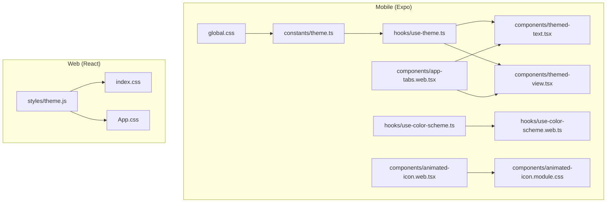
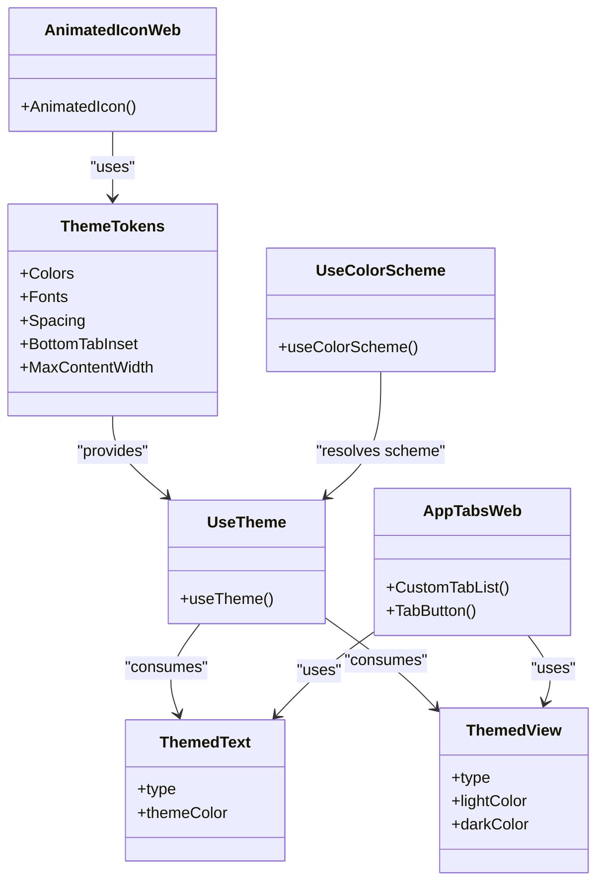
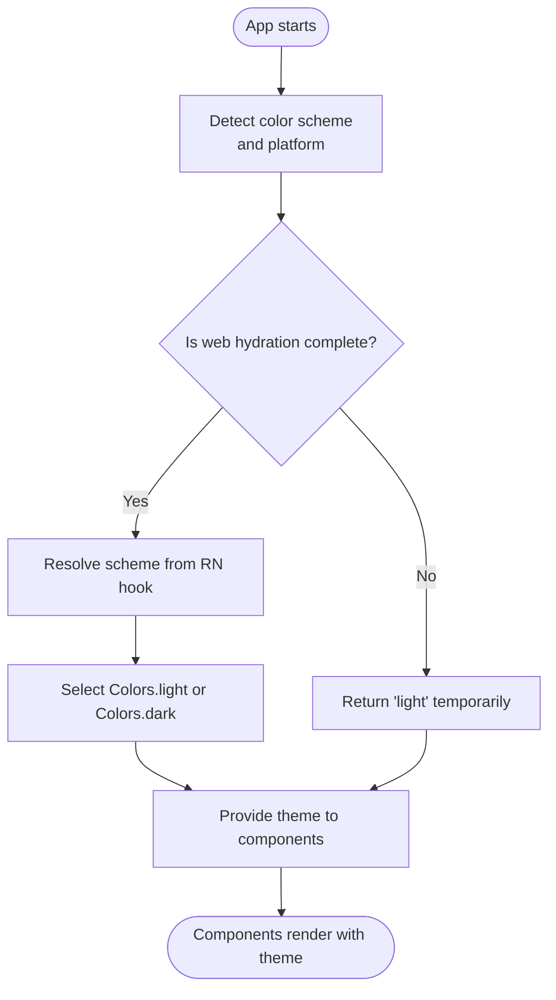
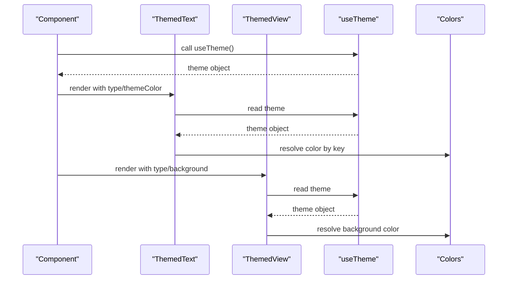
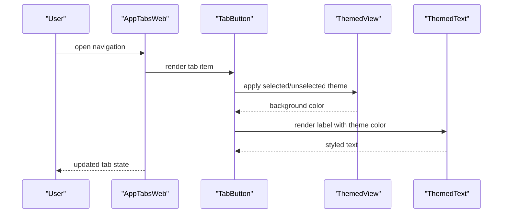
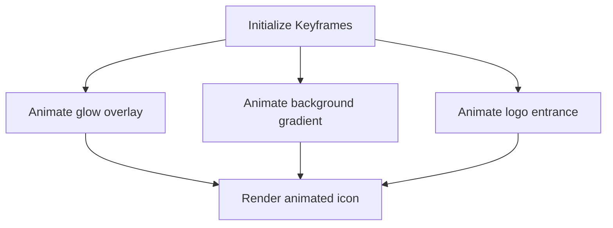
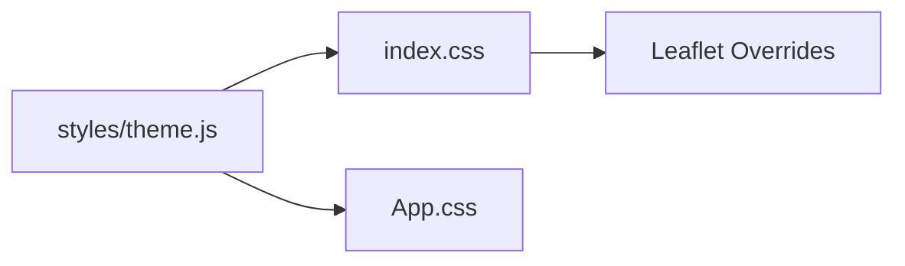
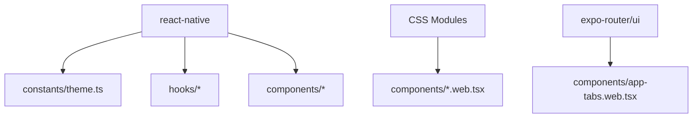

# Cross-Platform Styling

<cite>
**Referenced Files in This Document**
- [theme.ts](file://axx-spaces-mobile/src/constants/theme.ts)
- [use-theme.ts](file://axx-spaces-mobile/src/hooks/use-theme.ts)
- [use-color-scheme.ts](file://axx-spaces-mobile/src/hooks/use-color-scheme.ts)
- [use-color-scheme.web.ts](file://axx-spaces-mobile/src/hooks/use-color-scheme.web.ts)
- [themed-text.tsx](file://axx-spaces-mobile/src/components/themed-text.tsx)
- [themed-view.tsx](file://axx-spaces-mobile/src/components/themed-view.tsx)
- [global.css](file://axx-spaces-mobile/src/global.css)
- [app-tabs.web.tsx](file://axx-spaces-mobile/src/components/app-tabs.web.tsx)
- [animated-icon.web.tsx](file://axx-spaces-mobile/src/components/animated-icon.web.tsx)
- [animated-icon.module.css](file://axx-spaces-mobile/src/components/animated-icon.module.css)
- [web-badge.tsx](file://axx-spaces-mobile/src/components/web-badge.tsx)
- [theme.js](file://src/styles/theme.js)
- [index.css](file://src/index.css)
- [App.css](file://src/App.css)
</cite>

## Table of Contents
1. [Introduction](#introduction)
2. [Project Structure](#project-structure)
3. [Core Components](#core-components)
4. [Architecture Overview](#architecture-overview)
5. [Detailed Component Analysis](#detailed-component-analysis)
6. [Dependency Analysis](#dependency-analysis)
7. [Performance Considerations](#performance-considerations)
8. [Troubleshooting Guide](#troubleshooting-guide)
9. [Conclusion](#conclusion)

## Introduction
This document explains cross-platform styling strategies between the React web application and the React Native (Expo) mobile application. It focuses on how themes are synchronized, platform-specific styling considerations, conditional styling approaches, and shared design principles. The goal is to maintain a consistent user experience across platforms while adapting to differences such as screen densities, input methods, and platform conventions.

Key takeaways:
- Centralized theme tokens for colors, spacing, and typography.
- Platform-aware hooks and components that adapt behavior and visuals per environment.
- Web-specific overrides using CSS modules and global styles.
- Conditional rendering and styling based on platform detection.

## Project Structure
The project contains two main styling surfaces:
- Mobile (React Native via Expo): Theme constants, color scheme hooks, themed primitives, and platform-specific component variants.
- Web (React + Vite): A unified design system with CSS variables, global resets, and component-level styles.

**Diagram sources**
- [theme.ts:1-66](file://axx-spaces-mobile/src/constants/theme.ts#L1-L66)
- [use-theme.ts:1-15](file://axx-spaces-mobile/src/hooks/use-theme.ts#L1-L15)
- [use-color-scheme.ts:1-2](file://axx-spaces-mobile/src/hooks/use-color-scheme.ts#L1-L2)
- [use-color-scheme.web.ts:1-22](file://axx-spaces-mobile/src/hooks/use-color-scheme.web.ts#L1-L22)
- [themed-text.tsx:1-74](file://axx-spaces-mobile/src/components/themed-text.tsx#L1-L74)
- [themed-view.tsx:1-17](file://axx-spaces-mobile/src/components/themed-view.tsx#L1-L17)
- [app-tabs.web.tsx:1-116](file://axx-spaces-mobile/src/components/app-tabs.web.tsx#L1-L116)
- [animated-icon.web.tsx:1-109](file://axx-spaces-mobile/src/components/animated-icon.web.tsx#L1-L109)
- [animated-icon.module.css:1-7](file://axx-spaces-mobile/src/components/animated-icon.module.css#L1-L7)
- [global.css:1-10](file://axx-spaces-mobile/src/global.css#L1-L10)
- [theme.js:1-202](file://src/styles/theme.js#L1-L202)
- [index.css:1-177](file://src/index.css#L1-L177)
- [App.css:1-185](file://src/App.css#L1-L185)

**Section sources**
- [theme.ts:1-66](file://axx-spaces-mobile/src/constants/theme.ts#L1-L66)
- [theme.js:1-202](file://src/styles/theme.js#L1-L202)

## Core Components
- Themed primitives provide consistent text and container styling across the app.
- Theme hooks abstract color scheme resolution and platform differences.
- Web-only components leverage CSS modules and React Native’s web support.

Highlights:
- Color tokens and spacing scale are centralized for both platforms.
- Typography uses platform-specific font families and CSS variables.
- Conditional styling adapts to light/dark modes and platform capabilities.

**Section sources**
- [themed-text.tsx:1-74](file://axx-spaces-mobile/src/components/themed-text.tsx#L1-L74)
- [themed-view.tsx:1-17](file://axx-spaces-mobile/src/components/themed-view.tsx#L1-L17)
- [use-theme.ts:1-15](file://axx-spaces-mobile/src/hooks/use-theme.ts#L1-L15)
- [theme.ts:1-66](file://axx-spaces-mobile/src/constants/theme.ts#L1-L66)

## Architecture Overview
The styling architecture separates concerns into:
- Design tokens (colors, spacing, fonts).
- Theme resolution (light/dark mode, platform selection).
- Themed primitives (text, view).
- Platform-specific implementations (web-only tabs, animated icon).

**Diagram sources**
- [theme.ts:1-66](file://axx-spaces-mobile/src/constants/theme.ts#L1-L66)
- [use-theme.ts:1-15](file://axx-spaces-mobile/src/hooks/use-theme.ts#L1-L15)
- [use-color-scheme.ts:1-2](file://axx-spaces-mobile/src/hooks/use-color-scheme.ts#L1-L2)
- [use-color-scheme.web.ts:1-22](file://axx-spaces-mobile/src/hooks/use-color-scheme.web.ts#L1-L22)
- [themed-text.tsx:1-74](file://axx-spaces-mobile/src/components/themed-text.tsx#L1-L74)
- [themed-view.tsx:1-17](file://axx-spaces-mobile/src/components/themed-view.tsx#L1-L17)
- [app-tabs.web.tsx:1-116](file://axx-spaces-mobile/src/components/app-tabs.web.tsx#L1-L116)
- [animated-icon.web.tsx:1-109](file://axx-spaces-mobile/src/components/animated-icon.web.tsx#L1-L109)

## Detailed Component Analysis

### Theme Tokens and Color Scheme Resolution
- Colors define light and dark palettes; Fonts use Platform.select to map to native or CSS variable-based fonts on web.
- Spacing provides a consistent scale across components.
- BottomTabInset and MaxContentWidth help align layouts across devices and screens.
- useColorScheme resolves the current scheme; the web variant hydrates safely during SSR/static rendering.
- useTheme returns the active color set based on the resolved scheme.

**Diagram sources**
- [use-color-scheme.web.ts:1-22](file://axx-spaces-mobile/src/hooks/use-color-scheme.web.ts#L1-L22)
- [use-color-scheme.ts:1-2](file://axx-spaces-mobile/src/hooks/use-color-scheme.ts#L1-L2)
- [use-theme.ts:1-15](file://axx-spaces-mobile/src/hooks/use-theme.ts#L1-L15)
- [theme.ts:1-66](file://axx-spaces-mobile/src/constants/theme.ts#L1-L66)

**Section sources**
- [theme.ts:1-66](file://axx-spaces-mobile/src/constants/theme.ts#L1-L66)
- [use-theme.ts:1-15](file://axx-spaces-mobile/src/hooks/use-theme.ts#L1-L15)
- [use-color-scheme.ts:1-2](file://axx-spaces-mobile/src/hooks/use-color-scheme.ts#L1-L2)
- [use-color-scheme.web.ts:1-22](file://axx-spaces-mobile/src/hooks/use-color-scheme.web.ts#L1-L22)

### Themed Text and View Primitives
- ThemedText applies type-based typography and theme-aware colors.
- ThemedView sets background colors based on theme tokens.
- Both integrate with useTheme to stay in sync with light/dark modes.

**Diagram sources**
- [themed-text.tsx:1-74](file://axx-spaces-mobile/src/components/themed-text.tsx#L1-L74)
- [themed-view.tsx:1-17](file://axx-spaces-mobile/src/components/themed-view.tsx#L1-L17)
- [use-theme.ts:1-15](file://axx-spaces-mobile/src/hooks/use-theme.ts#L1-L15)
- [theme.ts:1-66](file://axx-spaces-mobile/src/constants/theme.ts#L1-L66)

**Section sources**
- [themed-text.tsx:1-74](file://axx-spaces-mobile/src/components/themed-text.tsx#L1-L74)
- [themed-view.tsx:1-17](file://axx-spaces-mobile/src/components/themed-view.tsx#L1-L17)

### Web-Specific Tabs and Badges
- AppTabsWeb composes tab UI using Expo Router’s Tabs and integrates ThemedText/ThemedView for consistent styling.
- WebBadge displays version info and an Expo badge image adapted to the current color scheme.
- These components demonstrate conditional rendering and platform-specific assets.

**Diagram sources**
- [app-tabs.web.tsx:1-116](file://axx-spaces-mobile/src/components/app-tabs.web.tsx#L1-L116)
- [themed-text.tsx:1-74](file://axx-spaces-mobile/src/components/themed-text.tsx#L1-L74)
- [themed-view.tsx:1-17](file://axx-spaces-mobile/src/components/themed-view.tsx#L1-L17)

**Section sources**
- [app-tabs.web.tsx:1-116](file://axx-spaces-mobile/src/components/app-tabs.web.tsx#L1-L116)
- [web-badge.tsx:1-44](file://axx-spaces-mobile/src/components/web-badge.tsx#L1-L44)

### Animated Icon (Web)
- Uses react-native-reanimated Keyframe animations and CSS modules for visual effects.
- Demonstrates combining React Native primitives with CSS classes on web.

**Diagram sources**
- [animated-icon.web.tsx:1-109](file://axx-spaces-mobile/src/components/animated-icon.web.tsx#L1-L109)
- [animated-icon.module.css:1-7](file://axx-spaces-mobile/src/components/animated-icon.module.css#L1-L7)

**Section sources**
- [animated-icon.web.tsx:1-109](file://axx-spaces-mobile/src/components/animated-icon.web.tsx#L1-L109)
- [animated-icon.module.css:1-7](file://axx-spaces-mobile/src/components/animated-icon.module.css#L1-L7)

### Web Global Styles and Theme
- index.css defines base resets, dark theme defaults, and Leaflet map overrides.
- App.css adds layout utilities and responsive rules.
- src/styles/theme.js provides a unified design system for the web app (colors, spacing, typography, reusable style objects).

**Diagram sources**
- [theme.js:1-202](file://src/styles/theme.js#L1-L202)
- [index.css:1-177](file://src/index.css#L1-L177)
- [App.css:1-185](file://src/App.css#L1-L185)

**Section sources**
- [theme.js:1-202](file://src/styles/theme.js#L1-L202)
- [index.css:1-177](file://src/index.css#L1-L177)
- [App.css:1-185](file://src/App.css#L1-L185)

## Dependency Analysis
- Mobile theme depends on React Native’s Platform and color scheme APIs.
- Web-specific components depend on CSS modules and Expo Router UI.
- Shared design tokens ensure consistency across platforms.

**Diagram sources**
- [theme.ts:1-66](file://axx-spaces-mobile/src/constants/theme.ts#L1-L66)
- [use-color-scheme.ts:1-2](file://axx-spaces-mobile/src/hooks/use-color-scheme.ts#L1-L2)
- [use-color-scheme.web.ts:1-22](file://axx-spaces-mobile/src/hooks/use-color-scheme.web.ts#L1-L22)
- [app-tabs.web.tsx:1-116](file://axx-spaces-mobile/src/components/app-tabs.web.tsx#L1-L116)
- [animated-icon.web.tsx:1-109](file://axx-spaces-mobile/src/components/animated-icon.web.tsx#L1-L109)

**Section sources**
- [theme.ts:1-66](file://axx-spaces-mobile/src/constants/theme.ts#L1-L66)
- [app-tabs.web.tsx:1-116](file://axx-spaces-mobile/src/components/app-tabs.web.tsx#L1-L116)
- [animated-icon.web.tsx:1-109](file://axx-spaces-mobile/src/components/animated-icon.web.tsx#L1-L109)

## Performance Considerations
- Prefer theme tokens over inline color values to reduce re-renders and improve maintainability.
- Avoid heavy animations on low-end devices; gate complex animations behind feature checks if needed.
- Use CSS variables for web-wide theming to minimize JavaScript-driven style updates.
- Keep platform-specific files minimal to reduce bundle size.

[No sources needed since this section provides general guidance]

## Troubleshooting Guide
- Color scheme mismatch on web hydration: Ensure the web color scheme hook defers rendering until hydration completes.
- Font inconsistencies: Verify CSS variables are defined and mapped correctly in global.css and theme.ts.
- Tab styling issues: Confirm ThemedView and ThemedText receive correct theme keys and that platform-specific styles are applied.
- Badge images not loading: Check asset paths and ensure the correct variant is selected based on color scheme.

**Section sources**
- [use-color-scheme.web.ts:1-22](file://axx-spaces-mobile/src/hooks/use-color-scheme.web.ts#L1-L22)
- [global.css:1-10](file://axx-spaces-mobile/src/global.css#L1-L10)
- [app-tabs.web.tsx:1-116](file://axx-spaces-mobile/src/components/app-tabs.web.tsx#L1-L116)
- [web-badge.tsx:1-44](file://axx-spaces-mobile/src/components/web-badge.tsx#L1-L44)

## Conclusion
By centralizing design tokens, leveraging platform-aware hooks, and using themed primitives, the project achieves consistent cross-platform styling. Web-specific overrides and conditional rendering allow adaptation to platform conventions without sacrificing brand consistency. Following these patterns ensures scalable, maintainable styling across React web and React Native applications.

[No sources needed since this section summarizes without analyzing specific files]