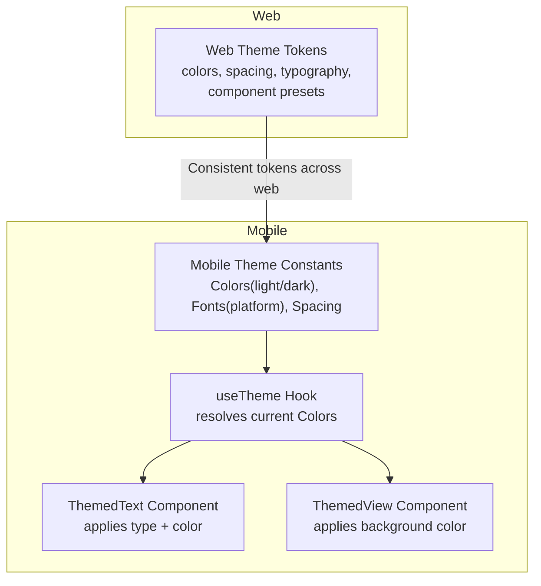
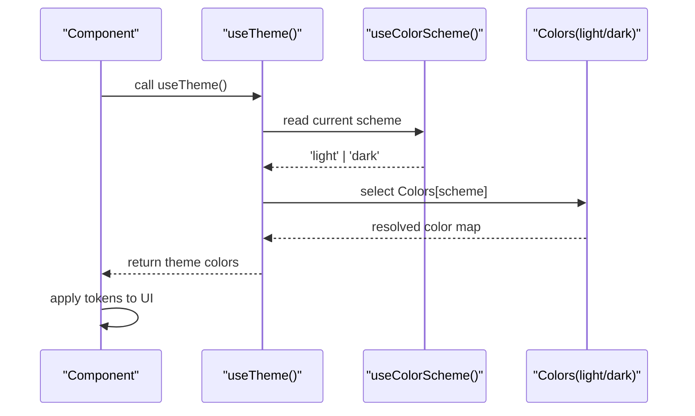
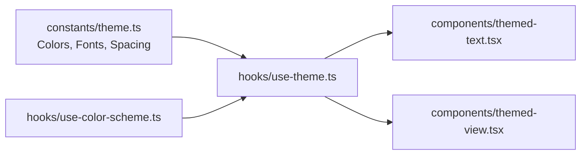

# Design System

<cite>
**Referenced Files in This Document**
- [theme.js](file://src/styles/theme.js)
- [theme.ts](file://axx-spaces-mobile/src/constants/theme.ts)
- [use-theme.ts](file://axx-spaces-mobile/src/hooks/use-theme.ts)
- [use-color-scheme.ts](file://axx-spaces-mobile/src/hooks/use-color-scheme.ts)
- [themed-text.tsx](file://axx-spaces-mobile/src/components/themed-text.tsx)
- [themed-view.tsx](file://axx-spaces-mobile/src/components/themed-view.tsx)
</cite>

## Table of Contents
1. [Introduction](#introduction)
2. [Project Structure](#project-structure)
3. [Core Components](#core-components)
4. [Architecture Overview](#architecture-overview)
5. [Detailed Component Analysis](#detailed-component-analysis)
6. [Dependency Analysis](#dependency-analysis)
7. [Performance Considerations](#performance-considerations)
8. [Troubleshooting Guide](#troubleshooting-guide)
9. [Conclusion](#conclusion)

## Introduction
This document explains the design system implementation across the web and mobile applications. It covers theme configuration, color palettes, typography scales, spacing units, and reusable design tokens. It also provides guidance on extending themes with custom colors, fonts, and spacing values, and demonstrates how to maintain visual consistency using tokens in components. Finally, it clarifies the relationship between web and mobile theme configurations.

## Project Structure
The design system is implemented in two places:
- Web application: centralized design tokens and component styles in a single theme file.
- Mobile application (Expo/React Native): platform-aware theme constants and hooks that provide light/dark mode support.

**Diagram sources**
- [theme.js:4-201](file://src/styles/theme.js#L4-L201)
- [theme.ts:10-66](file://axx-spaces-mobile/src/constants/theme.ts#L10-L66)
- [use-theme.ts:9-14](file://axx-spaces-mobile/src/hooks/use-theme.ts#L9-L14)
- [themed-text.tsx:11-30](file://axx-spaces-mobile/src/components/themed-text.tsx#L11-L30)
- [themed-view.tsx:12-16](file://axx-spaces-mobile/src/components/themed-view.tsx#L12-L16)

**Section sources**
- [theme.js:4-201](file://src/styles/theme.js#L4-L201)
- [theme.ts:10-66](file://axx-spaces-mobile/src/constants/theme.ts#L10-L66)

## Core Components
- Web theme tokens:
  - Color palette: primary/accent/background/text/border/status.
  - Spacing scale: xs through xxl.
  - Border radius scale: sm through full.
  - Typography: font sizes and weights.
  - Preset styles: buttons, inputs, cards, page layouts, hero, section headers.
- Mobile theme tokens:
  - Colors: light and dark modes with semantic keys (text, background, backgroundElement, backgroundSelected, textSecondary).
  - Fonts: platform-specific font families for sans/serif/rounded/mono.
  - Spacing: numeric scale in pixels.
  - Platform helpers: BottomTabInset and MaxContentWidth.

How they are used:
- Web components consume tokens directly from the theme file to build consistent UIs.
- Mobile components use the useTheme hook to resolve current Colors and apply them via ThemedText and ThemedView.

**Section sources**
- [theme.js:4-201](file://src/styles/theme.js#L4-L201)
- [theme.ts:10-66](file://axx-spaces-mobile/src/constants/theme.ts#L10-L66)
- [use-theme.ts:9-14](file://axx-spaces-mobile/src/hooks/use-theme.ts#L9-L14)

## Architecture Overview
The design system separates token definitions from their consumption:
- Token definitions live in dedicated files per platform.
- Hooks abstract theme resolution (light/dark) for mobile.
- Components encapsulate token usage to ensure consistency.

**Diagram sources**
- [use-theme.ts:9-14](file://axx-spaces-mobile/src/hooks/use-theme.ts#L9-L14)
- [use-color-scheme.ts:1-2](file://axx-spaces-mobile/src/hooks/use-color-scheme.ts#L1-L2)
- [theme.ts:10-25](file://axx-spaces-mobile/src/constants/theme.ts#L10-L25)

## Detailed Component Analysis

### Web Theme Tokens (src/styles/theme.js)
- Colors:
  - Primary/accent variants for brand emphasis.
  - Backgrounds for dark/light surfaces.
  - Text colors for contrast on both backgrounds.
  - Borders and status colors for feedback states.
- Spacing:
  - A compact scale from xs to xxl for consistent layout rhythm.
- Border Radius:
  - Consistent rounding for interactive elements and containers.
- Typography:
  - Font size scale from xs to 5xl.
  - Weight scale from normal to extrabold.
- Presets:
  - Buttons: primary, secondary, outline with gradients and shadows.
  - Inputs: base and dark variants with consistent padding and borders.
  - Cards: light and dark surface styles.
  - Page/Hero/SectionHeader: layout scaffolding with consistent spacing and colors.

Extending the web theme:
- Add new colors under COLORS with descriptive keys.
- Extend SPACING or BORDER_RADIUS for new layout tokens.
- Add new entries to FONT_SIZES or FONT_WEIGHTS for new typographic roles.
- Create new preset styles (e.g., button variants) by referencing existing tokens.

Usage examples (conceptual):
- Apply COLORS.primary to CTAs and accents.
- Use SPACING.md for component padding/margins.
- Use FONT_SIZES.lg and FONT_WEIGHTS.bold for headings.
- Reuse cardStyles.dark for elevated content blocks.

**Section sources**
- [theme.js:4-201](file://src/styles/theme.js#L4-L201)

### Mobile Theme Tokens (axx-spaces-mobile/src/constants/theme.ts)
- Colors:
  - Light and dark maps with semantic keys: text, background, backgroundElement, backgroundSelected, textSecondary.
- Fonts:
  - Platform-selective font families for sans/serif/rounded/mono.
  - Web uses CSS variables; native platforms use system fonts.
- Spacing:
  - Numeric pixel-based scale (half to six).
- Platform helpers:
  - BottomTabInset and MaxContentWidth for layout constraints.

Extending the mobile theme:
- Add new semantic color keys to both light and dark maps.
- Extend Fonts for additional family aliases if needed.
- Add new spacing steps to Spacing for finer granularity.

Usage examples (conceptual):
- Use Colors.light.text for default text in light mode.
- Reference Fonts.sans for body copy across platforms.
- Apply Spacing.three for vertical rhythm.

**Section sources**
- [theme.ts:10-66](file://axx-spaces-mobile/src/constants/theme.ts#L10-L66)

### Theme Hook (axx-spaces-mobile/src/hooks/use-theme.ts)
- Resolves the active color scheme and returns the corresponding Colors map.
- Falls back to light when scheme is unspecified.

Extending:
- Introduce additional schemes (e.g., high contrast) by expanding the selection logic.

**Section sources**
- [use-theme.ts:9-14](file://axx-spaces-mobile/src/hooks/use-theme.ts#L9-L14)

### Color Scheme Hook (axx-spaces-mobile/src/hooks/use-color-scheme.ts)
- Exposes React Native’s useColorScheme for detecting light/dark mode.

**Section sources**
- [use-color-scheme.ts:1-2](file://axx-spaces-mobile/src/hooks/use-color-scheme.ts#L1-L2)

### ThemedText Component (axx-spaces-mobile/src/components/themed-text.tsx)
- Applies a type-based style set (default/title/small/smallBold/subtitle/link/linkPrimary/code).
- Uses useTheme to resolve text color from the current theme.
- Integrates Fonts.mono for code styling.

Extending:
- Add new types and corresponding style rules.
- Introduce new theme color keys and reference them via themeColor prop.

**Section sources**
- [themed-text.tsx:11-30](file://axx-spaces-mobile/src/components/themed-text.tsx#L11-L30)
- [themed-text.tsx:33-73](file://axx-spaces-mobile/src/components/themed-text.tsx#L33-L73)

### ThemedView Component (axx-spaces-mobile/src/components/themed-view.tsx)
- Applies background color based on the current theme and optional type key.
- Supports explicit lightColor/darkColor overrides.

Extending:
- Add new semantic color keys to Colors and reference them via type.

**Section sources**
- [themed-view.tsx:12-16](file://axx-spaces-mobile/src/components/themed-view.tsx#L12-L16)

## Dependency Analysis
The following diagram shows how components depend on theme tokens and hooks.

**Diagram sources**
- [theme.ts:10-66](file://axx-spaces-mobile/src/constants/theme.ts#L10-L66)
- [use-theme.ts:9-14](file://axx-spaces-mobile/src/hooks/use-theme.ts#L9-L14)
- [use-color-scheme.ts:1-2](file://axx-spaces-mobile/src/hooks/use-color-scheme.ts#L1-L2)
- [themed-text.tsx:11-30](file://axx-spaces-mobile/src/components/themed-text.tsx#L11-L30)
- [themed-view.tsx:12-16](file://axx-spaces-mobile/src/components/themed-view.tsx#L12-L16)

**Section sources**
- [theme.ts:10-66](file://axx-spaces-mobile/src/constants/theme.ts#L10-L66)
- [use-theme.ts:9-14](file://axx-spaces-mobile/src/hooks/use-theme.ts#L9-L14)
- [use-color-scheme.ts:1-2](file://axx-spaces-mobile/src/hooks/use-color-scheme.ts#L1-L2)
- [themed-text.tsx:11-30](file://axx-spaces-mobile/src/components/themed-text.tsx#L11-L30)
- [themed-view.tsx:12-16](file://axx-spaces-mobile/src/components/themed-view.tsx#L12-L16)

## Performance Considerations
- Centralized tokens reduce redundant style calculations and improve maintainability.
- Using hooks to resolve theme avoids re-computing colors on every render where possible.
- Prefer semantic tokens over ad-hoc hex values to minimize style duplication.

[No sources needed since this section provides general guidance]

## Troubleshooting Guide
- Incorrect colors in dark mode:
  - Ensure all semantic color keys exist in both light and dark maps.
  - Verify useTheme returns the expected scheme and that components consume theme[type].
- Inconsistent typography:
  - Confirm Fonts mapping includes the intended family alias on each platform.
  - For web, verify CSS variables referenced by Fonts are defined.
- Spacing inconsistencies:
  - Use the Spacing scale instead of hard-coded pixel values.
- Button/input/card styles not updating:
  - Check that preset styles reference updated tokens rather than static values.

**Section sources**
- [theme.ts:10-25](file://axx-spaces-mobile/src/constants/theme.ts#L10-L25)
- [use-theme.ts:9-14](file://axx-spaces-mobile/src/hooks/use-theme.ts#L9-L14)
- [themed-text.tsx:33-73](file://axx-spaces-mobile/src/components/themed-text.tsx#L33-L73)
- [theme.js:78-157](file://src/styles/theme.js#L78-L157)

## Conclusion
The design system provides a unified approach to visual consistency across web and mobile. The web theme defines comprehensive tokens and component presets, while the mobile theme offers platform-aware colors, fonts, and spacing with a simple hook-driven API. By extending tokens centrally and consuming them through components, teams can maintain a cohesive look and feel across the entire application.

[No sources needed since this section summarizes without analyzing specific files]