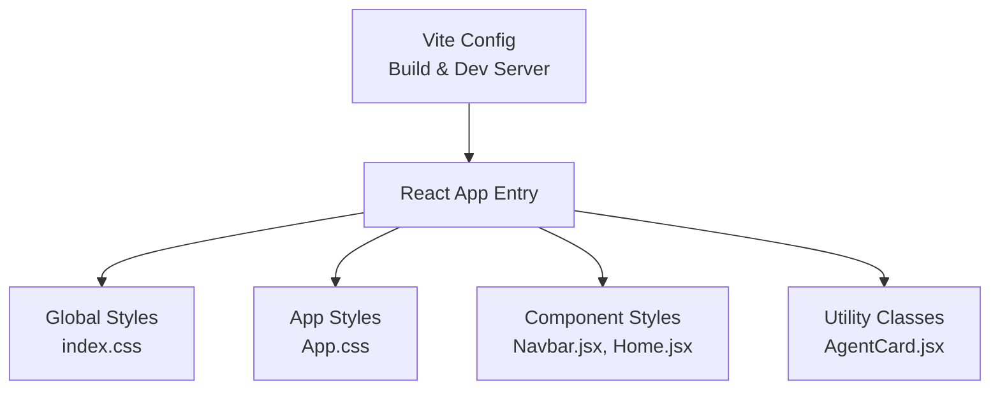
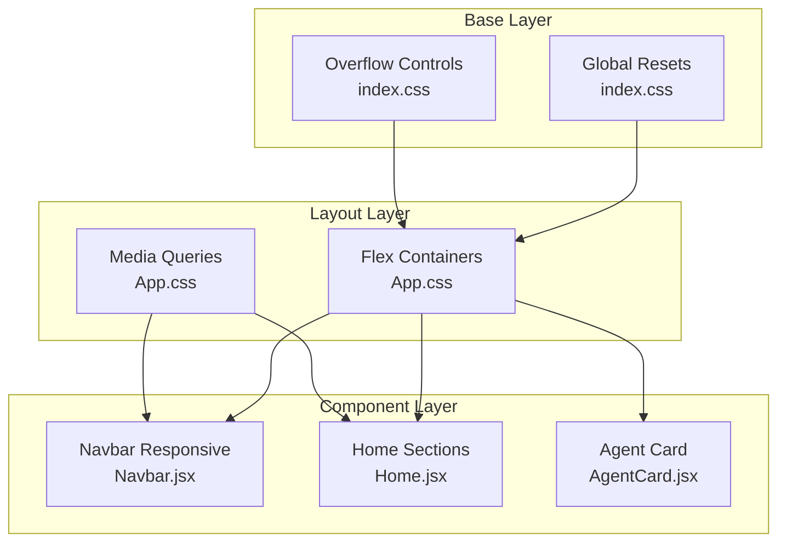
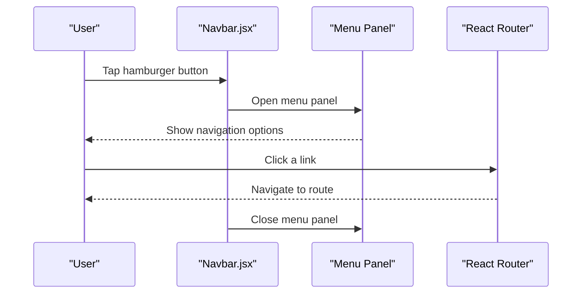
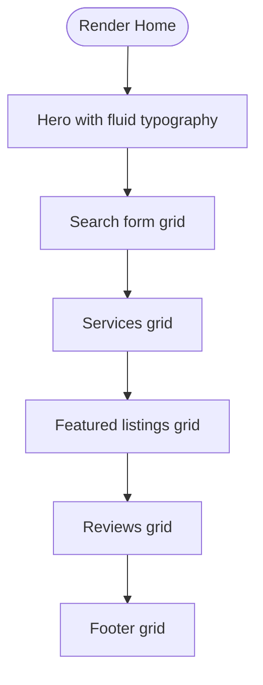
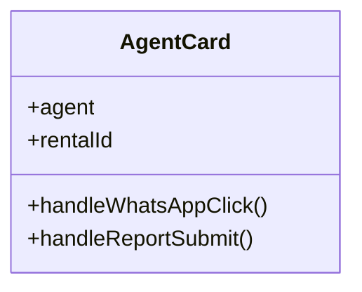
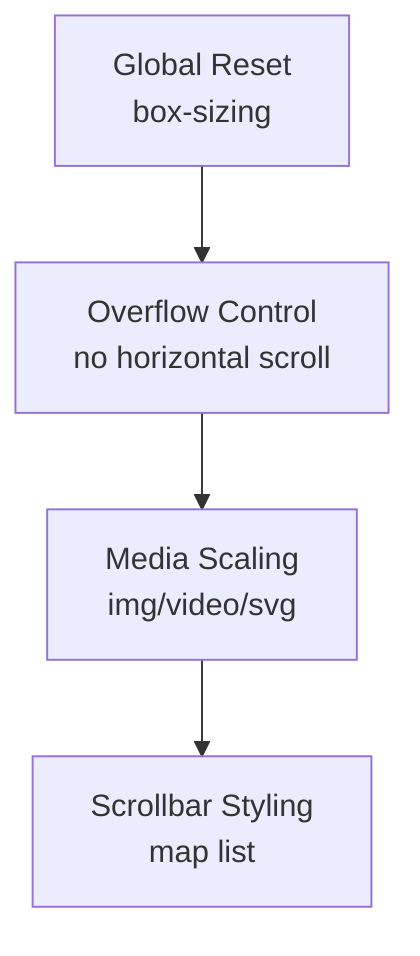
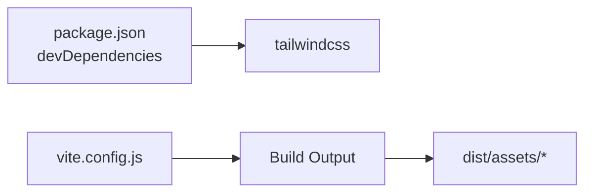

# Responsive Design

<cite>
**Referenced Files in This Document**
- [package.json](file://package.json)
- [vite.config.js](file://vite.config.js)
- [src/index.css](file://src/index.css)
- [src/App.css](file://src/App.css)
- [src/components/Navbar.jsx](file://src/components/Navbar.jsx)
- [src/pages/Home.jsx](file://src/pages/Home.jsx)
- [src/components/AgentCard.jsx](file://src/components/AgentCard.jsx)
</cite>

## Table of Contents
1. [Introduction](#introduction)
2. [Project Structure](#project-structure)
3. [Core Components](#core-components)
4. [Architecture Overview](#architecture-overview)
5. [Detailed Component Analysis](#detailed-component-analysis)
6. [Dependency Analysis](#dependency-analysis)
7. [Performance Considerations](#performance-considerations)
8. [Troubleshooting Guide](#troubleshooting-guide)
9. [Conclusion](#conclusion)

## Introduction
This document explains how responsive design is implemented across the frontend application. It focuses on:
- Mobile-first approach and fluid layouts
- Breakpoint strategy using CSS media queries
- Adaptive navigation, cards, and forms
- Fluid typography and flexible grid systems
- Practical patterns for responsive components

The project uses Vite with React and Tailwind CSS as a dependency. While Tailwind is present, most responsive behavior in this codebase is implemented via scoped CSS and media queries within component files.

## Project Structure
Responsive styles are primarily defined inside component-scoped CSS strings or global CSS files. The main entry points for responsive behavior include:
- Global base styles and overflow constraints
- Component-level CSS (e.g., Navbar, Home)
- Utility classes used by some components (e.g., AgentCard)

**Diagram sources**
- [vite.config.js:1-36](file://vite.config.js#L1-L36)
- [src/index.css:1-177](file://src/index.css#L1-L177)
- [src/App.css:1-185](file://src/App.css#L1-L185)
- [src/components/Navbar.jsx:701-800](file://src/components/Navbar.jsx#L701-L800)
- [src/pages/Home.jsx:13-342](file://src/pages/Home.jsx#L13-L342)
- [src/components/AgentCard.jsx:77-155](file://src/components/AgentCard.jsx#L77-L155)

**Section sources**
- [package.json:1-50](file://package.json#L1-L50)
- [vite.config.js:1-36](file://vite.config.js#L1-L36)
- [src/index.css:1-177](file://src/index.css#L1-L177)
- [src/App.css:1-185](file://src/App.css#L1-L185)

## Core Components
Key responsive patterns observed:
- Mobile-first base styles with progressive enhancement at larger breakpoints
- Fluid typography using clamp()
- Flexible grids using CSS Grid with auto-fill/minmax
- Media queries to adapt layout at specific widths
- Overflow and horizontal scroll prevention for mobile devices

Examples:
- Navigation adapts from a compact top bar to a full-screen menu panel on small screens
- Home page sections reflow into single-column layouts on smaller devices
- Cards and lists use responsive grids that collapse gracefully

**Section sources**
- [src/components/Navbar.jsx:701-800](file://src/components/Navbar.jsx#L701-L800)
- [src/pages/Home.jsx:13-342](file://src/pages/Home.jsx#L13-L342)
- [src/index.css:167-177](file://src/index.css#L167-L177)

## Architecture Overview
The responsive architecture follows a layered approach:
- Base layer: Global resets, typography defaults, and overflow controls
- Layout layer: Flexbox/Grid containers and spacing
- Component layer: Scoped styles per feature (navbar, home, cards)
- Utilities: Reusable utility classes where applicable

**Diagram sources**
- [src/index.css:1-177](file://src/index.css#L1-L177)
- [src/App.css:1-185](file://src/App.css#L1-L185)
- [src/components/Navbar.jsx:701-800](file://src/components/Navbar.jsx#L701-L800)
- [src/pages/Home.jsx:13-342](file://src/pages/Home.jsx#L13-L342)
- [src/components/AgentCard.jsx:77-155](file://src/components/AgentCard.jsx#L77-L155)

## Detailed Component Analysis

### Responsive Navigation (Navbar)
The navbar implements a mobile-first pattern:
- Compact top bar with brand, user actions, and primary tabs
- Hamburger-triggered full-screen menu panel on small screens
- Backdrop overlay to prevent background scrolling when menus are open
- Accessible attributes for screen readers and keyboard navigation

**Diagram sources**
- [src/components/Navbar.jsx:140-182](file://src/components/Navbar.jsx#L140-L182)
- [src/components/Navbar.jsx:570-698](file://src/components/Navbar.jsx#L570-L698)

Key responsive behaviors:
- Menu toggle state controls body scroll lock
- Panels render conditionally based on interaction state
- Focus-visible outlines improve accessibility

**Section sources**
- [src/components/Navbar.jsx:110-132](file://src/components/Navbar.jsx#L110-L132)
- [src/components/Navbar.jsx:140-182](file://src/components/Navbar.jsx#L140-L182)
- [src/components/Navbar.jsx:570-698](file://src/components/Navbar.jsx#L570-L698)
- [src/components/Navbar.jsx:701-800](file://src/components/Navbar.jsx#L701-L800)

### Home Page Sections and Cards
The Home page demonstrates:
- Fluid typography with clamp() for headings and subtitles
- Responsive search form that collapses to a single column on small screens
- Service cards and featured listings using CSS Grid with auto-fill/minmax
- Section padding and layout adjustments via media queries

**Diagram sources**
- [src/pages/Home.jsx:13-342](file://src/pages/Home.jsx#L13-L342)

Responsive highlights:
- clamp() ensures scalable text without multiple breakpoints
- Grid columns collapse to fewer columns at smaller widths
- Padding and gaps adjust for readability on mobile

**Section sources**
- [src/pages/Home.jsx:13-342](file://src/pages/Home.jsx#L13-L342)

### Agent Card (Utility Classes)
The Agent card uses utility classes (likely Tailwind) for layout and spacing:
- Flexbox for avatar and content alignment
- Responsive sizing and spacing through utility classes
- Modal overlay for reporting functionality

**Diagram sources**
- [src/components/AgentCard.jsx:77-155](file://src/components/AgentCard.jsx#L77-L155)
- [src/components/AgentCard.jsx:157-224](file://src/components/AgentCard.jsx#L157-L224)

Responsive highlights:
- Avatar and info align flexibly
- Buttons stack or wrap depending on available width
- Modal covers viewport on all devices

**Section sources**
- [src/components/AgentCard.jsx:77-155](file://src/components/AgentCard.jsx#L77-L155)
- [src/components/AgentCard.jsx:157-224](file://src/components/AgentCard.jsx#L157-L224)

### Global Base Styles and Overflow Control
Global styles enforce:
- Consistent box-sizing
- Horizontal overflow prevention
- Image and media scaling to container width
- Scrollbar styling for map-related elements

**Diagram sources**
- [src/index.css:167-177](file://src/index.css#L167-L177)
- [src/index.css:149-166](file://src/index.css#L149-L166)

**Section sources**
- [src/index.css:1-177](file://src/index.css#L1-L177)

## Dependency Analysis
Tailwind CSS is included as a dev dependency, but the majority of responsive behavior in this codebase is implemented via scoped CSS and media queries rather than Tailwind utilities. Vite config defines build output and development server settings.

**Diagram sources**
- [package.json:34-48](file://package.json#L34-L48)
- [vite.config.js:19-30](file://vite.config.js#L19-L30)

**Section sources**
- [package.json:1-50](file://package.json#L1-L50)
- [vite.config.js:1-36](file://vite.config.js#L1-L36)

## Performance Considerations
- Prefer CSS Grid and Flexbox for layout to reduce reflows
- Use clamp() for fluid typography to avoid heavy breakpoint logic
- Avoid unnecessary animations; respect prefers-reduced-motion
- Keep images and media constrained to container sizes to prevent layout shifts
- Minimize large inline style blocks; prefer modular CSS where possible

[No sources needed since this section provides general guidance]

## Troubleshooting Guide
Common issues and resolutions:
- Horizontal scroll on mobile: Ensure overflow-x is clipped and images/media scale to 100% width
- Menu not closing: Verify event listeners close dropdowns on outside clicks and route changes
- Typography too large/small: Adjust clamp() values and verify font-family inheritance
- Grid misalignment: Check minmax thresholds and gap values in responsive contexts

**Section sources**
- [src/index.css:167-177](file://src/index.css#L167-L177)
- [src/components/Navbar.jsx:110-132](file://src/components/Navbar.jsx#L110-L132)
- [src/pages/Home.jsx:13-342](file://src/pages/Home.jsx#L13-L342)

## Conclusion
The application’s responsive design relies on a mobile-first approach with scoped CSS and media queries. Key patterns include fluid typography, flexible grids, and adaptive navigation. While Tailwind is present, most responsive behavior is implemented directly in component styles, providing fine-grained control over layout and interactions across devices.

[No sources needed since this section summarizes without analyzing specific files]