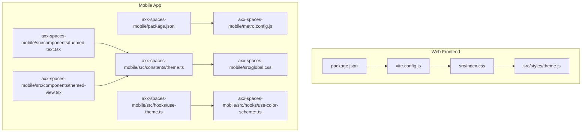
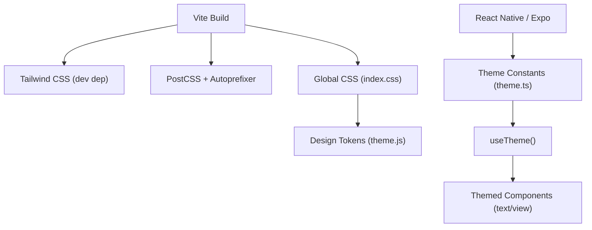
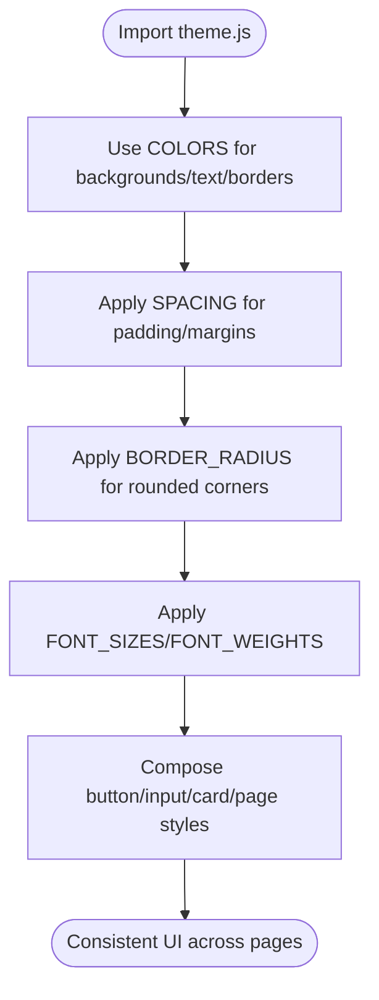
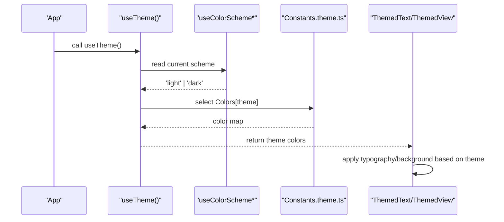
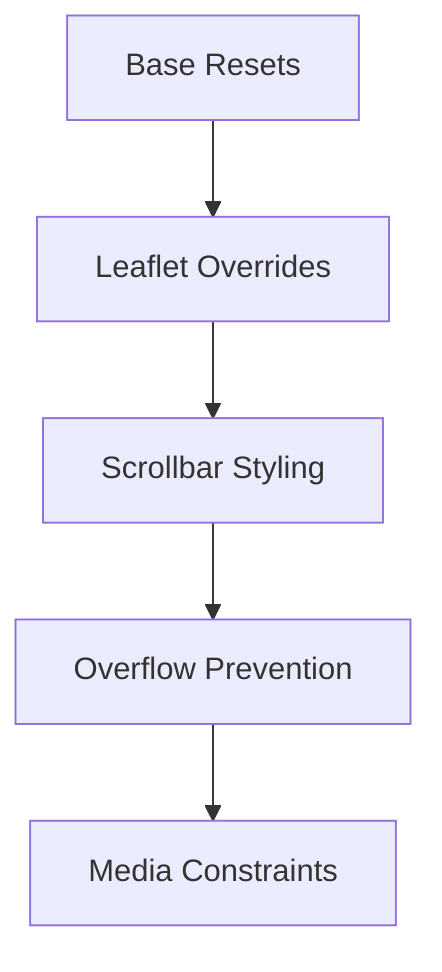
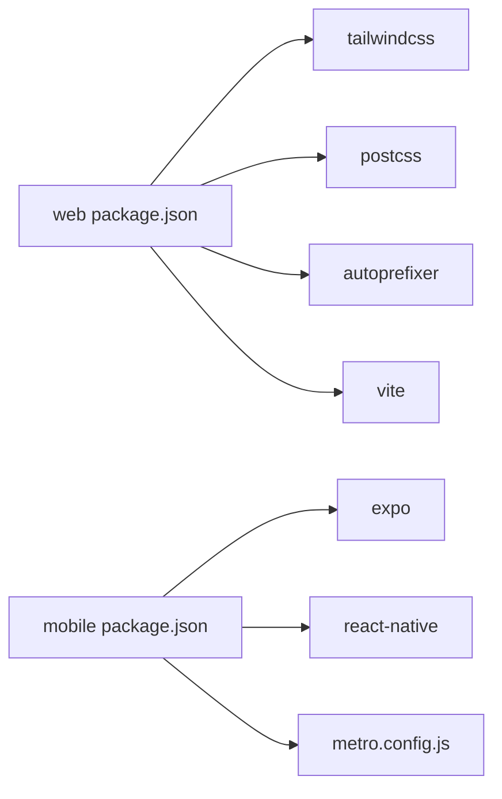

# Styling & Theming

<cite>
**Referenced Files in This Document**
- [package.json](file://package.json)
- [vite.config.js](file://vite.config.js)
- [src/index.css](file://src/index.css)
- [src/styles/theme.js](file://src/styles/theme.js)
- [axx-spaces-mobile/package.json](file://axx-spaces-mobile/package.json)
- [axx-spaces-mobile/metro.config.js](file://axx-spaces-mobile/metro.config.js)
- [axx-spaces-mobile/src/constants/theme.ts](file://axx-spaces-mobile/src/constants/theme.ts)
- [axx-spaces-mobile/src/global.css](file://axx-spaces-mobile/src/global.css)
- [axx-spaces-mobile/src/hooks/use-theme.ts](file://axx-spaces-mobile/src/hooks/use-theme.ts)
- [axx-spaces-mobile/src/hooks/use-color-scheme.ts](file://axx-spaces-mobile/src/hooks/use-color-scheme.ts)
- [axx-spaces-mobile/src/hooks/use-color-scheme.web.ts](file://axx-spaces-mobile/src/hooks/use-color-scheme.web.ts)
- [axx-spaces-mobile/src/components/themed-text.tsx](file://axx-spaces-mobile/src/components/themed-text.tsx)
- [axx-spaces-mobile/src/components/themed-view.tsx](file://axx-spaces-mobile/src/components/themed-view.tsx)
</cite>

## Table of Contents
1. [Introduction](#introduction)
2. [Project Structure](#project-structure)
3. [Core Components](#core-components)
4. [Architecture Overview](#architecture-overview)
5. [Detailed Component Analysis](#detailed-component-analysis)
6. [Dependency Analysis](#dependency-analysis)
7. [Performance Considerations](#performance-considerations)
8. [Troubleshooting Guide](#troubleshooting-guide)
9. [Conclusion](#conclusion)
10. [Appendices](#appendices)

## Introduction
This document explains the styling and theming system across the web frontend and mobile app. It covers Tailwind CSS configuration, theme customization, design tokens (colors, typography, spacing), responsive patterns, component styling approaches, and cross-platform considerations for web and mobile. It also provides guidance on customizing themes, adding new design tokens, and maintaining consistent styling across platforms.

## Project Structure
The project consists of:
- Web frontend built with Vite and React, using Tailwind CSS v4 and PostCSS/Autoprefixer. Global styles are defined in a single CSS file, and a unified design token file centralizes colors, spacing, typography, and reusable UI primitives.
- Mobile app built with Expo/React Native, using platform-aware theme constants, global CSS variables for fonts, and themed components that consume the active color scheme.

**Diagram sources**
- [package.json:1-50](file://package.json#L1-L50)
- [vite.config.js:1-36](file://vite.config.js#L1-L36)
- [src/index.css:1-177](file://src/index.css#L1-L177)
- [src/styles/theme.js:1-202](file://src/styles/theme.js#L1-L202)
- [axx-spaces-mobile/package.json:1-41](file://axx-spaces-mobile/package.json#L1-L41)
- [axx-spaces-mobile/metro.config.js:1-6](file://axx-spaces-mobile/metro.config.js#L1-L6)
- [axx-spaces-mobile/src/constants/theme.ts:1-66](file://axx-spaces-mobile/src/constants/theme.ts#L1-L66)
- [axx-spaces-mobile/src/global.css:1-10](file://axx-spaces-mobile/src/global.css#L1-L10)
- [axx-spaces-mobile/src/hooks/use-theme.ts:1-15](file://axx-spaces-mobile/src/hooks/use-theme.ts#L1-L15)
- [axx-spaces-mobile/src/hooks/use-color-scheme.ts:1-2](file://axx-spaces-mobile/src/hooks/use-color-scheme.ts#L1-L2)
- [axx-spaces-mobile/src/hooks/use-color-scheme.web.ts:1-22](file://axx-spaces-mobile/src/hooks/use-color-scheme.web.ts#L1-L22)
- [axx-spaces-mobile/src/components/themed-text.tsx:1-74](file://axx-spaces-mobile/src/components/themed-text.tsx#L1-L74)
- [axx-spaces-mobile/src/components/themed-view.tsx:1-17](file://axx-spaces-mobile/src/components/themed-view.tsx#L1-L17)

**Section sources**
- [package.json:1-50](file://package.json#L1-L50)
- [axx-spaces-mobile/package.json:1-41](file://axx-spaces-mobile/package.json#L1-L41)

## Core Components
- Web design tokens: Centralized color palette, spacing scale, border radius, font sizes, font weights, and reusable style objects for buttons, inputs, cards, pages, hero sections, and section headers.
- Mobile theme constants: Light/dark color sets, platform-specific fonts, spacing scale, and safe area insets.
- Themed components: Reusable text and view components that apply theme-aware colors and typography.

Key responsibilities:
- src/styles/theme.js: Defines the unified design tokens and common UI style objects for the web app.
- axx-spaces-mobile/src/constants/theme.ts: Defines mobile theme colors, fonts, spacing, and platform-specific values.
- axx-spaces-mobile/src/components/themed-text.tsx and themed-view.tsx: Provide theme-aware UI primitives for mobile.

**Section sources**
- [src/styles/theme.js:1-202](file://src/styles/theme.js#L1-L202)
- [axx-spaces-mobile/src/constants/theme.ts:1-66](file://axx-spaces-mobile/src/constants/theme.ts#L1-L66)
- [axx-spaces-mobile/src/components/themed-text.tsx:1-74](file://axx-spaces-mobile/src/components/themed-text.tsx#L1-L74)
- [axx-spaces-mobile/src/components/themed-view.tsx:1-17](file://axx-spaces-mobile/src/components/themed-view.tsx#L1-L17)

## Architecture Overview
The styling architecture separates concerns into:
- Build toolchain: Vite configures the web build; Tailwind CSS is included as a dev dependency and PostCSS/Autoprefixer are present.
- Design tokens: A single source of truth for colors, spacing, and typography per platform.
- Theme hooks: Mobile uses a hook to resolve the active color scheme and provide theme values to components.
- Global styles: CSS files define base resets, third-party overrides (Leaflet), and CSS variables for fonts.

**Diagram sources**
- [vite.config.js:1-36](file://vite.config.js#L1-L36)
- [package.json:34-48](file://package.json#L34-L48)
- [src/index.css:1-177](file://src/index.css#L1-L177)
- [src/styles/theme.js:1-202](file://src/styles/theme.js#L1-L202)
- [axx-spaces-mobile/src/constants/theme.ts:1-66](file://axx-spaces-mobile/src/constants/theme.ts#L1-L66)
- [axx-spaces-mobile/src/hooks/use-theme.ts:1-15](file://axx-spaces-mobile/src/hooks/use-theme.ts#L1-L15)
- [axx-spaces-mobile/src/components/themed-text.tsx:1-74](file://axx-spaces-mobile/src/components/themed-text.tsx#L1-L74)
- [axx-spaces-mobile/src/components/themed-view.tsx:1-17](file://axx-spaces-mobile/src/components/themed-view.tsx#L1-L17)

## Detailed Component Analysis

### Web Design Tokens (src/styles/theme.js)
- Colors: Primary, accent, background, text, border, and status colors.
- Spacing: xs through xxl.
- Border Radius: sm through full.
- Typography: Font sizes and weights.
- Reusable UI Styles: Button variants, input variants, card variants, page backgrounds, hero and section header layouts.

Usage pattern:
- Import tokens where needed and compose component styles from these primitives to ensure consistency.

**Diagram sources**
- [src/styles/theme.js:4-75](file://src/styles/theme.js#L4-L75)
- [src/styles/theme.js:77-202](file://src/styles/theme.js#L77-L202)

**Section sources**
- [src/styles/theme.js:1-202](file://src/styles/theme.js#L1-L202)

### Mobile Theme System (constants/theme.ts, use-theme.ts, themed components)
- Theme constants:
  - Colors.light and Colors.dark define semantic color keys.
  - Fonts are platform-aware via Platform.select.
  - Spacing is a numeric scale.
  - BottomTabInset and MaxContentWidth provide layout constraints.
- Hook:
  - useTheme resolves the active color scheme and returns the corresponding color set.
- Components:
  - ThemedText applies type-based typography and theme-aware text color.
  - ThemedView applies theme-aware background color.

**Diagram sources**
- [axx-spaces-mobile/src/hooks/use-theme.ts:1-15](file://axx-spaces-mobile/src/hooks/use-theme.ts#L1-L15)
- [axx-spaces-mobile/src/hooks/use-color-scheme.ts:1-2](file://axx-spaces-mobile/src/hooks/use-color-scheme.ts#L1-L2)
- [axx-spaces-mobile/src/hooks/use-color-scheme.web.ts:1-22](file://axx-spaces-mobile/src/hooks/use-color-scheme.web.ts#L1-L22)
- [axx-spaces-mobile/src/constants/theme.ts:1-66](file://axx-spaces-mobile/src/constants/theme.ts#L1-L66)
- [axx-spaces-mobile/src/components/themed-text.tsx:1-74](file://axx-spaces-mobile/src/components/themed-text.tsx#L1-L74)
- [axx-spaces-mobile/src/components/themed-view.tsx:1-17](file://axx-spaces-mobile/src/components/themed-view.tsx#L1-L17)

**Section sources**
- [axx-spaces-mobile/src/constants/theme.ts:1-66](file://axx-spaces-mobile/src/constants/theme.ts#L1-L66)
- [axx-spaces-mobile/src/hooks/use-theme.ts:1-15](file://axx-spaces-mobile/src/hooks/use-theme.ts#L1-L15)
- [axx-spaces-mobile/src/hooks/use-color-scheme.ts:1-2](file://axx-spaces-mobile/src/hooks/use-color-scheme.ts#L1-L2)
- [axx-spaces-mobile/src/hooks/use-color-scheme.web.ts:1-22](file://axx-spaces-mobile/src/hooks/use-color-scheme.web.ts#L1-L22)
- [axx-spaces-mobile/src/components/themed-text.tsx:1-74](file://axx-spaces-mobile/src/components/themed-text.tsx#L1-L74)
- [axx-spaces-mobile/src/components/themed-view.tsx:1-17](file://axx-spaces-mobile/src/components/themed-view.tsx#L1-L17)

### Global Styles and Third-Party Overrides (src/index.css)
- Base resets and defaults for body, html, root container.
- Leaflet map overrides to match the dark theme (popups, controls, attribution).
- Scrollbar styling and overflow prevention for horizontal scroll.
- Responsive image/media constraints.

**Diagram sources**
- [src/index.css:1-177](file://src/index.css#L1-L177)

**Section sources**
- [src/index.css:1-177](file://src/index.css#L1-L177)

### Mobile Global CSS Variables (axx-spaces-mobile/src/global.css)
- Defines CSS custom properties for font families used by the app.
- Provides fallback stacks for display, mono, rounded, and serif fonts.

**Section sources**
- [axx-spaces-mobile/src/global.css:1-10](file://axx-spaces-mobile/src/global.css#L1-L10)

## Dependency Analysis
- Web dependencies relevant to styling:
  - Tailwind CSS (dev dependency)
  - PostCSS and Autoprefixer (dev dependencies)
  - Vite build configuration
- Mobile dependencies:
  - Expo/React Native runtime
  - Metro bundler configuration

**Diagram sources**
- [package.json:34-48](file://package.json#L34-L48)
- [axx-spaces-mobile/package.json:14-34](file://axx-spaces-mobile/package.json#L14-L34)
- [axx-spaces-mobile/metro.config.js:1-6](file://axx-spaces-mobile/metro.config.js#L1-L6)

**Section sources**
- [package.json:34-48](file://package.json#L34-L48)
- [axx-spaces-mobile/package.json:14-34](file://axx-spaces-mobile/package.json#L14-L34)
- [axx-spaces-mobile/metro.config.js:1-6](file://axx-spaces-mobile/metro.config.js#L1-L6)

## Performance Considerations
- Keep design tokens centralized to avoid redundant definitions and reduce bundle size.
- Prefer compositional styles over inline ad-hoc styles to leverage reuse and minimize CSS bloat.
- For maps, ensure Leaflet overrides are scoped and minimal to avoid unnecessary repaints.
- On mobile, prefer theme-aware components to prevent conditional logic in many places.

## Troubleshooting Guide
- Leaflet theme mismatch:
  - Ensure global CSS imports Leaflet’s default stylesheet before applying overrides.
  - Verify override selectors target the correct classes and use !important sparingly.
- Horizontal overflow:
  - Confirm overflow-x clipping rules are applied at the root level.
- Mobile theme not updating:
  - Validate useColorScheme implementation for web hydration behavior.
  - Ensure useTheme returns the correct color map for the active scheme.

**Section sources**
- [src/index.css:34-166](file://src/index.css#L34-L166)
- [axx-spaces-mobile/src/hooks/use-color-scheme.web.ts:1-22](file://axx-spaces-mobile/src/hooks/use-color-scheme.web.ts#L1-L22)

## Conclusion
The styling and theming system is structured around centralized design tokens and platform-aware components. The web app leverages Tailwind CSS within a Vite build and a robust global CSS layer, while the mobile app uses a theme constant model with themed components and hooks. Maintaining consistency across platforms requires adhering to the shared token philosophy and extending it thoughtfully when adding new design tokens or customizing themes.

## Appendices

### Tailwind CSS Configuration Notes
- Tailwind CSS is included as a development dependency.
- PostCSS and Autoprefixer are present to support modern CSS features and browser compatibility.
- No explicit Tailwind config file was found; configuration can be added if needed.

**Section sources**
- [package.json:34-48](file://package.json#L34-L48)

### Customizing Themes and Adding New Tokens
- Web:
  - Extend src/styles/theme.js with new color entries, spacing units, or typography scales.
  - Compose new UI primitives from existing tokens to maintain consistency.
- Mobile:
  - Add new semantic color keys under Colors.light and Colors.dark in constants/theme.ts.
  - Update themed components to consume the new tokens where appropriate.
- Cross-platform:
  - Align naming conventions between web tokens and mobile theme constants to facilitate shared documentation and mental models.

**Section sources**
- [src/styles/theme.js:4-75](file://src/styles/theme.js#L4-L75)
- [axx-spaces-mobile/src/constants/theme.ts:10-25](file://axx-spaces-mobile/src/constants/theme.ts#L10-L25)

### Responsive Design Patterns
- Web:
  - Use media queries or utility classes (when Tailwind is configured) to adapt layouts.
  - Enforce max-width and overflow constraints to prevent horizontal scrolling.
- Mobile:
  - Use platform-safe areas and spacing scales to accommodate different screen sizes and device chrome.

**Section sources**
- [src/index.css:167-177](file://src/index.css#L167-L177)
- [axx-spaces-mobile/src/constants/theme.ts:54-66](file://axx-spaces-mobile/src/constants/theme.ts#L54-L66)