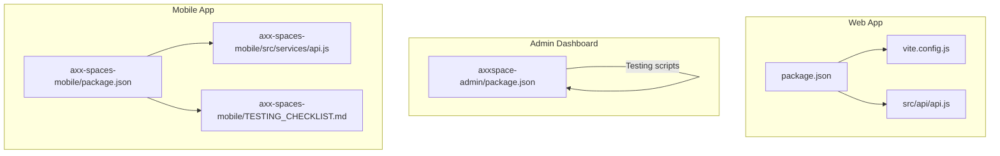
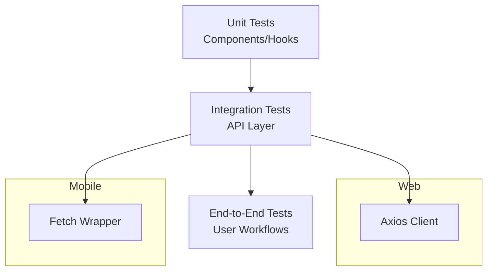
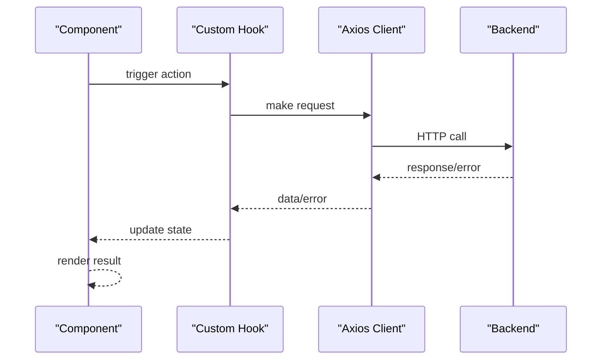
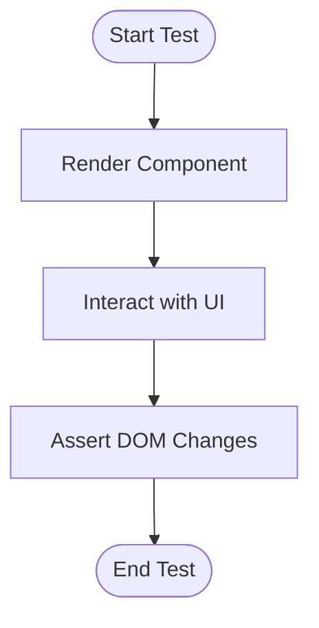
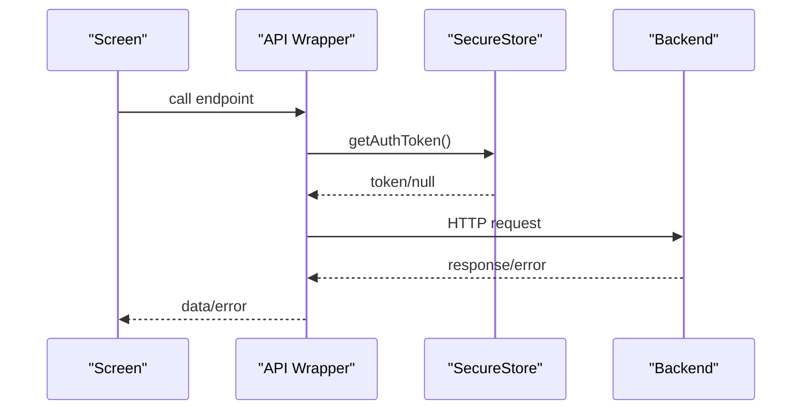
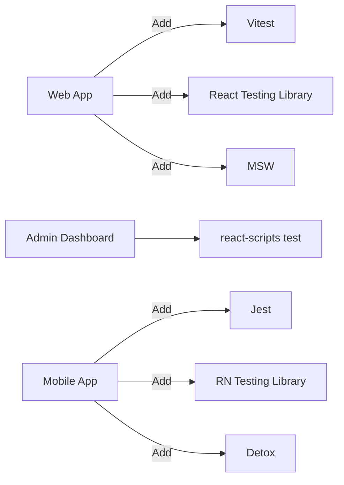

# Testing Strategy

<cite>
**Referenced Files in This Document**
- [package.json](file://package.json)
- [vite.config.js](file://vite.config.js)
- [api.js](file://src/api/api.js)
- [package.json](file://axx-spaces-mobile/package.json)
- [TESTING_CHECKLIST.md](file://axx-spaces-mobile/TESTING_CHECKLIST.md)
- [api.js](file://axx-spaces-mobile/src/services/api.js)
- [package.json](file://axxspace-admin/package.json)
</cite>

## Table of Contents
1. [Introduction](#introduction)
2. [Project Structure](#project-structure)
3. [Core Components](#core-components)
4. [Architecture Overview](#architecture-overview)
5. [Detailed Component Analysis](#detailed-component-analysis)
6. [Dependency Analysis](#dependency-analysis)
7. [Performance Considerations](#performance-considerations)
8. [Troubleshooting Guide](#troubleshooting-guide)
9. [Conclusion](#conclusion)

## Introduction
This document defines a comprehensive testing strategy for the frontend monorepo, covering unit testing for React components and hooks, integration testing for API calls, and end-to-end testing for user workflows across web, admin, and mobile apps. It also documents testing utilities, mock strategies, coverage requirements, mobile-specific considerations, performance testing, and accessibility testing.

## Project Structure
The repository contains three primary frontends:
- Main Web App (Vite + React)
- Admin Dashboard (React Scripts)
- Mobile App (Expo + React Native)

**Diagram sources**
- [package.json:1-50](file://package.json#L1-L50)
- [vite.config.js:1-36](file://vite.config.js#L1-L36)
- [api.js:1-47](file://src/api/api.js#L1-L47)
- [package.json:1-44](file://axxspace-admin/package.json#L1-L44)
- [package.json:1-41](file://axx-spaces-mobile/package.json#L1-L41)
- [TESTING_CHECKLIST.md:1-206](file://axx-spaces-mobile/TESTING_CHECKLIST.md#L1-L206)
- [api.js:1-194](file://axx-spaces-mobile/src/services/api.js#L1-L194)

**Section sources**
- [package.json:1-50](file://package.json#L1-L50)
- [vite.config.js:1-36](file://vite.config.js#L1-L36)
- [package.json:1-44](file://axxspace-admin/package.json#L1-L44)
- [package.json:1-41](file://axx-spaces-mobile/package.json#L1-L41)
- [TESTING_CHECKLIST.md:1-206](file://axx-spaces-mobile/TESTING_CHECKLIST.md#L1-L206)

## Core Components
- Web API client: Centralized Axios instance with interceptors for auth and logging.
- Mobile API client: Fetch-based wrapper with secure token handling and domain-scoped modules.
- Admin dashboard: Uses Create React App tooling with built-in test runner.

Key responsibilities:
- Web API client: request/response interception, timeout, base URL configuration.
- Mobile API client: token retrieval from secure storage, error propagation, feature-scoped endpoints.
- Admin dashboard: standard React testing setup via react-scripts.

**Section sources**
- [api.js:1-47](file://src/api/api.js#L1-L47)
- [api.js:1-194](file://axx-spaces-mobile/src/services/api.js#L1-L194)
- [package.json:1-44](file://axxspace-admin/package.json#L1-L44)

## Architecture Overview
The testing architecture spans three layers:
- Unit tests: Validate components, hooks, and pure logic in isolation.
- Integration tests: Verify API layer behavior and data flows using mocks.
- End-to-end tests: Simulate real user workflows across navigation, authentication, and core features.

[No sources needed since this diagram shows conceptual workflow, not actual code structure]

## Detailed Component Analysis

### Web App Testing Strategy
- Frameworks and tools:
  - Vite as build tool; no built-in test runner in current scripts.
  - Recommended stack: Vitest + React Testing Library + MSW for network mocking.
- Unit testing:
  - Test components with React Testing Library; assert rendered output and interactions.
  - Test hooks by rendering custom hook wrappers and asserting state/effects.
- Integration testing:
  - Mock the centralized Axios client to verify request headers, timeouts, and error paths.
  - Use MSW or Jest/Vitest spies to stub axios.create and interceptors.
- End-to-end testing:
  - Use Playwright or Cypress to validate routes, auth flows, and critical business flows.

Mock strategies:
- Replace axios.create with a mocked instance that returns controlled responses.
- Stub localStorage for tokens when testing authorization headers.
- Isolate side effects with timers and fake async operations where necessary.

Coverage requirements:
- Aim for high branch and line coverage on API client and critical UI components.
- Enforce minimum thresholds in CI.

Accessibility testing:
- Integrate axe-core with React Testing Library to assert accessible markup.
- Validate color contrast and keyboard navigation for key screens.

Performance testing:
- Use Lighthouse CI for web vitals and bundle analysis.
- Profile component renders with React DevTools and measure re-renders.

**Diagram sources**
- [api.js:1-47](file://src/api/api.js#L1-L47)

**Section sources**
- [package.json:1-50](file://package.json#L1-L50)
- [vite.config.js:1-36](file://vite.config.js#L1-L36)
- [api.js:1-47](file://src/api/api.js#L1-L47)

### Admin Dashboard Testing Strategy
- Tooling:
  - react-scripts provides a built-in test runner and Jest environment.
  - @testing-library/react and related packages are available.
- Unit testing:
  - Use React Testing Library to render components and assert DOM changes.
  - Test user interactions with user-event.
- Integration testing:
  - Mock fetch/axios at the module level to simulate API responses.
  - Validate error states and loading indicators.
- End-to-end testing:
  - Use Playwright or Cypress to validate admin workflows like approvals and dashboards.

Coverage requirements:
- Set coverage thresholds in jest config or via react-scripts reporting.

Accessibility testing:
- Add axe-core checks within tests to ensure compliance.

**Section sources**
- [package.json:1-44](file://axxspace-admin/package.json#L1-L44)

### Mobile App Testing Strategy
- Tooling:
  - Expo SDK; no default test runner in package scripts.
  - Recommended stack: Jest + React Native Testing Library + Detox for E2E.
- Unit testing:
  - Test components and hooks with React Native Testing Library.
  - Mock native modules (camera, location, notifications) via Jest mocks.
- Integration testing:
  - Mock the fetch-based API wrapper to validate endpoint usage and error handling.
  - Validate secure token retrieval flow without touching SecureStore.
- End-to-end testing:
  - Use Detox to automate device/emulator interactions for critical user journeys.

Mobile-specific considerations:
- Follow the APK testing checklist for functional, performance, security, and compatibility validation.
- Ensure permissions are handled correctly and gracefully when denied.
- Validate offline caching and sync behaviors.

Accessibility testing:
- Use RN Accessibility Inspector and automated checks where possible.
- Ensure touch targets meet size guidelines and labels are present.

**Diagram sources**
- [api.js:1-194](file://axx-spaces-mobile/src/services/api.js#L1-L194)

**Section sources**
- [package.json:1-41](file://axx-spaces-mobile/package.json#L1-L41)
- [TESTING_CHECKLIST.md:1-206](file://axx-spaces-mobile/TESTING_CHECKLIST.md#L1-L206)
- [api.js:1-194](file://axx-spaces-mobile/src/services/api.js#L1-L194)

## Dependency Analysis
Testing dependencies and tooling vary per app:
- Web app: currently lacks explicit test dependencies in root package.json; add Vitest, RTL, MSW, and E2E tooling.
- Admin dashboard: includes @testing-library/* and uses react-scripts test.
- Mobile app: no test dependencies listed; add Jest, RTL for RN, and Detox.

**Diagram sources**
- [package.json:1-50](file://package.json#L1-L50)
- [package.json:1-44](file://axxspace-admin/package.json#L1-L44)
- [package.json:1-41](file://axx-spaces-mobile/package.json#L1-L41)

**Section sources**
- [package.json:1-50](file://package.json#L1-L50)
- [package.json:1-44](file://axxspace-admin/package.json#L1-L44)
- [package.json:1-41](file://axx-spaces-mobile/package.json#L1-L41)

## Performance Considerations
- Web:
  - Measure Core Web Vitals with Lighthouse CI.
  - Analyze bundle sizes and lazy-load heavy components.
  - Debounce/throttle expensive operations in hooks.
- Mobile:
  - Monitor cold start time and memory usage on devices.
  - Optimize image loading and caching strategies.
  - Validate network performance under varying conditions.

[No sources needed since this section provides general guidance]

## Troubleshooting Guide
Common issues and resolutions:
- Web API client errors:
  - Inspect interceptor logs for request/response details and status codes.
  - Validate token presence and expiration handling.
- Mobile API failures:
  - Confirm SecureStore token availability and fallback behavior.
  - Handle network errors and server error responses consistently.
- Test flakiness:
  - Stabilize timers and async flows with fake timers and controlled promises.
  - Avoid relying on external services; use mocks and fixtures.

**Section sources**
- [api.js:1-47](file://src/api/api.js#L1-L47)
- [api.js:1-194](file://axx-spaces-mobile/src/services/api.js#L1-L194)

## Conclusion
Adopt a layered testing approach across all frontends:
- Establish robust unit tests for components and hooks.
- Implement integration tests around API clients with strong mocks.
- Automate end-to-end tests for critical user journeys.
- Enforce coverage thresholds, accessibility checks, and performance budgets in CI.
- Tailor mobile testing to device ecosystems and follow the provided checklist for release readiness.

[No sources needed since this section summarizes without analyzing specific files]