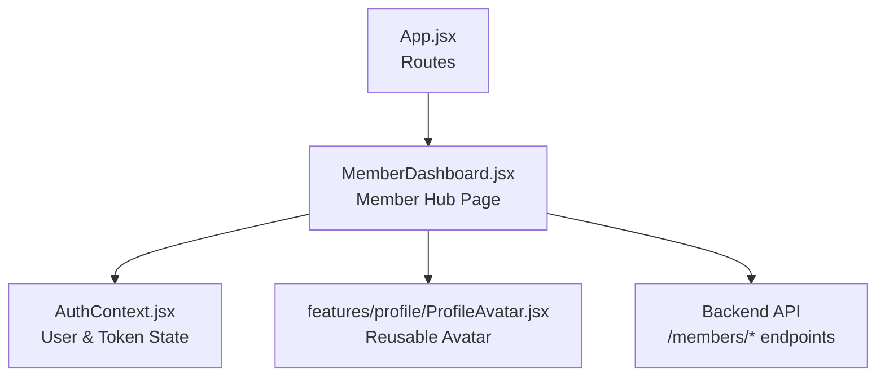
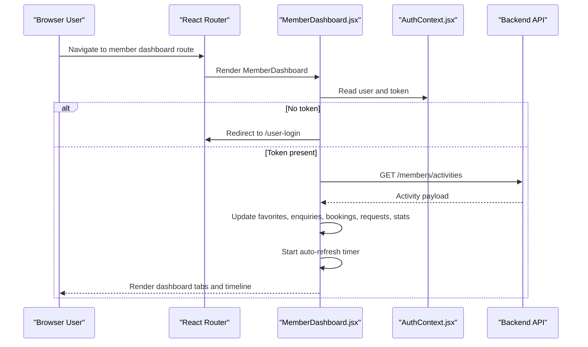
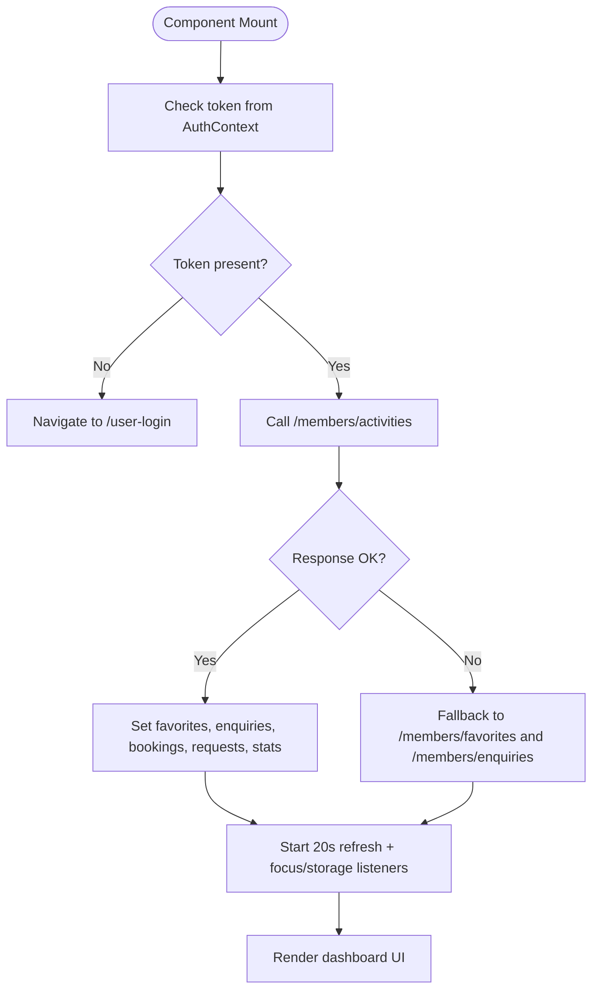
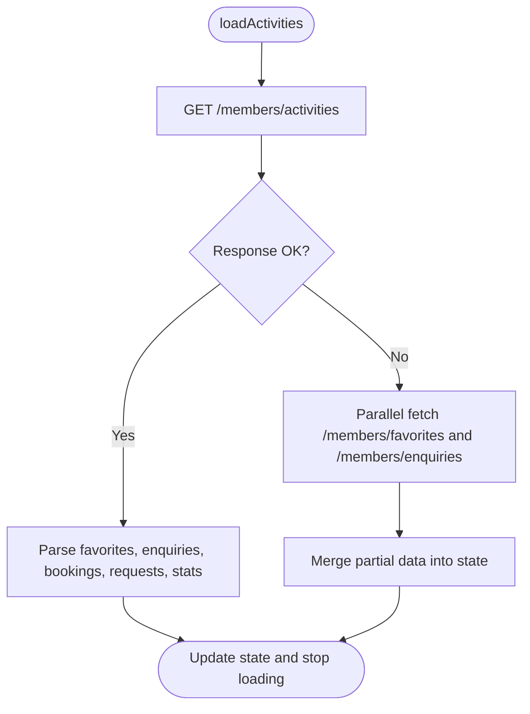
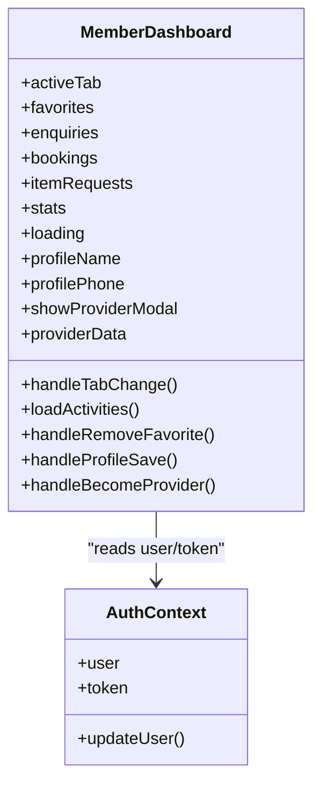
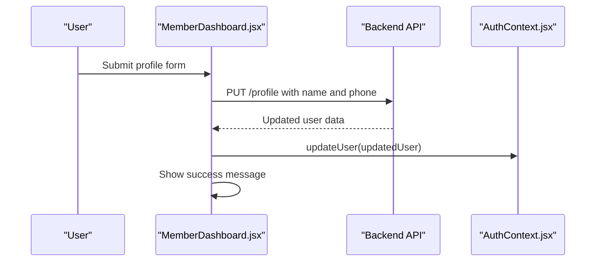
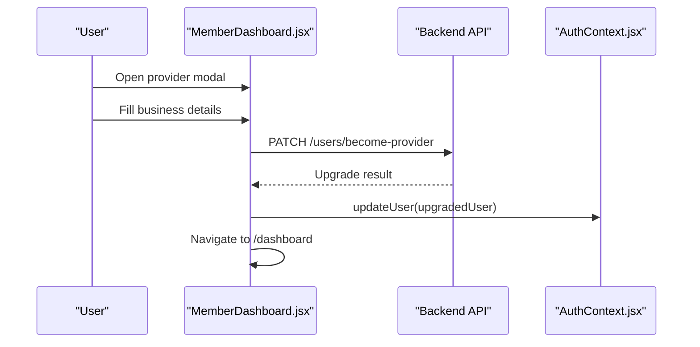
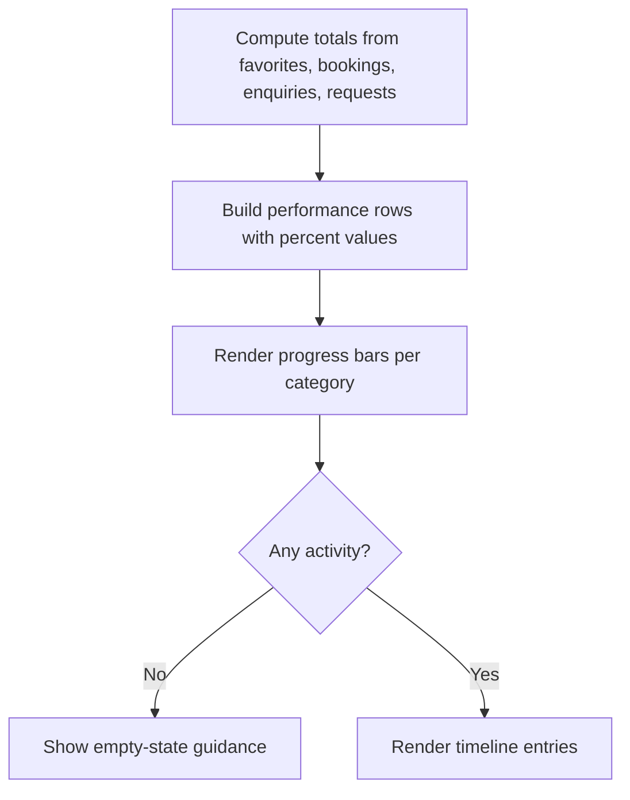
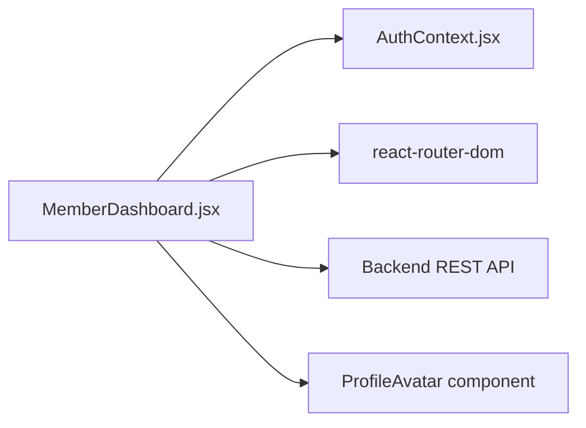

# Member Dashboard

<cite>
**Referenced Files in This Document**
- [MemberDashboard.jsx](file://src/pages/MemberDashboard.jsx)
- [AuthContext.jsx](file://src/context/AuthContext.jsx)
- [App.jsx](file://src/App.jsx)
- [ProfilePage.jsx](file://src/pages/ProfilePage.jsx)
- [Listings.jsx](file://src/pages/Listings.jsx)
</cite>

## Table of Contents
1. [Introduction](#introduction)
2. [Project Structure](#project-structure)
3. [Core Components](#core-components)
4. [Architecture Overview](#architecture-overview)
5. [Detailed Component Analysis](#detailed-component-analysis)
6. [Dependency Analysis](#dependency-analysis)
7. [Performance Considerations](#performance-considerations)
8. [Troubleshooting Guide](#troubleshooting-guide)
9. [Conclusion](#conclusion)

## Introduction
The Member Dashboard is the central hub for regular Axxspace members. It aggregates a member’s saved spaces, enquiries, bookings, and service requests into one interactive interface. It also provides account details, activity performance metrics, an activity timeline, quick links to notifications and wallet features, and a provider upgrade flow that converts a member into a space or service provider.

At a high level:
- The dashboard loads identity-scoped member data from backend endpoints.
- It renders multiple tabs: overview, saved spaces, bookings, enquiries, service requests, and profile.
- It supports real-time refresh behavior and automatic navigation when authentication state changes.
- It integrates with the global authentication context and uses React Router for navigation.

## Project Structure
The Member Dashboard lives under the pages directory as a single-page React component. It imports:
- Global authentication context for user and token access.
- A reusable profile avatar component.
- React Router hooks for navigation and URL-based tab synchronization.
- Inline SVG icons and a large inline styles object for layout and theming.

**Diagram sources**
- [App.jsx:300-330](file://src/App.jsx#L300-L330)
- [MemberDashboard.jsx:1-10](file://src/pages/MemberDashboard.jsx#L1-L10)
- [AuthContext.jsx:1-20](file://src/context/AuthContext.jsx#L1-L20)

**Section sources**
- [MemberDashboard.jsx:1-10](file://src/pages/MemberDashboard.jsx#L1-L10)
- [App.jsx:300-330](file://src/App.jsx#L300-L330)

## Core Components
The Member Dashboard is implemented as a single React functional component with several internal responsibilities:

- Authentication and routing integration
  - Reads `user`, `token`, and `updateUser` from `AuthContext`.
  - Uses `useNavigate` and `useSearchParams` for navigation and URL-synced tabs.
  - Redirects unauthenticated users to the login page.

- Data loading and refresh strategy
  - Loads activities from `/members/activities`.
  - Falls back to separate `/members/favorites` and `/members/enquiries` endpoints if needed.
  - Auto-refreshes every 20 seconds and on window focus/storage events.

- Tabbed content rendering
  - Overview: account details, performance bars, activity timeline, and account shortcuts.
  - Saved Spaces: grid of bookmarked properties or businesses.
  - Bookings: accommodation stays and service bookings.
  - Enquiries: active property questions and waitlist items.
  - Service Requests: sourced item/service requests.
  - Profile: editable name and phone fields.

- Provider upgrade modal
  - Collects business name, county, services, and description.
  - Submits a PATCH request to `/users/become-provider`.
  - Updates local user state and navigates to the provider dashboard.

**Section sources**
- [MemberDashboard.jsx:645-755](file://src/pages/MemberDashboard.jsx#L645-L755)
- [MemberDashboard.jsx:764-845](file://src/pages/MemberDashboard.jsx#L764-L845)
- [MemberDashboard.jsx:865-1275](file://src/pages/MemberDashboard.jsx#L865-L1275)
- [MemberDashboard.jsx:1277-1530](file://src/pages/MemberDashboard.jsx#L1277-L1530)
- [MemberDashboard.jsx:1532-1721](file://src/pages/MemberDashboard.jsx#L1532-L1721)

## Architecture Overview
The dashboard follows a straightforward client-side architecture:

- UI layer: One large page component with inline styles and small icon components.
- State layer: Local React state for tabs, lists, loading, messages, and modal visibility.
- Context layer: Shared authentication state for user identity and bearer tokens.
- Integration layer: Direct `fetch` calls to backend REST endpoints.

**Diagram sources**
- [MemberDashboard.jsx:645-755](file://src/pages/MemberDashboard.jsx#L645-L755)
- [AuthContext.jsx:52-97](file://src/context/AuthContext.jsx#L52-L97)

## Detailed Component Analysis

### Authentication and Navigation Flow
The dashboard depends on authenticated state. If no token exists, it redirects to the login page. When a token exists, it loads member activity data and sets up periodic refresh behavior.

**Diagram sources**
- [MemberDashboard.jsx:645-755](file://src/pages/MemberDashboard.jsx#L645-L755)
- [AuthContext.jsx:52-97](file://src/context/AuthContext.jsx#L52-L97)

**Section sources**
- [MemberDashboard.jsx:645-755](file://src/pages/MemberDashboard.jsx#L645-L755)
- [AuthContext.jsx:52-97](file://src/context/AuthContext.jsx#L52-L97)

### Activity Loading and Fallback Strategy
The primary data source is `/members/activities`. If this endpoint is unavailable, the dashboard falls back to fetching favorites and enquiries separately. This makes the dashboard resilient during backend transitions.

Key behaviors:
- Identity-scoped data only.
- Excludes device-local wishlists from the server response so shared devices do not leak another account’s saved spaces.
- Computes derived stats such as total activities and booking counts.

**Diagram sources**
- [MemberDashboard.jsx:689-732](file://src/pages/MemberDashboard.jsx#L689-L732)

**Section sources**
- [MemberDashboard.jsx:689-732](file://src/pages/MemberDashboard.jsx#L689-L732)

### Tabs and Content Sections
The dashboard exposes six main tabs:

| Tab | Purpose | Key Data | Actions |
|---|---|---|---|
| Overview | Account summary, performance snapshot, timeline, and shortcuts | User profile, favorites, enquiries, bookings, requests | Edit profile link, refresh feed, navigate to settings/wallet/payments |
| Saved Spaces | Bookmark management | Favorites list | View listing, remove favorite |
| Bookings | Accommodation and service reservations | Bookings object with accommodations and services | View accommodation details |
| Enquiries | Property questions and waitlist items | Enquiries list | View linked property |
| Service Requests | Sourced items and services | Item requests list | Status tracking |
| Profile | Editable contact fields | Name and phone | Save profile update |

**Diagram sources**
- [MemberDashboard.jsx:645-845](file://src/pages/MemberDashboard.jsx#L645-L845)
- [AuthContext.jsx:15-20](file://src/context/AuthContext.jsx#L15-L20)

**Section sources**
- [MemberDashboard.jsx:865-1275](file://src/pages/MemberDashboard.jsx#L865-L1275)
- [MemberDashboard.jsx:1277-1530](file://src/pages/MemberDashboard.jsx#L1277-L1530)
- [MemberDashboard.jsx:1532-1615](file://src/pages/MemberDashboard.jsx#L1532-L1615)

### Profile Update Flow
The profile tab allows updating name and phone number. On success, it updates the global user context and shows a temporary success message.

**Diagram sources**
- [MemberDashboard.jsx:779-805](file://src/pages/MemberDashboard.jsx#L779-L805)
- [AuthContext.jsx:111-127](file://src/context/AuthContext.jsx#L111-L127)

**Section sources**
- [MemberDashboard.jsx:779-805](file://src/pages/MemberDashboard.jsx#L779-L805)
- [AuthContext.jsx:111-127](file://src/context/AuthContext.jsx#L111-L127)

### Become a Provider Modal
Members can upgrade to providers through a modal form. The submission sends business metadata and services to the backend. On success, the dashboard updates the user context and navigates to the provider dashboard.

**Diagram sources**
- [MemberDashboard.jsx:807-845](file://src/pages/MemberDashboard.jsx#L807-L845)
- [MemberDashboard.jsx:1618-1717](file://src/pages/MemberDashboard.jsx#L1618-L1717)
- [AuthContext.jsx:111-127](file://src/context/AuthContext.jsx#L111-L127)

**Section sources**
- [MemberDashboard.jsx:807-845](file://src/pages/MemberDashboard.jsx#L807-L845)
- [MemberDashboard.jsx:1618-1717](file://src/pages/MemberDashboard.jsx#L1618-L1717)

### Timeline and Performance Snapshot
The overview section computes a performance snapshot based on the member’s own activity distribution. It displays progress bars for saved spaces, bookings, enquiries, and service requests.

**Diagram sources**
- [MemberDashboard.jsx:847-863](file://src/pages/MemberDashboard.jsx#L847-L863)
- [MemberDashboard.jsx:1065-1102](file://src/pages/MemberDashboard.jsx#L1065-L1102)
- [MemberDashboard.jsx:1105-1247](file://src/pages/MemberDashboard.jsx#L1105-L1247)

**Section sources**
- [MemberDashboard.jsx:847-863](file://src/pages/MemberDashboard.jsx#L847-L863)
- [MemberDashboard.jsx:1065-1247](file://src/pages/MemberDashboard.jsx#L1065-L1247)

## Dependency Analysis
The Member Dashboard has clear dependencies:

- Internal dependencies
  - `AuthContext`: Provides user identity, token, and user update capability.
  - React Router: Handles navigation and URL-synced tabs.
  - Reusable profile avatar component.

- External dependencies
  - Backend REST API endpoints for member activities, favorites, enquiries, profile updates, and provider upgrades.

**Diagram sources**
- [MemberDashboard.jsx:1-10](file://src/pages/MemberDashboard.jsx#L1-L10)
- [AuthContext.jsx:1-20](file://src/context/AuthContext.jsx#L1-L20)

**Section sources**
- [MemberDashboard.jsx:1-10](file://src/pages/MemberDashboard.jsx#L1-L10)
- [AuthContext.jsx:1-20](file://src/context/AuthContext.jsx#L1-L20)

## Performance Considerations
- Auto-refresh interval: The dashboard refreshes member activity every 20 seconds. This keeps the timeline responsive but may increase network load.
- Focus and storage listeners: The dashboard reloads data when the window regains focus or when storage events occur, improving cross-tab consistency.
- Derived state: Totals and percentages are computed locally rather than fetched, reducing backend pressure.
- Conditional rendering: Each tab renders only its relevant data, avoiding unnecessary DOM work.
- Error resilience: Fallback endpoints ensure partial data availability when the unified activities endpoint is unavailable.

[No sources needed since this section provides general guidance]

## Troubleshooting Guide
Common issues and resolutions:

- Unauthenticated redirect
  - Symptom: User is redirected to `/user-login`.
  - Cause: Missing token in `AuthContext`.
  - Resolution: Ensure login succeeds and token persists; check guest sign-in fallback logic.

- Empty activity feed
  - Symptom: Overview shows empty-state guidance.
  - Cause: No saved spaces, enquiries, bookings, or requests yet.
  - Resolution: Encourage browsing listings, accommodations, or sending enquiries.

- Profile save failure
  - Symptom: Error message appears after submitting profile form.
  - Cause: Network error or backend validation failure.
  - Resolution: Check network connectivity and backend `/profile` endpoint behavior.

- Provider upgrade failure
  - Symptom: Error message in provider modal.
  - Cause: Invalid input or backend rejects upgrade request.
  - Resolution: Validate business name, county, services, and description; verify `/users/become-provider` endpoint.

- Stale data across tabs
  - Symptom: Data does not reflect recent changes.
  - Cause: Auto-refresh not triggered or backend response failed.
  - Resolution: Use the refresh button, switch tabs, or rely on focus/storage event refresh.

**Section sources**
- [MemberDashboard.jsx:734-755](file://src/pages/MemberDashboard.jsx#L734-L755)
- [MemberDashboard.jsx:779-805](file://src/pages/MemberDashboard.jsx#L779-L805)
- [MemberDashboard.jsx:807-845](file://src/pages/MemberDashboard.jsx#L807-L845)
- [MemberDashboard.jsx:1132-1154](file://src/pages/MemberDashboard.jsx#L1132-L1154)

## Conclusion
The Member Dashboard provides a comprehensive, identity-scoped view of a member’s interactions with Axxspace. It consolidates saved spaces, enquiries, bookings, and service requests into a single interface while supporting real-time updates, profile editing, and provider upgrades. Its design balances simplicity with resilience by using fallback endpoints, local derived state, and robust navigation and authentication integration.

[No sources needed since this section summarizes without analyzing specific files]