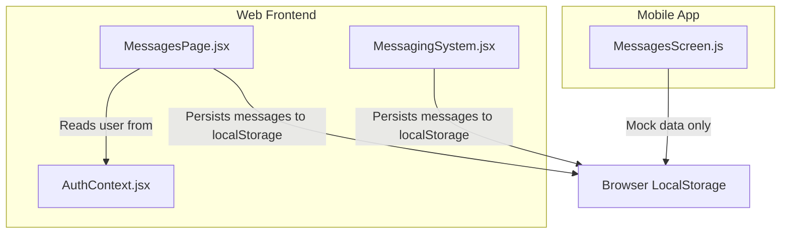
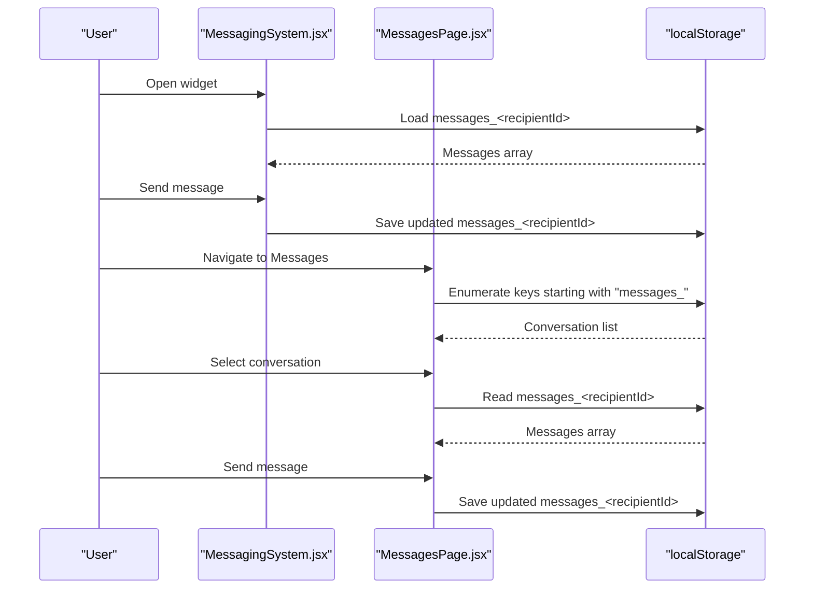
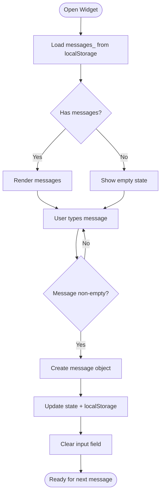
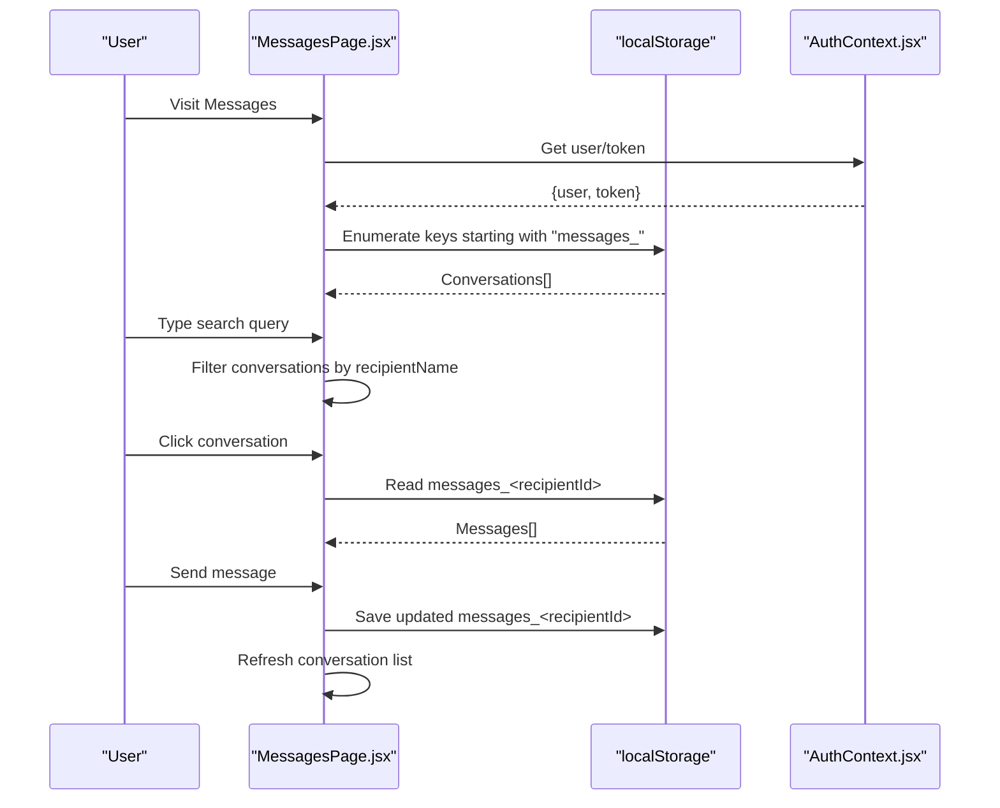
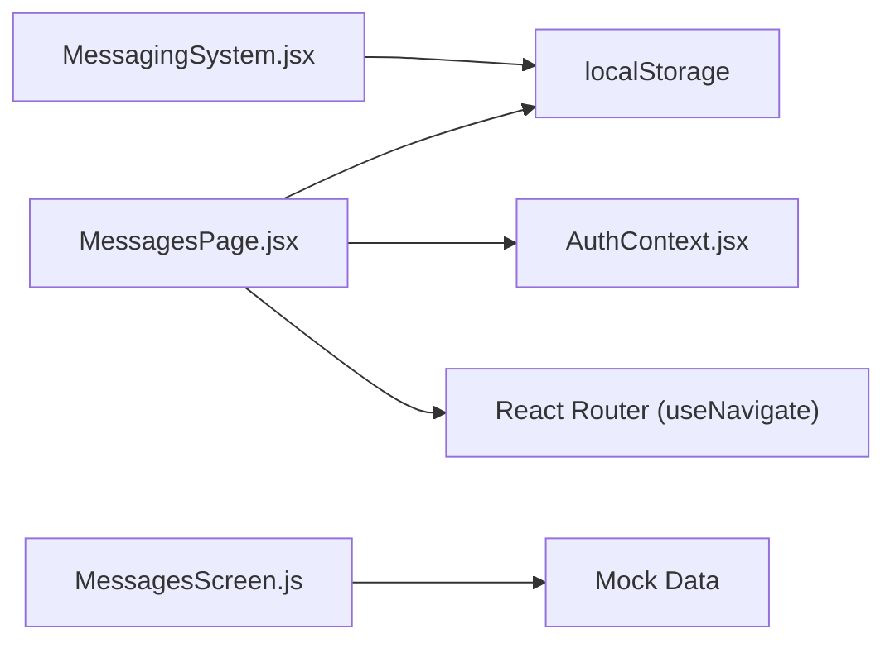

# Messaging System

<cite>
**Referenced Files in This Document**
- [MessagingSystem.jsx](file://src/components/MessagingSystem.jsx)
- [MessagesPage.jsx](file://src/pages/MessagesPage.jsx)
- [AuthContext.jsx](file://src/context/AuthContext.jsx)
- [MessagesScreen.js](file://axx-spaces-mobile/src/screens/MessagesScreen.js)
</cite>

## Table of Contents
1. [Introduction](#introduction)
2. [Project Structure](#project-structure)
3. [Core Components](#core-components)
4. [Architecture Overview](#architecture-overview)
5. [Detailed Component Analysis](#detailed-component-analysis)
6. [Dependency Analysis](#dependency-analysis)
7. [Performance Considerations](#performance-considerations)
8. [Troubleshooting Guide](#troubleshooting-guide)
9. [Conclusion](#conclusion)
10. [Appendices](#appendices)

## Introduction
This document explains the messaging system implemented in the frontend application. It covers real-time communication, conversation management, message threading, and notification integration. The current implementation uses local storage for persistence and does not include WebSocket or server-backed real-time synchronization. It provides two primary user experiences:
- A floating chat widget embedded on pages (MessagingSystem component).
- A dedicated Messages page with a conversation list and chat area (MessagesPage).

The mobile app includes a placeholder Messages screen that currently uses mock data.

## Project Structure
The messaging features are organized as follows:
- src/components/MessagingSystem.jsx: Floating chat widget with per-recipient message persistence.
- src/pages/MessagesPage.jsx: Full-page conversation list and chat interface with search and delete capabilities.
- axx-spaces-mobile/src/screens/MessagesScreen.js: Mobile placeholder screen for conversations.
- src/context/AuthContext.jsx: Authentication context used by the Messages page to access the current user and token.

**Diagram sources**
- [MessagingSystem.jsx:1-337](file://src/components/MessagingSystem.jsx#L1-L337)
- [MessagesPage.jsx:1-312](file://src/pages/MessagesPage.jsx#L1-L312)
- [AuthContext.jsx:1-157](file://src/context/AuthContext.jsx#L1-L157)
- [MessagesScreen.js:1-190](file://axx-spaces-mobile/src/screens/MessagesScreen.js#L1-L190)

**Section sources**
- [MessagingSystem.jsx:1-337](file://src/components/MessagingSystem.jsx#L1-L337)
- [MessagesPage.jsx:1-312](file://src/pages/MessagesPage.jsx#L1-L312)
- [AuthContext.jsx:1-157](file://src/context/AuthContext.jsx#L1-L157)
- [MessagesScreen.js:1-190](file://axx-spaces-mobile/src/screens/MessagesScreen.js#L1-L190)

## Core Components
- MessagingSystem: A floating chat widget that opens/closes, displays messages, and persists them per recipient using localStorage. It supports optional property context (propertyId, propertyTitle).
- MessagesPage: A full-page UI with a sidebar listing conversations, a search bar, and a chat area. It reads/writes messages from/to localStorage and uses AuthContext for user identity.
- MessagesScreen (mobile): Placeholder screen showing a list of mock conversations; no persistence or API calls yet.

Key responsibilities:
- Message creation and display.
- Conversation list generation from localStorage keys.
- Time formatting and relative timestamps.
- Search filtering of conversations by recipient name.
- Deletion of individual conversations.

**Section sources**
- [MessagingSystem.jsx:5-53](file://src/components/MessagingSystem.jsx#L5-L53)
- [MessagesPage.jsx:5-64](file://src/pages/MessagesPage.jsx#L5-L64)
- [MessagesScreen.js:12-46](file://axx-spaces-mobile/src/screens/MessagesScreen.js#L12-L46)

## Architecture Overview
The messaging architecture is client-side only at this time:
- State is held in React component state and persisted to browser localStorage under keys prefixed with “messages_” followed by the recipient identifier.
- No WebSocket or polling-based real-time sync is implemented.
- User identity comes from AuthContext (web) or local state (widget).
- The mobile app currently uses mock data and navigation placeholders.

**Diagram sources**
- [MessagingSystem.jsx:20-32](file://src/components/MessagingSystem.jsx#L20-L32)
- [MessagesPage.jsx:14-30](file://src/pages/MessagesPage.jsx#L14-L30)
- [MessagesPage.jsx:39-64](file://src/pages/MessagesPage.jsx#L39-L64)

## Detailed Component Analysis

### MessagingSystem Component
Responsibilities:
- Toggle open/close state.
- Load and save messages per recipient via localStorage.
- Compose new messages with sender info, timestamp, and optional property context.
- Render message bubbles with relative timestamps.
- Provide inline styles and a compact UI suitable for embedding on any page.

Data model:
- Each message contains id, text, senderId, senderName, recipientId, recipientName, timestamp, and optional propertyId/propertyTitle.

Persistence:
- Keys follow the pattern messages_<recipientId>.
- On load, it checks localStorage and hydrates state.
- On send, it updates both state and localStorage.

Real-time behavior:
- Not implemented. There is no WebSocket or polling mechanism.

Customization points:
- Styles object can be replaced with CSS modules or theme tokens.
- Property context fields can be extended to support other entities.

**Diagram sources**
- [MessagingSystem.jsx:20-53](file://src/components/MessagingSystem.jsx#L20-L53)
- [MessagingSystem.jsx:55-68](file://src/components/MessagingSystem.jsx#L55-L68)

**Section sources**
- [MessagingSystem.jsx:5-53](file://src/components/MessagingSystem.jsx#L5-L53)
- [MessagingSystem.jsx:55-68](file://src/components/MessagingSystem.jsx#L55-L68)
- [MessagingSystem.jsx:70-157](file://src/components/MessagingSystem.jsx#L70-L157)

### MessagesPage Component
Responsibilities:
- List all conversations derived from localStorage keys.
- Show last message preview, timestamp, and unread count (not tracked here).
- Allow searching conversations by recipient name.
- Open a selected conversation and render its messages.
- Support sending new messages and deleting entire conversations.

Conversation model:
- Derived from localStorage entries: recipientId, recipientName, lastMessage, lastTimestamp, messageCount, propertyTitle.

Search functionality:
- Client-side filter over the conversation list based on recipientName.

Deletion:
- Removes the corresponding localStorage key and resets active conversation if needed.

Authentication:
- Uses AuthContext to get the current user and token; redirects unauthenticated users to login.

**Diagram sources**
- [MessagesPage.jsx:14-30](file://src/pages/MessagesPage.jsx#L14-L30)
- [MessagesPage.jsx:39-64](file://src/pages/MessagesPage.jsx#L39-L64)
- [MessagesPage.jsx:66-74](file://src/pages/MessagesPage.jsx#L66-L74)
- [MessagesPage.jsx:91-93](file://src/pages/MessagesPage.jsx#L91-L93)
- [AuthContext.jsx:17-20](file://src/context/AuthContext.jsx#L17-L20)

**Section sources**
- [MessagesPage.jsx:5-30](file://src/pages/MessagesPage.jsx#L5-L30)
- [MessagesPage.jsx:39-74](file://src/pages/MessagesPage.jsx#L39-L74)
- [MessagesPage.jsx:91-93](file://src/pages/MessagesPage.jsx#L91-L93)
- [MessagesPage.jsx:95-206](file://src/pages/MessagesPage.jsx#L95-L206)

### Mobile MessagesScreen
Current status:
- Displays a static list of mock conversations.
- Does not persist messages or integrate with web localStorage.
- Provides navigation placeholders for future chat detail screens.

Recommendation:
- Replace mock data with a backend API or shared persistence layer when integrating with the web messaging system.

**Section sources**
- [MessagesScreen.js:12-46](file://axx-spaces-mobile/src/screens/MessagesScreen.js#L12-L46)
- [MessagesScreen.js:48-101](file://axx-spaces-mobile/src/screens/MessagesScreen.js#L48-L101)

## Dependency Analysis
- MessagingSystem depends on:
  - Browser localStorage for persistence.
  - Optional props: recipientId, recipientName, recipientType, propertyId, propertyTitle.
  - Inline styles and a small CSS snippet for scrollbars.
- MessagesPage depends on:
  - AuthContext for user identity and token.
  - Browser localStorage for conversation and message persistence.
  - React Router’s useNavigate for back navigation.
- Mobile MessagesScreen has no runtime dependencies beyond React Native primitives and mock data.

**Diagram sources**
- [MessagingSystem.jsx:1-337](file://src/components/MessagingSystem.jsx#L1-L337)
- [MessagesPage.jsx:1-312](file://src/pages/MessagesPage.jsx#L1-L312)
- [AuthContext.jsx:1-157](file://src/context/AuthContext.jsx#L1-L157)
- [MessagesScreen.js:1-190](file://axx-spaces-mobile/src/screens/MessagesScreen.js#L1-L190)

**Section sources**
- [MessagesPage.jsx:1-12](file://src/pages/MessagesPage.jsx#L1-L12)
- [AuthContext.jsx:1-20](file://src/context/AuthContext.jsx#L1-L20)

## Performance Considerations
- LocalStorage operations are synchronous and can block the main thread. For large message histories, consider:
  - Pagination or virtualization of message lists.
  - Debouncing writes to reduce frequent localStorage updates.
  - Capping stored messages per conversation (e.g., keep last N messages).
- Rendering performance:
  - Avoid re-rendering entire lists on every keystroke; memoize conversation items where possible.
  - Use stable keys (prefer server-assigned IDs) to minimize DOM churn.
- Search optimization:
  - For many conversations, consider debounced search input and precomputed lowercase names.
- Memory usage:
  - Ensure old or archived conversations are pruned periodically.

[No sources needed since this section provides general guidance]

## Troubleshooting Guide
Common issues and resolutions:
- Messages not appearing after refresh:
  - Verify localStorage keys exist and contain valid JSON arrays.
  - Check that the recipientId matches between components and storage keys.
- Unauthenticated redirect loop:
  - Ensure AuthContext initializes correctly and sets token/user before rendering MessagesPage.
- Duplicate or stale messages:
  - Confirm that message ids are unique; avoid relying solely on Date.now() without collision handling.
- Mobile not syncing with web:
  - The mobile screen currently uses mock data; implement a shared backend or cross-platform persistence.

Operational checks:
- Inspect localStorage entries prefixed with “messages_”.
- Validate that the user object from AuthContext contains expected fields (_id or id, name).

**Section sources**
- [MessagesPage.jsx:14-30](file://src/pages/MessagesPage.jsx#L14-L30)
- [AuthContext.jsx:52-97](file://src/context/AuthContext.jsx#L52-L97)

## Conclusion
The current messaging system provides a functional, client-only experience with:
- A floating chat widget for quick interactions.
- A full-page conversation manager with search and deletion.
- LocalStorage-based persistence without real-time synchronization.

To evolve toward a production-grade system:
- Introduce a backend API for message persistence and retrieval.
- Implement real-time communication via WebSockets or server-sent events.
- Add message threading, read receipts, typing indicators, and rich media support.
- Standardize message schemas and introduce pagination and indexing for search.

[No sources needed since this section summarizes without analyzing specific files]

## Appendices

### Customizing Message Interfaces
- Replace inline styles with CSS modules or a design system.
- Extend the message object to support attachments, reactions, and mentions.
- Add custom message types (e.g., system notifications, booking confirmations) and renderers.

### Adding New Message Types
- Define a type discriminator in the message schema.
- Implement conditional rendering logic in the message list.
- Persist and index new fields for search and analytics.

### Integrating External Chat Services
- Abstract the persistence layer behind an adapter interface.
- Swap localStorage for a service that communicates with external providers (e.g., Twilio, WhatsApp Business API).
- Maintain backward compatibility by migrating existing localStorage data during onboarding.

### Message Persistence Strategy
- Current: localStorage with keys messages_<recipientId>.
- Recommended: Server-side database with indexed fields (senderId, recipientId, timestamp, propertyId).
- Migration plan: Export localStorage data and import into the new store on first run.

### Search Functionality Enhancements
- Client-side: Debounce search input and cache results.
- Server-side: Full-text search over message bodies and metadata.
- Filters: By date range, property, participant, and message type.

### Real-Time Communication Options
- WebSockets: Bidirectional, low-latency communication.
- Polling: Simple fallback with configurable intervals and exponential backoff.
- Hybrid: Prefer WebSockets with automatic fallback to polling on connection failure.

[No sources needed since this section provides general guidance]