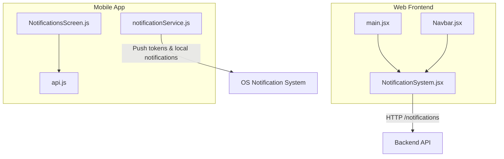
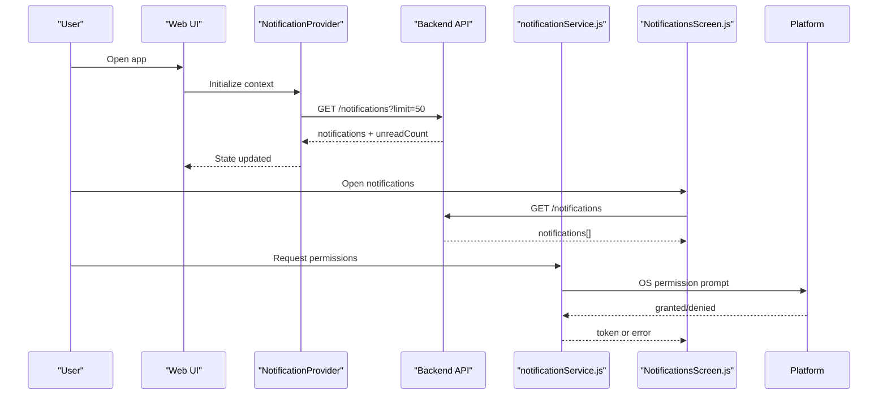
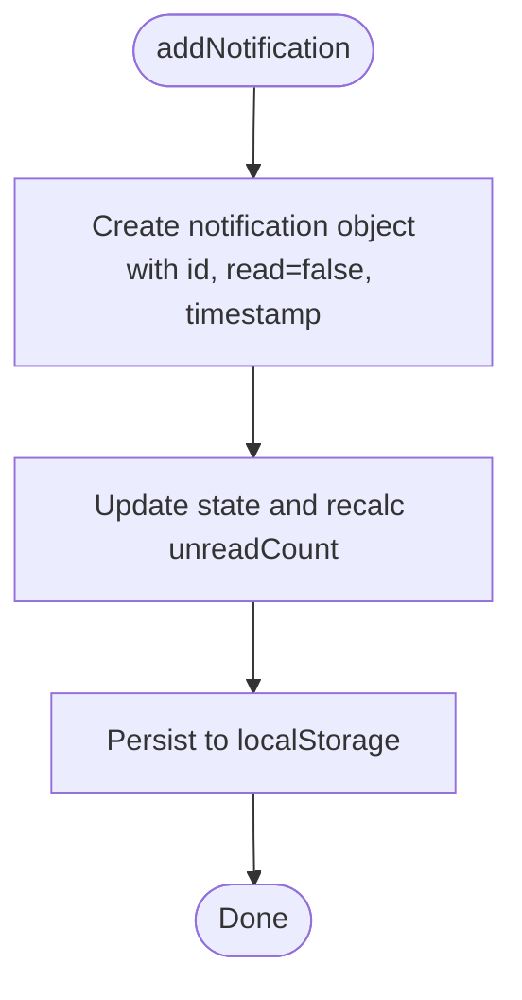
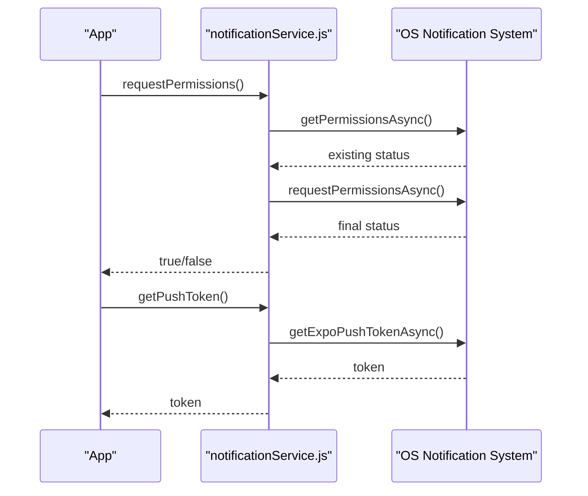
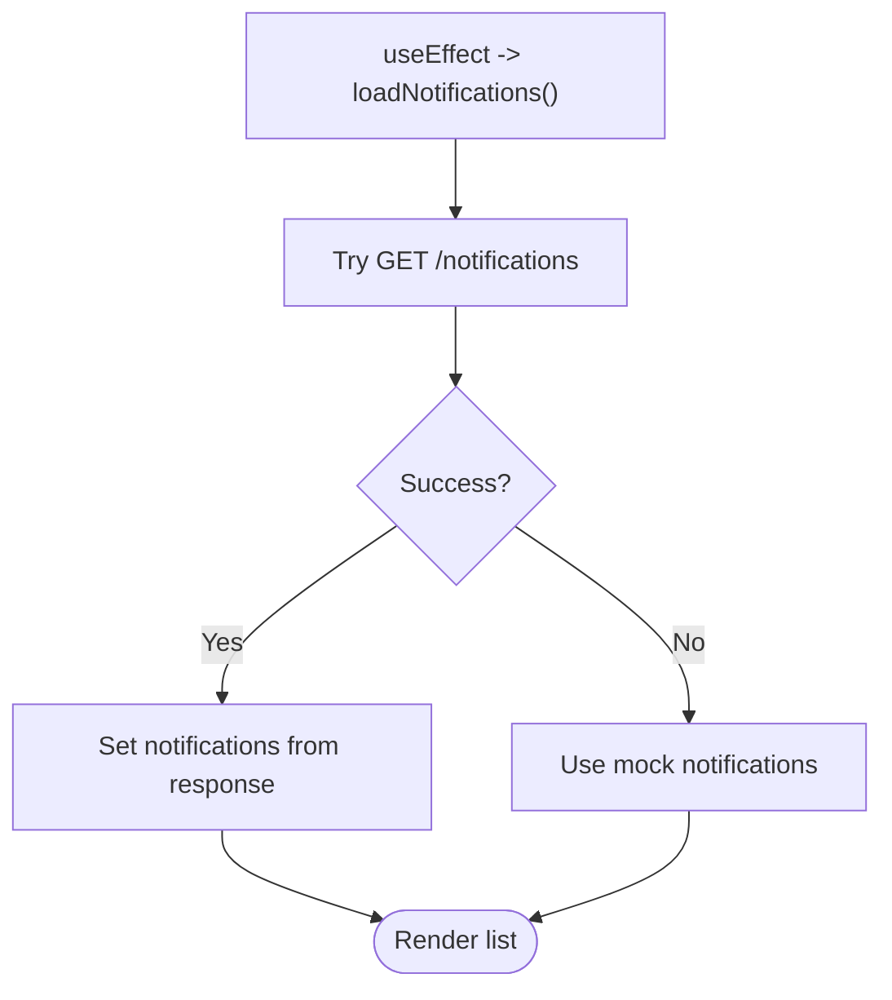
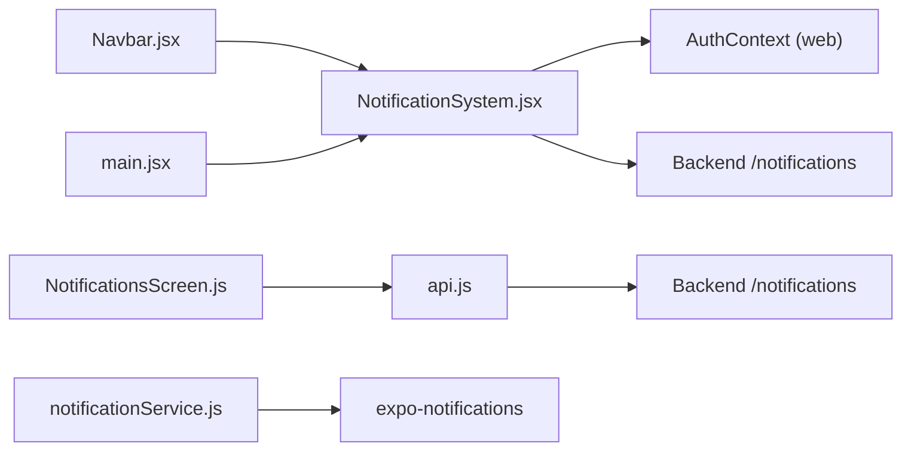

# Notification Center

<cite>
**Referenced Files in This Document**
- [NotificationSystem.jsx](file://src/components/NotificationSystem.jsx)
- [main.jsx](file://src/main.jsx)
- [Navbar.jsx](file://src/components/Navbar.jsx)
- [notificationService.js](file://axx-spaces-mobile/src/services/notificationService.js)
- [NotificationsScreen.js](file://axx-spaces-mobile/src/screens/NotificationsScreen.js)
- [api.js](file://axx-spaces-mobile/src/services/api.js)
</cite>

## Table of Contents
1. [Introduction](#introduction)
2. [Project Structure](#project-structure)
3. [Core Components](#core-components)
4. [Architecture Overview](#architecture-overview)
5. [Detailed Component Analysis](#detailed-component-analysis)
6. [Dependency Analysis](#dependency-analysis)
7. [Performance Considerations](#performance-considerations)
8. [Troubleshooting Guide](#troubleshooting-guide)
9. [Conclusion](#conclusion)
10. [Appendices](#appendices)

## Introduction
This document explains the notification center system across web and mobile platforms. It covers how notifications are created, delivered, and managed; the NotificationSystem component on the web; push notification integration on mobile; and user preference management. It also provides guidance for creating custom notification types, implementing scheduling, integrating with third-party services, handling permissions, background processing, and cross-platform compatibility.

## Project Structure
The notification system spans two main areas:
- Web frontend (React): a context-driven notification provider and bell UI integrated into the application shell.
- Mobile app (Expo/React Native): a service layer wrapping platform notification APIs and a screen to display notifications.

**Diagram sources**
- [main.jsx:17-26](file://src/main.jsx#L17-L26)
- [Navbar.jsx:6-6](file://src/components/Navbar.jsx#L6-L6)
- [NotificationSystem.jsx:25-55](file://src/components/NotificationSystem.jsx#L25-L55)
- [api.js:179-185](file://axx-spaces-mobile/src/services/api.js#L179-L185)
- [notificationService.js:15-74](file://axx-spaces-mobile/src/services/notificationService.js#L15-L74)
- [NotificationsScreen.js:12-46](file://axx-spaces-mobile/src/screens/NotificationsScreen.js#L12-L46)

**Section sources**
- [main.jsx:17-26](file://src/main.jsx#L17-L26)
- [Navbar.jsx:6-6](file://src/components/Navbar.jsx#L6-L6)
- [NotificationSystem.jsx:19-159](file://src/components/NotificationSystem.jsx#L19-L159)
- [notificationService.js:15-74](file://axx-spaces-mobile/src/services/notificationService.js#L15-L74)
- [NotificationsScreen.js:12-46](file://axx-spaces-mobile/src/screens/NotificationsScreen.js#L12-L46)
- [api.js:179-185](file://axx-spaces-mobile/src/services/api.js#L179-L185)

## Core Components
- Web NotificationProvider and useNotifications: provide centralized state for notifications, unread counts, and operations like add, mark as read, mark all as read, delete, and clear. They prefer server data when authenticated and fall back to localStorage otherwise.
- Web NotificationBell: renders a bell icon with badge and dropdown list, supports per-notification actions and bulk actions.
- Mobile notificationService: wraps expo-notifications for permissions, token retrieval, local/scheduled notifications, channels, listeners, badges, and dismissal.
- Mobile NotificationsScreen: fetches notifications via api.js and displays them with read/unread states.

Key responsibilities:
- Data persistence: server-first with localStorage fallback on web.
- Cross-platform delivery: push notifications on mobile via Expo Push Token.
- User interactions: mark as read, clear, delete, and view history.

**Section sources**
- [NotificationSystem.jsx:19-159](file://src/components/NotificationSystem.jsx#L19-L159)
- [NotificationSystem.jsx:161-291](file://src/components/NotificationSystem.jsx#L161-L291)
- [notificationService.js:15-213](file://axx-spaces-mobile/src/services/notificationService.js#L15-L213)
- [NotificationsScreen.js:12-101](file://axx-spaces-mobile/src/screens/NotificationsScreen.js#L12-L101)

## Architecture Overview
The system uses a hybrid approach:
- Web: React Context manages notification state and UI. HTTP endpoints handle CRUD operations. LocalStorage is used as a fallback.
- Mobile: A dedicated service integrates with OS-level notification systems and exposes methods for permission, token management, scheduling, and lifecycle control. The screen consumes an API client to load and update notifications.

**Diagram sources**
- [NotificationSystem.jsx:25-55](file://src/components/NotificationSystem.jsx#L25-L55)
- [api.js:179-185](file://axx-spaces-mobile/src/services/api.js#L179-L185)
- [notificationService.js:17-56](file://axx-spaces-mobile/src/services/notificationService.js#L17-L56)
- [NotificationsScreen.js:16-46](file://axx-spaces-mobile/src/screens/NotificationsScreen.js#L16-L46)

## Detailed Component Analysis

### Web NotificationSystem
Responsibilities:
- Provide context with notifications array and unread count.
- Load from server if authenticated; otherwise load from localStorage.
- Support adding, marking as read, marking all as read, deleting, and clearing notifications.
- Render bell UI with badge and dropdown.

Data model:
- Each notification includes id, read flag, timestamp, title, message, and type.
- Types supported by UI styling include message, booking, payment, review, property.

Operations:
- addNotification: creates a new entry with current timestamp and persists to localStorage.
- markAsRead: updates single notification; calls server endpoint when using server IDs.
- markAllAsRead: bulk operation; calls server endpoint when authenticated.
- deleteNotification: removes a notification; calls server endpoint when using server IDs.
- clearAll: clears local state or marks all as read on server.

Error handling:
- Network errors during load or mutations are caught and logged; local state remains consistent.

**Diagram sources**
- [NotificationSystem.jsx:61-73](file://src/components/NotificationSystem.jsx#L61-L73)

**Section sources**
- [NotificationSystem.jsx:19-159](file://src/components/NotificationSystem.jsx#L19-L159)
- [NotificationSystem.jsx:161-291](file://src/components/NotificationSystem.jsx#L161-L291)

### Mobile notificationService
Responsibilities:
- Request and manage notification permissions.
- Retrieve and register push tokens.
- Send local notifications and schedule future notifications.
- Manage Android notification channels.
- Add listeners for received notifications and responses.
- Control badge counts and dismiss notifications.

Key flows:
- Permissions: checks device capability, requests permission, returns success/failure.
- Push token: obtains Expo push token and optionally registers it with backend.
- Scheduling: schedules immediate or triggered notifications and returns identifiers.

**Diagram sources**
- [notificationService.js:17-56](file://axx-spaces-mobile/src/services/notificationService.js#L17-L56)

**Section sources**
- [notificationService.js:15-213](file://axx-spaces-mobile/src/services/notificationService.js#L15-L213)

### Mobile NotificationsScreen
Responsibilities:
- Fetch notifications via api.js.
- Display list with read/unread indicators.
- Mark individual notifications as read.

Behavior:
- On load, attempts to fetch notifications; falls back to mock data on error.
- Updates local state after marking as read.

**Diagram sources**
- [NotificationsScreen.js:16-46](file://axx-spaces-mobile/src/screens/NotificationsScreen.js#L16-L46)

**Section sources**
- [NotificationsScreen.js:12-101](file://axx-spaces-mobile/src/screens/NotificationsScreen.js#L12-L101)
- [api.js:179-185](file://axx-spaces-mobile/src/services/api.js#L179-L185)

### Integration Points
- Web: NotificationProvider integrates at app root via main.jsx and is consumed by Navbar.jsx through NotificationBell.
- Mobile: NotificationsScreen uses api.js for REST operations; notificationService.js handles platform-specific notification features.

**Section sources**
- [main.jsx:17-26](file://src/main.jsx#L17-L26)
- [Navbar.jsx:6-6](file://src/components/Navbar.jsx#L6-L6)
- [api.js:179-185](file://axx-spaces-mobile/src/services/api.js#L179-L185)

## Dependency Analysis
- Web components depend on React Context for shared state and on the backend for persistence.
- Mobile screens depend on api.js for REST; notificationService.js depends on expo-notifications and platform capabilities.

**Diagram sources**
- [NotificationSystem.jsx:1-3](file://src/components/NotificationSystem.jsx#L1-L3)
- [Navbar.jsx:6-6](file://src/components/Navbar.jsx#L6-L6)
- [main.jsx:7-7](file://src/main.jsx#L7-L7)
- [api.js:179-185](file://axx-spaces-mobile/src/services/api.js#L179-L185)
- [notificationService.js:1-4](file://axx-spaces-mobile/src/services/notificationService.js#L1-L4)

**Section sources**
- [NotificationSystem.jsx:1-3](file://src/components/NotificationSystem.jsx#L1-L3)
- [Navbar.jsx:6-6](file://src/components/Navbar.jsx#L6-L6)
- [main.jsx:7-7](file://src/main.jsx#L7-L7)
- [api.js:179-185](file://axx-spaces-mobile/src/services/api.js#L179-L185)
- [notificationService.js:1-4](file://axx-spaces-mobile/src/services/notificationService.js#L1-L4)

## Performance Considerations
- Prefer server-side pagination and limit parameters (e.g., limit=50) to reduce payload size.
- Debounce rapid UI actions like mark-all-as-read to avoid redundant network calls.
- Cache notifications locally on web to minimize re-fetching; sync only on changes.
- On mobile, batch badge updates and avoid frequent channel reconfiguration.
- Use efficient rendering for large lists (virtualization) on both platforms.

[No sources needed since this section provides general guidance]

## Troubleshooting Guide
Common issues and resolutions:
- Web notifications not loading:
  - Check authentication token presence and Authorization header.
  - Verify backend endpoint availability and CORS settings.
  - Confirm localStorage fallback behavior when API fails.
- Mobile push token failures:
  - Ensure physical device or emulator with proper configuration.
  - Validate project ID and permissions.
  - Handle denied permissions gracefully and guide users to settings.
- Scheduled notifications not firing:
  - Verify trigger configuration and timezone handling.
  - Check Android channel setup and importance levels.
  - Confirm that the app has necessary background execution permissions.

**Section sources**
- [NotificationSystem.jsx:25-55](file://src/components/NotificationSystem.jsx#L25-L55)
- [notificationService.js:17-56](file://axx-spaces-mobile/src/services/notificationService.js#L17-L56)
- [notificationService.js:145-155](file://axx-spaces-mobile/src/services/notificationService.js#L145-L155)

## Conclusion
The notification center provides a cohesive experience across web and mobile:
- Web uses a React Context provider for state and UI, with server synchronization and local fallback.
- Mobile leverages expo-notifications for permissions, tokens, scheduling, and lifecycle management, with a screen for viewing and managing notifications.
To extend the system, define new notification types in the UI logic, implement scheduling via the mobile service, and integrate third-party services by registering push tokens and handling incoming events consistently across platforms.

[No sources needed since this section summarizes without analyzing specific files]

## Appendices

### Creating Custom Notification Types
- Extend the UI mapping for icons and colors to support new types.
- Ensure backend payloads include a stable type field for consistent rendering.
- Update any filters or sorting logic to recognize new types.

**Section sources**
- [NotificationSystem.jsx:180-200](file://src/components/NotificationSystem.jsx#L180-L200)

### Implementing Notification Scheduling
- Use scheduled notifications for reminders and time-based alerts.
- Provide triggers based on date/time or intervals.
- Cancel or update scheduled notifications as needed.

**Section sources**
- [notificationService.js:94-112](file://axx-spaces-mobile/src/services/notificationService.js#L94-L112)
- [notificationService.js:114-132](file://axx-spaces-mobile/src/services/notificationService.js#L114-L132)

### Integrating Third-Party Notification Services
- Register device tokens with your backend upon successful permission grant.
- Route incoming push events to appropriate handlers based on payload metadata.
- Maintain a unified event model across platforms for consistent UX.

**Section sources**
- [notificationService.js:39-74](file://axx-spaces-mobile/src/services/notificationService.js#L39-L74)

### Notification Permissions and Background Processing
- Always request permissions before attempting to send or schedule notifications.
- Handle denied permissions and guide users to enable notifications in system settings.
- For background tasks, ensure platform-specific configurations (e.g., Android channels, iOS background modes) are set up.

**Section sources**
- [notificationService.js:17-37](file://axx-spaces-mobile/src/services/notificationService.js#L17-L37)
- [notificationService.js:145-155](file://axx-spaces-mobile/src/services/notificationService.js#L145-L155)

### Cross-Platform Compatibility
- Web: rely on browser notifications or in-app UI; persist to localStorage as fallback.
- Mobile: use expo-notifications for consistent behavior across iOS and Android.
- Normalize notification payloads to support both platforms seamlessly.

**Section sources**
- [NotificationSystem.jsx:25-55](file://src/components/NotificationSystem.jsx#L25-L55)
- [notificationService.js:1-4](file://axx-spaces-mobile/src/services/notificationService.js#L1-L4)