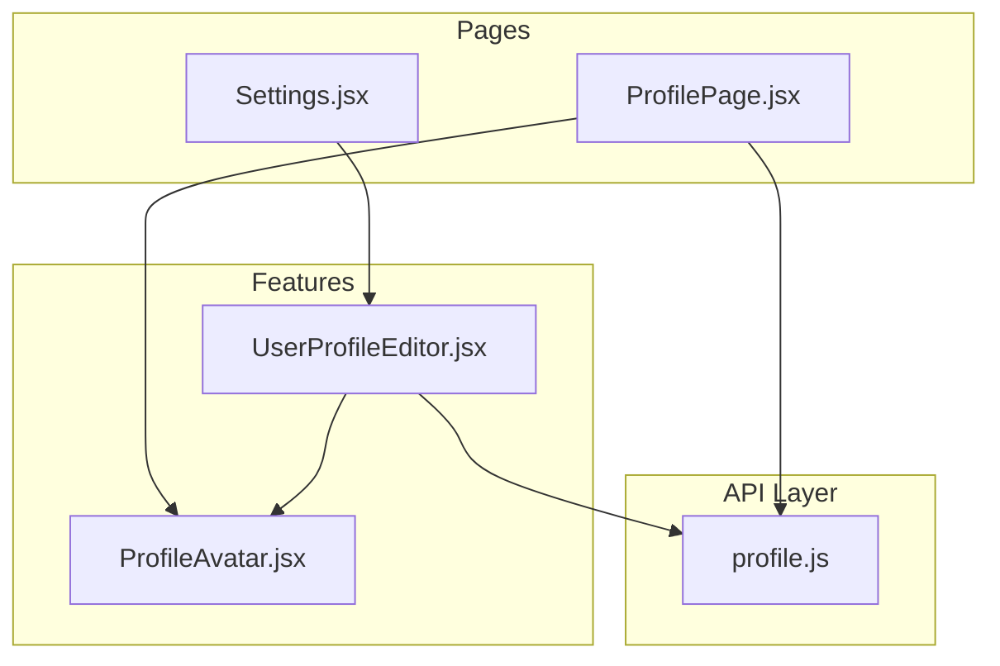
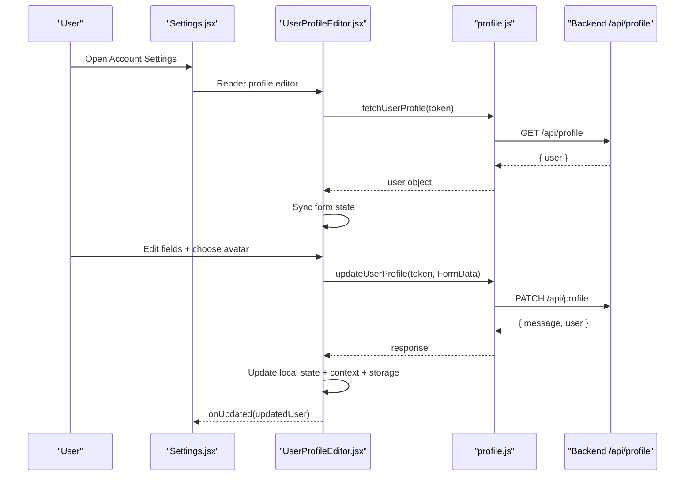
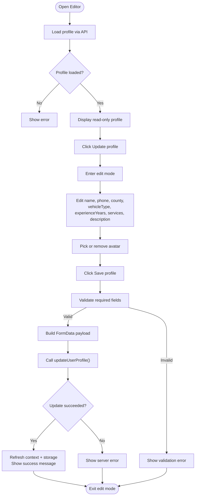
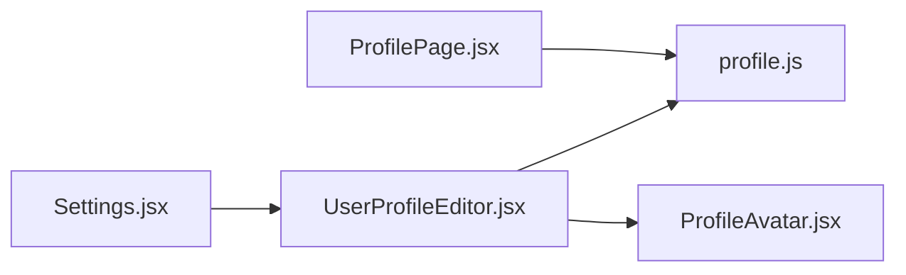

# Profile Management

<cite>
**Referenced Files in This Document**
- [UserProfileEditor.jsx](file://src/features/profile/UserProfileEditor.jsx)
- [ProfileAvatar.jsx](file://src/features/profile/ProfileAvatar.jsx)
- [profile.js](file://src/api/profile.js)
- [Settings.jsx](file://src/pages/Settings.jsx)
- [ProfilePage.jsx](file://src/pages/ProfilePage.jsx)
</cite>

## Table of Contents
1. [Introduction](#introduction)
2. [Project Structure](#project-structure)
3. [Core Components](#core-components)
4. [Architecture Overview](#architecture-overview)
5. [Detailed Component Analysis](#detailed-component-analysis)
6. [Dependency Analysis](#dependency-analysis)
7. [Performance Considerations](#performance-considerations)
8. [Troubleshooting Guide](#troubleshooting-guide)
9. [Security Considerations](#security-considerations)
10. [Customization and Extension Guide](#customization-and-extension-guide)
11. [Conclusion](#conclusion)

## Introduction
This document explains the profile management system used across the frontend application. It covers how user profiles are created, edited, and displayed; how avatar images are uploaded and managed; how profile data is validated; and how the UI integrates with backend APIs. It also includes guidance for customizing profile forms, adding new fields, integrating external services, and handling security considerations for sensitive profile data and image uploads.

The main editing experience is provided by a reusable profile editor component, which can be embedded in dashboards or settings pages. A dedicated account overview page displays profile information, role badges, activity metrics, and quick actions.

## Project Structure
The profile feature is organized into:
- Feature components under `src/features/profile`
- API helpers under `src/api`
- Pages that compose and display profile data under `src/pages`

**Diagram sources**
- [UserProfileEditor.jsx:1-342](file://src/features/profile/UserProfileEditor.jsx#L1-L342)
- [ProfileAvatar.jsx:1-35](file://src/features/profile/ProfileAvatar.jsx#L1-L35)
- [profile.js:1-60](file://src/api/profile.js#L1-L60)
- [Settings.jsx:1-595](file://src/pages/Settings.jsx#L1-L595)
- [ProfilePage.jsx:1-800](file://src/pages/ProfilePage.jsx#L1-L800)

**Section sources**
- [UserProfileEditor.jsx:1-342](file://src/features/profile/UserProfileEditor.jsx#L1-L342)
- [profile.js:1-60](file://src/api/profile.js#L1-L60)
- [Settings.jsx:1-595](file://src/pages/Settings.jsx#L1-L595)
- [ProfilePage.jsx:1-800](file://src/pages/ProfilePage.jsx#L1-L800)

## Core Components
- UserProfileEditor: Reusable form and display card for editing core profile fields, avatar upload, mover-specific fields, and saving changes to the backend.
- ProfileAvatar: Avatar renderer that shows an uploaded image or falls back to initials.
- Settings page: Hosts the profile editor alongside password change and notification preferences.
- ProfilePage: Displays a rich account overview with profile info, role badge, activity stats, and navigation links.

Key responsibilities:
- Fetching and updating profile data via API
- Managing local state for editing, previewing, and submitting avatar files
- Validating required fields before submission
- Updating global authentication context and local storage after successful updates

**Section sources**
- [UserProfileEditor.jsx:16-317](file://src/features/profile/UserProfileEditor.jsx#L16-L317)
- [ProfileAvatar.jsx:1-35](file://src/features/profile/ProfileAvatar.jsx#L1-L35)
- [Settings.jsx:199-206](file://src/pages/Settings.jsx#L199-L206)
- [ProfilePage.jsx:10-74](file://src/pages/ProfilePage.jsx#L10-L74)

## Architecture Overview
The profile flow connects UI components to a centralized API helper. The Settings page composes the UserProfileEditor, while the ProfilePage reads profile data directly from the API and renders a dashboard-style view.

**Diagram sources**
- [Settings.jsx:199-206](file://src/pages/Settings.jsx#L199-L206)
- [UserProfileEditor.jsx:45-63](file://src/features/profile/UserProfileEditor.jsx#L45-L63)
- [UserProfileEditor.jsx:107-153](file://src/features/profile/UserProfileEditor.jsx#L107-L153)
- [profile.js:16-32](file://src/api/profile.js#L16-L32)

## Detailed Component Analysis

### UserProfileEditor
Responsibilities:
- Load current profile using token
- Provide edit mode with inline form
- Validate required fields (name, phone)
- Handle avatar selection, preview, removal, and upload
- Build FormData payload including optional mover fields
- Persist updated user to context and local storage
- Show success/error states

Key behaviors:
- Token resolution supports props, context, and localStorage fallbacks
- Form sync ensures UI reflects server data
- Mover-only fields are conditionally shown based on role or prop flag
- Avatar preview uses a temporary URL until save completes
- On save, it calls the API and refreshes both UI and auth context

**Diagram sources**
- [UserProfileEditor.jsx:45-63](file://src/features/profile/UserProfileEditor.jsx#L45-L63)
- [UserProfileEditor.jsx:107-153](file://src/features/profile/UserProfileEditor.jsx#L107-L153)
- [UserProfileEditor.jsx:211-299](file://src/features/profile/UserProfileEditor.jsx#L211-L299)

**Section sources**
- [UserProfileEditor.jsx:16-317](file://src/features/profile/UserProfileEditor.jsx#L16-L317)

### ProfileAvatar
Responsibilities:
- Display user profile image if available
- Fallback to initials when no image exists
- Accept size and style overrides

Behavior:
- Uses user.profileImage as src
- If missing, renders a colored circle with the first letter of the user’s name

**Section sources**
- [ProfileAvatar.jsx:1-35](file://src/features/profile/ProfileAvatar.jsx#L1-L35)

### Settings Page
Responsibilities:
- Host tabs for profile, security, and notifications
- Render UserProfileEditor in the profile tab
- Manage password change form and notification preferences

Integration points:
- Passes token and user to UserProfileEditor
- Updates global auth context on profile update via onUpdated callback

**Section sources**
- [Settings.jsx:199-206](file://src/pages/Settings.jsx#L199-L206)
- [Settings.jsx:53-92](file://src/pages/Settings.jsx#L53-L92)

### ProfilePage
Responsibilities:
- Display account overview with hero card, role badge, email verification status, contact chips, and member since date
- Fetch latest profile and activity metrics
- Provide quick action cards to related features

Data flow:
- Calls fetchUserProfile and activities endpoint concurrently
- Normalizes role and maps to visual configuration
- Renders activity stats and wallet balance

**Section sources**
- [ProfilePage.jsx:10-74](file://src/pages/ProfilePage.jsx#L10-L74)
- [ProfilePage.jsx:76-90](file://src/pages/ProfilePage.jsx#L76-L90)
- [ProfilePage.jsx:158-231](file://src/pages/ProfilePage.jsx#L158-L231)

## Dependency Analysis
The profile feature has clear layering:
- Pages depend on feature components and API helpers
- Feature components depend on API helpers and shared UI components
- API helpers encapsulate HTTP requests and payload building

**Diagram sources**
- [Settings.jsx:199-206](file://src/pages/Settings.jsx#L199-L206)
- [ProfilePage.jsx:1-74](file://src/pages/ProfilePage.jsx#L1-L74)
- [UserProfileEditor.jsx:1-6](file://src/features/profile/UserProfileEditor.jsx#L1-L6)
- [profile.js:1-60](file://src/api/profile.js#L1-L60)

**Section sources**
- [Settings.jsx:199-206](file://src/pages/Settings.jsx#L199-L206)
- [ProfilePage.jsx:1-74](file://src/pages/ProfilePage.jsx#L1-L74)
- [UserProfileEditor.jsx:1-6](file://src/features/profile/UserProfileEditor.jsx#L1-L6)
- [profile.js:1-60](file://src/api/profile.js#L1-L60)

## Performance Considerations
- Concurrent loading: ProfilePage loads profile and activity data in parallel to reduce perceived latency.
- Conditional rendering: Mover-specific fields are only rendered when needed, reducing unnecessary DOM.
- Avatar preview: Uses a temporary object URL to avoid re-uploading during editing.
- Minimal re-renders: Local state is updated incrementally; context and storage are refreshed only after successful save.

[No sources needed since this section provides general guidance]

## Troubleshooting Guide
Common issues and resolutions:
- Profile not loading:
  - Ensure token is present and valid.
  - Check network connectivity and API base URL environment variable.
- Save fails:
  - Verify required fields (name, phone) are filled.
  - Confirm avatar file type and size constraints.
  - Inspect server error messages returned by the API.
- Avatar not updating:
  - Make sure you selected a new file or did not accidentally remove the photo.
  - After save, confirm the context and local storage were updated.

Operational tips:
- Use browser dev tools to inspect network requests to `/api/profile`.
- For client-side errors, check error state variables in the editor component.
- For server-side errors, review the error message returned by the API.

**Section sources**
- [UserProfileEditor.jsx:107-153](file://src/features/profile/UserProfileEditor.jsx#L107-L153)
- [profile.js:10-14](file://src/api/profile.js#L10-L14)

## Security Considerations
- Authentication:
  - All profile endpoints require a bearer token.
  - Tokens are passed via Authorization headers.
- Input validation:
  - Client-side validation enforces required fields before submission.
  - File type validation ensures only images are accepted.
- Image handling:
  - Images are sent as multipart/form-data with a specific field name.
  - Remove flag allows deleting existing avatar.
- Sensitive data:
  - Password changes are handled through a separate secure endpoint.
  - Notification preferences are stored locally and should not contain secrets.

Recommendations:
- Enforce server-side validation and authorization for all profile mutations.
- Limit file size and MIME types on the server.
- Sanitize and validate any additional profile fields added later.
- Avoid storing tokens in long-lived storage without encryption where possible.

**Section sources**
- [profile.js:6-8](file://src/api/profile.js#L6-L8)
- [profile.js:35-59](file://src/api/profile.js#L35-L59)
- [Settings.jsx:53-92](file://src/pages/Settings.jsx#L53-L92)

## Customization and Extension Guide

### Adding a New Profile Field
Steps:
1. Extend the form state to include the new field.
2. Add a corresponding input in the edit form.
3. Include the field in the FormData builder.
4. Update the display view to show the new field.
5. Optionally add validation rules and UI hints.

Example integration points:
- Form state and sync logic: [UserProfileEditor.jsx:38-85](file://src/features/profile/UserProfileEditor.jsx#L38-L85)
- Edit form inputs: [UserProfileEditor.jsx:229-289](file://src/features/profile/UserProfileEditor.jsx#L229-L289)
- FormData builder: [profile.js:35-59](file://src/api/profile.js#L35-L59)
- Display fields: [UserProfileEditor.jsx:300-313](file://src/features/profile/UserProfileEditor.jsx#L300-L313)

### Customizing Profile Forms
- Change accent color by passing the accentColor prop to UserProfileEditor.
- Toggle mover-specific fields using showMoverFields or rely on role detection.
- Adjust compact layout by setting compact prop.

Reference:
- Props and conditional behavior: [UserProfileEditor.jsx:16-43](file://src/features/profile/UserProfileEditor.jsx#L16-L43)

### Integrating External Services
- Replace or wrap the API helper to integrate third-party profile services.
- Keep the same interface: fetchUserProfile and updateUserProfile should return compatible shapes.
- For analytics or tracking, instrument the save flow around the submit step.

Reference:
- API contract: [profile.js:16-32](file://src/api/profile.js#L16-L32)

### Example Flows

#### Creating a Profile
- First-time users typically create an account elsewhere; profile creation is then reflected when fetching `/api/profile`.
- The editor will populate fields from the server response and allow immediate edits.

References:
- Profile load: [UserProfileEditor.jsx:45-63](file://src/features/profile/UserProfileEditor.jsx#L45-L63)
- Profile load in overview: [ProfilePage.jsx:31-74](file://src/pages/ProfilePage.jsx#L31-L74)

#### Editing and Saving Profile
- Click “Update profile” to enter edit mode.
- Fill required fields and optionally select an avatar.
- Submit to persist changes and refresh UI.

References:
- Edit flow: [UserProfileEditor.jsx:87-153](file://src/features/profile/UserProfileEditor.jsx#L87-L153)

#### Uploading and Managing Avatars
- Pick an image file; preview appears immediately.
- Remove photo toggles deletion flag.
- On save, the avatar is included in FormData.

References:
- Avatar selection and preview: [UserProfileEditor.jsx:94-105](file://src/features/profile/UserProfileEditor.jsx#L94-L105)
- Remove photo logic: [UserProfileEditor.jsx:220-224](file://src/features/profile/UserProfileEditor.jsx#L220-L224)
- FormData avatar field: [profile.js:56-57](file://src/api/profile.js#L56-L57)

**Section sources**
- [UserProfileEditor.jsx:16-43](file://src/features/profile/UserProfileEditor.jsx#L16-L43)
- [UserProfileEditor.jsx:87-153](file://src/features/profile/UserProfileEditor.jsx#L87-L153)
- [UserProfileEditor.jsx:220-224](file://src/features/profile/UserProfileEditor.jsx#L220-L224)
- [profile.js:35-59](file://src/api/profile.js#L35-L59)

## Conclusion
The profile management system provides a cohesive, reusable editing experience and a polished account overview. UserProfileEditor centralizes profile editing, avatar handling, and API integration, while Settings and ProfilePage provide contextual views for different user workflows. By following the extension guide, teams can safely add new fields, customize forms, and integrate external services while maintaining consistent validation, error handling, and security practices.

[No sources needed since this section summarizes without analyzing specific files]