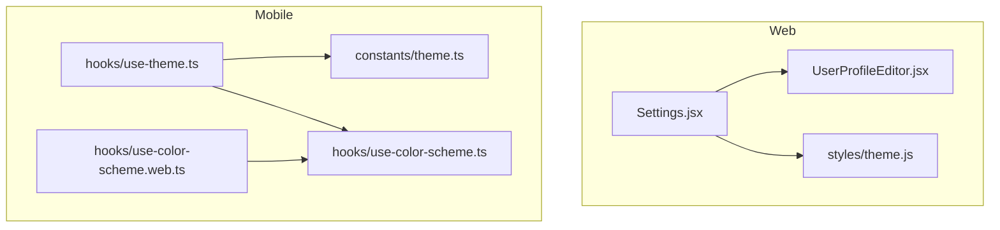
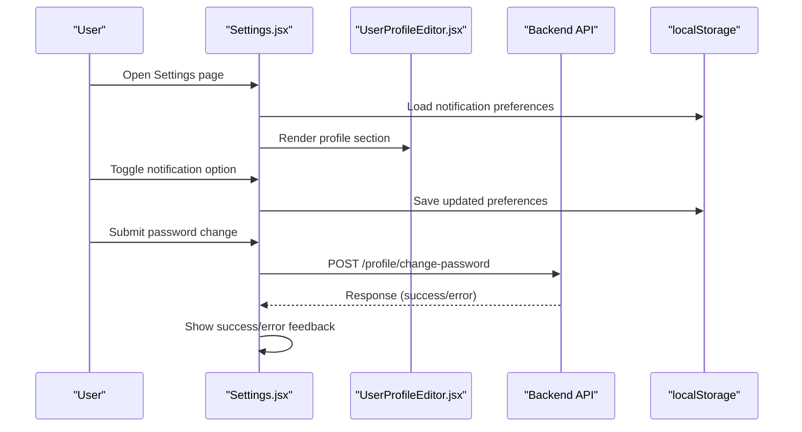
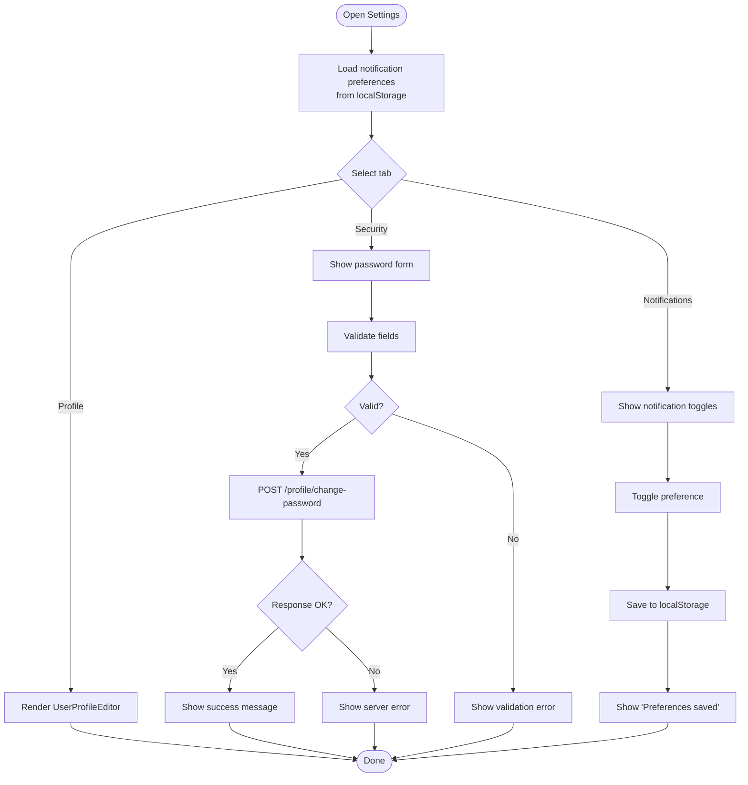
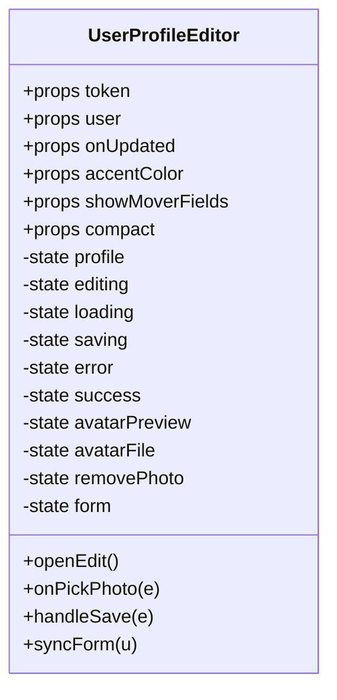
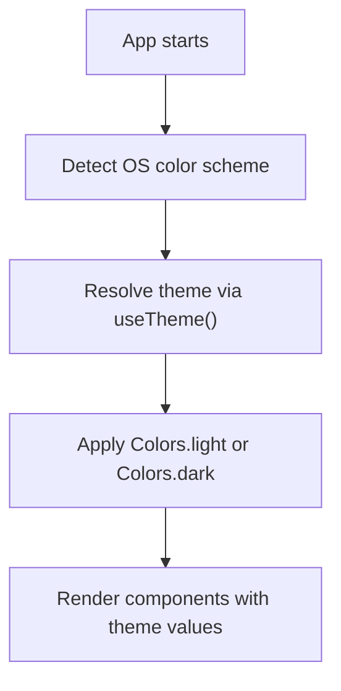
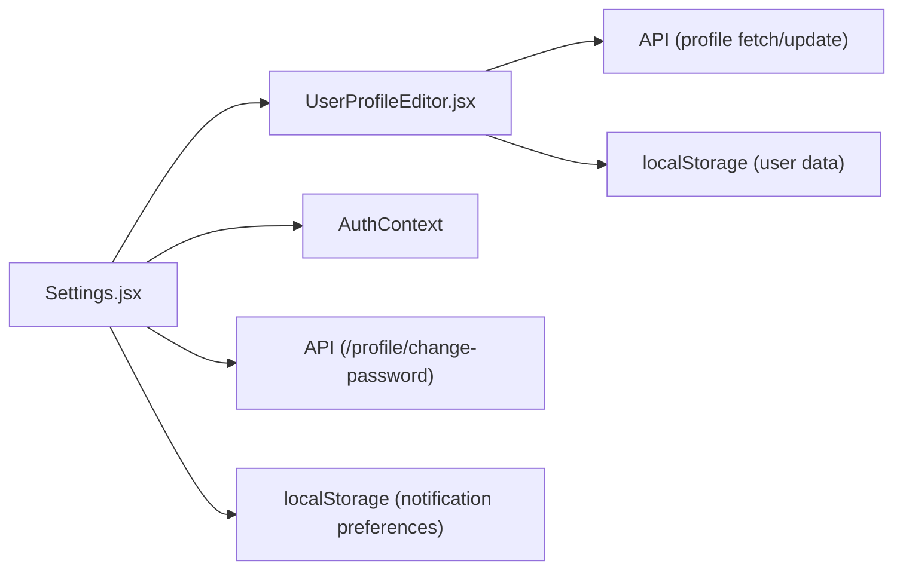

# Settings & Preferences

<cite>
**Referenced Files in This Document**
- [Settings.jsx](file://src/pages/Settings.jsx)
- [UserProfileEditor.jsx](file://src/features/profile/UserProfileEditor.jsx)
- [theme.js](file://src/styles/theme.js)
- [theme.ts](file://axx-spaces-mobile/src/constants/theme.ts)
- [use-theme.ts](file://axx-spaces-mobile/src/hooks/use-theme.ts)
- [use-color-scheme.ts](file://axx-spaces-mobile/src/hooks/use-color-scheme.ts)
- [use-color-scheme.web.ts](file://axx-spaces-mobile/src/hooks/use-color-scheme.web.ts)
</cite>

## Table of Contents
1. [Introduction](#introduction)
2. [Project Structure](#project-structure)
3. [Core Components](#core-components)
4. [Architecture Overview](#architecture-overview)
5. [Detailed Component Analysis](#detailed-component-analysis)
6. [Dependency Analysis](#dependency-analysis)
7. [Performance Considerations](#performance-considerations)
8. [Troubleshooting Guide](#troubleshooting-guide)
9. [Conclusion](#conclusion)
10. [Appendices](#appendices)

## Introduction
This document explains the settings and preferences system for the application, focusing on:
- User configuration management (profile updates, password changes)
- Theme customization (web design tokens and mobile theme hooks)
- Language preferences (current state and extension points)
- Application settings (notification preferences and persistence)
- Cross-platform considerations between web and mobile
- Guidance for adding new settings categories, implementing validation, customizing the interface, migration, backup/restore, and privacy

## Project Structure
The settings functionality spans a few key areas:
- Web Settings page with tabs for profile, security, and notifications
- Profile editor component used within the Settings page
- Web theme tokens for consistent styling
- Mobile theme constants and hooks for light/dark mode

**Diagram sources**
- [Settings.jsx:1-613](file://src/pages/Settings.jsx#L1-L613)
- [UserProfileEditor.jsx:1-200](file://src/features/profile/UserProfileEditor.jsx#L1-L200)
- [theme.js:1-202](file://src/styles/theme.js#L1-L202)
- [theme.ts:1-66](file://axx-spaces-mobile/src/constants/theme.ts#L1-L66)
- [use-theme.ts:1-15](file://axx-spaces-mobile/src/hooks/use-theme.ts#L1-L15)
- [use-color-scheme.ts:1-2](file://axx-spaces-mobile/src/hooks/use-color-scheme.ts#L1-L2)
- [use-color-scheme.web.ts:1-22](file://axx-spaces-mobile/src/hooks/use-color-scheme.web.ts#L1-L22)

**Section sources**
- [Settings.jsx:1-613](file://src/pages/Settings.jsx#L1-L613)
- [UserProfileEditor.jsx:1-200](file://src/features/profile/UserProfileEditor.jsx#L1-L200)
- [theme.js:1-202](file://src/styles/theme.js#L1-L202)
- [theme.ts:1-66](file://axx-spaces-mobile/src/constants/theme.ts#L1-L66)
- [use-theme.ts:1-15](file://axx-spaces-mobile/src/hooks/use-theme.ts#L1-L15)
- [use-color-scheme.ts:1-2](file://axx-spaces-mobile/src/hooks/use-color-scheme.ts#L1-L2)
- [use-color-scheme.web.ts:1-22](file://axx-spaces-mobile/src/hooks/use-color-scheme.web.ts#L1-L22)

## Core Components
- Settings page: Provides tabs for Profile Information, Password & Security, and Notifications. It manages local state for notification preferences and persists them to localStorage. It also handles password change flows via API calls and integrates with the AuthContext for session management.
- UserProfileEditor: Reusable profile editing component that fetches, validates, and updates user profiles, including avatar handling and syncing updated data back into context and storage.
- Web theme tokens: Centralized color, spacing, typography, and UI style definitions used across the web app.
- Mobile theme system: Defines light/dark color palettes, fonts, spacing, and platform-specific insets; exposes a hook to resolve the active theme based on device color scheme.

Key responsibilities:
- Settings.jsx: Tab navigation, form validation, API integration for password change, and local preference persistence for notifications.
- UserProfileEditor.jsx: Profile data fetching, form synchronization, file upload handling, and updating both server and client-side user state.
- theme.js: Design tokens for colors, spacing, typography, and reusable styles.
- Mobile theme files: Color schemes, font selection per platform, and theme resolution hook.

**Section sources**
- [Settings.jsx:1-613](file://src/pages/Settings.jsx#L1-L613)
- [UserProfileEditor.jsx:1-200](file://src/features/profile/UserProfileEditor.jsx#L1-L200)
- [theme.js:1-202](file://src/styles/theme.js#L1-L202)
- [theme.ts:1-66](file://axx-spaces-mobile/src/constants/theme.ts#L1-L66)
- [use-theme.ts:1-15](file://axx-spaces-mobile/src/hooks/use-theme.ts#L1-L15)

## Architecture Overview
The settings architecture separates concerns between UI, persistence, and theming:
- UI layer: Settings page composes tabbed sections and delegates profile editing to UserProfileEditor.
- Persistence layer: Notification preferences are stored in localStorage; profile updates are persisted to both server and local storage by the profile editor.
- Theming layer: Web uses centralized design tokens; mobile resolves theme from OS color scheme and provides a hook for components.

**Diagram sources**
- [Settings.jsx:23-43](file://src/pages/Settings.jsx#L23-L43)
- [Settings.jsx:94-106](file://src/pages/Settings.jsx#L94-L106)
- [Settings.jsx:53-92](file://src/pages/Settings.jsx#L53-L92)
- [UserProfileEditor.jsx:45-63](file://src/features/profile/UserProfileEditor.jsx#L45-L63)
- [UserProfileEditor.jsx:107-153](file://src/features/profile/UserProfileEditor.jsx#L107-L153)

## Detailed Component Analysis

### Settings Page Component
Responsibilities:
- Tab navigation for profile, security, and notifications
- Local state and validation for password change flow
- Notification preferences toggling and persistence
- Session management and sign-out actions

Data model:
- Active tab: string ("profile" | "security" | "notifications")
- Password form: object with current/new/confirm fields
- Notification preferences: object with boolean flags persisted under a specific localStorage key

Validation rules:
- All password fields required
- New password minimum length enforced
- Confirm password must match new password

Persistence:
- Notification preferences saved to localStorage under a dedicated key
- Profile updates handled by UserProfileEditor, which syncs to server and local storage

Error handling:
- Displays error/success messages for password operations
- Graceful fallback when localStorage is unavailable

**Diagram sources**
- [Settings.jsx:11-21](file://src/pages/Settings.jsx#L11-L21)
- [Settings.jsx:23-43](file://src/pages/Settings.jsx#L23-L43)
- [Settings.jsx:46-92](file://src/pages/Settings.jsx#L46-L92)
- [Settings.jsx:94-106](file://src/pages/Settings.jsx#L94-L106)

**Section sources**
- [Settings.jsx:1-613](file://src/pages/Settings.jsx#L1-L613)

### UserProfileEditor Component
Responsibilities:
- Fetch current profile data using token
- Sync form fields with profile data
- Handle avatar file selection and preview
- Validate required fields before submission
- Build FormData and call update API
- Update context and local storage with new profile data

State and behavior:
- Loading, saving, error, and success states
- Edit mode toggle
- Avatar preview and removal flag
- Conditional mover-specific fields

**Diagram sources**
- [UserProfileEditor.jsx:16-41](file://src/features/profile/UserProfileEditor.jsx#L16-L41)
- [UserProfileEditor.jsx:45-85](file://src/features/profile/UserProfileEditor.jsx#L45-L85)
- [UserProfileEditor.jsx:94-153](file://src/features/profile/UserProfileEditor.jsx#L94-L153)

**Section sources**
- [UserProfileEditor.jsx:1-200](file://src/features/profile/UserProfileEditor.jsx#L1-L200)

### Theme Customization System

#### Web Theme Tokens
Centralized design tokens define colors, spacing, typography, and reusable UI styles. These tokens ensure consistency across pages and components.

Key aspects:
- Colors: primary, accent, backgrounds, text, borders, status
- Spacing scale
- Border radius scale
- Font sizes and weights
- Button, input, card, page, hero, and section header style presets

Usage:
- Components import tokens to build consistent UI elements
- Pages apply page-level styles using theme presets

**Section sources**
- [theme.js:1-202](file://src/styles/theme.js#L1-L202)

#### Mobile Theme Hooks
Mobile app defines light/dark color palettes and platform-specific fonts and spacing. The useTheme hook resolves the active theme based on the device’s color scheme.

Key aspects:
- Colors.light and Colors.dark
- Fonts.Platform.select for iOS/web defaults
- Spacing scale
- Platform insets and content width constraints
- useTheme returns the active palette

Platform support:
- use-color-scheme.ts re-exports react-native’s hook
- use-color-scheme.web.ts hydrates color scheme on web to avoid SSR mismatch

**Diagram sources**
- [theme.ts:10-25](file://axx-spaces-mobile/src/constants/theme.ts#L10-L25)
- [use-theme.ts:9-13](file://axx-spaces-mobile/src/hooks/use-theme.ts#L9-L13)
- [use-color-scheme.ts:1-2](file://axx-spaces-mobile/src/hooks/use-color-scheme.ts#L1-L2)
- [use-color-scheme.web.ts:7-20](file://axx-spaces-mobile/src/hooks/use-color-scheme.web.ts#L7-L20)

**Section sources**
- [theme.ts:1-66](file://axx-spaces-mobile/src/constants/theme.ts#L1-L66)
- [use-theme.ts:1-15](file://axx-spaces-mobile/src/hooks/use-theme.ts#L1-L15)
- [use-color-scheme.ts:1-2](file://axx-spaces-mobile/src/hooks/use-color-scheme.ts#L1-L2)
- [use-color-scheme.web.ts:1-22](file://axx-spaces-mobile/src/hooks/use-color-scheme.web.ts#L1-L22)

### Language Preferences
Current state:
- No explicit language preference storage or i18n implementation is present in the analyzed files.
- Extension point: Add a language key in localStorage and a UI control in the Settings page to switch languages at runtime.

Recommended approach:
- Introduce a language setting key in localStorage
- Provide a dropdown or radio group in the Settings page
- On change, update the active locale and re-render localized content

[No sources needed since this section proposes an extension without analyzing specific files]

## Dependency Analysis
Inter-component relationships:
- Settings.jsx depends on:
  - UserProfileEditor for profile editing
  - AuthContext for user/session state
  - API for password change requests
  - localStorage for notification preferences
- UserProfileEditor depends on:
  - AuthContext for token/user
  - API endpoints for profile fetch/update
  - localStorage for persisting user data

**Diagram sources**
- [Settings.jsx:1-10](file://src/pages/Settings.jsx#L1-L10)
- [Settings.jsx:23-43](file://src/pages/Settings.jsx#L23-L43)
- [Settings.jsx:53-92](file://src/pages/Settings.jsx#L53-L92)
- [UserProfileEditor.jsx:1-5](file://src/features/profile/UserProfileEditor.jsx#L1-L5)
- [UserProfileEditor.jsx:45-63](file://src/features/profile/UserProfileEditor.jsx#L45-L63)
- [UserProfileEditor.jsx:107-153](file://src/features/profile/UserProfileEditor.jsx#L107-L153)

**Section sources**
- [Settings.jsx:1-613](file://src/pages/Settings.jsx#L1-L613)
- [UserProfileEditor.jsx:1-200](file://src/features/profile/UserProfileEditor.jsx#L1-L200)

## Performance Considerations
- Minimize unnecessary re-renders in Settings by memoizing derived values and avoiding heavy computations inside render.
- Debounce frequent localStorage writes if expanding notification preferences to many toggles.
- Use lazy loading for non-critical sections (e.g., load notifications only when the tab is active).
- Avoid blocking the main thread during large profile updates; stream or chunk operations where possible.
- For mobile theme resolution, ensure hydration logic does not cause layout shifts on first render.

[No sources needed since this section provides general guidance]

## Troubleshooting Guide
Common issues and resolutions:
- Notification preferences not persisting:
  - Verify localStorage availability and permissions
  - Ensure the correct key is used consistently
- Password change failures:
  - Check network connectivity and API responses
  - Validate client-side constraints (length, matching confirm)
- Profile updates not reflected:
  - Confirm API response contains updated user data
  - Ensure context and localStorage are updated after successful save
- Theme inconsistencies on web vs mobile:
  - Confirm useTheme resolves the correct palette
  - Validate platform-specific font and inset configurations

**Section sources**
- [Settings.jsx:94-106](file://src/pages/Settings.jsx#L94-L106)
- [Settings.jsx:53-92](file://src/pages/Settings.jsx#L53-L92)
- [UserProfileEditor.jsx:107-153](file://src/features/profile/UserProfileEditor.jsx#L107-L153)
- [use-theme.ts:9-13](file://axx-spaces-mobile/src/hooks/use-theme.ts#L9-L13)

## Conclusion
The settings and preferences system centers around a tabbed Settings page that manages profile editing, security credentials, and notification preferences. Profile updates are handled by a reusable editor component that synchronizes with the server and local storage. Theming is well-structured with centralized web tokens and a robust mobile theme hook system. While language preferences are not yet implemented, the architecture supports easy extension. For production readiness, consider adding structured migrations, backup/restore capabilities, and enhanced privacy controls.

[No sources needed since this section summarizes without analyzing specific files]

## Appendices

### Adding a New Settings Category
Steps:
- Define a new tab button and conditional rendering block in the Settings page
- Create local state for the category’s options
- Implement validation and persistence (localStorage or API)
- Wire up success/error feedback

Example reference paths:
- Tab structure and state: [Settings.jsx:11-21](file://src/pages/Settings.jsx#L11-L21)
- Rendering blocks per tab: [Settings.jsx:177-338](file://src/pages/Settings.jsx#L177-L338)

**Section sources**
- [Settings.jsx:11-21](file://src/pages/Settings.jsx#L11-L21)
- [Settings.jsx:177-338](file://src/pages/Settings.jsx#L177-L338)

### Implementing Preference Validation
Guidelines:
- Validate required fields before submission
- Enforce business rules (e.g., minimum password length)
- Display clear error messages and disable submit while processing

Reference paths:
- Password validation and submission: [Settings.jsx:46-92](file://src/pages/Settings.jsx#L46-L92)
- Profile field validation: [UserProfileEditor.jsx:107-115](file://src/features/profile/UserProfileEditor.jsx#L107-L115)

**Section sources**
- [Settings.jsx:46-92](file://src/pages/Settings.jsx#L46-L92)
- [UserProfileEditor.jsx:107-115](file://src/features/profile/UserProfileEditor.jsx#L107-L115)

### Customizing the Settings Interface
Approaches:
- Adjust tab styles and active states
- Modify card sections and form layouts
- Leverage web theme tokens for consistent styling

Reference paths:
- Tab buttons and active state: [Settings.jsx:132-175](file://src/pages/Settings.jsx#L132-L175)
- Card sections and forms: [Settings.jsx:177-338](file://src/pages/Settings.jsx#L177-L338)
- Web theme tokens: [theme.js:1-202](file://src/styles/theme.js#L1-L202)

**Section sources**
- [Settings.jsx:132-175](file://src/pages/Settings.jsx#L132-L175)
- [Settings.jsx:177-338](file://src/pages/Settings.jsx#L177-L338)
- [theme.js:1-202](file://src/styles/theme.js#L1-L202)

### Settings Migration Strategy
Recommendations:
- Version your settings schema (e.g., settingsVersion)
- On app start, compare stored version with current schema
- Run migration functions to transform old keys/values to new ones
- Clear invalid or deprecated keys safely

[No sources needed since this section provides general guidance]

### Backup and Restore Functionality
Recommendations:
- Export all user settings (including notification preferences and theme choices) to a JSON file
- Import and validate JSON before applying
- Provide confirmation prompts and rollback on failure

[No sources needed since this section provides general guidance]

### Privacy Considerations
Best practices:
- Avoid storing sensitive data (passwords, tokens) in localStorage beyond what is necessary
- Clearly communicate what data is stored locally and why
- Provide opt-in controls for analytics or marketing communications
- Sanitize and validate all imported settings to prevent injection risks

[No sources needed since this section provides general guidance]