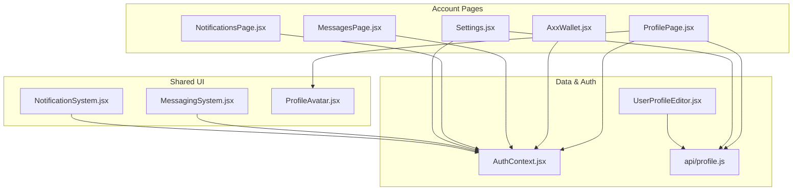
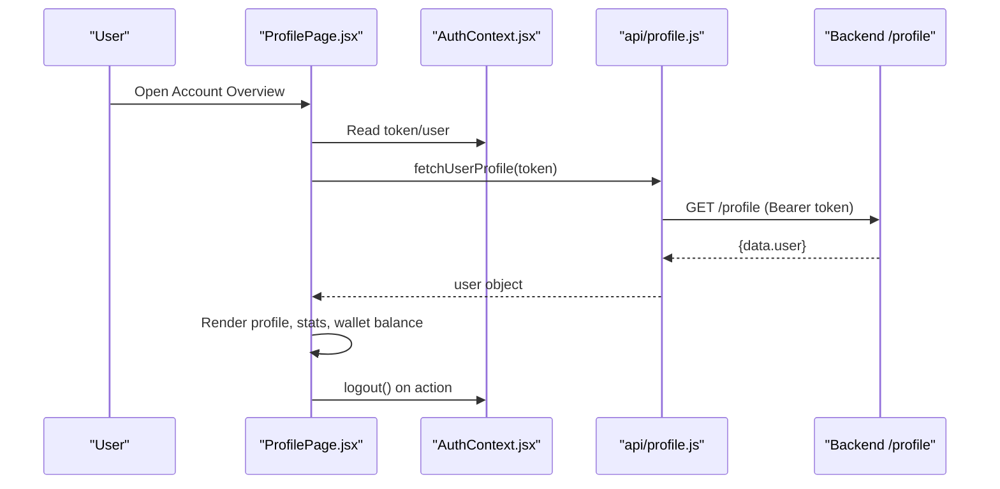
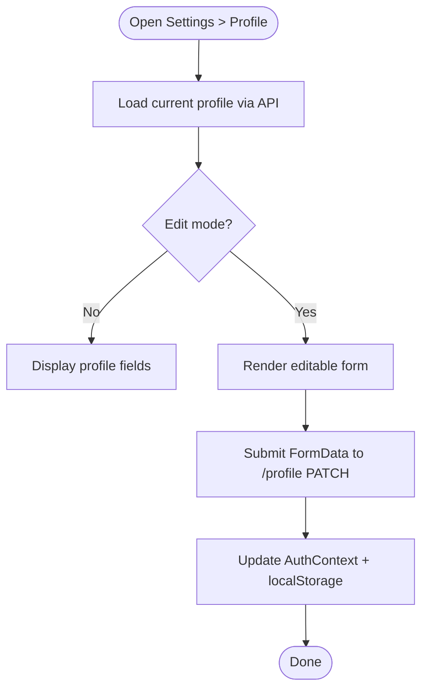
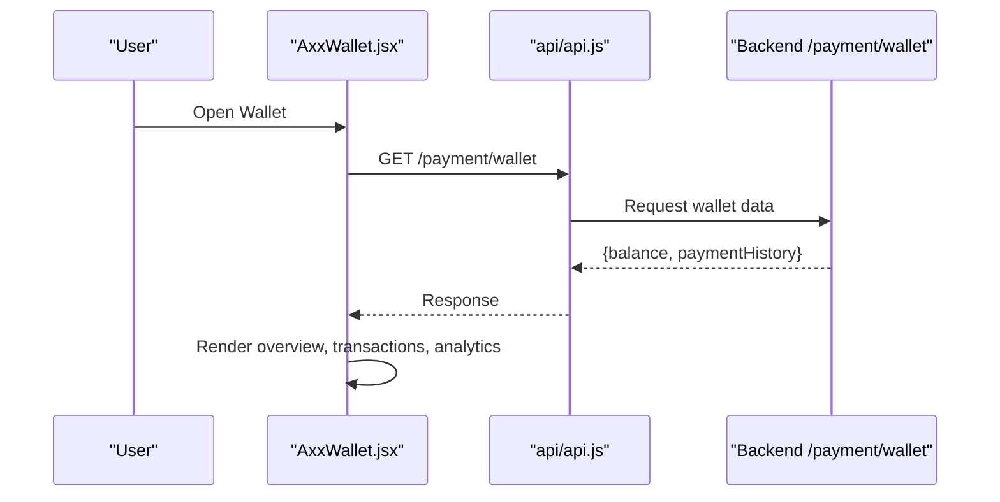
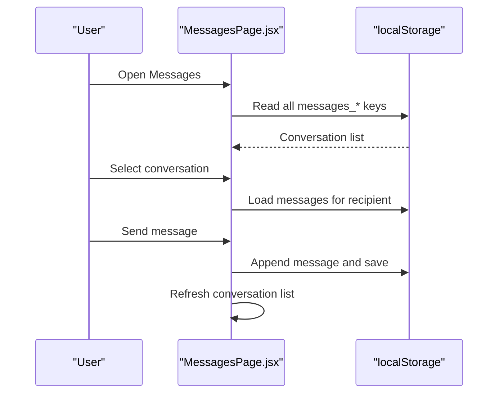
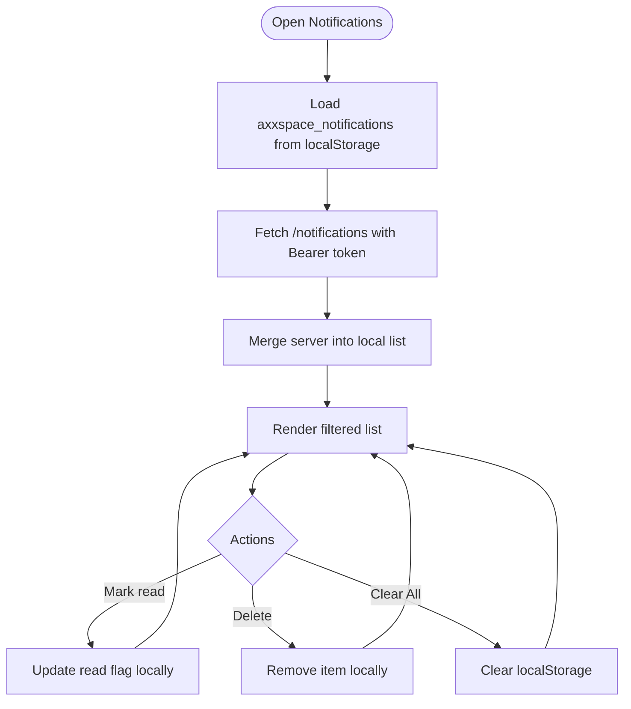
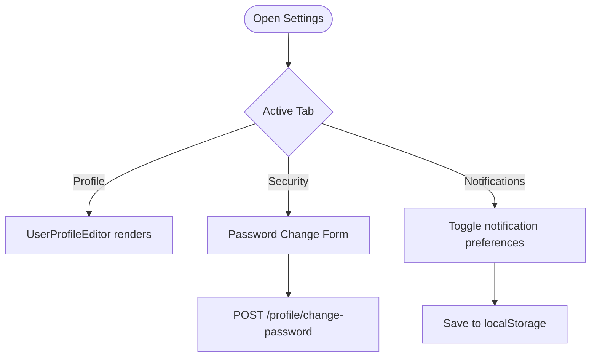
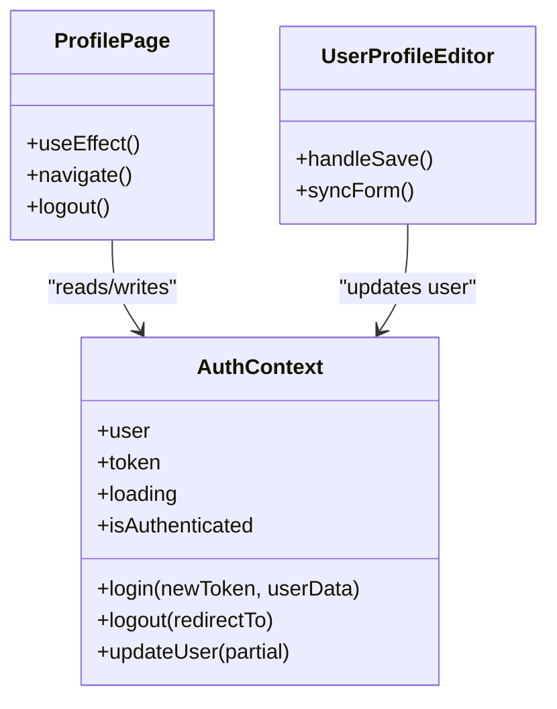
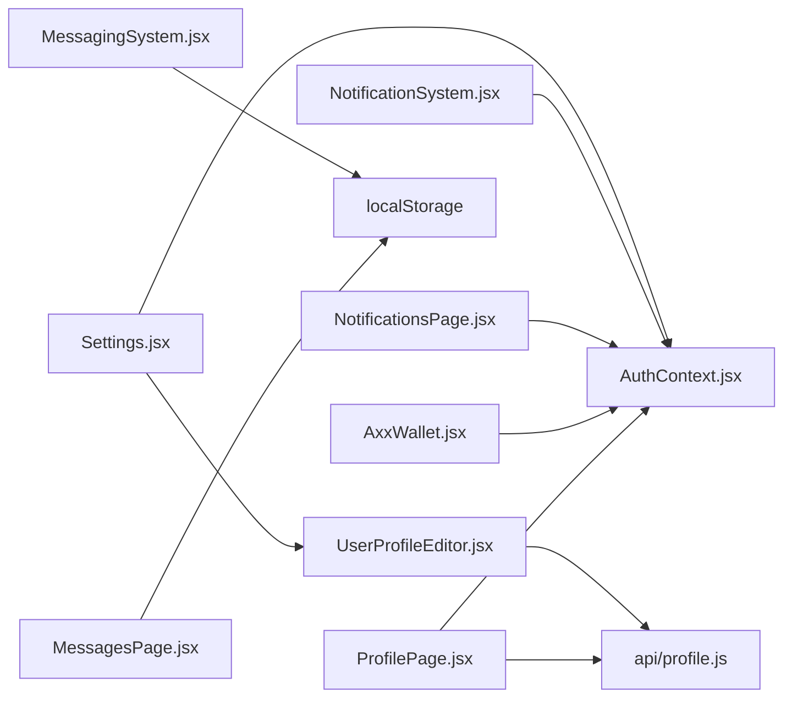

# User Account Management

<cite>
**Referenced Files in This Document**
- [ProfilePage.jsx](file://src/pages/ProfilePage.jsx)
- [AxxWallet.jsx](file://src/pages/AxxWallet.jsx)
- [MessagesPage.jsx](file://src/pages/MessagesPage.jsx)
- [NotificationsPage.jsx](file://src/pages/NotificationsPage.jsx)
- [MessagingSystem.jsx](file://src/components/MessagingSystem.jsx)
- [Settings.jsx](file://src/pages/Settings.jsx)
- [AuthContext.jsx](file://src/context/AuthContext.jsx)
- [profile.js](file://src/api/profile.js)
- [UserProfileEditor.jsx](file://src/features/profile/UserProfileEditor.jsx)
- [ProfileAvatar.jsx](file://src/features/profile/ProfileAvatar.jsx)
- [NotificationSystem.jsx](file://src/components/NotificationSystem.jsx)
</cite>

## Table of Contents
1. [Introduction](#introduction)
2. [Project Structure](#project-structure)
3. [Core Components](#core-components)
4. [Architecture Overview](#architecture-overview)
5. [Detailed Component Analysis](#detailed-component-analysis)
6. [Dependency Analysis](#dependency-analysis)
7. [Performance Considerations](#performance-considerations)
8. [Troubleshooting Guide](#troubleshooting-guide)
9. [Conclusion](#conclusion)
10. [Appendices](#appendices)

## Introduction
This document explains the user account management features implemented in the frontend application. It covers:
- Profile management and avatar handling
- Wallet system for transactions and history
- Message center for communications
- Notification system with local and server-backed behavior
- Settings and preferences, including security options
- User data management and authentication context
- Examples for extending user features and customizing the account interface

The goal is to make these systems understandable for both technical and non-technical readers while providing code-level references for implementation details.

## Project Structure
The user account features are primarily implemented as React pages and components under src/pages and src/components, with shared logic in src/features and src/api. Authentication state is centralized in a context provider.

**Diagram sources**
- [ProfilePage.jsx:1-12](file://src/pages/ProfilePage.jsx#L1-L12)
- [AxxWallet.jsx:1-10](file://src/pages/AxxWallet.jsx#L1-L10)
- [MessagesPage.jsx:1-12](file://src/pages/MessagesPage.jsx#L1-L12)
- [NotificationsPage.jsx:1-8](file://src/pages/NotificationsPage.jsx#L1-L8)
- [MessagingSystem.jsx:1-10](file://src/components/MessagingSystem.jsx#L1-L10)
- [NotificationSystem.jsx:1-6](file://src/components/NotificationSystem.jsx#L1-L6)
- [Settings.jsx:1-10](file://src/pages/Settings.jsx#L1-L10)
- [AuthContext.jsx:1-20](file://src/context/AuthContext.jsx#L1-L20)
- [profile.js:1-10](file://src/api/profile.js#L1-L10)
- [UserProfileEditor.jsx:1-10](file://src/features/profile/UserProfileEditor.jsx#L1-L10)
- [ProfileAvatar.jsx:1-10](file://src/features/profile/ProfileAvatar.jsx#L1-L10)

**Section sources**
- [ProfilePage.jsx:1-12](file://src/pages/ProfilePage.jsx#L1-L12)
- [AxxWallet.jsx:1-10](file://src/pages/AxxWallet.jsx#L1-L10)
- [MessagesPage.jsx:1-12](file://src/pages/MessagesPage.jsx#L1-L12)
- [NotificationsPage.jsx:1-8](file://src/pages/NotificationsPage.jsx#L1-L8)
- [MessagingSystem.jsx:1-10](file://src/components/MessagingSystem.jsx#L1-L10)
- [NotificationSystem.jsx:1-6](file://src/components/NotificationSystem.jsx#L1-L6)
- [Settings.jsx:1-10](file://src/pages/Settings.jsx#L1-L10)
- [AuthContext.jsx:1-20](file://src/context/AuthContext.jsx#L1-L20)
- [profile.js:1-10](file://src/api/profile.js#L1-L10)
- [UserProfileEditor.jsx:1-10](file://src/features/profile/UserProfileEditor.jsx#L1-L10)
- [ProfileAvatar.jsx:1-10](file://src/features/profile/ProfileAvatar.jsx#L1-L10)

## Core Components
- Profile overview and quick actions: Displays user identity, role badge, verification status, activity stats, wallet balance preview, and navigation to key areas like saved spaces, bookings, notifications, settings, and wallet.
- Wallet: Provides an overview tab, transaction list, analytics, virtual card view, and placeholder modals for deposit/withdraw/transfer.
- Messages: Local conversation list and chat area using localStorage; supports search, delete, and time formatting.
- Notifications: Merges local and server notifications, supports filtering, read/unread states, and bulk actions.
- MessagingSystem: Reusable inline chat widget that persists messages per recipient via localStorage.
- Settings: Tabs for profile editing, password change, and notification preferences.
- AuthContext: Centralized authentication state, login/logout, and guest auto-login flow.
- Profile API: Fetch/update profile endpoints and FormData builder.
- UserProfileEditor: Reusable profile editor with avatar upload and role-aware fields.
- ProfileAvatar: Avatar component with image or initials fallback.

**Section sources**
- [ProfilePage.jsx:10-12](file://src/pages/ProfilePage.jsx#L10-L12)
- [AxxWallet.jsx:6-20](file://src/pages/AxxWallet.jsx#L6-L20)
- [MessagesPage.jsx:5-12](file://src/pages/MessagesPage.jsx#L5-L12)
- [NotificationsPage.jsx:43-49](file://src/pages/NotificationsPage.jsx#L43-L49)
- [MessagingSystem.jsx:5-10](file://src/components/MessagingSystem.jsx#L5-L10)
- [Settings.jsx:7-11](file://src/pages/Settings.jsx#L7-L11)
- [AuthContext.jsx:17-20](file://src/context/AuthContext.jsx#L17-L20)
- [profile.js:16-32](file://src/api/profile.js#L16-L32)
- [UserProfileEditor.jsx:16-41](file://src/features/profile/UserProfileEditor.jsx#L16-L41)
- [ProfileAvatar.jsx:2-10](file://src/features/profile/ProfileAvatar.jsx#L2-L10)

## Architecture Overview
The account features follow a layered approach:
- Presentation layer: Pages and components render UI and handle user interactions.
- State layer: Context providers (AuthContext, NotificationSystem) manage global state.
- Data layer: API utilities call backend endpoints; localStorage provides offline persistence where applicable.

**Diagram sources**
- [ProfilePage.jsx:25-74](file://src/pages/ProfilePage.jsx#L25-L74)
- [AuthContext.jsx:99-133](file://src/context/AuthContext.jsx#L99-L133)
- [profile.js:16-21](file://src/api/profile.js#L16-L21)

**Section sources**
- [ProfilePage.jsx:25-74](file://src/pages/ProfilePage.jsx#L25-L74)
- [AuthContext.jsx:99-133](file://src/context/AuthContext.jsx#L99-L133)
- [profile.js:16-21](file://src/api/profile.js#L16-L21)

## Detailed Component Analysis

### Profile Management
- ProfilePage displays user identity, role badge, email verification status, phone, county, member since date, and activity metrics. It links to wallet, notifications, settings, and other dashboards based on role.
- UserProfileEditor allows updating name, phone, county, vehicle type, experience years, services, description, and avatar. It builds FormData and calls update endpoints, then updates AuthContext and localStorage.
- ProfileAvatar renders either a profile image or initials.

**Diagram sources**
- [UserProfileEditor.jsx:45-63](file://src/features/profile/UserProfileEditor.jsx#L45-L63)
- [UserProfileEditor.jsx:107-153](file://src/features/profile/UserProfileEditor.jsx#L107-L153)
- [profile.js:23-32](file://src/api/profile.js#L23-L32)

**Section sources**
- [ProfilePage.jsx:10-12](file://src/pages/ProfilePage.jsx#L10-L12)
- [ProfilePage.jsx:160-231](file://src/pages/ProfilePage.jsx#L160-L231)
- [UserProfileEditor.jsx:16-41](file://src/features/profile/UserProfileEditor.jsx#L16-L41)
- [UserProfileEditor.jsx:107-153](file://src/features/profile/UserProfileEditor.jsx#L107-L153)
- [ProfileAvatar.jsx:2-34](file://src/features/profile/ProfileAvatar.jsx#L2-L34)
- [profile.js:16-32](file://src/api/profile.js#L16-L32)

### Wallet System
- AxxWallet shows balance, total spent/received, recent transactions, analytics, and a virtual card view. Deposit/Withdraw/Transfer modals are present but currently show “coming soon” messages.
- Transactions are fetched from /payment/wallet and displayed with status styling and sorting by date.

**Diagram sources**
- [AxxWallet.jsx:30-42](file://src/pages/AxxWallet.jsx#L30-L42)
- [AxxWallet.jsx:139-224](file://src/pages/AxxWallet.jsx#L139-L224)

**Section sources**
- [AxxWallet.jsx:6-20](file://src/pages/AxxWallet.jsx#L6-L20)
- [AxxWallet.jsx:30-42](file://src/pages/AxxWallet.jsx#L30-L42)
- [AxxWallet.jsx:67-84](file://src/pages/AxxWallet.jsx#L67-L84)
- [AxxWallet.jsx:139-224](file://src/pages/AxxWallet.jsx#L139-L224)
- [AxxWallet.jsx:227-325](file://src/pages/AxxWallet.jsx#L227-L325)
- [AxxWallet.jsx:327-355](file://src/pages/AxxWallet.jsx#L327-L355)

### Message Center
- MessagesPage loads conversations from localStorage keys prefixed with messages_, displays last message, timestamp, and count. Users can open a conversation, send messages, and delete conversations.
- MessagingSystem is a reusable inline chat widget that persists messages per recipientId and supports property context.

**Diagram sources**
- [MessagesPage.jsx:14-30](file://src/pages/MessagesPage.jsx#L14-L30)
- [MessagesPage.jsx:46-64](file://src/pages/MessagesPage.jsx#L46-L64)
- [MessagingSystem.jsx:20-32](file://src/components/MessagingSystem.jsx#L20-L32)

**Section sources**
- [MessagesPage.jsx:5-12](file://src/pages/MessagesPage.jsx#L5-L12)
- [MessagesPage.jsx:14-30](file://src/pages/MessagesPage.jsx#L14-L30)
- [MessagesPage.jsx:46-64](file://src/pages/MessagesPage.jsx#L46-L64)
- [MessagingSystem.jsx:5-10](file://src/components/MessagingSystem.jsx#L5-L10)
- [MessagingSystem.jsx:20-32](file://src/components/MessagingSystem.jsx#L20-L32)

### Notification System
- NotificationsPage merges local and server notifications, supports filters (all, unread, specific types), mark-as-read, delete, and clear-all.
- NotificationSystem provides a context provider and bell dropdown with add/mark/clear operations, syncing with localStorage when server endpoints are unavailable.

**Diagram sources**
- [NotificationsPage.jsx:50-83](file://src/pages/NotificationsPage.jsx#L50-L83)
- [NotificationsPage.jsx:114-136](file://src/pages/NotificationsPage.jsx#L114-L136)
- [NotificationSystem.jsx:25-55](file://src/components/NotificationSystem.jsx#L25-L55)
- [NotificationSystem.jsx:75-140](file://src/components/NotificationSystem.jsx#L75-L140)

**Section sources**
- [NotificationsPage.jsx:43-49](file://src/pages/NotificationsPage.jsx#L43-L49)
- [NotificationsPage.jsx:50-83](file://src/pages/NotificationsPage.jsx#L50-L83)
- [NotificationsPage.jsx:114-136](file://src/pages/NotificationsPage.jsx#L114-L136)
- [NotificationSystem.jsx:19-55](file://src/components/NotificationSystem.jsx#L19-L55)
- [NotificationSystem.jsx:75-140](file://src/components/NotificationSystem.jsx#L75-L140)

### Settings and Preferences
- Settings page includes tabs:
  - Profile Information: Uses UserProfileEditor to update contact details and avatar.
  - Password & Security: Validates and submits password change to /profile/change-password.
  - Notifications: Toggles email inquiries, weekly digest, SMS alerts, marketing updates; persisted in localStorage.

**Diagram sources**
- [Settings.jsx:10-44](file://src/pages/Settings.jsx#L10-L44)
- [Settings.jsx:53-92](file://src/pages/Settings.jsx#L53-L92)
- [Settings.jsx:94-106](file://src/pages/Settings.jsx#L94-L106)
- [UserProfileEditor.jsx:107-153](file://src/features/profile/UserProfileEditor.jsx#L107-L153)

**Section sources**
- [Settings.jsx:7-11](file://src/pages/Settings.jsx#L7-L11)
- [Settings.jsx:53-92](file://src/pages/Settings.jsx#L53-L92)
- [Settings.jsx:94-106](file://src/pages/Settings.jsx#L94-L106)
- [Settings.jsx:190-207](file://src/pages/Settings.jsx#L190-L207)
- [Settings.jsx:210-274](file://src/pages/Settings.jsx#L210-L274)
- [Settings.jsx:276-350](file://src/pages/Settings.jsx#L276-L350)
- [UserProfileEditor.jsx:107-153](file://src/features/profile/UserProfileEditor.jsx#L107-L153)

### Authentication and User Data Management
- AuthContext initializes auth state, supports guest auto-login, stores token/user in localStorage, and exposes login/logout/updateUser functions.
- ProfilePage uses AuthContext to guard routes and perform logout.
- UserProfileEditor updates AuthContext and localStorage after successful profile update.

**Diagram sources**
- [AuthContext.jsx:17-20](file://src/context/AuthContext.jsx#L17-L20)
- [AuthContext.jsx:52-97](file://src/context/AuthContext.jsx#L52-L97)
- [AuthContext.jsx:99-133](file://src/context/AuthContext.jsx#L99-L133)
- [ProfilePage.jsx:10-12](file://src/pages/ProfilePage.jsx#L10-L12)
- [UserProfileEditor.jsx:107-153](file://src/features/profile/UserProfileEditor.jsx#L107-L153)

**Section sources**
- [AuthContext.jsx:17-20](file://src/context/AuthContext.jsx#L17-L20)
- [AuthContext.jsx:52-97](file://src/context/AuthContext.jsx#L52-L97)
- [AuthContext.jsx:99-133](file://src/context/AuthContext.jsx#L99-L133)
- [ProfilePage.jsx:10-12](file://src/pages/ProfilePage.jsx#L10-L12)
- [UserProfileEditor.jsx:107-153](file://src/features/profile/UserProfileEditor.jsx#L107-L153)

## Dependency Analysis
- ProfilePage depends on AuthContext for token/user, api/profile for fetching profile data, and dashboardRoutes for role normalization.
- AxxWallet depends on AuthContext and API client for wallet data.
- MessagesPage and MessagingSystem depend on localStorage for persistence.
- NotificationsPage and NotificationSystem depend on AuthContext and optional server endpoints, falling back to localStorage.
- Settings depends on AuthContext, UserProfileEditor, and API client for password changes.

**Diagram sources**
- [ProfilePage.jsx:1-12](file://src/pages/ProfilePage.jsx#L1-L12)
- [AxxWallet.jsx:1-10](file://src/pages/AxxWallet.jsx#L1-L10)
- [MessagesPage.jsx:1-12](file://src/pages/MessagesPage.jsx#L1-L12)
- [MessagingSystem.jsx:1-10](file://src/components/MessagingSystem.jsx#L1-L10)
- [NotificationsPage.jsx:1-8](file://src/pages/NotificationsPage.jsx#L1-L8)
- [NotificationSystem.jsx:1-6](file://src/components/NotificationSystem.jsx#L1-L6)
- [Settings.jsx:1-10](file://src/pages/Settings.jsx#L1-L10)
- [UserProfileEditor.jsx:1-10](file://src/features/profile/UserProfileEditor.jsx#L1-L10)
- [profile.js:1-10](file://src/api/profile.js#L1-L10)

**Section sources**
- [ProfilePage.jsx:1-12](file://src/pages/ProfilePage.jsx#L1-L12)
- [AxxWallet.jsx:1-10](file://src/pages/AxxWallet.jsx#L1-L10)
- [MessagesPage.jsx:1-12](file://src/pages/MessagesPage.jsx#L1-L12)
- [MessagingSystem.jsx:1-10](file://src/components/MessagingSystem.jsx#L1-L10)
- [NotificationsPage.jsx:1-8](file://src/pages/NotificationsPage.jsx#L1-L8)
- [NotificationSystem.jsx:1-6](file://src/components/NotificationSystem.jsx#L1-L6)
- [Settings.jsx:1-10](file://src/pages/Settings.jsx#L1-L10)
- [UserProfileEditor.jsx:1-10](file://src/features/profile/UserProfileEditor.jsx#L1-L10)
- [profile.js:1-10](file://src/api/profile.js#L1-L10)

## Performance Considerations
- Profile loading uses Promise.allSettled to concurrently fetch profile and activities, reducing perceived latency.
- Notifications merge local and server lists efficiently using Set for ID deduplication.
- Messages and notifications rely on localStorage; consider indexing strategies if datasets grow large.
- Wallet analytics compute totals and averages on the client; paginate or cache results if transaction volume increases.

[No sources needed since this section provides general guidance]

## Troubleshooting Guide
- Profile load errors: Check network connectivity and token validity; verify /profile endpoint returns expected structure.
- Wallet data errors: Ensure /payment/wallet endpoint is available and returns balance and paymentHistory.
- Notifications endpoint missing: The app falls back to localStorage; confirm server endpoint availability if relying on server-synced notifications.
- Password change failures: Validate current/new passwords and ensure minimum length requirements; check error responses from /profile/change-password.
- Message persistence: Verify localStorage permissions and storage limits; clear corrupted entries if necessary.

**Section sources**
- [ProfilePage.jsx:63-68](file://src/pages/ProfilePage.jsx#L63-L68)
- [AxxWallet.jsx:30-42](file://src/pages/AxxWallet.jsx#L30-L42)
- [NotificationsPage.jsx:50-83](file://src/pages/NotificationsPage.jsx#L50-L83)
- [Settings.jsx:53-92](file://src/pages/Settings.jsx#L53-L92)

## Conclusion
The user account management system provides a cohesive set of features for profile management, wallet overview, messaging, notifications, and settings. It balances server-backed operations with local persistence for resilience and speed. Extensibility points include adding new profile fields, integrating real-time messaging, enabling wallet transactions, and expanding notification channels.

[No sources needed since this section summarizes without analyzing specific files]

## Appendices

### Examples: Extending User Features
- Add a new profile field:
  - Extend UserProfileEditor form state and buildProfileFormData.
  - Update the API call to include the new field.
  - Reflect the field in ProfilePage and UserProfileEditor display sections.
- Enable wallet transactions:
  - Implement deposit/withdraw/transfer handlers in AxxWallet to call backend endpoints.
  - Update transaction list and analytics upon successful operations.
- Integrate real-time messaging:
  - Replace localStorage persistence in MessagesPage and MessagingSystem with WebSocket or server-synced messages.
  - Add presence indicators and typing indicators.

[No sources needed since this section provides general guidance]