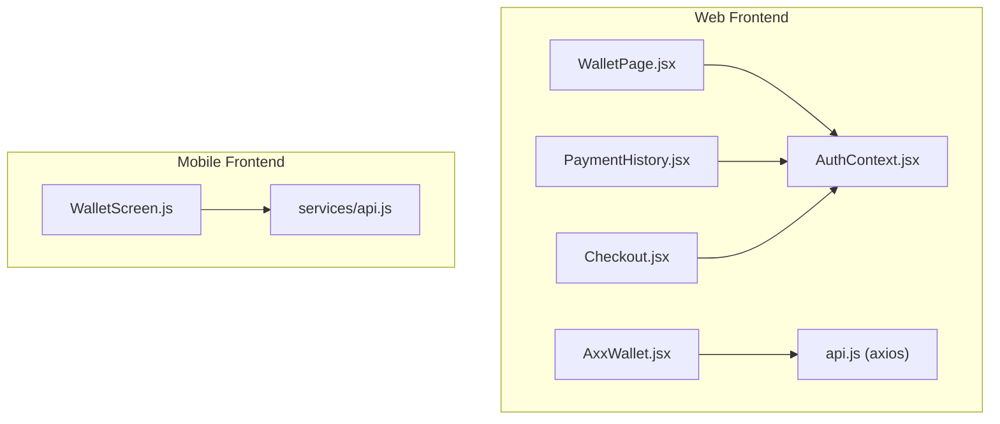
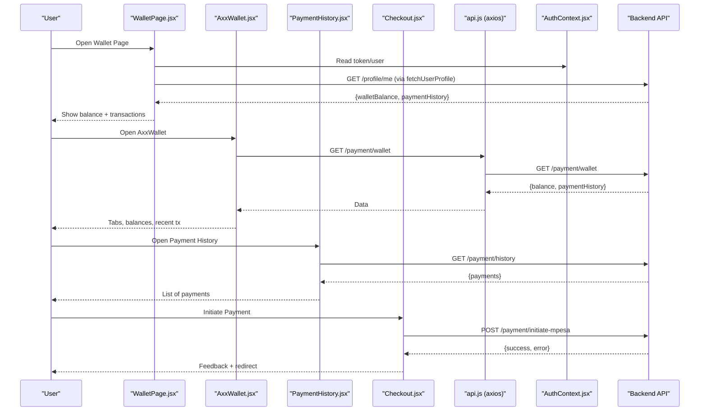
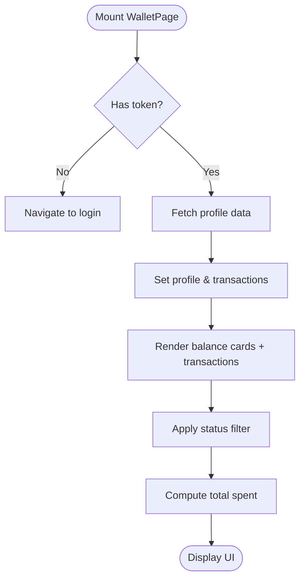
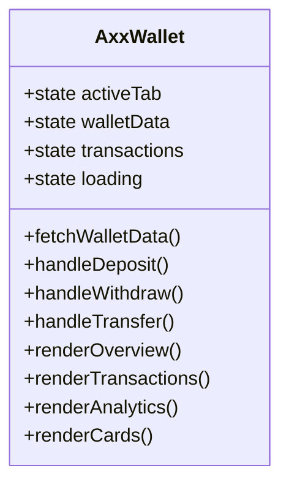
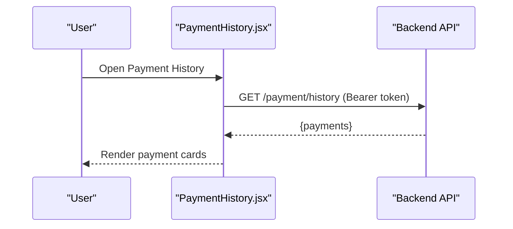
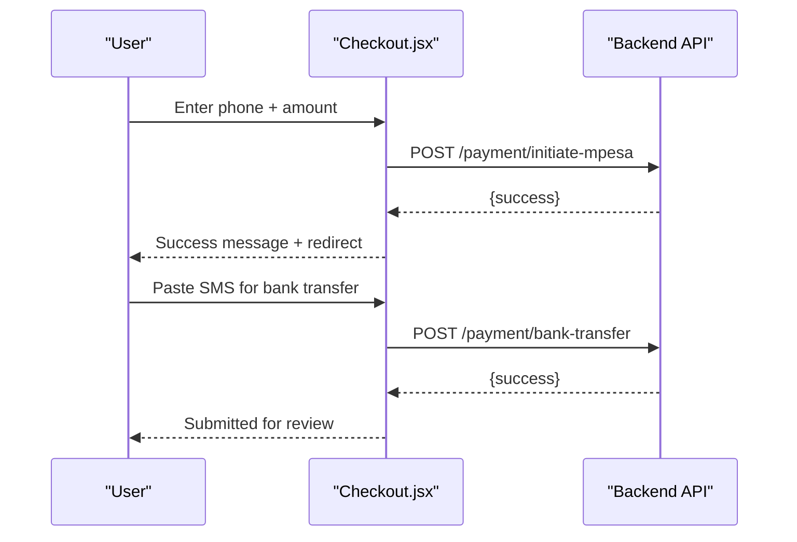
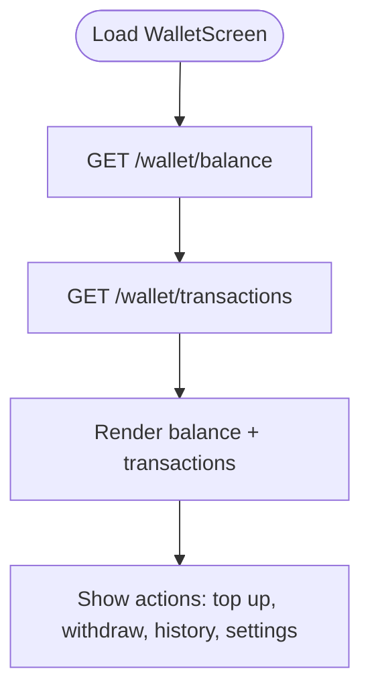
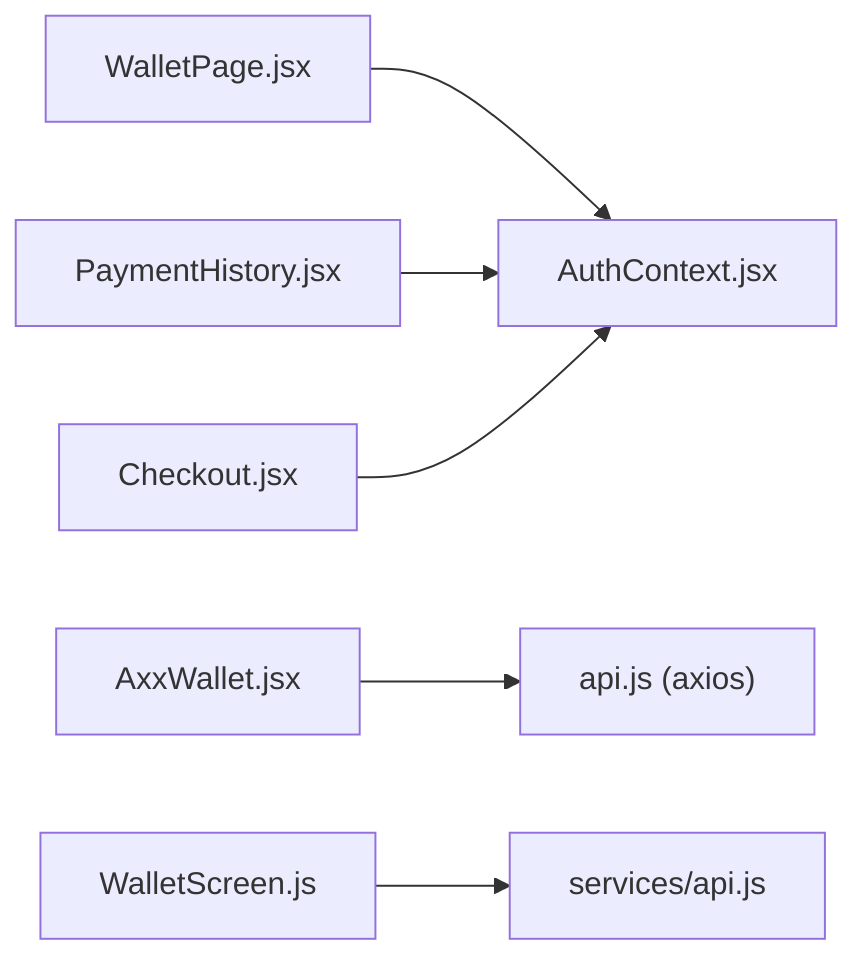

# Wallet System

<cite>
**Referenced Files in This Document**   
- [WalletPage.jsx](file://src/pages/WalletPage.jsx)
- [AxxWallet.jsx](file://src/pages/AxxWallet.jsx)
- [PaymentHistory.jsx](file://src/pages/PaymentHistory.jsx)
- [Checkout.jsx](file://src/pages/Checkout.jsx)
- [api.js](file://src/api/api.js)
- [AuthContext.jsx](file://src/context/AuthContext.jsx)
- [WalletScreen.js](file://axx-spaces-mobile/src/screens/WalletScreen.js)
- [api.js](file://axx-spaces-mobile/src/services/api.js)
</cite>

## Table of Contents
1. [Introduction](#introduction)
2. [Project Structure](#project-structure)
3. [Core Components](#core-components)
4. [Architecture Overview](#architecture-overview)
5. [Detailed Component Analysis](#detailed-component-analysis)
6. [Dependency Analysis](#dependency-analysis)
7. [Performance Considerations](#performance-considerations)
8. [Troubleshooting Guide](#troubleshooting-guide)
9. [Conclusion](#conclusion)
10. [Appendices](#appendices)

## Introduction
This document explains the wallet system implementation across the web and mobile frontends. It covers:
- Wallet balance management and display
- Transaction processing flows (M-Pesa STK Push and Paybill submission)
- Payment history tracking and filtering
- Financial operations (deposit, withdraw, transfer placeholders)
- Security measures (token handling, request interceptors)
- Extensibility patterns for adding payment methods and custom transactions

The documentation is designed to be accessible to both technical and non-technical readers, with diagrams and step-by-step explanations.

## Project Structure
The wallet system spans multiple components and screens:
- Web frontend pages: WalletPage, AxxWallet, PaymentHistory, Checkout
- Shared API client and authentication context
- Mobile app wallet screen and service layer

**Diagram sources**
- [WalletPage.jsx:1-32](file://src/pages/WalletPage.jsx#L1-L32)
- [AxxWallet.jsx:1-42](file://src/pages/AxxWallet.jsx#L1-L42)
- [PaymentHistory.jsx:1-49](file://src/pages/PaymentHistory.jsx#L1-L49)
- [Checkout.jsx:1-71](file://src/pages/Checkout.jsx#L1-L71)
- [api.js:1-47](file://src/api/api.js#L1-L47)
- [AuthContext.jsx:1-97](file://src/context/AuthContext.jsx#L1-L97)
- [WalletScreen.js:1-51](file://axx-spaces-mobile/src/screens/WalletScreen.js#L1-L51)
- [api.js:187-193](file://axx-spaces-mobile/src/services/api.js#L187-L193)

**Section sources**
- [WalletPage.jsx:1-32](file://src/pages/WalletPage.jsx#L1-L32)
- [AxxWallet.jsx:1-42](file://src/pages/AxxWallet.jsx#L1-L42)
- [PaymentHistory.jsx:1-49](file://src/pages/PaymentHistory.jsx#L1-L49)
- [Checkout.jsx:1-71](file://src/pages/Checkout.jsx#L1-L71)
- [api.js:1-47](file://src/api/api.js#L1-L47)
- [AuthContext.jsx:1-97](file://src/context/AuthContext.jsx#L1-L97)
- [WalletScreen.js:1-51](file://axx-spaces-mobile/src/screens/WalletScreen.js#L1-L51)
- [api.js:187-193](file://axx-spaces-mobile/src/services/api.js#L187-L193)

## Core Components
- WalletPage: Displays user profile-based wallet balance and transaction history from profile data.
- AxxWallet: Full-featured wallet UI with tabs (overview, transactions, analytics, cards), upcoming deposit/withdraw/transfer actions, and virtual card placeholder.
- PaymentHistory: Dedicated page to list payments fetched via a dedicated endpoint.
- Checkout: Handles payment initiation (M-Pesa STK Push) and manual bank transfer submission.
- AuthContext: Provides token and user state; supports guest auto-login and persistence.
- API Client (web): Axios instance with auth interceptor and logging.
- Mobile WalletScreen: Shows balance and transactions using mobile-specific API wrappers.

Key responsibilities:
- Balance retrieval and display
- Transaction listing and filtering
- Payment initiation and confirmation feedback
- Error handling and loading states
- Security through tokenized requests

**Section sources**
- [WalletPage.jsx:8-32](file://src/pages/WalletPage.jsx#L8-L32)
- [AxxWallet.jsx:6-47](file://src/pages/AxxWallet.jsx#L6-L47)
- [PaymentHistory.jsx:7-49](file://src/pages/PaymentHistory.jsx#L7-L49)
- [Checkout.jsx:9-71](file://src/pages/Checkout.jsx#L9-L71)
- [AuthContext.jsx:17-97](file://src/context/AuthContext.jsx#L17-L97)
- [api.js:1-47](file://src/api/api.js#L1-L47)
- [WalletScreen.js:12-51](file://axx-spaces-mobile/src/screens/WalletScreen.js#L12-L51)
- [api.js:187-193](file://axx-spaces-mobile/src/services/api.js#L187-L193)

## Architecture Overview
The wallet system integrates with backend endpoints for:
- Profile data including wallet balance and payment history
- Wallet overview and transaction history
- Payment initiation (M-Pesa STK Push)
- Manual bank transfer submission

**Diagram sources**
- [WalletPage.jsx:16-32](file://src/pages/WalletPage.jsx#L16-L32)
- [AxxWallet.jsx:30-42](file://src/pages/AxxWallet.jsx#L30-L42)
- [PaymentHistory.jsx:22-49](file://src/pages/PaymentHistory.jsx#L22-L49)
- [Checkout.jsx:28-71](file://src/pages/Checkout.jsx#L28-L71)
- [api.js:11-24](file://src/api/api.js#L11-L24)
- [AuthContext.jsx:52-97](file://src/context/AuthContext.jsx#L52-L97)

## Detailed Component Analysis

### WalletPage Component
Responsibilities:
- Fetches user profile data containing wallet balance and payment history
- Renders balance cards and transaction list with status styling
- Supports filtering by status (all, success, pending, failed)
- Calculates total spent from successful/completed transactions

Data flow:
- Uses AuthContext for token and user
- Calls fetchUserProfile to retrieve profile data
- Sets local state for profile and transactions
- Sorts transactions by date descending

Error handling:
- Catches errors during data fetching and logs them
- Maintains loading state to show spinner while fetching

Extensibility:
- Add new filters or computed metrics (e.g., monthly totals)
- Integrate real-time updates via polling or WebSocket

**Diagram sources**
- [WalletPage.jsx:16-32](file://src/pages/WalletPage.jsx#L16-L32)
- [WalletPage.jsx:44-50](file://src/pages/WalletPage.jsx#L44-L50)
- [WalletPage.jsx:114-141](file://src/pages/WalletPage.jsx#L114-L141)

**Section sources**
- [WalletPage.jsx:8-32](file://src/pages/WalletPage.jsx#L8-L32)
- [WalletPage.jsx:34-50](file://src/pages/WalletPage.jsx#L34-L50)
- [WalletPage.jsx:64-141](file://src/pages/WalletPage.jsx#L64-L141)

### AxxWallet Component
Responsibilities:
- Multi-tab interface: overview, transactions, analytics, cards
- Placeholder actions for deposit, withdraw, transfer (coming soon)
- Displays main balance, total spent, total received
- Recent transactions list with status badges
- Virtual card placeholder

Data flow:
- On mount, calls API.get("/payment/wallet") to get balance and payment history
- Updates local state and renders tab content accordingly

Error handling:
- Catches errors and shows notification
- Graceful fallback when no data available

Extensibility:
- Implement actual deposit/withdraw/transfer handlers
- Connect analytics calculations to backend metrics
- Enable virtual card issuance and management

**Diagram sources**
- [AxxWallet.jsx:6-47](file://src/pages/AxxWallet.jsx#L6-L47)
- [AxxWallet.jsx:139-224](file://src/pages/AxxWallet.jsx#L139-L224)
- [AxxWallet.jsx:227-325](file://src/pages/AxxWallet.jsx#L227-L325)
- [AxxWallet.jsx:327-355](file://src/pages/AxxWallet.jsx#L327-L355)

**Section sources**
- [AxxWallet.jsx:6-47](file://src/pages/AxxWallet.jsx#L6-L47)
- [AxxWallet.jsx:139-224](file://src/pages/AxxWallet.jsx#L139-L224)
- [AxxWallet.jsx:227-325](file://src/pages/AxxWallet.jsx#L227-L325)
- [AxxWallet.jsx:327-355](file://src/pages/AxxWallet.jsx#L327-L355)

### PaymentHistory Component
Responsibilities:
- Fetches payment history from /payment/history
- Renders detailed payment cards with amount, date, transaction ID, property info, payment method
- Provides receipt link if available

Data flow:
- Guards against unauthenticated users by redirecting to login
- Calls fetch with Authorization header
- Handles 404 gracefully by showing empty state

Error handling:
- Catches network errors and sets internal error state
- Falls back to empty list without alarming the user

Extensibility:
- Add pagination or search/filter capabilities
- Integrate receipt download functionality

**Diagram sources**
- [PaymentHistory.jsx:14-49](file://src/pages/PaymentHistory.jsx#L14-L49)
- [PaymentHistory.jsx:101-155](file://src/pages/PaymentHistory.jsx#L101-L155)

**Section sources**
- [PaymentHistory.jsx:7-49](file://src/pages/PaymentHistory.jsx#L7-L49)
- [PaymentHistory.jsx:101-155](file://src/pages/PaymentHistory.jsx#L101-L155)

### Checkout Component
Responsibilities:
- Initiates M-Pesa STK Push payment
- Accepts manual bank transfer submission with SMS paste
- Validates phone number and message format
- Provides feedback and redirects after success

Data flow:
- Reads URL parameters for propertyId, plan, amount, subscriptionType
- Submits to /payment/initiate-mpesa or /payment/bank-transfer
- Navigates to dashboard path based on user role

Error handling:
- Shows messages for validation failures and connection errors
- Disables submit button during processing

Extensibility:
- Add more payment providers (card, escrow)
- Enhance validation rules and error messaging
- Integrate webhook callbacks for async confirmations

**Diagram sources**
- [Checkout.jsx:28-71](file://src/pages/Checkout.jsx#L28-L71)
- [Checkout.jsx:73-112](file://src/pages/Checkout.jsx#L73-L112)

**Section sources**
- [Checkout.jsx:9-71](file://src/pages/Checkout.jsx#L9-L71)
- [Checkout.jsx:73-112](file://src/pages/Checkout.jsx#L73-L112)

### Mobile WalletScreen
Responsibilities:
- Loads wallet balance and transactions via mobile API
- Displays balance card and action buttons (top up, withdraw, history, settings)
- Lists recent transactions with credit/debit indicators

Data flow:
- Calls walletAPI.getBalance() and walletAPI.getTransactions()
- Falls back to mock data on error

Extensibility:
- Replace mock data with real backend integration
- Add navigation to payment flows and settings

**Diagram sources**
- [WalletScreen.js:21-51](file://axx-spaces-mobile/src/screens/WalletScreen.js#L21-L51)
- [api.js:187-193](file://axx-spaces-mobile/src/services/api.js#L187-L193)

**Section sources**
- [WalletScreen.js:12-51](file://axx-spaces-mobile/src/screens/WalletScreen.js#L12-L51)
- [api.js:187-193](file://axx-spaces-mobile/src/services/api.js#L187-L193)

## Dependency Analysis
- WalletPage depends on AuthContext for token/user and fetchUserProfile for profile data.
- AxxWallet uses the shared axios API client to call /payment/wallet.
- PaymentHistory directly fetches /payment/history with Authorization header.
- Checkout initiates payments via direct fetch calls with token.
- Mobile WalletScreen uses services/api.js which wraps fetch and secure storage for tokens.

**Diagram sources**
- [WalletPage.jsx:1-32](file://src/pages/WalletPage.jsx#L1-L32)
- [AxxWallet.jsx:1-42](file://src/pages/AxxWallet.jsx#L1-L42)
- [PaymentHistory.jsx:1-49](file://src/pages/PaymentHistory.jsx#L1-L49)
- [Checkout.jsx:1-71](file://src/pages/Checkout.jsx#L1-L71)
- [WalletScreen.js:1-51](file://axx-spaces-mobile/src/screens/WalletScreen.js#L1-L51)
- [api.js:187-193](file://axx-spaces-mobile/src/services/api.js#L187-L193)

**Section sources**
- [WalletPage.jsx:1-32](file://src/pages/WalletPage.jsx#L1-L32)
- [AxxWallet.jsx:1-42](file://src/pages/AxxWallet.jsx#L1-L42)
- [PaymentHistory.jsx:1-49](file://src/pages/PaymentHistory.jsx#L1-L49)
- [Checkout.jsx:1-71](file://src/pages/Checkout.jsx#L1-L71)
- [WalletScreen.js:1-51](file://axx-spaces-mobile/src/screens/WalletScreen.js#L1-L51)
- [api.js:187-193](file://axx-spaces-mobile/src/services/api.js#L187-L193)

## Performance Considerations
- Minimize re-renders by memoizing derived values (e.g., filtered transactions, totals).
- Debounce filter changes to avoid excessive re-computation.
- Use pagination for large transaction lists.
- Cache profile and wallet data locally where appropriate to reduce network calls.
- Avoid heavy computations on render; compute totals outside render cycles.

[No sources needed since this section provides general guidance]

## Troubleshooting Guide
Common issues and resolutions:
- Unauthenticated access: Ensure token exists in localStorage or AuthContext before accessing wallet features.
- API errors: Check network connectivity and backend availability; inspect console logs for response details.
- Empty payment history: If endpoint returns 404, component shows empty state; verify backend route availability.
- Payment initiation failures: Validate phone number format and ensure sufficient funds; check backend logs for provider errors.

Security considerations:
- Token handling: Tokens are stored in localStorage and attached via Authorization headers.
- Request interception: Axios interceptors log requests/responses for debugging; remove sensitive logs in production.
- Input validation: Enforce server-side validation for amounts, phone numbers, and transaction references.

Compliance considerations:
- Audit trails: Ensure all financial operations are logged with timestamps and user IDs.
- Data protection: Encrypt sensitive data at rest and in transit; restrict access to financial endpoints.
- Regulatory requirements: Follow local financial regulations for payment processing and record retention.

**Section sources**
- [api.js:11-44](file://src/api/api.js#L11-L44)
- [AuthContext.jsx:52-97](file://src/context/AuthContext.jsx#L52-L97)
- [PaymentHistory.jsx:22-49](file://src/pages/PaymentHistory.jsx#L22-L49)
- [Checkout.jsx:28-71](file://src/pages/Checkout.jsx#L28-L71)

## Conclusion
The wallet system provides a comprehensive foundation for managing user balances, processing payments, and tracking transaction history across web and mobile platforms. While some features like deposit, withdraw, and transfer are marked as coming soon, the architecture supports easy extension. Security is enforced through tokenized requests and input validation, and compliance can be achieved by implementing robust audit trails and data protection measures.

[No sources needed since this section summarizes without analyzing specific files]

## Appendices

### Adding New Payment Methods
Steps:
- Extend Checkout component to support additional providers (e.g., card, escrow).
- Add corresponding backend endpoints for payment initiation and confirmation.
- Update UI to handle provider-specific inputs and feedback.
- Implement error handling and retry logic for each provider.

Example reference paths:
- [Checkout.jsx:28-71](file://src/pages/Checkout.jsx#L28-L71)
- [Checkout.jsx:73-112](file://src/pages/Checkout.jsx#L73-L112)

### Implementing Custom Transactions
Steps:
- Define transaction types and statuses in the backend schema.
- Update frontend components to recognize and display new transaction types.
- Adjust filtering and analytics calculations to include new types.
- Test end-to-end flows with mock data before integrating with backend.

Example reference paths:
- [WalletPage.jsx:44-50](file://src/pages/WalletPage.jsx#L44-L50)
- [AxxWallet.jsx:77-83](file://src/pages/AxxWallet.jsx#L77-L83)

### Extending Wallet Functionality
Recommendations:
- Introduce a state management library (e.g., Redux, Zustand) for complex wallet state.
- Implement real-time updates via WebSockets for live balance and transaction feeds.
- Add export functionality for transaction history (CSV, PDF).
- Provide user education and tooltips for financial terms and actions.

[No sources needed since this section provides general guidance]